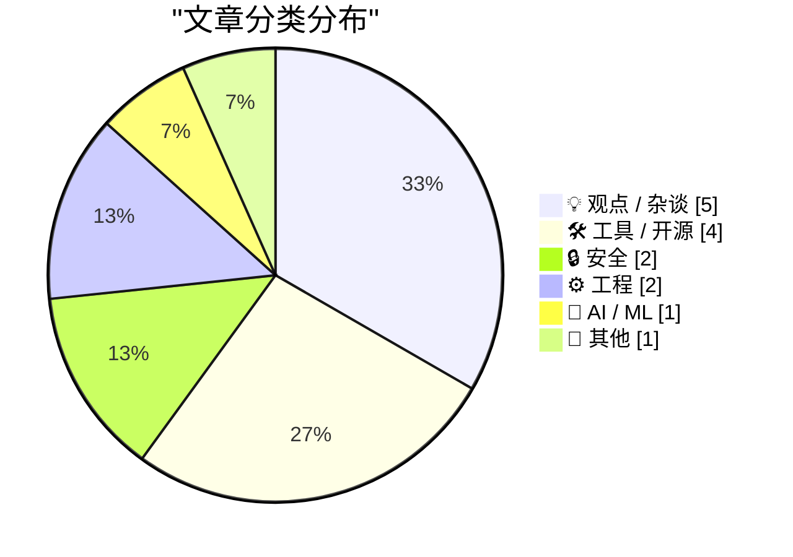
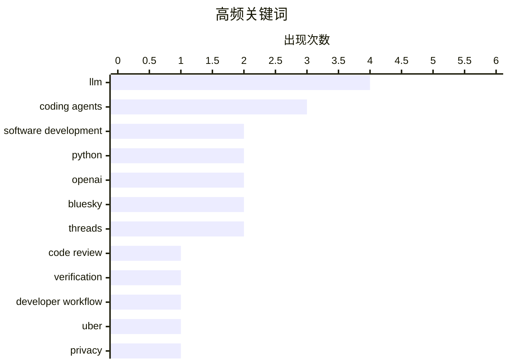

# 📰 Aug 23, 2026

> 来自 Karpathy 推荐的 92 个顶级技术博客，AI 精选 Top 15

## 📝 今日看点

今日技术圈的核心话题集中在编码代理的实际落地：AI 正在承担更多编码与调试工作，但开发者必须通过测试、验证和人工判断把好质量关。随着语言迁移和界面开发成本下降，编程语言选择与 TUI 等传统工具形态的重要性正在被重新评估，软件开发更强调交付速度与用户体验。与此同时，自动化决策引发的隐私与合规风险持续升温，企业在提升效率的同时也需要确保过程透明、可解释。底层工具生态则继续快速演进，包管理、安全修复以及 LLM 工具的依赖兼容性成为开发者日常维护的重点。

---

## 🏆 今日必读

🥇 **不只是代码审查**

[More than just code review](https://simonwillison.net/2026/Aug/22/more-than-just-code-review/) — simonwillison.net · 9 小时前 · 💡 观点 / 杂谈

> 高效使用编码代理的核心能力，是准确地指示代理如何修改代码，并可靠地验证修改确实以正确方式完成。验证并不等于逐行检查代理生成的所有代码，因为人工浏览每一行从来都不是验证软件变更最有效的方法。更实用的做法是结合自动化测试、行为验证、代码运行结果和有针对性的审查，确认变更满足预期。文章的核心观点是，编码代理时代的软件工程重点正从“写出代码”转向“指导变更并建立可信验证机制”。

💡 **为什么值得读**: 它提供了比逐行审查更适合编码代理工作流的质量保障思路，有助于重新设计开发和审查流程。

🏷️ coding agents, code review, verification, developer workflow

🥈 **荷兰监管机构因优步自动停用不诚实司机账号罚款 10 亿美元**

[Dutch Regulator Fines Uber $1 Billion for Suspending Dishonest Drivers](https://www.reuters.com/world/dutch-regulator-fines-uber-966-million-automating-driver-suspensions-document-2026-08-21/) — daringfireball.net · 10 小时前 · 🔒 安全

> 荷兰数据保护局因优步使用自动化系统停用司机账号、却未充分告知相关司机，决定对其处以 8.25 亿欧元（约 9.66 亿美元）罚款。该决定于 2026 年 8 月 17 日作出，Reuters 在审阅文件后进行了报道。若执行，这将成为欧盟《通用数据保护条例》（GDPR）生效以来金额第二高的罚款，仅次于爱尔兰监管机构在 2023 年对 Meta 开出的 12 亿欧元罚款。事件凸显了企业在使用算法作出账号停用等重大决定时，需要满足透明度、说明理由以及数据保护方面的监管要求。

💡 **为什么值得读**: 这是一个金额巨大且具有示范效应的 GDPR 执法案例，能帮助企业理解自动化决策的合规边界。

🏷️ Uber, privacy, algorithmic decisions, GDPR

🥉 **又快又硬的代码**

[Fast and Hard Code](https://lucumr.pocoo.org/2026/8/22/fast-hard-code/) — lucumr.pocoo.org · 1 天前 · 💡 观点 / 杂谈

> 大型语言模型和编码代理正在降低程序员熟悉编程语言的成本，使语言选择相比过去变得不那么重要。过去围绕语法、生态和学习曲线的摩擦，对代理而言往往可以通过生成、重写或迁移代码来快速消除。由此，开发者可以更自由地选择适合机器生成、性能要求或运行环境的语言，而不必过度受个人熟悉度限制。文章由此探讨了“编程已经被解决”的说法究竟意味着什么，以及代理时代如何重新理解编程语言和工程效率。

💡 **为什么值得读**: 它从编码代理的实际能力出发，重新审视语言选型这一长期工程决策，适合思考 AI 对软件开发分工的深层影响。

🏷️ LLM, coding agents, software development

---

## 📊 数据概览

| 扫描源 | 抓取文章 | 时间范围 | 精选 |
|:---:|:---:|:---:|:---:|
| 85/92 | 2562 篇 → 32 篇 | 48h | **15 篇** |

### 分类分布



### 高频关键词



<details>
<summary>📈 纯文本关键词图（终端友好）</summary>

```
llm                  │ ████████████████████ 4
coding agents        │ ███████████████░░░░░ 3
software development │ ██████████░░░░░░░░░░ 2
python               │ ██████████░░░░░░░░░░ 2
openai               │ ██████████░░░░░░░░░░ 2
bluesky              │ ██████████░░░░░░░░░░ 2
threads              │ ██████████░░░░░░░░░░ 2
code review          │ █████░░░░░░░░░░░░░░░ 1
verification         │ █████░░░░░░░░░░░░░░░ 1
developer workflow   │ █████░░░░░░░░░░░░░░░ 1
```

</details>

### 🏷️ 话题标签

**llm**(4) · **coding agents**(3) · **software development**(2) · python(2) · openai(2) · bluesky(2) · threads(2) · code review(1) · verification(1) · developer workflow(1) · uber(1) · privacy(1) · algorithmic decisions(1) · gdpr(1) · ai coding(1) · linux(1) · debugging(1) · tui(1) · gui(1) · user interface(1)

---

## 💡 观点 / 杂谈

### 1. 不只是代码审查

[More than just code review](https://simonwillison.net/2026/Aug/22/more-than-just-code-review/) — **simonwillison.net** · 9 小时前 · ⭐ 25/30

> 高效使用编码代理的核心能力，是准确地指示代理如何修改代码，并可靠地验证修改确实以正确方式完成。验证并不等于逐行检查代理生成的所有代码，因为人工浏览每一行从来都不是验证软件变更最有效的方法。更实用的做法是结合自动化测试、行为验证、代码运行结果和有针对性的审查，确认变更满足预期。文章的核心观点是，编码代理时代的软件工程重点正从“写出代码”转向“指导变更并建立可信验证机制”。

🏷️ coding agents, code review, verification, developer workflow

---

### 2. 又快又硬的代码

[Fast and Hard Code](https://lucumr.pocoo.org/2026/8/22/fast-hard-code/) — **lucumr.pocoo.org** · 1 天前 · ⭐ 25/30

> 大型语言模型和编码代理正在降低程序员熟悉编程语言的成本，使语言选择相比过去变得不那么重要。过去围绕语法、生态和学习曲线的摩擦，对代理而言往往可以通过生成、重写或迁移代码来快速消除。由此，开发者可以更自由地选择适合机器生成、性能要求或运行环境的语言，而不必过度受个人熟悉度限制。文章由此探讨了“编程已经被解决”的说法究竟意味着什么，以及代理时代如何重新理解编程语言和工程效率。

🏷️ LLM, coding agents, software development

---

### 3. 别再制作 TUI 了

[Stop Making TUIs](https://simonwillison.net/2026/Aug/21/stop-making-tuis/) — **simonwillison.net** · 1 天前 · ⭐ 24/30

> Thomas Ptacek 主张，即使是最小型的个人工具，也应优先构建真正的原生用户界面，而不是终端用户界面（TUI）。编码代理已经将搭建一个“足够好用”的 GUI 的成本降到接近于零，过去选择 TUI 的主要理由因此正在减弱。原生界面可以更自然地利用操作系统能力，提供任务栏集成、系统通知和更符合平台习惯的交互。文章以 macOS 上使用 SwiftUI 构建带宽和 GPU 监控工具的实践为例，说明 AI 辅助开发如何改变个人工具的界面选型。

🏷️ TUI, GUI, coding agents, user interface

---

### 4. 引用 Matt Webb

[Quoting Matt Webb](https://simonwillison.net/2026/Aug/21/matt-webb/) — **simonwillison.net** · 1 天前 · ⭐ 22/30

> Matt Webb 分享了自己学习四元数的经历：在应用发布 1.0 之后，他原本以为必须亲自完成旋转相关代码。与其让 ChatGPT 直接生成代码，他选择把 ChatGPT 当作耐心、互动的导师，借此理解四元数的基本用法。这样的学习方式帮助他完成了单靠读书和请教数学家朋友都没能完成的任务。核心观点是，即使把部分执行工作外包给 AI，学习和建立理解仍然可以持续发生。

🏷️ ChatGPT, interactive learning, AI tutor, programming

---

### 5. 你永远不应该在工作中生气

[You should never be angry at work](https://seangoedecke.com/you-should-never-be-angry-at-work/) — **seangoedecke.com** · 1 天前 · ⭐ 22/30

> 文章提出一个明确的职场建议：无论技术公司采用何种工作方式，员工都不应该在工作中被愤怒支配。作者承认不同公司、管理链和项目推进方式都可能有效，因此并不主张一套普适的工作方法。文章的核心切入点是区分坚定推进工作与情绪化愤怒，强调后者会损害协作和判断。作者认为，保持冷静并不等于软弱，而是更可靠地完成项目、维持管理关系和长期职业发展的基础。

🏷️ work culture, management, software teams, career

---

## 🛠 工具 / 开源

### 6. 本周包管理动态：2026 年 8 月 22 日

[This Week in Package Management: 22 August 2026](https://nesbitt.io/2026/08/22/this-week-in-package-management.html) — **nesbitt.io** · 15 小时前 · ⭐ 24/30

> 文章汇总截至 2026 年 8 月 22 日包管理生态中的重要发布、安全公告和相关文章。内容覆盖不同编程语言与软件生态的包管理工具、依赖项更新以及漏洞修复信息。读者可以通过集中整理快速了解近期版本变化、供应链风险和社区讨论重点。它更像一份面向开发者和维护者的周报索引，而不是对某个单独工具的深入教程。

🏷️ package management, software releases, security advisories

---

### 7. llm 0.33

[llm 0.33](https://simonwillison.net/2026/Aug/22/llm/) — **simonwillison.net** · 8 小时前 · ⭐ 23/30

> llm 0.33 是 Simon Willison 的 LLM 命令行工具发布版本，重点处理了 OpenAI Python 客户端依赖升级带来的兼容性变化。该版本升级到 OpenAI Python library 3.x，并将 HTTP 客户端依赖从 `httpx` 切换为 `httpx2`。这项调整对应了 OpenAI SDK 的依赖变更，避免 llm 继续依赖旧 HTTP 客户端链路。对于使用 llm 进行模型调用、插件开发或自动化脚本集成的用户，0.33 是一次需要关注依赖和兼容性的版本升级。

🏷️ LLM, Python, OpenAI, CLI

---

### 8. llm 0.32.1

[llm 0.32.1](https://simonwillison.net/2026/Aug/21/llm/) — **simonwillison.net** · 1 天前 · ⭐ 22/30

> llm 0.32.1 修复了 OpenAI Python library 调整依赖后导致的新安装失败问题。此前 OpenAI 库不再使用 `httpx`，而 llm 仍依赖该库，却只通过 `openai` 的传递依赖间接安装它，导致全新环境无法正常安装或运行。这个点版本通过固定 `openai<3` 暂时恢复兼容性。后续即将发布的 llm 0.33 将改用新的依赖方案，因此 0.32.1 主要是面向当前用户的过渡性修复版本。

🏷️ LLM, OpenAI, Python, dependency management

---

### 9. llm-openrouter 0.7

[llm-openrouter 0.7](https://simonwillison.net/2026/Aug/21/llm-openrouter/) — **simonwillison.net** · 1 天前 · ⭐ 22/30

> llm-openrouter 0.7 已更新，以兼容 LLM 0.32。升级后，通过 OpenRouter 使用的 LLM 模型可以显示推理轨迹。该版本还更新了插件与 LLM 0.32 的集成方式，并调整了模型使用 OpenRouter 的相关配置。核心价值在于让 OpenRouter 上的模型推理过程能够直接纳入 LLM 的命令行工作流。

🏷️ OpenRouter, LLM, reasoning traces, plugin

---

## 🔒 安全

### 10. 荷兰监管机构因优步自动停用不诚实司机账号罚款 10 亿美元

[Dutch Regulator Fines Uber $1 Billion for Suspending Dishonest Drivers](https://www.reuters.com/world/dutch-regulator-fines-uber-966-million-automating-driver-suspensions-document-2026-08-21/) — **daringfireball.net** · 10 小时前 · ⭐ 25/30

> 荷兰数据保护局因优步使用自动化系统停用司机账号、却未充分告知相关司机，决定对其处以 8.25 亿欧元（约 9.66 亿美元）罚款。该决定于 2026 年 8 月 17 日作出，Reuters 在审阅文件后进行了报道。若执行，这将成为欧盟《通用数据保护条例》（GDPR）生效以来金额第二高的罚款，仅次于爱尔兰监管机构在 2023 年对 Meta 开出的 12 亿欧元罚款。事件凸显了企业在使用算法作出账号停用等重大决定时，需要满足透明度、说明理由以及数据保护方面的监管要求。

🏷️ Uber, privacy, algorithmic decisions, GDPR

---

### 11. WorkOS：现在智能体可以注册你的应用了

[WorkOS: Agents Can Now Sign Up for Your App](https://workos.com/auth-md?utm_source=daringfireball&amp;utm_medium=newsletter&amp;utm_campaign=q32026) — **daringfireball.net** · 10 小时前 · ⭐ 22/30

> 随着 AI 智能体开始访问应用，传统为人类设计的浏览器登录流程会让智能体在注册阶段直接流失。WorkOS Agent Registration 提供了一套面向智能体的注册机制，可在 WorkOS 控制台中启用。启用后，AuthKit 会发布一个 `auth.md` 文件，供智能体读取注册指引。该流程支持由应用方控制的、具有明确权限范围且短期有效的凭证，从而把智能体访问转化为可管理的注册流量。

🏷️ AI agents, authentication, signup, WorkOS

---

## ⚙️ 工程

### 12. 并发服务器：第 8 部分——Go

[Concurrent Servers: Part 8 - Go](https://eli.thegreenplace.net/2026/concurrent-servers-part-8-go/) — **eli.thegreenplace.net** · 10 小时前 · ⭐ 23/30

> 这是并发网络服务器系列的第 8 篇，转而使用 Go 实现此前讨论的服务器问题。文章考察 Go 如何通过 goroutine、channel 以及标准库网络接口处理并发连接和任务协作。与直接管理线程或依赖更复杂异步机制的方案相比，Go 的并发模型旨在以较少的代码表达并发服务器的生命周期、通信和资源管理。读者可以借此理解 Go 在网络服务器开发中的并发抽象，以及这些抽象如何对应系列前文提出的工程挑战。

🏷️ Go, concurrency, network servers

---

### 13. Bluesky 和 Threads 如何将自己的 Logo 偷偷植入 iOS 截图

[How Bluesky and Threads Sneak Their Logos Into iOS Screenshots](https://timmarinin.net/2026/bluesky-screenshots/) — **daringfireball.net** · 1 天前 · ⭐ 22/30

> Bluesky 和 Threads 在 iOS 截取单条帖子截图时，会把界面中的“Follow”按钮替换成各自的 Logo。这个设计最初由 Tim Marinin 在 Bluesky 应用中发现，随后他利用 Bluesky 开源的应用代码追查实现方式。关键线索位于一个名为 `GrowthHack.tsx` 的文件中，该功能于 2026 年 1 月由 mozzius 引入。文件本身只是调用了一个依赖，因此进一步分析依赖包才能理解这种截图品牌植入是如何完成的。

🏷️ iOS, Bluesky, Threads, screenshots

---

## 🤖 AI / ML

### 14. 引用 Linus Torvalds

[Quoting Linus Torvalds](https://simonwillison.net/2026/Aug/22/linus-torvalds/) — **simonwillison.net** · 3 小时前 · ⭐ 24/30

> Linus Torvalds 描述了一次极其棘手的 Linux 调试过程，并表示 AI 完成了大量繁琐工作，对最终解决问题起到了很大帮助。与此同时，AI 多次断言问题“不可能”或“无法解决”，甚至建议直接写报告记录失败。Torvalds 认为，这种过早放弃可能源于模型训练数据中的人类并不够执着，而不是问题本身真的不可解。这个案例展示了 AI 在调试中的执行和检索价值，也提醒工程师必须保留判断力、持续验证并在模型失去信心时继续追查。

🏷️ AI coding, Linux, debugging, software development

---

## 📝 其他

### 15. Bluesky 活跃用户正在减少，与 Threads 和 Twitter/X 相比仍然规模很小

[Bluesky’s Active User Base Is Shrinking, and Remains Tiny Compared to Threads and Twitter/X](https://techcrunch.com/2026/08/11/blueskys-active-user-base-is-shrinking-as-its-focus-expands-beyond-the-app/) — **daringfireball.net** · 1 天前 · ⭐ 23/30

> 去中心化社交网络 Bluesky 曾在 2024 年 11 月美国大选后因用户离开 Elon Musk 的 X 而获得增长，但目前正在失去发展势头。Similarweb 数据显示，Bluesky 移动应用在 2026 年 6 月的全球月活跃用户为 1040 万，同比下降 27.2%。在扩大应用以外业务和定位的同时，Bluesky 仍难以维持用户增长，其规模也明显小于 Threads 和 Twitter/X。文章呈现了 Bluesky 从替代 X 的受益者转向面临留存与规模压力的变化。

🏷️ Bluesky, Threads, social media, user growth

---

*生成于 2026-08-23 01:04 | 扫描 85 源 → 获取 2562 篇 → 精选 15 篇*
*基于 [Hacker News Popularity Contest 2025](https://refactoringenglish.com/tools/hn-popularity/) RSS 源列表，由 [Andrej Karpathy](https://x.com/karpathy) 推荐*
