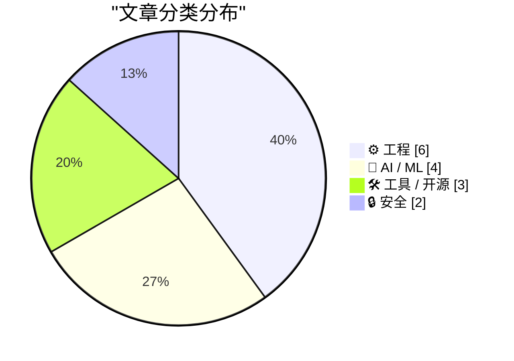
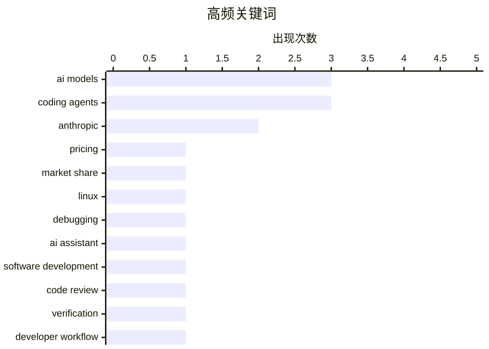

# 📰 Aug 24, 2026

> 来自 Karpathy 推荐的 92 个顶级技术博客，AI 精选 Top 15

## 📝 今日看点

今日技术圈的核心趋势，是 AI 竞争从单纯追求模型能力转向价格、算力供给与开放权重生态的综合较量，低成本工具和开放模型正加速普及。编码代理开始从“自动写代码”迈向工程化协作，开发者更关注上下文管理、任务指令和结果验证，代理接入应用的基础设施也在逐步完善。与此同时，自动化决策的透明度与责任边界受到监管强力审视，Uber 罚款事件凸显 AI 系统必须具备可解释、可申诉的治理机制。工程基础设施方面，包管理安全、开发工具升级以及 Go 并发服务等传统主题仍持续演进，反映出效率提升与可靠性建设正在同步推进。

---

## 🏆 今日必读

🥇 **Anthropic 最强 AI 模型难以吸引用户，便宜工具却蓬勃发展**

[Anthropic’s best AI model struggles to attract users as cheaper tools thrive](https://simonwillison.net/2026/Aug/23/anthropics-best-ai-model-struggles-to-attract-users-as-cheaper-t/) — simonwillison.net · 4 小时前 · 🤖 AI / ML

> Anthropic 的顶级模型面临用户增长乏力的问题，而价格更低的 AI 工具正在获得更多采用。文章援引知情人士称，Anthropic 7 月的年化收入最高达到 650 亿美元，高于 5 月的 470 亿美元。收入快速增长与最强模型难以扩大用户规模同时出现，反映出 AI 市场中模型能力、价格和实际使用成本之间的矛盾。核心观点是，顶尖模型并不一定能转化为最多用户，低价和可负担性正在成为竞争优势。

💡 **为什么值得读**: 通过收入数据与用户采用趋势的反差，文章揭示了 AI 模型竞争从单纯追求能力转向价格与规模化使用的变化。

🏷️ Anthropic, AI models, pricing, market share

🥈 **引用 Linus Torvalds**

[Quoting Linus Torvalds](https://simonwillison.net/2026/Aug/22/linus-torvalds/) — simonwillison.net · 1 天前 · ⚙️ 工程

> Linus Torvalds 分享了一次由 AI 大量承担繁琐工作、最终帮助解决棘手调试问题的经历。这个调试过程被他形容为“地狱般”，AI 显著提高了排查效率。AI 也多次断言问题“不可能”或“无法解决”，甚至建议直接写报告放弃继续调查。Torvalds 认为，AI 可能被不够执着的人训练出来，但只要人类坚持验证和推进，它仍然可以成为非常有价值的助手。

💡 **为什么值得读**: 这段一线经验具体展示了 AI 编程助手的真实边界：它能承担大量工作，却不能替代工程师在困难问题上的判断和坚持。

🏷️ Linux, debugging, AI assistant, software development

🥉 **不只是代码审查**

[More than just code review](https://simonwillison.net/2026/Aug/22/more-than-just-code-review/) — simonwillison.net · 1 天前 · ⚙️ 工程

> 高效使用编码代理的核心能力，是能够准确指示代理修改代码，并有把握地验证修改确实正确完成。验证并不等于逐行阅读代理生成的全部代码，因为人工逐行检查从来不是确认软件变更有效性的最高效方法。更可行的做法还包括运行测试、检查行为结果、审查变更范围，以及使用其他自动化或结构化验证手段。作者的核心观点是，编码代理时代最重要的工程能力，是建立对修改过程和结果的可靠信任，而不是机械地检查每一行代码。

💡 **为什么值得读**: 文章把讨论从“AI 会不会写代码”推进到“如何验证 AI 写的代码”，对实际采用编码代理的团队更具操作价值。

🏷️ coding agents, code review, verification, developer workflow

---

## 📊 数据概览

| 扫描源 | 抓取文章 | 时间范围 | 精选 |
|:---:|:---:|:---:|:---:|
| 84/92 | 2545 篇 → 22 篇 | 48h | **15 篇** |

### 分类分布



### 高频关键词



<details>
<summary>📈 纯文本关键词图（终端友好）</summary>

```
ai models            │ ████████████████████ 3
coding agents        │ ████████████████████ 3
anthropic            │ █████████████░░░░░░░ 2
pricing              │ ███████░░░░░░░░░░░░░ 1
market share         │ ███████░░░░░░░░░░░░░ 1
linux                │ ███████░░░░░░░░░░░░░ 1
debugging            │ ███████░░░░░░░░░░░░░ 1
ai assistant         │ ███████░░░░░░░░░░░░░ 1
software development │ ███████░░░░░░░░░░░░░ 1
code review          │ ███████░░░░░░░░░░░░░ 1
```

</details>

### 🏷️ 话题标签

**ai models**(3) · **coding agents**(3) · **anthropic**(2) · pricing(1) · market share(1) · linux(1) · debugging(1) · ai assistant(1) · software development(1) · code review(1) · verification(1) · developer workflow(1) · privacy(1) · uber(1) · automated decisions(1) · gdpr(1) · package management(1) · software supply chain(1) · security advisories(1) · open weights(1)

---

## ⚙️ 工程

### 1. 引用 Linus Torvalds

[Quoting Linus Torvalds](https://simonwillison.net/2026/Aug/22/linus-torvalds/) — **simonwillison.net** · 1 天前 · ⭐ 24/30

> Linus Torvalds 分享了一次由 AI 大量承担繁琐工作、最终帮助解决棘手调试问题的经历。这个调试过程被他形容为“地狱般”，AI 显著提高了排查效率。AI 也多次断言问题“不可能”或“无法解决”，甚至建议直接写报告放弃继续调查。Torvalds 认为，AI 可能被不够执着的人训练出来，但只要人类坚持验证和推进，它仍然可以成为非常有价值的助手。

🏷️ Linux, debugging, AI assistant, software development

---

### 2. 不只是代码审查

[More than just code review](https://simonwillison.net/2026/Aug/22/more-than-just-code-review/) — **simonwillison.net** · 1 天前 · ⭐ 24/30

> 高效使用编码代理的核心能力，是能够准确指示代理修改代码，并有把握地验证修改确实正确完成。验证并不等于逐行阅读代理生成的全部代码，因为人工逐行检查从来不是确认软件变更有效性的最高效方法。更可行的做法还包括运行测试、检查行为结果、审查变更范围，以及使用其他自动化或结构化验证手段。作者的核心观点是，编码代理时代最重要的工程能力，是建立对修改过程和结果的可靠信任，而不是机械地检查每一行代码。

🏷️ coding agents, code review, verification, developer workflow

---

### 3. 并发服务器：第 8 部分——Go

[Concurrent Servers: Part 8 - Go](https://eli.thegreenplace.net/2026/concurrent-servers-part-8-go/) — **eli.thegreenplace.net** · 1 天前 · ⭐ 22/30

> 本篇是并发网络服务器系列的第 8 部分，主题从此前的实现方式转向 Go。文章围绕并发网络服务器面临的线程、连接处理和同步等问题，考察 Go 如何通过语言和运行时机制应对这些挑战。Go 的并发模型为服务器开发提供了不同于传统线程模型的实现路径，读者可以结合系列前文理解这些设计选择。文章的核心价值在于通过连续系列的上下文，展示用 Go 编写并发服务器时的具体思路和工程取舍。

🏷️ Go, concurrency, network servers, systems programming

---

### 4. 像素消亡，ch 万岁

[Death to px, long live ch!](https://shkspr.mobi/blog/2026/08/death-to-px-long-live-ch/) — **shkspr.mobi** · 13 小时前 · ⭐ 21/30

> CSS 中的 px 并不等同于显示器上的物理像素，因此“像素级精确”本身可能建立在错误的尺度假设上。高清屏幕会用多个物理像素呈现一个 CSS 像素，而 CSS 中的 1cm 也通常不对应国际单位制中真实的 1 厘米。文章据此质疑以 px 和物理长度为基础的界面尺寸设计，并将注意力转向 ch 等更贴近文本和内容宽度的相对单位。核心观点是，Web 布局应根据可读性和内容度量进行设计，而不是迷信虚假的像素网格。

🏷️ CSS, pixels, responsive design

---

### 5. Syncthing 与 SQLite 的一个陷阱

[A Syncthing and SQLite Gotcha](https://borretti.me/article/a-syncthing-and-sqlite-gotcha) — **borretti.me** · 1 天前 · ⭐ 21/30

> 文件同步工具 Syncthing 与 SQLite 一起使用时，文件重命名可能引发不易察觉的数据一致性问题。文章聚焦 Unix 的 rename 系统调用，说明重命名并不等同于简单地复制文件内容，而可能以原子方式替换目标路径。SQLite 数据库依赖多个文件及其路径、锁和临时状态，Syncthing 对这些文件的同步或重命名操作因此可能破坏数据库预期的文件关系。结论是，SQLite 数据库文件不应在不了解其文件系统语义的情况下直接交给通用同步工具处理。

🏷️ Syncthing, SQLite, rename, file synchronization

---

### 6. 借助 Claude 修复 eMachines EL1200 的 BIOS Bug

[Fixing an eMachines EL1200 BIOS bug with Claude](https://www.downtowndougbrown.com/2026/08/fixing-an-emachines-el1200-bios-bug-with-claude/) — **downtowndougbrown.com** · 5 小时前 · ⭐ 21/30

> 作者借助 Claude 排查并修复了一台 eMachines EL1200 电脑的 BIOS 问题，展示了 AI 辅助分析老旧硬件固件的实际过程。文章延续了作者此前通过修改 GRUB、修正 ACPI 表中 PCI 区域重叠问题，从而让仅支持 8 GB 内存的主板正确使用 16 GB 内存的经验。此次案例的重点是定位 BIOS 初始化或硬件描述中的错误，并通过低层级修复绕过厂商固件缺陷。它说明 Claude 可以参与逆向分析、资料检索和调试推理，但最终仍需要人工验证修改对启动流程和硬件稳定性的影响。

🏷️ Claude, BIOS, ACPI, hardware

---

## 🤖 AI / ML

### 7. Anthropic 最强 AI 模型难以吸引用户，便宜工具却蓬勃发展

[Anthropic’s best AI model struggles to attract users as cheaper tools thrive](https://simonwillison.net/2026/Aug/23/anthropics-best-ai-model-struggles-to-attract-users-as-cheaper-t/) — **simonwillison.net** · 4 小时前 · ⭐ 24/30

> Anthropic 的顶级模型面临用户增长乏力的问题，而价格更低的 AI 工具正在获得更多采用。文章援引知情人士称，Anthropic 7 月的年化收入最高达到 650 亿美元，高于 5 月的 470 亿美元。收入快速增长与最强模型难以扩大用户规模同时出现，反映出 AI 市场中模型能力、价格和实际使用成本之间的矛盾。核心观点是，顶尖模型并不一定能转化为最多用户，低价和可负担性正在成为竞争优势。

🏷️ Anthropic, AI models, pricing, market share

---

### 8. 开放权重模型之夏

[The summer of open weights](https://martinalderson.com/posts/the-summer-of-open-weights/?utm_source=rss&amp;utm_medium=rss&amp;utm_campaign=feed) — **martinalderson.com** · 1 天前 · ⭐ 24/30

> 文章认为，2025 年冬季是编码代理发展的转折点，而 2026 年夏季正在成为开放权重模型的类似转折点。当前模型市场的价格越来越不由模型质量单独决定，而是由计算资源供应决定。开放权重模型的扩散降低了使用和部署模型的门槛，也使硬件、算力获取和推理成本成为新的竞争焦点。作者的核心判断是，AI 行业的下一阶段竞争将围绕谁能获得并高效利用计算资源展开，而不只是比较模型排行榜上的能力。

🏷️ open weights, coding agents, compute supply, AI models

---

### 9. 引用 Drew Breunig

[Quoting Drew Breunig](https://simonwillison.net/2026/Aug/23/drew-breunig/) — **simonwillison.net** · 5 小时前 · ⭐ 22/30

> Drew Breunig 回顾了编码代理工具的发展，并指出过去开发者没有太大动力投入时间优化 harness 或上下文策略。原因在于新模型通常会以相同或更低价格发布，并自动弥补旧工具链和上下文管理中的缺陷。Fable 的出现改变了这种平衡：它能力极强，但成本很高，因此 Opus、5.6、K3 甚至 GLM 等“足够好”的模型对大多数代码任务仍更具实用性。核心观点是，当最强模型的价格显著上升时，编码代理的竞争会重新转向工具链设计、上下文策略和成本效率。

🏷️ coding agents, context engineering, AI models, Moore's Law

---

### 10. Cooper Sharp 证明美国奶酪也可以是好奶酪

[Cooper Sharp Proves That American Cheese Can Be Great Cheese](https://sixcolors.com/member/2026/08/this-week-in-apple-lets-fight/) — **daringfireball.net** · 7 小时前 · ⭐ 20/30

> 文章借由 Cooper Sharp 芝士讨论美国奶酪的品质，并引出对 Anthropic AI 文本水印方案的评论。Anthropic 提议通过细微调整语言模型生成下一个词时的随机性，为 AI 生成文本加入可识别的统计水印，以便区分 AI 内容和人类创作。该方法不需要在文本中插入明显标记，理论上可以在保持可读性的同时提供来源检测线索，但也会影响模型生成机制并引发可靠性、可检测性和创作自由方面的争议。John Gruber 对这一做法持反感态度，文章整体更像是对该方案及相关观点的评论性转述，而非技术实现指南。

🏷️ AI watermarking, content authenticity, Anthropic, detection

---

## 🛠 工具 / 开源

### 11. 本周软件包管理动态：2026 年 8 月 22 日

[This Week in Package Management: 22 August 2026](https://nesbitt.io/2026/08/22/this-week-in-package-management.html) — **nesbitt.io** · 1 天前 · ⭐ 24/30

> 这是一份截至 2026 年 8 月 22 日的软件包管理领域周报，汇总近期发布、 უსაფრთხ告和相关文章。内容覆盖包管理生态中的版本发布、供应链安全提醒以及值得关注的技术讨论。读者可以通过集中整理快速了解不同包管理器、软件仓库和开发工具的近期变化。其核心价值在于减少逐一追踪社区信息的成本，帮助开发者及时发现升级机会和潜在风险。

🏷️ package management, software supply chain, security advisories

---

### 12. llm 0.33

[llm 0.33](https://simonwillison.net/2026/Aug/22/llm/) — **simonwillison.net** · 1 天前 · ⭐ 23/30

> llm 0.33 是 Simon Willison 的 LLM 命令行工具的新版本，重点更新了底层 OpenAI 客户端依赖。该版本升级到 OpenAI Python library 3.x，并将 HTTP 客户端依赖从 httpx 切换为 httpx2。此次变更涉及依赖兼容性和网络请求实现，相关工作对应 GitHub issue #1608 与 pull request #1631。对于使用 llm 连接 OpenAI 及其他模型服务的用户，升级前应关注插件、运行环境和现有集成是否兼容新依赖。

🏷️ llm, OpenAI API, Python, HTTP client

---

### 13. WorkOS：代理现在可以注册你的应用

[WorkOS: Agents Can Now Sign Up for Your App](https://workos.com/auth-md?utm_source=daringfireball&amp;utm_medium=newsletter&amp;utm_campaign=q32026) — **daringfireball.net** · 1 天前 · ⭐ 23/30

> AI 代理正在访问应用的注册流程，但面向人类设计的浏览器登录页面会让许多代理在注册环节失败。WorkOS Agent Registration 通过 AuthKit 发布代理可读取的 auth.md 文件，为代理提供专门的注册入口。应用可以在 WorkOS 控制台启用该功能，并为代理签发由应用控制的、范围受限且短期有效的凭据。该方案的核心思路是把代理身份注册纳入标准认证流程，同时降低长期凭据泄露和权限过大的风险。

🏷️ AI agents, authentication, agent registration, WorkOS

---

## 🔒 安全

### 14. 荷兰监管机构因 Uber 停用不诚实司机账户，对其处以 10 亿美元罚款

[Dutch Regulator Fines Uber $1 Billion for Suspending Dishonest Drivers](https://www.reuters.com/world/dutch-regulator-fines-uber-966-million-automating-driver-suspensions-document-2026-08-21/) — **daringfireball.net** · 1 天前 · ⭐ 24/30

> 荷兰数据保护局因 Uber 使用自动化系统停用司机账户、却未充分告知相关司机，对其处以 8.25 亿欧元（约 9.66 亿美元）罚款。监管机构关注的核心问题是，司机受到自动化决策影响时，是否获得了足够的透明度、解释和申诉机会。该罚款可能成为欧洲《通用数据保护条例》（GDPR）实施以来的第二大罚款，仅次于爱尔兰在 2023 年对 Meta 处以的 12 亿欧元罚款。案件表明，平台不能仅以反欺诈或运营效率为由，将影响个人就业资格的关键决定完全交给不透明的自动化系统。

🏷️ privacy, Uber, automated decisions, GDPR

---

### 15. 欢迎斯里兰卡政府加入“我是否被黑了”（Have I Been Pwned）

[Welcoming the Sri Lankan Government to Have I Been Pwned](https://www.troyhunt.com/welcoming-the-sri-lankan-government-to-have-i-been-pwned/) — **troyhunt.com** · 18 小时前 · ⭐ 22/30

> 斯里兰卡成为接入 Have I Been Pwned（HIBP）免费政府服务的第 48 个政府。斯里兰卡计算机紧急响应小组（Sri Lanka CERT）现可监控斯里兰卡政府域名，并将其与 HIBP 的泄露数据进行比对。该服务能够帮助政府发现已暴露的政府账户，并在账户出现在新数据泄露事件中时及时响应。接入 HIBP 体现了政府机构利用公开泄露情报加强账户安全和事件响应的实践价值。

🏷️ HIBP, data breaches, government security, Sri Lanka CERT

---

*生成于 2026-08-24 01:02 | 扫描 84 源 → 获取 2545 篇 → 精选 15 篇*
*基于 [Hacker News Popularity Contest 2025](https://refactoringenglish.com/tools/hn-popularity/) RSS 源列表，由 [Andrej Karpathy](https://x.com/karpathy) 推荐*
