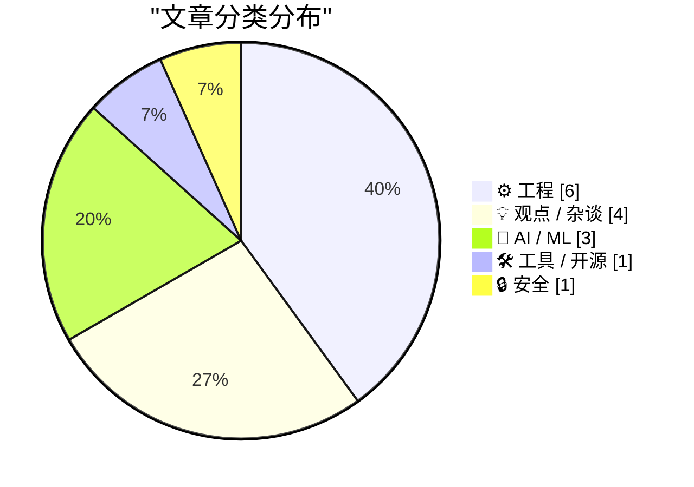
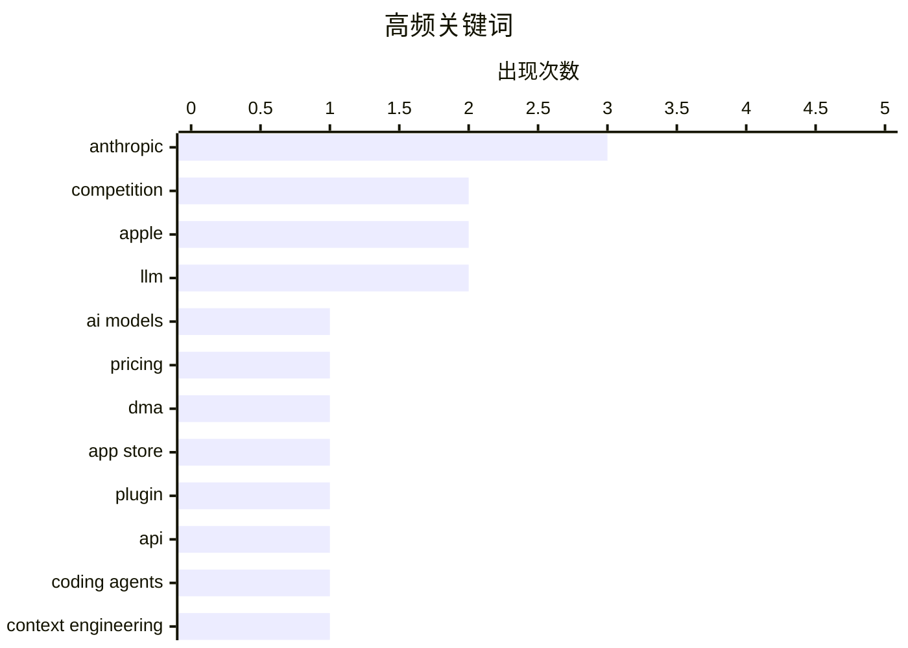

# 📰 Aug 25, 2026

> 来自 Karpathy 推荐的 92 个顶级技术博客，AI 精选 Top 15

## 📝 今日看点

今日技术圈的核心矛盾，正从“模型能力有多强”转向“用户是否愿意为能力和成本买单”，高端模型承压、低价工具和更灵活的工作流持续扩张。AI 的应用边界也在快速下沉，从编码辅助、元数据整理延伸到 BIOS 修复等硬件与底层工程，模型正成为普通开发者的通用工具。与此同时，平台规则与监管的实际效果受到质疑，苹果登录体系调整、应用分发佣金和 AI 水印等议题，凸显技术创新与平台控制之间的持续博弈。工程实践则继续强调开放格式、可组合工具和面向真实设备的务实方案。

---

## 🏆 今日必读

🥇 **Anthropic 最强 AI 模型难以吸引用户，廉价工具却蓬勃发展**

[Anthropic’s best AI model struggles to attract users as cheaper tools thrive](https://simonwillison.net/2026/Aug/23/anthropics-best-ai-model-struggles-to-attract-users-as-cheaper-t/) — simonwillison.net · 1 天前 · 🤖 AI / ML

> Anthropic 的高端 AI 模型虽然能力突出，但用户和市场是否愿意为其高昂成本买单正成为问题。文章引用知情人士数据称，Anthropic 7 月的年化收入已达到 650 亿美元，高于 5 月的 470 亿美元。与此同时，Claude Opus 等高价模型正面临更便宜的模型和工具竞争，后者对大多数用户的需求已经“足够好”。核心矛盾是模型能力提升与实际使用成本之间的差距：顶级性能未必能转化为更广泛的用户采用。

💡 **为什么值得读**: 适合希望了解 AI 模型商业化、价格竞争与 Anthropic 收入增长之间矛盾的读者。

🏷️ Anthropic, AI models, pricing, competition

🥈 **《数字市场法》究竟有什么意义？**

[★ What Is the Point of the DMA?](https://daringfireball.net/2026/08/what_is_the_point_of_the_dma) — daringfireball.net · 2 小时前 · 💡 观点 / 杂谈

> 文章质疑欧盟《数字市场法》（DMA）是否真正实现了促进竞争、选择和开发者自由的目标。按照文中提到的合规安排，Apple 仍可对 App Store 分发应用中指向网页的链接收取 15% 佣金。即使应用通过第三方应用市场分发并使用第三方支付，Apple 还将收取 5% 的核心技术佣金（Core Technology Commission）。这些收费机制表明，监管名义上的开放并不一定能消除平台对开发者的经济控制。作者借此追问：如果开发者仍需向 Apple 付费，DMA 的实际监管价值究竟在哪里？

💡 **为什么值得读**: 它把 DMA 从抽象的监管口号拉回 Apple 佣金这一具体案例，适合关注平台治理和数字市场竞争的人阅读。

🏷️ DMA, Apple, App Store, competition

🥉 **llm-anthropic 0.27**

[llm-anthropic 0.27](https://simonwillison.net/2026/Aug/24/llm-anthropic/) — simonwillison.net · 8 小时前 · 🛠 工具 / 开源

> llm-anthropic 0.27 是用于 LLM 工具的 Anthropic 插件更新，主要目标是兼容新版 Anthropic Python SDK。该 SDK 已发布 1.0.0，并将底层 HTTP 依赖从 httpx 切换为 httpx2。插件需要跟随这一依赖变化，以继续支持通过 LLM 调用 Anthropic 模型的工作流。此次发布的重点是兼容性维护，而不是新增模型能力或改变用户使用方式。

💡 **为什么值得读**: 使用 Simon Willison 的 LLM 工具或 Anthropic API 的开发者可以据此判断是否需要升级插件和相关依赖。

🏷️ Anthropic, LLM, plugin, API

---

## 📊 数据概览

| 扫描源 | 抓取文章 | 时间范围 | 精选 |
|:---:|:---:|:---:|:---:|
| 84/92 | 2539 篇 → 24 篇 | 48h | **15 篇** |

### 分类分布



### 高频关键词



<details>
<summary>📈 纯文本关键词图（终端友好）</summary>

```
anthropic   │ ████████████████████ 3
competition │ █████████████░░░░░░░ 2
apple       │ █████████████░░░░░░░ 2
llm         │ █████████████░░░░░░░ 2
ai models   │ ███████░░░░░░░░░░░░░ 1
pricing     │ ███████░░░░░░░░░░░░░ 1
dma         │ ███████░░░░░░░░░░░░░ 1
app store   │ ███████░░░░░░░░░░░░░ 1
plugin      │ ███████░░░░░░░░░░░░░ 1
api         │ ███████░░░░░░░░░░░░░ 1
```

</details>

### 🏷️ 话题标签

**anthropic**(3) · **competition**(2) · **apple**(2) · llm(2) · ai models(1) · pricing(1) · dma(1) · app store(1) · plugin(1) · api(1) · coding agents(1) · context engineering(1) · moore's law(1) · ai(1) · sign in with apple(1) · hide my email(1) · privacy(1) · metadata(1) · color classification(1) · icon collection(1)

---

## ⚙️ 工程

### 1. Apple 重新考虑将“隐藏我的邮箱”域名与“通过 Apple 登录”合并的计划

[Apple Rethinks Plan to Merge ‘Hide My Email’ Domain Name With ‘Sign In With Apple’](https://developer.apple.com/news/?id=1ptvdtcm) — **daringfireball.net** · 1 小时前 · ⭐ 23/30

> Apple 宣布，新的“通过 Apple 登录”（Sign in with Apple）地址将在今年晚些时候从 privaterelay.appleid.com 改为 private.icloud.com。已经使用 privaterelay.appleid.com 的地址将继续有效，并持续将邮件转发给用户，不会中断现有服务。经过进一步评估并参考社区反馈后，iCloud+“隐藏我的邮箱”（Hide My Email）地址将继续使用 icloud.com 域名。Apple 此前在 6 月曾宣布计划把两套系统合并到新的 private.icloud.com 域名下，如今已调整这一方案。

🏷️ Sign in with Apple, Hide My Email, privacy, Apple

---

### 2. 你的可执行文件就是一个 SQLite 数据库

[Your executable is a SQLite database](https://simonwillison.net/2026/Aug/24/your-executable-is-a-sqlite-database/) — **simonwillison.net** · 13 小时前 · ⭐ 22/30

> 文章介绍一种 Linux 技巧：构造一个既能作为 SQLite 数据库、又能直接执行的文件。关键做法是把 SQLite 文件格式中偏移 68 字节处的 4 字节 application ID 设置为 SELF，代表 Structured Executable & Linkable Format。随后，文件会同时满足 SQLite 数据库和 ELF 可执行文件所需的结构约束。这样可以把数据、查询逻辑与可执行入口组合在同一个文件中，形成一种新颖的可执行数据库模式。这个方案主要体现文件格式兼容和 Linux ELF 机制的巧妙利用，而不是 SQLite 的常规部署方式。

🏷️ SQLite, Linux, executable, database

---

### 3. 告别 px，ch 万岁

[Death to px, long live ch!](https://shkspr.mobi/blog/2026/08/death-to-px-long-live-ch/) — **shkspr.mobi** · 1 天前 · ⭐ 22/30

> 文章质疑 CSS 中“像素精确”的观念，指出显示器并不存在绝对可靠的物理像素网格。CSS 的 1px 不一定等于设备上的一个物理像素，在高清屏幕上可能对应多个物理像素；同样，CSS 中的 1cm 也通常不等于现实世界中 SI 单位定义的百分之一米。作者因此主张减少对 px 等绝对尺寸单位的依赖，并更多考虑字体、文本宽度和内容本身的尺度。标题中的 ch 是与字符宽度相关的 CSS 单位，适合用于根据文本容量设计布局，而不是假设所有设备都拥有相同的物理显示精度。

🏷️ CSS, pixels, ch, responsive design

---

### 4. Windows 95 于1995年8月24日发布

[Windows 95 released August 24, 1995](https://dfarq.homeip.net/happy-20th-birthday-to-windows-95/?utm_source=rss&#038;utm_medium=rss&#038;utm_campaign=happy-20th-birthday-to-windows-95) — **dfarq.homeip.net** · 14 小时前 · ⭐ 20/30

> Windows 95 于1995年8月24日正式发布，并在发布前引发了极高的公众期待。文章认为，这是历史上最受期待的Windows版本，其他版本的关注度都难以与之相比。发布当天，人们排长队购买或体验系统，成为当时科技产品发布热潮的典型场景。Windows 95的发布体现了个人电脑从专业设备走向大众消费市场的重要阶段。文章的核心观点是，Windows 95不仅是一次操作系统更新，也是一场具有广泛社会影响力的科技事件。

🏷️ Windows 95, operating systems, Microsoft, history

---

### 5. 分布式身份

[distributed identity](https://jyn.dev/distributed-identity/) — **jyn.dev** · 1 天前 · ⭐ 20/30

> 文章聚焦Git中的身份机制，指出Git让用户修改或隐藏自己的身份变得异常困难。Git提交通常会记录作者和提交者信息，这些元数据会随提交历史传播，并成为项目历史的一部分。分布式版本控制的复制特性意味着身份信息可能存在于多个仓库和历史副本中，单点修改很难彻底消除痕迹。这个问题涉及提交签名、身份验证、历史重写以及隐私之间的关系。核心观点是，Git的分布式设计强化了身份记录的持久性，也暴露出用户对自身身份数据缺乏控制的问题。

🏷️ Git, identity, distributed systems

---

### 6. 三项递推关系

[Three-term recurrences](https://www.johndcook.com/blog/2026/08/24/three-term-recurrences/) — **johndcook.com** · 10 小时前 · ⭐ 19/30

> 三项递推关系描述了一类函数族，其中每个函数都可以表示为前两个函数的线性组合。递推式中的系数通常是变量x的函数，但不依赖于项编号n，这类形式在数学分析中十分常见。文章指出，许多看似不同的函数系统都会自然地产生三项递推关系，并存在相应定理用于判断其成立条件。该主题常见于正交多项式、特殊函数以及数值计算等领域。作者的核心观点是，三项递推关系出现得异常频繁，掌握其结构和适用条件有助于统一理解大量函数族。

🏷️ recurrence, special functions, mathematics

---

## 💡 观点 / 杂谈

### 7. 《数字市场法》究竟有什么意义？

[★ What Is the Point of the DMA?](https://daringfireball.net/2026/08/what_is_the_point_of_the_dma) — **daringfireball.net** · 2 小时前 · ⭐ 24/30

> 文章质疑欧盟《数字市场法》（DMA）是否真正实现了促进竞争、选择和开发者自由的目标。按照文中提到的合规安排，Apple 仍可对 App Store 分发应用中指向网页的链接收取 15% 佣金。即使应用通过第三方应用市场分发并使用第三方支付，Apple 还将收取 5% 的核心技术佣金（Core Technology Commission）。这些收费机制表明，监管名义上的开放并不一定能消除平台对开发者的经济控制。作者借此追问：如果开发者仍需向 Apple 付费，DMA 的实际监管价值究竟在哪里？

🏷️ DMA, Apple, App Store, competition

---

### 8. 引用 Drew Breunig

[Quoting Drew Breunig](https://simonwillison.net/2026/Aug/23/drew-breunig/) — **simonwillison.net** · 1 天前 · ⭐ 23/30

> Drew Breunig 认为，在 Fable 出现之前，花大量时间优化编码工具链或上下文策略并不划算，因为新模型通常会以相同甚至更低价格到来，并弥补旧工作流的不足。Fable 发布后，模型能力和效果极其出色，但成本也非常高。相比之下，Opus、5.6、K3 甚至 GLM 对大多数编码任务已经足够好。文章呈现出一个重要转变：随着模型能力差距与价格差距扩大，优化 harness、上下文管理和整体工作流重新变得有价值。核心观点是，最强模型并不总是最具性价比的选择，工程方法可以帮助中等模型达到更好的实际产出。

🏷️ coding agents, context engineering, Moore's Law, AI

---

### 9. Cooper Sharp 证明美国奶酪也可以是好奶酪

[Cooper Sharp Proves That American Cheese Can Be Great Cheese](https://sixcolors.com/member/2026/08/this-week-in-apple-lets-fight/) — **daringfireball.net** · 1 天前 · ⭐ 21/30

> 文章转述 John Moltz 对 Anthropic AI 文本水印计划的评论，并以此展开对 AI 产品与技术判断的讨论。Anthropic 计划通过改变模型选择下一个词时的随机性，为生成文本加入难以察觉的水印，以帮助识别 AI 生成内容。作者承认这一方案服务于识别 AI 的合理目标，但指出它引发了对可靠性、透明度和用户体验的担忧。文章还借用“美国奶酪也能是好奶酪”的标题表达对被低估事物的重新评价，整体带有明显的评论和讽刺色彩。

🏷️ AI watermarking, Anthropic, content detection, satire

---

### 10. 愤怒、焦虑与能动性

[Anger, Anxiety and Agency](https://lucumr.pocoo.org/2026/8/24/anger-anxiety-agency/) — **lucumr.pocoo.org** · 1 天前 · ⭐ 20/30

> 文章围绕职场中的愤怒、焦虑，以及个人能否推动事情改变展开，作者明确认同“工作中不应愤怒”的观点。愤怒可以作为发现问题的信号，但在职场中表达愤怒通常不会改善局面，反而可能让周围同事承受后果。许多同事对愤怒的根源并没有更多控制权，因此把情绪施加给他们既无助于解决问题，也可能进一步恶化工作关系。作者结合自己的经历指出，公司内部存在共同愿景，个人若不认同这一愿景，就需要理解组织权力和责任的分布，并寻找更具建设性的行动方式。核心结论是，应把愤怒和焦虑转化为判断问题、明确自身能动范围并采取有效行动的依据。

🏷️ workplace anger, anxiety, agency

---

## 🤖 AI / ML

### 11. Anthropic 最强 AI 模型难以吸引用户，廉价工具却蓬勃发展

[Anthropic’s best AI model struggles to attract users as cheaper tools thrive](https://simonwillison.net/2026/Aug/23/anthropics-best-ai-model-struggles-to-attract-users-as-cheaper-t/) — **simonwillison.net** · 1 天前 · ⭐ 25/30

> Anthropic 的高端 AI 模型虽然能力突出，但用户和市场是否愿意为其高昂成本买单正成为问题。文章引用知情人士数据称，Anthropic 7 月的年化收入已达到 650 亿美元，高于 5 月的 470 亿美元。与此同时，Claude Opus 等高价模型正面临更便宜的模型和工具竞争，后者对大多数用户的需求已经“足够好”。核心矛盾是模型能力提升与实际使用成本之间的差距：顶级性能未必能转化为更广泛的用户采用。

🏷️ Anthropic, AI models, pricing, competition

---

### 12. 让 LLM 为我的图标收藏制作丰富颜色元数据工具

[Getting an LLM to Make Me a Tool for Enriching the Color Metadata in My Icon Collection](https://blog.jim-nielsen.com/2026/use-llm-to-add-color-metadata/) — **blog.jim-nielsen.com** · 1 天前 · ⭐ 23/30

> 作者长期为 iOS 和 macOS 图标收藏手工添加颜色元数据，例如标记图标主要是蓝色、橙色或其他颜色。网站随后利用这些标签，将大致相同颜色的图标集中展示，方便用户按视觉特征浏览。文章记录了作者如何借助 LLM 制作一个自动丰富图标颜色元数据的工具，以减少手工标注工作。这个案例体现了 LLM 在半结构化内容整理、视觉属性分类和个人数据管理中的实用价值。

🏷️ LLM, metadata, color classification, icon collection

---

### 13. 用 Claude 修复 eMachines EL1200 的 BIOS Bug

[Fixing an eMachines EL1200 BIOS bug with Claude](https://www.downtowndougbrown.com/2026/08/fixing-an-emachines-el1200-bios-bug-with-claude/) — **downtowndougbrown.com** · 1 天前 · ⭐ 21/30

> 作者记录了借助 Claude 排查和修复老旧 eMachines EL1200 电脑 BIOS 问题的过程。文章聚焦于硬件固件缺陷与操作系统启动链之间的关系，延续了作者过去通过修改 ACPI 表解决内存识别问题的实践经验。此前一个限制 16 GB 内存、尽管主板支持范围只有 8 GB 的问题，最终可通过一行 GRUB 修改修复错误重叠的 PCI 相关 ACPI 表。这个案例展示了 Claude 如何参与分析 BIOS、ACPI 和 GRUB 之间复杂的底层交互，但具体修复步骤和结果在给出的文章摘录中并未完整展示。

🏷️ Claude, BIOS, ACPI, hardware hacking

---

## 🛠 工具 / 开源

### 14. llm-anthropic 0.27

[llm-anthropic 0.27](https://simonwillison.net/2026/Aug/24/llm-anthropic/) — **simonwillison.net** · 8 小时前 · ⭐ 23/30

> llm-anthropic 0.27 是用于 LLM 工具的 Anthropic 插件更新，主要目标是兼容新版 Anthropic Python SDK。该 SDK 已发布 1.0.0，并将底层 HTTP 依赖从 httpx 切换为 httpx2。插件需要跟随这一依赖变化，以继续支持通过 LLM 调用 Anthropic 模型的工作流。此次发布的重点是兼容性维护，而不是新增模型能力或改变用户使用方式。

🏷️ Anthropic, LLM, plugin, API

---

## 🔒 安全

### 15. 欢迎斯里兰卡政府加入 Have I Been Pwned

[Welcoming the Sri Lankan Government to Have I Been Pwned](https://www.troyhunt.com/welcoming-the-sri-lankan-government-to-have-i-been-pwned/) — **troyhunt.com** · 1 天前 · ⭐ 21/30

> Have I Been Pwned（HIBP）宣布斯里兰卡政府加入其免费的政府服务，成为第48个接入的政府。斯里兰卡计算机紧急响应小组（Sri Lanka CERT）现在可以监控斯里兰卡政府域名，并将其与HIBP泄露数据进行比对。该服务有助于识别已经暴露的政府账户，并在这些账户出现在新数据泄露事件中时及时响应。作者的核心观点是，政府机构接入HIBP能够提升公共部门对账户泄露和数据泄露风险的发现与处置能力。

🏷️ Have I Been Pwned, data breach, Sri Lanka CERT, government security

---

*生成于 2026-08-25 01:01 | 扫描 84 源 → 获取 2539 篇 → 精选 15 篇*
*基于 [Hacker News Popularity Contest 2025](https://refactoringenglish.com/tools/hn-popularity/) RSS 源列表，由 [Andrej Karpathy](https://x.com/karpathy) 推荐*
