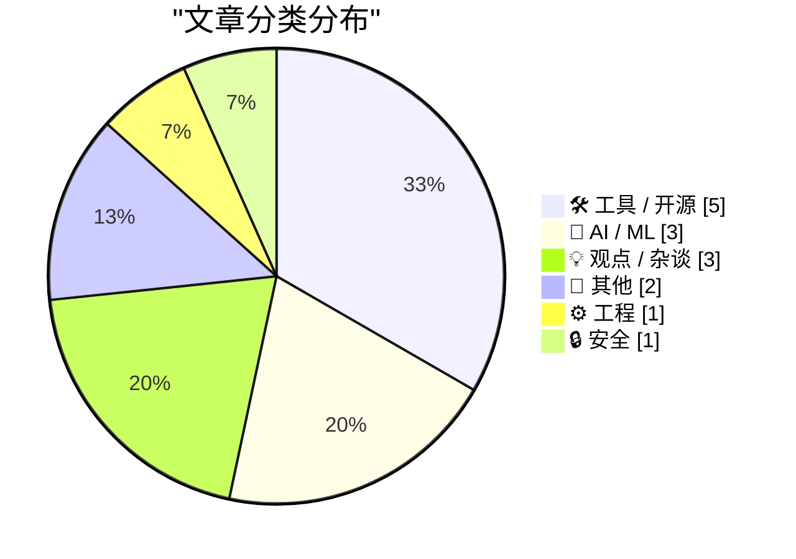
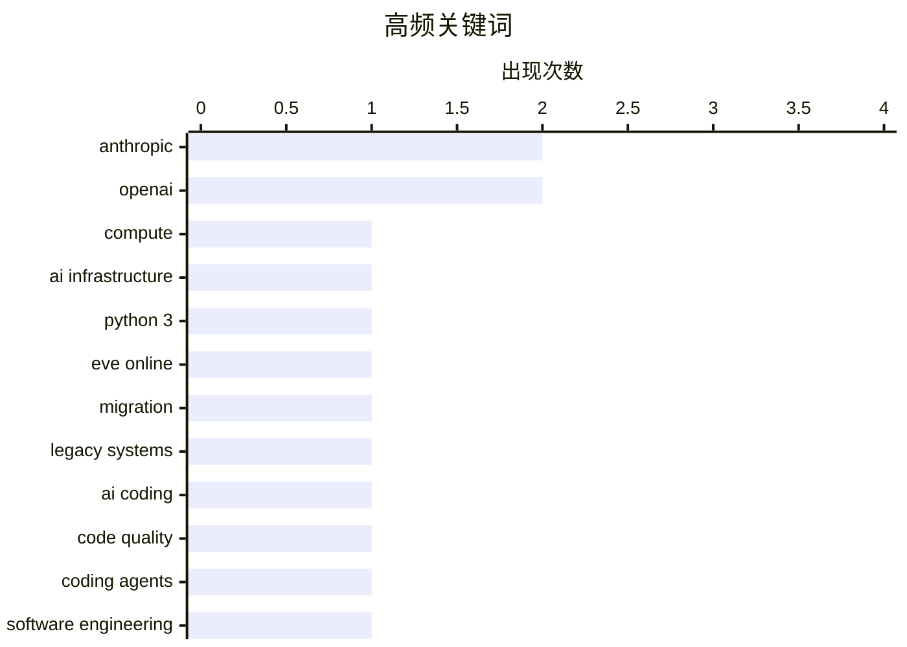

# 📰 Aug 27, 2026

> 来自 Karpathy 推荐的 92 个顶级技术博客，AI 精选 Top 15

## 📝 今日看点

今日技术圈的核心议题，首先是 AI 算力与基础设施加速集中于少数头部实验室，模型规模竞争正延伸到芯片、数据中心和资本布局。与此同时，AI 编程从“提升效率”进入质量、可靠性与责任边界的深水区，软件是否还能依赖人工审查，以及开发者角色是否被重新定义，成为争论焦点。开源模型与苹果新一代芯片则显示，推理效率、多模态能力和端侧 AI 仍在持续演进。围绕 AI 中心化、行业叙事和安全承诺的质疑也在升温，技术进步之外，验证机制与权力结构同样值得关注。

---

## 🏆 今日必读

🥇 **Dylan Patel：到 2028 年，Anthropic 与 OpenAI 将拥有全球大部分算力**

[Dylan Patel – Anthropic & OpenAI will have most of the world’s compute by 2028](https://www.dwarkesh.com/p/dylan-patel-3) — dwarkesh.com · 1 天前 · 🤖 AI / ML

> 文章围绕 AI 训练与推理算力是否会高度集中于 Anthropic、OpenAI 等少数实验室展开。Dylan Patel 的判断是，芯片供应、数据中心建设、资本投入、云服务合作和模型规模竞争等力量都在推动集中化。到 2028 年，领先 AI 公司可能掌握全球极大比例的可用 AI 计算资源，从而进一步拉大与中小公司及开源项目的差距。算力不只是模型研发的成本项，也会成为决定产品能力、部署规模和行业议价权的核心战略资产。核心观点是，AI 产业的竞争结构正从软件创业的分散格局转向由超大规模基础设施主导的集中格局。

💡 **为什么值得读**: 适合希望理解 AI 竞争为何越来越取决于芯片、数据中心和资本，而不只是模型算法的人阅读。

🏷️ Anthropic, OpenAI, compute, AI infrastructure

🥈 **EVE Online：迈向 Python 3 的迁移开始了！**

[EVE Online: The Move to Python 3 Begins!](https://simonwillison.net/2026/Aug/25/eve-online-move-to-python-3/) — simonwillison.net · 1 天前 · ⚙️ 工程

> 运营超过 20 年的 MMORPG《EVE Online》正式启动从 Stackless Python 2.7 向 Python 3 的迁移。该游戏自 2003 年上线起一直依赖 Stackless Python，而上一次重大升级已是 16 年前。长期运行的实时在线游戏服务意味着迁移不仅涉及语言语法和运行时兼容性，还会影响既有服务端逻辑、并发模型和庞大生产代码库。Stackless Python 的历史包袱使这次升级成为观察 Python 大规模遗留系统现代化的重要案例。核心结论是，即便高度定制且长期稳定运行的平台，也必须开始处理 Python 2 时代技术栈带来的维护风险。

💡 **为什么值得读**: 这是少见的超长期生产系统迁移案例，对维护遗留 Python 服务、评估运行时升级成本很有参考价值。

🏷️ Python 3, EVE Online, migration, legacy systems

🥉 **AI 编写的软件质量如何？**

[What is the quality of software that AI writes?](https://www.johndcook.com/blog/2026/08/26/what-is-the-quality-of-software-that-ai-writes/) — johndcook.com · 12 小时前 · 🤖 AI / ML

> 文章追问 AI 编程代理提升开发效率后，自动生成代码的质量、可维护性和可靠性是否足以支撑真实软件系统。一种激进观点认为未来会出现人类不再审阅源码的“黑暗软件工厂”，甚至“源代码会成为新的汇编语言”。另一种立场则认为，人类仍需要理解、检查和维护软件，因此代码质量不能因生成速度提升而被忽略。讨论的重点不只是 AI 能否产出可运行程序，还包括错误定位、安全、长期演进与责任归属。作者将问题落在一个关键判断上：生产力收益不能自动证明 AI 生成代码具有可接受的工程质量。

💡 **为什么值得读**: 它直指 AI 编程从演示效果走向生产环境时最容易被忽略的质量与治理问题。

🏷️ AI coding, code quality, coding agents, software engineering

---

## 📊 数据概览

| 扫描源 | 抓取文章 | 时间范围 | 精选 |
|:---:|:---:|:---:|:---:|
| 82/92 | 2509 篇 → 37 篇 | 48h | **15 篇** |

### 分类分布



### 高频关键词



<details>
<summary>📈 纯文本关键词图（终端友好）</summary>

```
anthropic         │ ████████████████████ 2
openai            │ ████████████████████ 2
compute           │ ██████████░░░░░░░░░░ 1
ai infrastructure │ ██████████░░░░░░░░░░ 1
python 3          │ ██████████░░░░░░░░░░ 1
eve online        │ ██████████░░░░░░░░░░ 1
migration         │ ██████████░░░░░░░░░░ 1
legacy systems    │ ██████████░░░░░░░░░░ 1
ai coding         │ ██████████░░░░░░░░░░ 1
code quality      │ ██████████░░░░░░░░░░ 1
```

</details>

### 🏷️ 话题标签

**anthropic**(2) · **openai**(2) · **compute**(1) · ai infrastructure(1) · python 3(1) · eve online(1) · migration(1) · legacy systems(1) · ai coding(1) · code quality(1) · coding agents(1) · software engineering(1) · qwen(1) · moe(1) · multimodal(1) · open weights(1) · ai criticism(1) · technology industry(1) · generative ai(1) · labor(1)

---

## 🛠 工具 / 开源

### 1. Apple 推出 M6 与 M5 Ultra 芯片，并发布新款 Mac mini 和 Mac Studio

[Apple Introduces M6 and M5 Ultra Chips, in New Mac Mini and Mac Studio](https://www.apple.com/newsroom/2026/08/apple-introduces-m6-and-m5-ultra-for-a-big-leap-in-performance-and-ai-compute/) — **daringfireball.net** · 1 天前 · ⭐ 23/30

> Apple 发布搭载 M6 的新款 Mac mini，以及搭载 M5 Ultra 的新款 Mac Studio，重点强调性能和 AI 计算能力提升。M6 是 Apple 首款 2 纳米制程芯片，配备更大的 12 核 CPU、带 Neural Accelerators 的 12 核 GPU，以及双 16 核 Neural Engine。该芯片最高支持 170GB/s 统一内存带宽，意在同时提升通用计算、图形任务和本地 AI 工作负载。M5 Ultra 则面向 Mac Studio 的更高端性能需求，扩展 Apple Silicon 在桌面专业工作站市场的覆盖。核心观点是，Apple 正将先进制程、统一内存和专用神经网络硬件作为 Mac 端 AI 能力的基础。

🏷️ Apple Silicon, M6, M5 Ultra, 2nm

---

### 2. 新款 Mac mini（M6/M5 Pro）与 Mac Studio（M5 Max/M5 Ultra）的内存、存储配置和定价

[★ Memory and Storage Configurations and Pricing for the New Mac Minis (M6/M5 Pro) and Mac Studios (M5 Max/M5 Ultra)](https://daringfireball.net/2026/08/configurations_and_pricing_for_new_mac_minis_and_mac_studios) — **daringfireball.net** · 1 天前 · ⭐ 22/30

> 文章将新款 Mac mini 的 M6、M5 Pro 配置，以及 Mac Studio 的 M5 Max、M5 Ultra 配置汇总为紧凑表格。比较维度包括各芯片可选的统一内存容量、SSD 存储容量，以及不同组合对应的价格。Apple 的产品配置通常受芯片分级约束，因此相同外形或相近基础售价不代表可获得相同的内存和存储上限。通过表格化呈现，读者可以更直观地识别从基础配置升级到大内存、大 SSD 或 Ultra 芯片的实际增量成本。核心结论是，购买决策应基于目标芯片支持的内存与存储组合，而不是仅比较机器起售价。

🏷️ Mac mini, Mac Studio, RAM, SSD pricing

---

### 3. 如果 VS Code 远程开发失效，请降级至 v1.124.x

[If your VS Code remotes stopped working, downgrade to v1.124.x](https://xeiaso.net/notes/2026/vscode-remotes-not-working-downgrade/) — **xeiaso.net** · 1 天前 · ⭐ 20/30

> 近期部分用户的 VS Code 远程开发功能出现无法工作的故障。作者给出的直接缓解方案是将 VS Code 降级到 v1.124.x。问题影响的范围包括依赖 VS Code Remote 连接远端环境的开发工作流。标题与“Quality software reigns again”的讽刺表述暗示，故障很可能来自较新版本的软件回归。现有内容没有提供具体受影响的 Remote 扩展、报错信息或上游修复版本。对于被升级后故障阻塞的用户，v1.124.x 是当前可操作的临时回退版本。

🏷️ VS Code, remote development, downgrade, regression

---

### 4. 使用 D2 为我的静态站点生成器添加图表功能

[Adding diagrams to my static site generator with D2](https://www.gilesthomas.com/2026/08/adding-d2) — **gilesthomas.com** · 1 天前 · ⭐ 20/30

> 作者认为技术博客中许多内容需要图表辅助说明，但高质量绘图的制作成本导致自己长期低估了图表的使用频率。为解决这一问题，作者将 D2 图表语言集成到自己的静态站点生成器中。此前，作者曾使用 LibreOffice 手工绘制并导出 SVG，但认为这种工作流既依赖设计能力，也难以高效产出理想结果。D2 通过以文本描述图表结构，适合放入 Markdown、版本控制和静态站点构建流程。最终实现让作者能以更低摩擦在博客文章中加入结构化图示。

🏷️ D2, static site generator, diagrams, documentation

---

### 5. 你听说过 Microlighter 的好消息吗？

[Have You Heard the Good News About Microlighter?](https://blog.jim-nielsen.com/2026/shipping-microlighter/) — **blog.jim-nielsen.com** · 1 天前 · ⭐ 20/30

> Microlighter 是一个利用 CSS Custom Highlights API 实现代码语法高亮的工具。Dave Rupert 发布该工具后，Jim Nielsen 当天便为自己的博客提交了集成实现的 PR。该方案将语法高亮建立在浏览器原生的 Custom Highlights API 之上，而不是完全依赖传统的 HTML token 包装与样式类。它的目标是以更轻量的方式处理网页中的代码高亮，并探索现代 CSS 平台能力在内容站点中的实际应用。文章围绕 Microlighter 的发布和快速落地，反映了原生 Web API 正在为长期由 JavaScript 库主导的功能提供替代路径。

🏷️ Microlighter, syntax highlighting, CSS, Web APIs

---

## 🤖 AI / ML

### 6. Dylan Patel：到 2028 年，Anthropic 与 OpenAI 将拥有全球大部分算力

[Dylan Patel – Anthropic & OpenAI will have most of the world’s compute by 2028](https://www.dwarkesh.com/p/dylan-patel-3) — **dwarkesh.com** · 1 天前 · ⭐ 26/30

> 文章围绕 AI 训练与推理算力是否会高度集中于 Anthropic、OpenAI 等少数实验室展开。Dylan Patel 的判断是，芯片供应、数据中心建设、资本投入、云服务合作和模型规模竞争等力量都在推动集中化。到 2028 年，领先 AI 公司可能掌握全球极大比例的可用 AI 计算资源，从而进一步拉大与中小公司及开源项目的差距。算力不只是模型研发的成本项，也会成为决定产品能力、部署规模和行业议价权的核心战略资产。核心观点是，AI 产业的竞争结构正从软件创业的分散格局转向由超大规模基础设施主导的集中格局。

🏷️ Anthropic, OpenAI, compute, AI infrastructure

---

### 7. AI 编写的软件质量如何？

[What is the quality of software that AI writes?](https://www.johndcook.com/blog/2026/08/26/what-is-the-quality-of-software-that-ai-writes/) — **johndcook.com** · 12 小时前 · ⭐ 25/30

> 文章追问 AI 编程代理提升开发效率后，自动生成代码的质量、可维护性和可靠性是否足以支撑真实软件系统。一种激进观点认为未来会出现人类不再审阅源码的“黑暗软件工厂”，甚至“源代码会成为新的汇编语言”。另一种立场则认为，人类仍需要理解、检查和维护软件，因此代码质量不能因生成速度提升而被忽略。讨论的重点不只是 AI 能否产出可运行程序，还包括错误定位、安全、长期演进与责任归属。作者将问题落在一个关键判断上：生产力收益不能自动证明 AI 生成代码具有可接受的工程质量。

🏷️ AI coding, code quality, coding agents, software engineering

---

### 8. Qwen3.8-Flash-Next

[Qwen3.8-Flash-Next](https://simonwillison.net/2026/Aug/26/qwen38-flash-next/) — **simonwillison.net** · 7 小时前 · ⭐ 24/30

> Qwen 发布开源权重模型 Qwen3.8-Flash-Next，它是一个多模态 MoE（混合专家）模型，并被定位为 Qwen4 架构的早期预览。模型总参数规模为 125B，但每次推理仅激活 6B 参数，以 MoE 稀疏激活机制降低实际计算量并提高速度。Simon Willison 使用 Unsloth 提供的 GGUF 量化版本，在 NVIDIA DGX Spark 上进行了本地试用。该模型说明，大参数量与本地可运行性可以通过量化和稀疏专家架构并存。核心观点是，开源模型正在借助 MoE 架构把更高能力带到相对可负担的推理硬件上。

🏷️ Qwen, MoE, multimodal, open weights

---

## 💡 观点 / 杂谈

### 9. AI 厌恶者宣言

[The AI Hater's Manifesto](https://www.wheresyoured.at/the-ai-haters-manifesto/) — **wheresyoured.at** · 1 天前 · ⭐ 24/30

> 文章以“AI 厌恶者”的立场反对将生成式 AI 视为不可避免且天然有益的技术进步。作者质疑 AI 公司、媒体和投资者围绕效率、自动化与未来就业构建的主流叙事，并强调这些叙事背后的商业利益和权力关系。批评重点包括生成式 AI 的产品价值是否被夸大、其基础设施成本与社会代价由谁承担，以及技术推广是否真正获得用户同意。文章也将反对 AI 正常化为一种合理的公共立场，而非单纯的技术恐惧。核心观点是，对 AI 的批判应聚焦其现实商业模式、劳动影响和权力集中，而不能只讨论模型能力。

🏷️ AI criticism, technology industry, generative AI, labor

---

### 10. 引用 Paul Dix

[Quoting Paul Dix](https://simonwillison.net/2026/Aug/26/paul-dix/) — **simonwillison.net** · 22 小时前 · ⭐ 22/30

> Paul Dix 认为，AI 编写并在数月内持续完善 100 万行代码，最终交付一个运行在数百万开发者机器上的可靠软件，是极具意义的工程突破。即使该项目存在可用于比较结果的“预言机”，从一种语言迁移到另一种语言也并不意味着任务简单。引文反驳了“有参考实现就不值得惊讶”的观点，强调大规模代码生成、迭代修正和生产可靠性必须被整体衡量。这里的重点是 AI 不仅生成片段式代码，还可能参与完整软件迁移和长期修复循环。核心结论是，规模达到 100 万行、覆盖数百万终端的可靠交付，标志着 AI 编程能力已跨过重要的实用门槛。

🏷️ AI programming, software development, automation

---

### 11. 出售中的危险工具

[Foot Guns for Sale](https://idiallo.com/blog/foot-gun-for-sale) — **idiallo.com** · 1 天前 · ⭐ 22/30

> 文章质疑“AI 必然走向中心化”的行业叙事，以及 Anthropic、OpenAI 等公司将成为安全、可信 AI 守门人的设想。作者认为，销售 AI 基础设施和服务的公司正在推动一种图景：开发者退化为提示词工程师，通过 API 按 token 付费租用智能能力。该模式会让用户和开发者成为少数平台的租户，依赖其模型、价格、政策与访问控制，而不是拥有可自主运行和修改的技术能力。作者用“出售中的危险工具”强调，集中式 AI 平台既可能提高便利性，也会放大依赖、锁定和权力不对称。核心观点是，不能把中心化 API AI 当作唯一未来，开发者应警惕把技术自主权交给少数供应商。

🏷️ AI centralization, OpenAI, Anthropic, developers

---

## 📝 其他

### 12. “惊喜与闪耀”苹果发布会：9 月 9 日星期三举行

[‘Surprise and Shine’ Apple Event: Wednesday 9 September](https://9to5mac.com/2026/08/26/apple-officially-announces-iphone-18-pro-foldable-event/) — **daringfireball.net** · 11 小时前 · ⭐ 21/30

> 苹果正式宣布下一场产品发布会将于 9 月 9 日太平洋时间上午 10 点举行，主题为“Surprise and shine（惊喜与闪耀）”。活动预计发布 iPhone 18 Pro 系列，以及苹果首款折叠屏 iPhone。邀请函采用发光的苹果标志和阳光穿透效果，呼应“闪耀”主题。苹果通常将秋季 iPhone 发布会安排在周二，但当美国劳动节落在 9 月第二周时，发布会会调整至周三。此次安排延续了苹果围绕美国节假日调整新品发布节奏的惯例。苹果首款折叠屏手机的亮相将是本次活动最值得关注的产品节点。

🏷️ Apple, iPhone, foldable, product event

---

### 13. Twitter/X 镜像服务 XCancel 收到 X Corp 停止侵权函后关闭

[XCancel, the Twitter/X Mirror, Shuts Down After Cease and Desist From the Fine Folks at X Corp](https://xcancel.com/) — **daringfireball.net** · 1 天前 · ⭐ 21/30

> 用于镜像 Twitter/X 内容的服务 XCancel 于 8 月 24 日美国东部时间晚上 8 点收到 X Corp 发出的停止侵权函。XCancel 已宣布立即暂停服务，恢复时间未定。运营方表示正在寻求法律建议，暂不披露更多细节。该服务已运行两年，为不希望直接访问 x.com 的用户提供公开帖文的替代访问入口。Daring Fireball 作者指出，XCancel 长期面临明显的法律风险，因此自己始终没有只链接至该镜像服务。事件表明，依赖第三方镜像访问社交平台内容的渠道仍容易受平台法律与政策行动影响。

🏷️ XCancel, Twitter, platform policy, legal dispute

---

## ⚙️ 工程

### 14. EVE Online：迈向 Python 3 的迁移开始了！

[EVE Online: The Move to Python 3 Begins!](https://simonwillison.net/2026/Aug/25/eve-online-move-to-python-3/) — **simonwillison.net** · 1 天前 · ⭐ 25/30

> 运营超过 20 年的 MMORPG《EVE Online》正式启动从 Stackless Python 2.7 向 Python 3 的迁移。该游戏自 2003 年上线起一直依赖 Stackless Python，而上一次重大升级已是 16 年前。长期运行的实时在线游戏服务意味着迁移不仅涉及语言语法和运行时兼容性，还会影响既有服务端逻辑、并发模型和庞大生产代码库。Stackless Python 的历史包袱使这次升级成为观察 Python 大规模遗留系统现代化的重要案例。核心结论是，即便高度定制且长期稳定运行的平台，也必须开始处理 Python 2 时代技术栈带来的维护风险。

🏷️ Python 3, EVE Online, migration, legacy systems

---

## 🔒 安全

### 15. 关于数据泄露声明、验证与 Carhartt 的警示故事

[A Cautionary Tale About Data Breach Claims, Verification and Carhartt](https://www.troyhunt.com/a-cautionary-tale-about-data-breach-claims-verification-and-carhartt/) — **troyhunt.com** · 1 天前 · ⭐ 24/30

> 文章借 Carhartt 相关事件说明，面对网络犯罪团伙或泄露者发布的数据泄露声明，不能仅凭其公开说法就认定事件属实。作者指出，最初的错误信息甚至未必来自网络犯罪者本身，事件需要从原始线索、受影响组织和证据链开始逐项验证。数据泄露通报、媒体报道与安全情报若缺少独立核验，可能会把误判迅速放大为品牌和用户层面的恐慌。对安全研究者而言，声明中的样本、时间线、系统归属和数据真实性都应被区分验证。核心结论是，数据泄露报道的可信度取决于证据验证，而不是泄露者、截图或新闻传播的声量。

🏷️ data breach, verification, Carhartt, cybercrime

---

*生成于 2026-08-27 07:07 | 扫描 82 源 → 获取 2509 篇 → 精选 15 篇*
*基于 [Hacker News Popularity Contest 2025](https://refactoringenglish.com/tools/hn-popularity/) RSS 源列表，由 [Andrej Karpathy](https://x.com/karpathy) 推荐*
