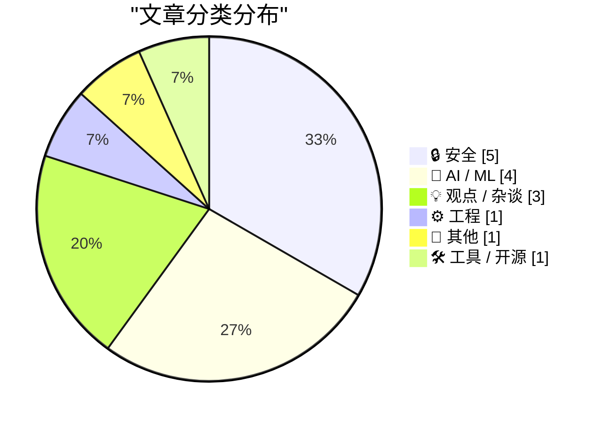
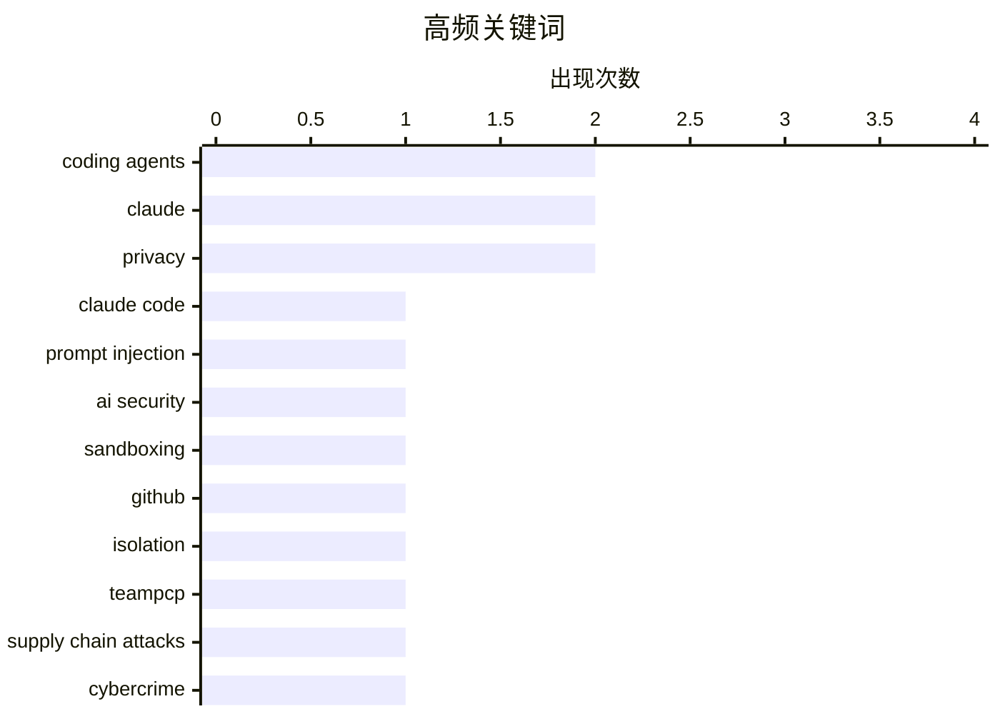

# 📰 Aug 28, 2026

> 来自 Karpathy 推荐的 92 个顶级技术博客，AI 精选 Top 15

## 📝 今日看点

今日技术圈的焦点集中在编码代理的安全边界：提示注入、凭据泄露和恶意开源软件风险持续暴露，沙箱隔离正成为代理落地的基础设施。与此同时，AI 编程从“能否生成代码”转向“代码是否可靠、是否真正具备指令执行能力”，评测指标、人工监督与责任归属成为新的争议中心。开放权重模型则继续沿着多模态、混合专家和低成本推理演进，但 AI 与国防及公共治理的法律博弈也在同步升温。

---

## 🏆 今日必读

🥇 **攻破 Claude Code Opus 5 自动模式**

[Breaking Claude Code Opus 5 Auto Mode](https://simonwillison.net/2026/Aug/27/breaking-claude-code-opus-5-auto-mode/) — simonwillison.net · 9 小时前 · 🔒 安全

> Anthropic 将 Claude Code 的 Auto Mode 作为抵御提示注入攻击、保护编码代理用户的重要防线，并已将其设为默认模式。文章通过 Johann Rehberger 的研究，检验了 Claude Code Opus 5 Auto Mode 面对恶意指令和不可信内容时的实际防护能力。研究结果表明，攻击者仍可能设计出绕过自动模式安全机制的提示注入路径，导致代理执行非预期操作。核心结论是，Auto Mode 的防护承诺不能替代沙箱、权限隔离和人工审查等纵深防御措施。

💡 **为什么值得读**: 如果你正在使用 Claude Code 或其他编码代理，这篇文章能帮助你识别“默认安全模式”与真正可依赖的安全边界之间的差距。

🏷️ Claude Code, prompt injection, coding agents, AI security

🥈 **为编码代理构建沙箱**

[Sandboxing coding agents](https://micahflee.com/sandboxing-coding-agents/) — micahflee.com · 12 小时前 · 🔒 安全

> 编码代理能够生成高质量代码，但其访问文件、网络和凭据的能力也会放大提示注入和误操作风险。文章展示了如何为代理配置隔离沙箱，使其只能访问一个独立的 GitHub 仓库。关键方案是将代理运行环境与个人文件、其他项目及敏感系统资源分开，并通过受限权限控制其操作范围。这样的隔离架构把代理造成的潜在损害限制在单个仓库内，比单纯依赖代理自身的安全判断更可靠。文章适合希望安全地把编码代理纳入日常开发流程的工程师。

💡 **为什么值得读**: 它提供的是可落地的代理安全配置思路，能直接降低编码代理误删文件、泄露凭据或被提示注入利用的风险。

🏷️ coding agents, sandboxing, GitHub, isolation

🥉 **澳大利亚逮捕两名涉嫌 TeamPCP 的黑客**

[Two Alleged ‘TeamPCP’ Hackers Arrested in Australia](https://krebsonsecurity.com/2026/08/two-alleged-teampcp-hackers-arrested-in-australia/) — krebsonsecurity.com · 21 小时前 · 🔒 安全

> 澳大利亚当局逮捕了两名涉嫌属于 TeamPCP 的男子，年龄分别为 21 岁和 23 岁，二人来自西澳大利亚。澳大利亚联邦警察称，他们与一个复杂的网络犯罪集团有关，该集团被指通过发布恶意开源软件窃取数千家组织的数据。TeamPCP 被认为是一个活跃的数据勒索组织，并被指实施了持续时间极长的软件供应链攻击行动。案件凸显了恶意软件包、开源生态和数据勒索之间的结合，以及执法机构追踪供应链攻击参与者的努力。报道目前基于警方指控，嫌疑人的最终法律责任仍需经过司法程序确认。

💡 **为什么值得读**: 这起案件把开源软件供应链安全从抽象风险转化为具体的刑事调查，值得关注其对包管理和依赖审计的影响。

🏷️ TeamPCP, supply chain attacks, cybercrime, data extortion

---

## 📊 数据概览

| 扫描源 | 抓取文章 | 时间范围 | 精选 |
|:---:|:---:|:---:|:---:|
| 84/92 | 2547 篇 → 35 篇 | 48h | **15 篇** |

### 分类分布



### 高频关键词



<details>
<summary>📈 纯文本关键词图（终端友好）</summary>

```
coding agents    │ ████████████████████ 2
claude           │ ████████████████████ 2
privacy          │ ████████████████████ 2
claude code      │ ██████████░░░░░░░░░░ 1
prompt injection │ ██████████░░░░░░░░░░ 1
ai security      │ ██████████░░░░░░░░░░ 1
sandboxing       │ ██████████░░░░░░░░░░ 1
github           │ ██████████░░░░░░░░░░ 1
isolation        │ ██████████░░░░░░░░░░ 1
teampcp          │ ██████████░░░░░░░░░░ 1
```

</details>

### 🏷️ 话题标签

**coding agents**(2) · **claude**(2) · **privacy**(2) · claude code(1) · prompt injection(1) · ai security(1) · sandboxing(1) · github(1) · isolation(1) · teampcp(1) · supply chain attacks(1) · cybercrime(1) · data extortion(1) · ai coding agents(1) · software quality(1) · source code(1) · productivity(1) · gpt-2(1) · dropout(1) · language models(1)

---

## 🔒 安全

### 1. 攻破 Claude Code Opus 5 自动模式

[Breaking Claude Code Opus 5 Auto Mode](https://simonwillison.net/2026/Aug/27/breaking-claude-code-opus-5-auto-mode/) — **simonwillison.net** · 9 小时前 · ⭐ 27/30

> Anthropic 将 Claude Code 的 Auto Mode 作为抵御提示注入攻击、保护编码代理用户的重要防线，并已将其设为默认模式。文章通过 Johann Rehberger 的研究，检验了 Claude Code Opus 5 Auto Mode 面对恶意指令和不可信内容时的实际防护能力。研究结果表明，攻击者仍可能设计出绕过自动模式安全机制的提示注入路径，导致代理执行非预期操作。核心结论是，Auto Mode 的防护承诺不能替代沙箱、权限隔离和人工审查等纵深防御措施。

🏷️ Claude Code, prompt injection, coding agents, AI security

---

### 2. 为编码代理构建沙箱

[Sandboxing coding agents](https://micahflee.com/sandboxing-coding-agents/) — **micahflee.com** · 12 小时前 · ⭐ 27/30

> 编码代理能够生成高质量代码，但其访问文件、网络和凭据的能力也会放大提示注入和误操作风险。文章展示了如何为代理配置隔离沙箱，使其只能访问一个独立的 GitHub 仓库。关键方案是将代理运行环境与个人文件、其他项目及敏感系统资源分开，并通过受限权限控制其操作范围。这样的隔离架构把代理造成的潜在损害限制在单个仓库内，比单纯依赖代理自身的安全判断更可靠。文章适合希望安全地把编码代理纳入日常开发流程的工程师。

🏷️ coding agents, sandboxing, GitHub, isolation

---

### 3. 澳大利亚逮捕两名涉嫌 TeamPCP 的黑客

[Two Alleged ‘TeamPCP’ Hackers Arrested in Australia](https://krebsonsecurity.com/2026/08/two-alleged-teampcp-hackers-arrested-in-australia/) — **krebsonsecurity.com** · 21 小时前 · ⭐ 26/30

> 澳大利亚当局逮捕了两名涉嫌属于 TeamPCP 的男子，年龄分别为 21 岁和 23 岁，二人来自西澳大利亚。澳大利亚联邦警察称，他们与一个复杂的网络犯罪集团有关，该集团被指通过发布恶意开源软件窃取数千家组织的数据。TeamPCP 被认为是一个活跃的数据勒索组织，并被指实施了持续时间极长的软件供应链攻击行动。案件凸显了恶意软件包、开源生态和数据勒索之间的结合，以及执法机构追踪供应链攻击参与者的努力。报道目前基于警方指控，嫌疑人的最终法律责任仍需经过司法程序确认。

🏷️ TeamPCP, supply chain attacks, cybercrime, data extortion

---

### 4. “根本无法阻止”——只有这种问题经常发生的语言的用户如是说

["No way to prevent this" say users of only language where this regularly happens](https://xeiaso.net/shitposts/no-way-to-prevent-this/memory-safety/CVE-2026-41992/) — **xeiaso.net** · 1 天前 · ⭐ 25/30

> 文章以讽刺口吻描述 GNU gzip 发布 CVE-2026-41992 后，站点可靠性工程师和系统管理员紧急重建、修补系统的场景。漏洞存在于 LZH 解码器：攻击者可以在同一次 gzip 调用中解压两个文件，从而触发越界读取。根本原因是多个调用之间复用了共享全局缓冲区，而该缓冲区没有被正确重置，导致后续解码过程能够读取超出边界的数据。文章借此调侃内存不安全语言和状态管理缺陷如何制造难以预防的漏洞，同时强调看似成熟的基础工具也可能出现严重安全问题。

🏷️ GNU gzip, CVE, memory safety, systems programming

---

### 5. 新的情报与安全服务法：他们现在已经能做什么，以及这些权力是为了什么

[Nieuwe wet Inlichtingen- en veiligheidsdiensten: wat mogen ze nu al en waar zijn ze voor](https://berthub.eu/articles/posts/geheime-veiligheids-en-inlichtingendiensten/) — **berthub.eu** · 22 小时前 · ⭐ 22/30

> 荷兰政府即将推出新的AIVD和MIVD法律，但具体条文尚未公开，作者主张必须以高度批判的态度审视其内容。文章以近期案例质疑情报机构的可靠性，包括错误逮捕人员、对乌克兰入侵行动提供不准确信息，以及对大规模个人数据管理不够谨慎。作者还指出，大规模监听计划目前成效有限，却可能覆盖和监听大量民众。核心问题不是机构还能获得哪些新权限，而是既有权限的使用是否准确、有效、合规并受到充分监督。

🏷️ surveillance, AIVD, MIVD, privacy

---

## 🤖 AI / ML

### 6. 人工智能编写的软件质量如何？

[What is the quality of software that AI writes?](https://www.johndcook.com/blog/2026/08/26/what-is-the-quality-of-software-that-ai-writes/) — **johndcook.com** · 1 天前 · ⭐ 26/30

> AI 编程代理已经为许多开发者带来生产力提升，但由 AI 生成的软件是否具备足够质量仍存在争议。一种观点认为，未来可能出现几乎不人工检查源代码的“黑暗软件工厂”，甚至把源代码视为新的汇编代码；另一种观点则强调代码可读性、可维护性和人工理解仍然重要。文章围绕“生产速度是否足以弥补质量风险”这一问题，提醒读者不能只用生成量或开发速度评价 AI 编程工具。最终需要同时考察正确性、测试覆盖率、可维护性、安全性以及人类是否能够有效审查代码。

🏷️ AI coding agents, software quality, source code, productivity

---

### 7. 为什么 OpenAI 的 GPT-2 权重胜过我的？第四部分：深入研究 Dropout

[Why do OpenAI's GPT-2 weights beat mine?  Part four: digging into dropout](https://www.gilesthomas.com/2026/08/why-do-openai-gpt2-weights-beat-mine-4-ift-dropout) — **gilesthomas.com** · 13 小时前 · ⭐ 26/30

> 作者发现，自己训练的越来越多模型在测试集 loss 这一狭窄指标上已经超过 OpenAI 发布的 GPT-2 small 权重，但在指令微调测试中表现反而较差。为解释这种“测试损失更低、实际指令能力更弱”的差异，作者结合 Switch Transformers 等 Mixture-of-Experts 模型论文，继续调查训练配置中的 dropout。文章重点分析 dropout 率及其位置如何影响预训练泛化、表示学习和后续 instruction tuning 效果。核心观点是，单一的 held-out loss 不能完整预测模型的指令遵循能力，训练正则化策略可能造成指标与实际使用表现之间的偏离。

🏷️ GPT-2, dropout, language models, loss

---

### 8. 美国法官阻止特朗普政府国防部将 Anthropic 列入黑名单

[U.S. Judge Blocks Trump Defense Department’s Anthropic Blacklisting](https://www.reuters.com/legal/government/us-judge-blocks-pentagons-anthropic-blacklisting-2026-08-28/) — **daringfireball.net** · 5 小时前 · ⭐ 25/30

> 美国一名法官阻止五角大楼将 Anthropic 列入黑名单，这是该公司与美国军方围绕战场 AI 安全问题展开的高风险法律争端的最新进展。Anthropic 在加州联邦法院起诉称，国防部长 Pete Hegseth 将其认定为国家安全供应链风险，超出了法定权限。政府可以对可能使军事系统面临渗透风险的企业施加这一类供应链风险标签，而 Anthropic 认为该措施与其 AI 安全立场有关。裁决暂时阻止了国防部的黑名单行动，但并未终结双方关于军方使用 AI、安全限制和政府权力边界的争议。

🏷️ Anthropic, Pentagon, AI policy, Claude

---

### 9. Qwen3.8-Flash-Next

[Qwen3.8-Flash-Next](https://simonwillison.net/2026/Aug/26/qwen38-flash-next/) — **simonwillison.net** · 1 天前 · ⭐ 24/30

> Qwen3.8-Flash-Next 是一款开放权重的多模态 Mixture-of-Experts 模型，同时被定位为 Qwen4 架构的早期预览。模型规模达到 125B tokens，但每次推理仅激活 6B 参数，因此能够在保持较大模型容量的同时降低实际计算开销并提升性能。作者使用 DGX Spark 和 Unsloth 提供的量化 GGUF 模型进行试用，关注其在本地硬件上的运行表现。该模型代表 Qwen 在开放权重、多模态和稀疏激活架构上的进一步探索，也为评估 Qwen4 的技术方向提供了提前样本。

🏷️ Qwen, MoE, multimodal, open weights

---

## 💡 观点 / 杂谈

### 10. 代理洗白的艺术

[The Art of Agency Laundering](https://www.joanwestenberg.com/p/the-art-of-agency-laundering) — **joanwestenberg.com** · 1 天前 · ⭐ 23/30

> 文章以“委员会、硬币和 Claude”为切入点，讨论人们如何借助 AI 代理把原本由自己承担的判断、责任或意图转移给系统。所谓“代理洗白”是指通过声称“这是代理决定的”来淡化人为选择，仿佛自动化过程能够消除决策者的责任。Claude 等生成式 AI 让这种责任转移更容易发生，因为系统输出常被包装成独立、客观或不可预测的建议。文章的核心观点是，使用代理并不会消除组织和个人的责任，反而需要更清晰的授权、审计和问责机制。

🏷️ agency laundering, committees, Claude, decision-making

---

### 11. 恭喜你，迎来了前所未有的危机

[Congratulations on Your Unprecedented Crisis](https://www.joanwestenberg.com/p/congratulations-on-your-unprecedented) — **joanwestenberg.com** · 3 小时前 · ⭐ 22/30

> 文章以“如何在当下生存”为副标题，聚焦个人面对前所未有危机时的处境。标题中的“恭喜”带有明显的反讽意味，暗示危机已经从偶发事件变成需要长期适应的现实。现有内容没有提供具体危机类型、应对框架或案例，因此无法确认作者提出了哪些详细方法。文章的核心价值预计在于帮助读者重新理解当下环境，并寻找可执行的生存策略。

🏷️ crisis, technology industry, resilience, future

---

### 12. 欧洲如何扼杀创客与微型创业者

[‘How Europe Is Killing Makers and Micro-Entrepreneurs’](https://lectronz.com/u/lectronz/articles/how-europe-is-killing-makers-and-micro-entrepreneurs) — **daringfireball.net** · 13 小时前 · ⭐ 21/30

> 文章从开源硬件和DIY电子产品市场切入，讨论欧洲监管环境对小型创作者和微型企业的生存压力。Lectronz是一个面向开源硬件创客的市场平台，其卖家多数不是工厂或资金充足的初创公司，而是利用卧室、车库和小型工作室生产产品的工程师、独立设计师和硬件爱好者。卖家的经营规模差异很大，有人依靠产品谋生，也有人每年只销售少量电路板，甚至只是因为做出了有用的东西而生产约10件产品。文章的核心观点是，面向大企业设计的合规与经营要求，可能让这些低产量、非工业化的创作者难以继续分享和销售产品。

🏷️ open-source hardware, EU regulation, makers, entrepreneurship

---

## ⚙️ 工程

### 13. Bazel 模块版本并不遵循 SemVer

[Bazel Module Versions Aren’t SemVer](https://nesbitt.io/2026/08/27/bazel-module-versions-arent-semver.html) — **nesbitt.io** · 22 小时前 · ⭐ 24/30

> Bazel 模块版本号与严格的语义化版本规范 SemVer 并不一致，导致依赖版本判断可能产生误解。文章指出，按照严格 SemVer 规则，protobuf 的最新 Bazel 发布版本实际上要追溯到 2022 年。问题在于 Bazel 的模块版本体系采用了自身的版本排序和兼容性约定，不能简单套用 npm 等生态常见的 SemVer 解释方式。使用 Bazel Modules 时，开发者需要理解其版本解析规则、模块元数据和实际兼容性，而不能仅依据版本号中的主次补丁位做升级决策。

🏷️ Bazel, SemVer, protobuf, dependency management

---

## 📝 其他

### 14. “惊喜与闪耀”苹果特别活动：9月9日星期三

[‘Surprise and Shine’ Apple Event: Wednesday 9 September](https://9to5mac.com/2026/08/26/apple-officially-announces-iphone-18-pro-foldable-event/) — **daringfireball.net** · 1 天前 · ⭐ 22/30

> 苹果正式宣布下一场新品发布活动，将于太平洋时间9月9日上午10点举行。活动预计发布iPhone 18 Pro系列以及苹果首款可折叠iPhone。发布会主题语为“Surprise and shine”（惊喜与闪耀），邀请函展示了阳光穿过发光苹果标志的视觉效果。苹果通常选择星期二举行秋季发布会，但由于当年美国劳动节落在9月的第二周，因此改在星期三举办。

🏷️ Apple event, iPhone 18 Pro, foldable iPhone, Mac

---

## 🛠 工具 / 开源

### 15. 自托管能做到简单吗？

[Can Self-Hosting Be Simple?](https://feed.tedium.co/link/15204/17432610/self-hosting-third-place-strategy) — **tedium.co** · 1 天前 · ⭐ 22/30

> 自托管项目很容易迅速陷入复杂的服务器、网络、存储和维护问题。文章围绕作者搭建一个“第三空间”设备的尝试，追问自托管是否可以采用“少即是多”的策略。作者通过实践考察了如何在功能、控制权与运维负担之间取得平衡，而不是不断扩展服务和技术栈。核心结论是，自托管并不必然意味着深度折腾，明确边界、缩小目标和保持系统简单，可能更适合日常使用。

🏷️ self-hosting, homelab, infrastructure, privacy

---

*生成于 2026-08-28 08:46 | 扫描 84 源 → 获取 2547 篇 → 精选 15 篇*
*基于 [Hacker News Popularity Contest 2025](https://refactoringenglish.com/tools/hn-popularity/) RSS 源列表，由 [Andrej Karpathy](https://x.com/karpathy) 推荐*
