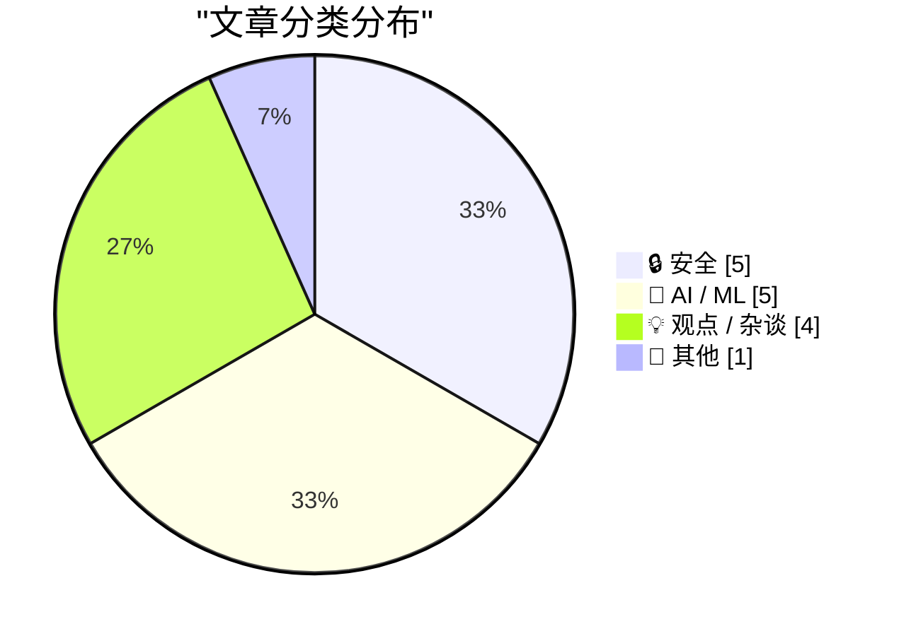
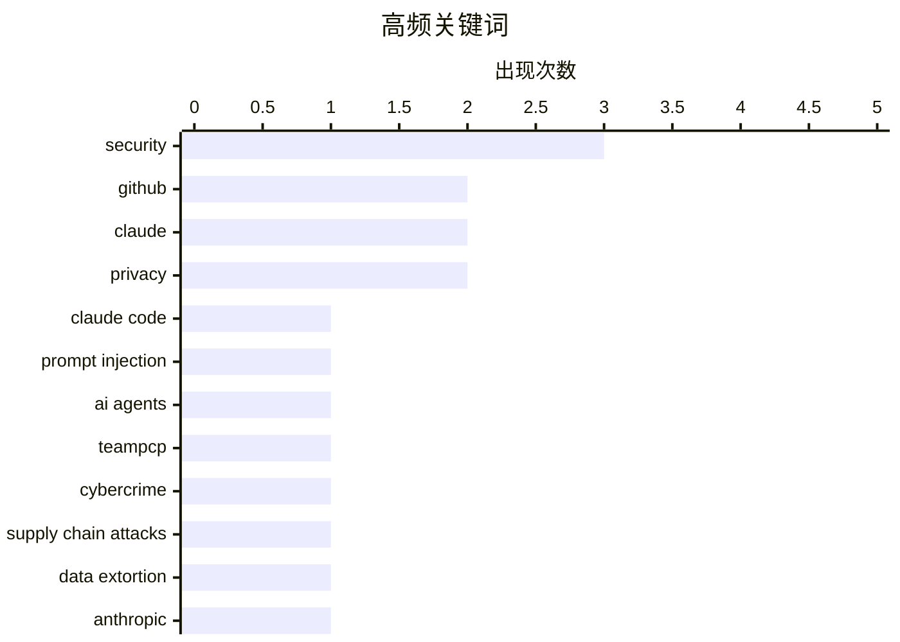

# 📰 Aug 29, 2026

> 来自 Karpathy 推荐的 92 个顶级技术博客，AI 精选 Top 15

## 📝 今日看点

今日技术圈的主线是，AI 编码代理正从“能干活”迈向“可控地干活”：自动风险判断、隔离沙箱与提示注入防护成为部署前提。与此同时，漏洞披露到攻击利用的窗口继续压缩，软件供应链安全和执法追踪都在加速，防御必须前置到开发流程。AI 的竞争也延伸到政策与基础设施层面，从军用安全边界之争到国产硬件承载大模型，模型能力正与治理能力、部署自主性深度绑定。

---

## 🏆 今日必读

🥇 **攻破 Claude Code Opus 5 自动模式**

[Breaking Claude Code Opus 5 Auto Mode](https://simonwillison.net/2026/Aug/27/breaking-claude-code-opus-5-auto-mode/) — simonwillison.net · 1 天前 · 🔒 安全

> Anthropic 将 Claude Code 的 Auto Mode 设为默认模式，并将其作为抵御提示注入攻击的重要安全机制。该模式试图自动判断编码代理执行工具调用和访问外部内容时的风险，以减少恶意提示对代理行为的操控。安全研究员 Johann Rehberger 对 Opus 5 Auto Mode 进行了针对性测试，展示了攻击者仍可借助间接提示注入影响代理决策。问题的关键在于，代理必须处理不可信代码、文档和网页内容，而自动化风险判定可能被上下文包装或任务链条绕过。作者借此质疑仅依赖“自动模式”能否为高权限编码代理提供足够强的安全边界。结论是，提示注入防护不能替代最小权限、人工确认和隔离执行环境等纵深防御措施。

💡 **为什么值得读**: 这篇内容提供了对主流 AI 编码代理默认安全机制的真实攻防检验，适合评估是否能在生产环境中信任 Auto Mode。

🏷️ Claude Code, prompt injection, AI agents, security

🥈 **两名涉嫌“TeamPCP”的黑客在澳大利亚被捕**

[Two Alleged ‘TeamPCP’ Hackers Arrested in Australia](https://krebsonsecurity.com/2026/08/two-alleged-teampcp-hackers-arrested-in-australia/) — krebsonsecurity.com · 1 天前 · 🔒 安全

> 澳大利亚执法部门逮捕了两名涉嫌属于 TeamPCP 的男子，该组织被指与长期软件供应链攻击和数据勒索活动有关。澳大利亚联邦警察称，两名来自西澳大利亚州、年龄分别为 21 岁和 23 岁的嫌疑人涉嫌参与一个复杂网络犯罪团伙。该团伙被控创建恶意开源软件包，并通过这些依赖项窃取数千名受害者的数据或资产。案件凸显开源生态中的供应链风险已从单次投毒发展为可持续、规模化的犯罪模式。执法行动表明，对恶意包维护者和供应链攻击基础设施的追踪正成为打击数据勒索的重要方向。

💡 **为什么值得读**: 这是理解现实开源供应链威胁如何运作、以及执法部门如何追查攻击团伙的高价值案例。

🏷️ TeamPCP, cybercrime, supply chain attacks, data extortion

🥉 **美国法官阻止特朗普国防部将 Anthropic 列入黑名单**

[U.S. Judge Blocks Trump Defense Department’s Anthropic Blacklisting](https://www.reuters.com/legal/government/us-judge-blocks-pentagons-anthropic-blacklisting-2026-08-28/) — daringfireball.net · 1 天前 · 🤖 AI / ML

> 美国联邦法官暂时阻止五角大楼将 Anthropic 列为国家安全供应链风险企业。该争议源于 Anthropic 与美国军方围绕战场 AI 安全要求的冲突，国防部长 Pete Hegseth 对该公司的风险认定可能限制其获得政府合同。Anthropic 在加州联邦法院起诉称，该认定超出了国防部长的法定权限。供应链风险标签通常用于处理可能使军事系统遭受渗透或破坏的企业，因此其适用标准直接影响 AI 供应商的政府市场准入。法院的禁令意味着，在实体争议得到裁决前，政府不能据此立即实施对 Anthropic 的排除措施。

💡 **为什么值得读**: 案件处在 AI 安全治理、国防采购权力和商业模型供应之间的交叉点，对关注 AI 政策的人具有直接参考价值。

🏷️ Anthropic, AI safety, Pentagon, litigation

---

## 📊 数据概览

| 扫描源 | 抓取文章 | 时间范围 | 精选 |
|:---:|:---:|:---:|:---:|
| 84/92 | 2548 篇 → 41 篇 | 48h | **15 篇** |

### 分类分布



### 高频关键词



<details>
<summary>📈 纯文本关键词图（终端友好）</summary>

```
security             │ ████████████████████ 3
github               │ █████████████░░░░░░░ 2
claude               │ █████████████░░░░░░░ 2
privacy              │ █████████████░░░░░░░ 2
claude code          │ ███████░░░░░░░░░░░░░ 1
prompt injection     │ ███████░░░░░░░░░░░░░ 1
ai agents            │ ███████░░░░░░░░░░░░░ 1
teampcp              │ ███████░░░░░░░░░░░░░ 1
cybercrime           │ ███████░░░░░░░░░░░░░ 1
supply chain attacks │ ███████░░░░░░░░░░░░░ 1
```

</details>

### 🏷️ 话题标签

**security**(3) · **github**(2) · **claude**(2) · privacy(2) · claude code(1) · prompt injection(1) · ai agents(1) · teampcp(1) · cybercrime(1) · supply chain attacks(1) · data extortion(1) · anthropic(1) · ai safety(1) · pentagon(1) · litigation(1) · coding agents(1) · sandboxing(1) · exploits(1) · ocaml(1) · vulnerability(1)

---

## 🔒 安全

### 1. 攻破 Claude Code Opus 5 自动模式

[Breaking Claude Code Opus 5 Auto Mode](https://simonwillison.net/2026/Aug/27/breaking-claude-code-opus-5-auto-mode/) — **simonwillison.net** · 1 天前 · ⭐ 27/30

> Anthropic 将 Claude Code 的 Auto Mode 设为默认模式，并将其作为抵御提示注入攻击的重要安全机制。该模式试图自动判断编码代理执行工具调用和访问外部内容时的风险，以减少恶意提示对代理行为的操控。安全研究员 Johann Rehberger 对 Opus 5 Auto Mode 进行了针对性测试，展示了攻击者仍可借助间接提示注入影响代理决策。问题的关键在于，代理必须处理不可信代码、文档和网页内容，而自动化风险判定可能被上下文包装或任务链条绕过。作者借此质疑仅依赖“自动模式”能否为高权限编码代理提供足够强的安全边界。结论是，提示注入防护不能替代最小权限、人工确认和隔离执行环境等纵深防御措施。

🏷️ Claude Code, prompt injection, AI agents, security

---

### 2. 两名涉嫌“TeamPCP”的黑客在澳大利亚被捕

[Two Alleged ‘TeamPCP’ Hackers Arrested in Australia](https://krebsonsecurity.com/2026/08/two-alleged-teampcp-hackers-arrested-in-australia/) — **krebsonsecurity.com** · 1 天前 · ⭐ 27/30

> 澳大利亚执法部门逮捕了两名涉嫌属于 TeamPCP 的男子，该组织被指与长期软件供应链攻击和数据勒索活动有关。澳大利亚联邦警察称，两名来自西澳大利亚州、年龄分别为 21 岁和 23 岁的嫌疑人涉嫌参与一个复杂网络犯罪团伙。该团伙被控创建恶意开源软件包，并通过这些依赖项窃取数千名受害者的数据或资产。案件凸显开源生态中的供应链风险已从单次投毒发展为可持续、规模化的犯罪模式。执法行动表明，对恶意包维护者和供应链攻击基础设施的追踪正成为打击数据勒索的重要方向。

🏷️ TeamPCP, cybercrime, supply chain attacks, data extortion

---

### 3. 为编码代理构建沙箱

[Sandboxing coding agents](https://micahflee.com/sandboxing-coding-agents/) — **micahflee.com** · 1 天前 · ⭐ 26/30

> 文章聚焦如何让编码代理在不接触开发者完整本机环境和全部私有资源的前提下完成实际开发任务。核心方案是为每个代理提供隔离沙箱，使其只能访问一个独立的 GitHub 仓库及完成任务所需的有限凭据。隔离范围应覆盖代码库、文件系统、网络访问、GitHub 权限和密钥，避免提示注入或代理误操作外溢到其他项目。代理产出的代码通过常规的提交、拉取请求和人工审查流程进入主仓库，而不是直接取得高权限写入能力。作者主张，安全使用编码代理的基础不是假设模型可靠，而是设计即使模型被诱导也难以造成严重后果的运行环境。

🏷️ coding agents, sandboxing, GitHub, security

---

### 4. 如今只要有漏洞传闻，就足以找到安全利用方法

[Just a rumour of a bug is enough to find a security exploit these days](https://simonwillison.net/2026/Aug/28/just-a-rumour-of-a-bug/) — **simonwillison.net** · 7 小时前 · ⭐ 25/30

> 剑桥大学计算机科学教授、OCaml 编译器核心维护者 Anil Madhavapeddy 观察到，OCaml 项目的安全补丁刚被公开讨论，攻击尝试就可能在数分钟内出现。过去从漏洞披露到实际利用通常需要数天时间，但自动化扫描、代码差异分析和 AI 辅助研究正在显著压缩这一窗口。攻击者即使不知道完整漏洞细节，也能从补丁讨论、提交记录或模糊传闻中定位可疑变更并快速构造利用。这个现象要求维护者重新评估公开修复流程中“先讨论、后发布”的风险，以及补丁发布与部署之间的时间差。核心结论是，漏洞信息传播速度已接近自动化利用速度，防御方必须把修复部署和暴露面收缩做得更快。

🏷️ security, exploits, OCaml, vulnerability

---

### 5. 新的情报与安全服务法：它们现在已经能做什么，又是为了什么

[Nieuwe wet Inlichtingen- en veiligheidsdiensten: wat mogen ze nu al en waar zijn ze voor](https://berthub.eu/articles/posts/geheime-veiligheids-en-inlichtingendiensten/) — **berthub.eu** · 1 天前 · ⭐ 23/30

> 荷兰政府将提交新的 AIVD 和 MIVD 法案，文章认为即使具体条文尚未公开，也必须对其扩张情报机关权限保持高度审查。AIVD 和 MIVD 分别是荷兰的国家安全与军事情报机构，涉及对通信和大规模数据的收集与分析。作者援引近期事件指出，这些机构曾错误逮捕无辜对象、就俄罗斯入侵乌克兰提供不准确信息，并被曝对大量公民数据处理粗疏。文章因此将新法置于既有监督失灵和情报可靠性问题的背景中，追问更强监控权究竟能否带来相应的公共安全收益。核心立场是，权限扩大必须伴随可验证的必要性、比例原则和有效监督，而不能只依赖安全机构自身承诺。

🏷️ surveillance, AIVD, MIVD, privacy

---

## 🤖 AI / ML

### 6. 美国法官阻止特朗普国防部将 Anthropic 列入黑名单

[U.S. Judge Blocks Trump Defense Department’s Anthropic Blacklisting](https://www.reuters.com/legal/government/us-judge-blocks-pentagons-anthropic-blacklisting-2026-08-28/) — **daringfireball.net** · 1 天前 · ⭐ 27/30

> 美国联邦法官暂时阻止五角大楼将 Anthropic 列为国家安全供应链风险企业。该争议源于 Anthropic 与美国军方围绕战场 AI 安全要求的冲突，国防部长 Pete Hegseth 对该公司的风险认定可能限制其获得政府合同。Anthropic 在加州联邦法院起诉称，该认定超出了国防部长的法定权限。供应链风险标签通常用于处理可能使军事系统遭受渗透或破坏的企业，因此其适用标准直接影响 AI 供应商的政府市场准入。法院的禁令意味着，在实体争议得到裁决前，政府不能据此立即实施对 Anthropic 的排除措施。

🏷️ Anthropic, AI safety, Pentagon, litigation

---

### 7. Claude 的承重词汇

[The Load-Bearing Vocabulary of Claude](https://louisabraham.github.io/load-bearing/) — **daringfireball.net** · 1 天前 · ⭐ 24/30

> Louis Abraham 通过分析 GitHub 拉取请求描述，研究 Claude 在编写文本时出现的高度重复语言模式。数据按常用词汇而非任务内容聚类后，呈现出八种稳定的写作模板，几乎每条描述都可归入其中一种。2025 年初只占语料库 1.0% 的某一类表达，到 2026 年年中已增长至 45%。这种集中化表明，模型输出中的固定措辞会在大规模使用后形成可识别的“语言指纹”，并逐渐改变开源协作文本的风格。项目的结论并非只是在嘲讽模型文风，而是指出生成式 AI 正在以可量化的方式压缩书面表达的多样性。

🏷️ Claude, GitHub, language analysis, AI writing

---

### 8. 为什么 OpenAI 的 GPT-2 权重胜过我的？第四部分：深入研究 Dropout

[Why do OpenAI's GPT-2 weights beat mine?  Part four: digging into dropout](https://www.gilesthomas.com/2026/08/why-do-openai-gpt2-weights-beat-mine-4-ift-dropout) — **gilesthomas.com** · 1 天前 · ⭐ 24/30

> 作者持续调查一个训练异常：自训模型在测试集 loss 上已能超过 OpenAI 的 GPT-2 small 权重，但在指令微调测试中表现仍然较差。第四部分把排查重点放在 dropout，因为训练时的随机失活会影响表征学习、泛化能力以及后续 instruction fine-tuning 的适应性。作者在阅读 Switch Transformers 等资料后，重新审视 GPT-2 训练配置中 dropout 的位置、概率和训练阶段作用，而不是只把 test loss 当成模型质量的充分指标。该实验路线试图解释预训练指标与下游指令能力之间的脱节，并通过对照配置寻找可复现的原因。核心观点是，复刻语言模型不能只对齐参数规模和损失函数，训练随机性与正则化细节同样可能决定模型是否具备可用的后训练能力。

🏷️ GPT-2, dropout, language models, training

---

### 9. GLM-5.3 Flash 运行在中国硬件上实际意味着什么

[What GLM-5.3 Flash running on Chinese hardware actually means](https://martinalderson.com/posts/glm-5-3-flash-chinese-hardware/?utm_source=rss&amp;utm_medium=rss&amp;utm_campaign=feed) — **martinalderson.com** · 5 小时前 · ⭐ 24/30

> Z.AI 发布了一个完整模型版本，并宣称 GLM-5.3 Flash 可在中国国产芯片上运行。作者认为，这证明中国本土 AI 硬件和软件栈已经具备支持模型发布与推理部署的实际能力，不能简单视为演示性质的成果。但文章同时指出，EUV 光刻仍是先进制程难以跨越的关键限制，影响芯片晶体管密度、能效和高端制造能力。由于这一制造约束，国产硬件与西方领先推理硬件之间的差距未必会缩小，反而可能继续扩大。结论是，能运行完整模型是重要的供应链和部署里程碑，但不应被误读为已在高端推理性能或制造能力上实现追平。

🏷️ GLM-5.3 Flash, Chinese chips, inference hardware, EUV lithography

---

### 10. 反对者的循环融资指南（第一部分）

[Premium: The Hater's Guide To Circular Financing (Part One)](https://www.wheresyoured.at/premium-the-haters-guide-to-circular-financing-part-one/) — **wheresyoured.at** · 13 小时前 · ⭐ 23/30

> 文章以讽刺性的 NVIDIA 公司全员会场景开篇，讨论 AI 产业中被称为“循环融资”的资本与收入关系。NVIDIA 向大型 AI 实验室销售高价 GPU，而这些实验室的融资、采购承诺、云服务合作与模型收入预期可能彼此交织。作者借 Jensen Huang、OpenAI 和 Anthropic 等行业角色，质疑这类交易是否会把供应商收入、投资估值和客户支出包装成可持续增长。核心问题并非 GPU 或 AI 产品本身，而是资本在产业链内循环时，市场如何区分真实终端需求与由融资推动的需求。文章倾向于认为，AI 热潮的财务叙事需要被更严格地审视，尤其是其收入质量和风险传导。

🏷️ NVIDIA, AI funding, GPUs, circular financing

---

## 💡 观点 / 杂谈

### 11. 向现实妥协

[Selling out](https://seangoedecke.com/selling-out/) — **seangoedecke.com** · 1 天前 · ⭐ 23/30

> 文章反思“sell out”在现代职业环境中的含义，认为在大型组织中取得影响力并非只是放弃原则。作者指出，要让自己的技术判断真正落地，既需要扎实的工程能力，也需要理解组织的权力结构、决策机制和实际优先级。坚持个人完整性不等于拒绝一切妥协，因为许多有价值的改变只能通过预算、协作、管理链条和长期信任来实现。文章将职业发展视为一种在价值观与组织现实之间持续校准的能力，而不是单纯追求独立性或服从性。核心观点是，技术人员若想扩大实际影响，应学会在不放弃底线的前提下参与并驾驭组织运作。

🏷️ engineering, career, ethics, technical skill

---

### 12. 欧洲如何扼杀创客和微型创业者

[‘How Europe Is Killing Makers and Micro-Entrepreneurs’](https://lectronz.com/u/lectronz/articles/how-europe-is-killing-makers-and-micro-entrepreneurs) — **daringfireball.net** · 1 天前 · ⭐ 23/30

> Lectronz 创始人 Alain Pannetrat 指出，欧洲的监管环境正在对开源硬件创客、独立电子设计师和微型卖家形成不成比例的压力。Lectronz 的卖家多数并非工厂或融资充足的创业公司，而是在车库、备用房间或小型工作室制作 DIY 电子产品的个人。有人依靠产品维生，也有人每年只卖出少量电路板，或仅生产 10 件产品分享自己的设计。文章的核心担忧是，面向大型企业设计的合规、责任和行政要求，会让这些低规模生产者难以继续参与市场。作者认为，欧洲若忽视小型制造者的现实能力，最终会损害开源硬件生态和基层创新。

🏷️ open-source hardware, micro-entrepreneurs, Europe, regulation

---

### 13. 我是那个把古董书扫描进公司永不满足的 AI 平台后再毁掉它们的人

[‘I’m the Guy Who Destroys Antique Books After We Scan Them Into Our Company’s Insatiable AI Platform’](https://www.mcsweeneys.net/articles/im-the-guy-who-destroys-antique-books-after-we-scan-them-into-our-companys-insatiable-ai-platform) — **daringfireball.net** · 7 小时前 · ⭐ 22/30

> 这是一篇 McSweeney's 讽刺作品，以一名员工的第一人称描述公司将古董书数字化后销毁的流程。书籍先被切除书脊、拆散页面，再通过大型扫描设备输入计算机，使 AI 吸收其中的文字并生成内容。叙述者负责处理扫描后残缺不全的实体书，并把“人性化环节”荒诞地定义为使用工业碎纸机。作品把 AI 训练数据采集的效率逻辑推至极端，讽刺企业为了构建“永不满足”的 AI 平台而忽视文化遗产、保存伦理和实体书价值。其核心批评是，技术公司的规模化数据欲望可能将不可替代的文化对象降格为一次性原料。

🏷️ AI, book scanning, content destruction, satire

---

### 14. 能动性洗白的艺术

[The Art of Agency Laundering](https://www.joanwestenberg.com/p/the-art-of-agency-laundering) — **joanwestenberg.com** · 1 天前 · ⭐ 22/30

> 文章以“委员会、加密货币与 Claude”为线索，讨论个人或组织如何借助系统、流程和 AI 工具来稀释自身决策责任。所谓“能动性洗白”，是把本应由人承担的选择包装成委员会共识、市场机制、算法输出或自动化系统的必然结果。委员会能够让责任分散到集体决议中，加密货币叙事常将权力关系表述为去中心化的代码规则，而 Claude 等生成式 AI 则可能被用来为既有决定提供看似中立的语言和判断。文章关注的不是这些工具是否拥有真正自主性，而是人类如何借其权威感回避“是谁作出决定、谁应负责”的追问。作者的核心观点是，技术和程序不会消除人的能动性，反而可能成为隐藏它的有效手段。

🏷️ AI agency, committees, Claude

---

## 📝 其他

### 15. Apple 地图广告现已上线

[Ads in Apple Maps Have Now Launched](https://9to5mac.com/2026/08/25/apple-maps-launches-ads-on-iphone-heres-whats-new/) — **daringfireball.net** · 1 天前 · ⭐ 23/30

> Apple 已向 9to5Mac 确认，Apple 地图中的广告已在 iPhone 端开始推出，并将在未来数周逐步覆盖所有用户。广告会出现在两个位置：搜索前的“推荐地点”页面，以及用户执行搜索后的相关搜索结果中。报道示例显示，“推荐地点”可展示距离用户 12 英里的 HVAC 承包商广告，说明广告并不一定仅限于附近的自然推荐结果。该变化将 Apple 地图从以原生地点搜索为主的产品，转向包含付费曝光位的本地商业发现渠道。结论是，地图广告上线将改变用户发现商家和商家获取本地流量的方式，其相关性、标注和干扰程度将决定实际体验。

🏷️ Apple Maps, advertising, privacy, monetization

---

*生成于 2026-08-29 05:24 | 扫描 84 源 → 获取 2548 篇 → 精选 15 篇*
*基于 [Hacker News Popularity Contest 2025](https://refactoringenglish.com/tools/hn-popularity/) RSS 源列表，由 [Andrej Karpathy](https://x.com/karpathy) 推荐*
