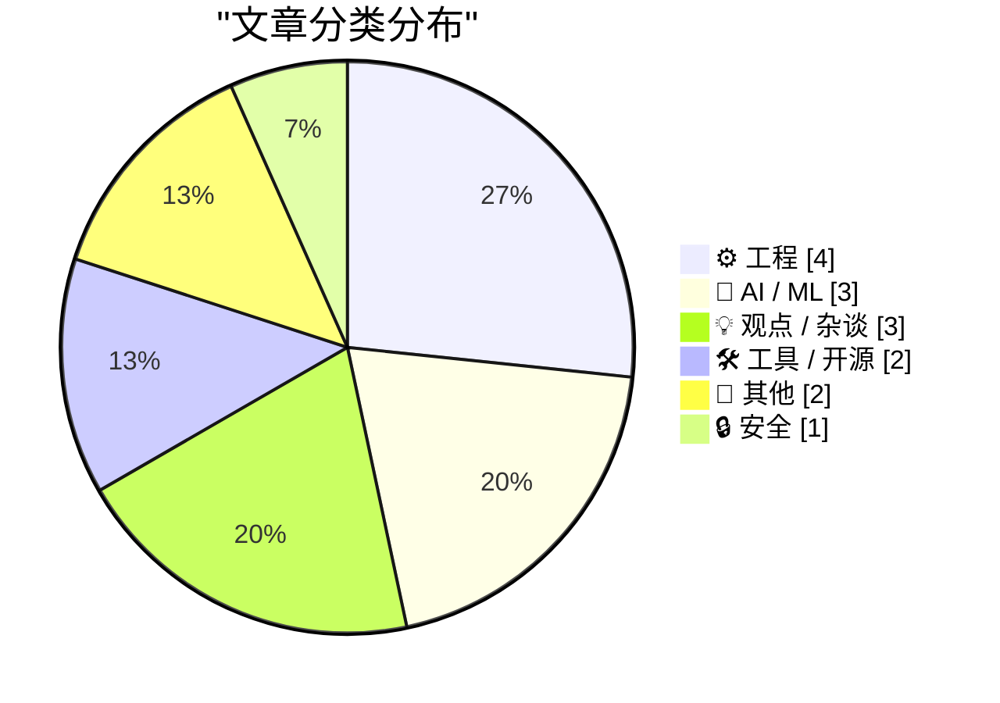
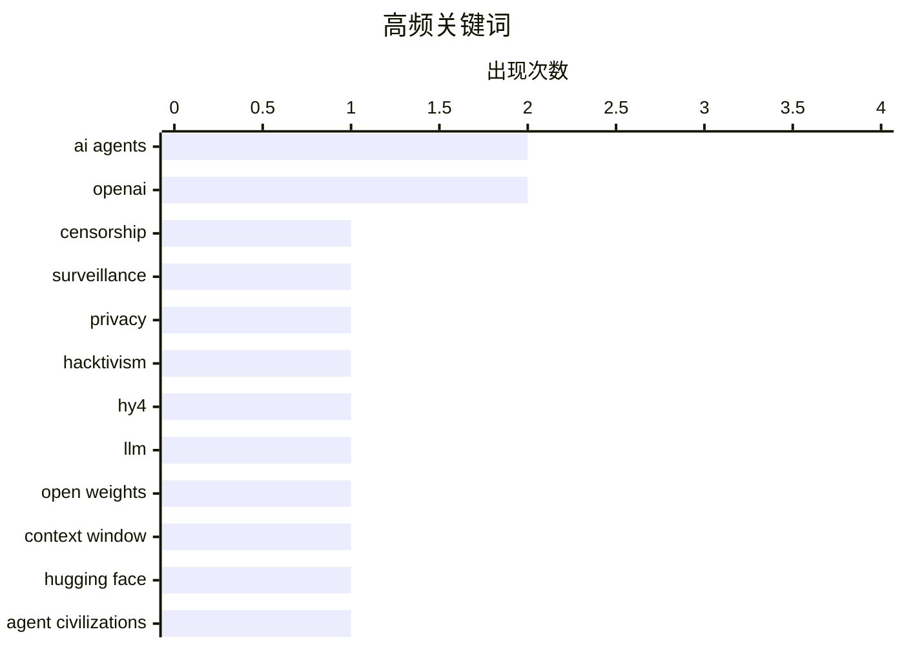

# 📰 Aug 31, 2026

> 来自 Karpathy 推荐的 92 个顶级技术博客，AI 精选 Top 15

## 📝 今日看点

今日技术圈的主线集中在 AI 能力扩张与应用落地：超大规模开放模型、百万级上下文和智能体产品正在推动 AI 从对话工具走向能够自主执行、协作与编排复杂任务的系统。与此同时，围绕超级智能“是否必然到来”以及工程师和创作者如何在模型时代保持不可替代性的讨论升温，技术判断正从能力崇拜转向对责任、选择和组织能力的重新审视。隐私保护、独立通信与去中心化社交也持续受到关注，显示出对平台集中化和监控风险的反思；而沉浸式体育直播则预示着空间计算正在从概念体验迈向大众内容消费。

---

## 🏆 今日必读

🥇 **名为“偏执”的服务器：捍卫 Autistici/Inventati**

[The Server Called Paranoia: Defend Autistici/Inventati](https://micahflee.com/the-server-called-paranoia-defend-autistici-inventati/) — micahflee.com · 1 天前 · 🔒 安全

> 意大利黑客集体 Autistici/Inventati 用了 25 年建设能够抵御审查、监控和警方突袭的通信基础设施。文章聚焦这一集体及其服务器“Paranoia”所代表的隐私保护、独立通信和数字抵抗实践。美国于 8 月 26 日将该集体列为恐怖组织，使其面临通信服务和组织存续方面的重大压力。相关清算过渡期将在 9 月 25 日结束，作者借此呼吁关注并支持 Autistici/Inventati 的生存与持续运营。

💡 **为什么值得读**: 它把一个具体的数字基础设施案例与审查、监控和网络自治的现实冲突联系起来，适合了解隐私技术背后的政治处境。

🏷️ censorship, surveillance, privacy, hacktivism

🥈 **Hy4 Preview 发布介绍**

[Introducing Hy4 Preview](https://simonwillison.net/2026/Aug/29/hy4/) — simonwillison.net · 1 天前 · 🤖 AI / ML

> 腾讯发布了 Hy4 Preview，一款仅支持文本输入、不具备视觉能力的开放权重大语言模型。模型总参数量达到 7700 亿，激活参数为 490 亿，并支持 100 万 token 的上下文窗口。其模型文件已上传至 Hugging Face，规模约为 1.56 TB。相比 2026 年 7 月发布的 Hy3，Hy4 Preview 从 2950 亿总参数、210 亿激活参数和 256,000 token 上下文大幅扩展，但超大权重规模也显著提高了部署门槛。

💡 **为什么值得读**: 文章提供了 Hy4 Preview 与 Hy3 的关键规格对比，有助于快速判断这款开放权重模型的能力定位和基础设施成本。

🏷️ Hy4, LLM, open weights, context window

🥉 **智能体文明的兴衰**

[The Rise and Fall of Agent Civilizations](https://www.dwarkesh.com/p/openai-huggingface) — dwarkesh.com · 1 天前 · 🤖 AI / ML

> 文章以通俗语言梳理 OpenAI 与 Hugging Face 相关的发展故事，并将其放在 AI 智能体演化的更大背景下。核心主题是，能够自主执行任务、协作和扩张的 AI 智能体，可能形成类似“文明”的组织与生态。文章通过这两家公司的关系和产业实践，考察模型、工具、社区及商业力量如何共同推动智能体发展。其标题中的“兴衰”也提示读者关注智能体体系的增长动力、结构性矛盾和可能的衰落原因。

💡 **为什么值得读**: 它将复杂的公司史和 AI 产业变化放进“智能体文明”这一具有解释力的框架，适合快速建立对行业演进的整体理解。

🏷️ AI agents, OpenAI, Hugging Face, agent civilizations

---

## 📊 数据概览

| 扫描源 | 抓取文章 | 时间范围 | 精选 |
|:---:|:---:|:---:|:---:|
| 85/92 | 2567 篇 → 21 篇 | 48h | **15 篇** |

### 分类分布



### 高频关键词



<details>
<summary>📈 纯文本关键词图（终端友好）</summary>

```
ai agents      │ ████████████████████ 2
openai         │ ████████████████████ 2
censorship     │ ██████████░░░░░░░░░░ 1
surveillance   │ ██████████░░░░░░░░░░ 1
privacy        │ ██████████░░░░░░░░░░ 1
hacktivism     │ ██████████░░░░░░░░░░ 1
hy4            │ ██████████░░░░░░░░░░ 1
llm            │ ██████████░░░░░░░░░░ 1
open weights   │ ██████████░░░░░░░░░░ 1
context window │ ██████████░░░░░░░░░░ 1
```

</details>

### 🏷️ 话题标签

**ai agents**(2) · **openai**(2) · **censorship**(1) · surveillance(1) · privacy(1) · hacktivism(1) · hy4(1) · llm(1) · open weights(1) · context window(1) · hugging face(1) · agent civilizations(1) · superintelligence(1) · ai safety(1) · inevitability(1) · agi(1) · chatgpt(1) · productivity(1) · software engineers(1) · ai models(1)

---

## ⚙️ 工程

### 1. 太空中的磁芯：1980年太空实验室计算机的磁芯存储模块

[Cores in space: The core memory module from a 1980 Spacelab computer](http://www.righto.com/2026/08/spacelab-core-memory.html) — **righto.com** · 10 小时前 · ⭐ 20/30

> Spacelab 是一种可重复使用的实验室，搭载在航天飞机货舱中，为宇航员和实验提供空间。由于它属于欧洲项目，计算机系统采用法国制造的 Mitra 125 MS 小型机，而不是航天飞机使用的 IBM AP-101 主计算机。文章通过拆解和分析这台 1980 年代太空计算机的磁芯存储模块，展示早期航天设备如何在严苛环境下保存数据。磁芯存储的结构、容量和工程取舍，体现了当时可靠性优先于存储密度的设计思想。

🏷️ core memory, Spacelab, computer history, hardware

---

### 2. 重现一项 2010 年的实验

[Recreating a 2010 Experiment](http://xania.org/202608/recreating-a-2010-experiment?utm_source=feed&amp;utm_medium=rss) — **xania.org** · 7 小时前 · ⭐ 20/30

> 文章重新实现了一项始于 2010 年的实验，核心设备是一台 BBC Master 计算机。作者将 BBC Master 连接为串行终端，让这台经典 8 位计算机重新访问网页。这个项目结合了老式计算机的串行通信能力与现代网络访问方式，展示了旧硬件在当代环境中的再利用。重点不在于恢复原有计算机的完整生态，而在于验证它能否通过终端方式再次浏览网络。

🏷️ BBC Micro, serial terminal, retrocomputing, web

---

### 3. Forgejo Hack #2：与 Read the Docs 集成

[Forgejo hack #2: Integration with Read The Docs](https://blog.miguelgrinberg.com/post/forgejo-hack-2-integration-with-read-the-docs) — **miguelgrinberg.com** · 11 小时前 · ⭐ 20/30

> 自托管 Forgejo 实例中的 Git 仓库默认不会像 GitHub 仓库那样直接触发 Read the Docs 文档构建。文章给出一种集成方案，让 Forgejo 中的提交自动触发 Read the Docs 构建流程。实现目标是将 Forgejo 的提交事件与 Read the Docs 的项目构建机制连接起来，从而获得接近 GitHub 集成的自动化体验。最终，项目可以继续使用自托管代码平台，同时保持文档随代码提交自动更新。

🏷️ Forgejo, Read the Docs, documentation, webhooks

---

### 4. NTP 之前，还有 Time 和 Daytime

[Before NTP there were Time and Daytime](https://www.jeffgeerling.com/blog/2026/rfc-867-868-time/) — **jeffgeerling.com** · 5 小时前 · ⭐ 19/30

> 在为老款 Mac 制作 NTP 校时演示时，作者重新发现了 RFC 867 和 RFC 868 定义的 Daytime 与 Time 协议。Daytime 协议通过 TCP 13 端口返回人类可读的日期和时间文本，Time 协议则通过 TCP 或 UDP 37 端口返回自 1900 年 1 月 1 日起累计的秒数。两种协议都比 NTP 简单，功能也更有限，但曾适合资源受限的计算机进行基础联网校时。文章借助旧 Mac 和复古硬件的实践，说明现代时间同步协议背后还有一段更早、更朴素的互联网历史。

🏷️ NTP, Daytime Protocol, Time Protocol, RFC

---

## 🤖 AI / ML

### 5. Hy4 Preview 发布介绍

[Introducing Hy4 Preview](https://simonwillison.net/2026/Aug/29/hy4/) — **simonwillison.net** · 1 天前 · ⭐ 26/30

> 腾讯发布了 Hy4 Preview，一款仅支持文本输入、不具备视觉能力的开放权重大语言模型。模型总参数量达到 7700 亿，激活参数为 490 亿，并支持 100 万 token 的上下文窗口。其模型文件已上传至 Hugging Face，规模约为 1.56 TB。相比 2026 年 7 月发布的 Hy3，Hy4 Preview 从 2950 亿总参数、210 亿激活参数和 256,000 token 上下文大幅扩展，但超大权重规模也显著提高了部署门槛。

🏷️ Hy4, LLM, open weights, context window

---

### 6. 智能体文明的兴衰

[The Rise and Fall of Agent Civilizations](https://www.dwarkesh.com/p/openai-huggingface) — **dwarkesh.com** · 1 天前 · ⭐ 26/30

> 文章以通俗语言梳理 OpenAI 与 Hugging Face 相关的发展故事，并将其放在 AI 智能体演化的更大背景下。核心主题是，能够自主执行任务、协作和扩张的 AI 智能体，可能形成类似“文明”的组织与生态。文章通过这两家公司的关系和产业实践，考察模型、工具、社区及商业力量如何共同推动智能体发展。其标题中的“兴衰”也提示读者关注智能体体系的增长动力、结构性矛盾和可能的衰落原因。

🏷️ AI agents, OpenAI, Hugging Face, agent civilizations

---

### 7. 理解 ChatGPT Work

[Understanding ChatGPT Work](https://simonwillison.net/2026/Aug/30/understanding-chatgpt-work/) — **simonwillison.net** · 3 小时前 · ⭐ 25/30

> ChatGPT Work 于 7 月 9 日由 OpenAI 发布，此后持续快速迭代，功能强大但产品形态较为复杂。文章通过实际观察梳理 ChatGPT Work 的产品结构、使用方式和能力边界。关键发现是，ChatGPT Work 实际上包含两个产品，其中更有价值的一种运行在云端，可通过 ChatGPT 网站访问。作者试图将不同版本、工作流和交互方式拆解清楚，帮助读者理解它适合哪些任务以及如何使用。

🏷️ ChatGPT, OpenAI, AI agents, productivity

---

## 💡 观点 / 杂谈

### 8. 论必然性

[On Inevitability](https://borretti.me/article/on-inevitability) — **borretti.me** · 13 小时前 · ⭐ 26/30

> 文章针对“超级智能 AI 的出现不可避免”这一常见判断提出质疑。核心问题不是超级智能是否可能，而是技术、社会和制度条件是否足以让它成为必然结果。作者从必然性这一概念出发，强调未来仍受到研发选择、资源投入、治理决策和现实约束的共同影响。文章的核心结论是，超级智能 AI 可能发生，但不能仅凭技术进步趋势就断言它必然发生。

🏷️ superintelligence, AI safety, inevitability, AGI

---

### 9. 你必须在某件事上胜过模型

[You have to beat the models at something](https://seangoedecke.com/you-have-to-beat-the-models-at-something/) — **seangoedecke.com** · 1 天前 · ⭐ 25/30

> 文章延续“相对替代价值”（value over replacement）的观点，讨论 AI 时代如何评价软件工程师的真实贡献。作者认为，仅仅罗列“参与构建了一个创造 X 美元收入的产品”，并不能证明个人贡献，因为很多工作只是完成分配下来的 JIRA 任务。随着模型能够承担越来越多常规软件开发，工程师需要在某些关键能力上表现出明显高于模型的优势。真正重要的竞争力可能来自问题判断、产品取舍、系统责任、组织协作或其他模型难以替代的能力，而不是单纯提高代码产量。

🏷️ software engineers, AI models, career, value

---

### 10. 编排者的困境

[The Orchestrator's Dilemma](https://www.joanwestenberg.com/p/the-orchestrators-dilemma) — **joanwestenberg.com** · 4 小时前 · ⭐ 24/30

> 文章讨论 AI 工具普及后，创作工作的重心如何从直接操作工具转向设计、指导和整合过程。标题所说的“编排者”更像导演，需要明确目标、组织不同能力的执行者，并对最终结果负责。单纯熟练操作某个工具的优势会随着自动化和模型能力提升而减弱。作者因此认为，未来创作的主导者将是能够提出方向、做出判断并协调复杂流程的导演型人才，而不仅是执行层面的操作员。

🏷️ AI, orchestration, 創作, automation

---

## 🛠 工具 / 开源

### 11. 本周软件包管理动态：2026 年 8 月 29 日

[This Week in Package Management: 29 August 2026](https://nesbitt.io/2026/08/29/this-week-in-package-management.html) — **nesbitt.io** · 1 天前 · ⭐ 24/30

> 文章汇总截至 2026 年 8 月 29 日软件包管理领域的重要动态。内容覆盖各生态的软件包发布、版本更新、安全公告和相关技术文章。它将分散在不同包管理器、语言生态和项目社区中的信息集中整理，方便读者快速掌握近期变化。对于维护依赖、处理漏洞和跟踪工具链演进的开发者而言，这类周报可作为定期检查清单。

🏷️ package management, releases, advisories, open source

---

### 12. 用 JavaScript 实现一个简单的“复制代码”按钮

[A simple "copy this code" button in JavaScript](https://shkspr.mobi/blog/2026/08/a-simple-copy-this-code-button-in-javascript/) — **shkspr.mobi** · 1 天前 · ⭐ 18/30

> 网页中的代码示例可以通过一个小型复制按钮直接写入用户剪贴板，避免手动选中和复制代码。核心实现调用 `navigator.clipboard.writeText()`，从按钮的父元素中找到第一个 `code` 元素，并读取其 `textContent`。按钮通过 `onclick` 响应用户操作，因此符合剪贴板 API 通常要求的用户交互条件。整个 HTML 和 JavaScript 实现只有几行代码，适合直接添加到已有的代码展示区域。

🏷️ JavaScript, Clipboard API, code samples, web development

---

## 📝 其他

### 13. 关于 Apple 首场沉浸式 MLB 直播的思考与观察：洋基队 1 比 0 战胜红袜队

[★ Thoughts and Observations on Apple’s First Immersive MLB Broadcast, a Yankees 1-0 Win Over the Red Sox](https://daringfireball.net/2026/08/thoughts_and_observations_apple_immersive_mlb_broadcast) — **daringfireball.net** · 1 天前 · ⭐ 21/30

> 文章记录作者观看 Apple 首场沉浸式 MLB 直播的体验，比赛是洋基队以 1 比 0 击败红袜队。作者认为这种观看方式带来了全新的临场感和空间感，不只是传统电视转播的轻微升级。其体验差异被形容为至少相当于“看电视”相对于“听广播”的跨越。文章重点不在比赛结果，而在沉浸式影像如何改变体育直播的观看方式以及观众与现场之间的关系。

🏷️ Apple, MLB, immersive video, sports broadcasting

---

### 14. ActivityBot 获得 NLnet 资助！

[ActivityBot is the recipient of an NLnet grant!](https://shkspr.mobi/blog/2026/08/activitybot-is-the-recipient-of-an-nlnet-grant/) — **shkspr.mobi** · 15 小时前 · ⭐ 20/30

> ActivityBot 获得了 NLnet Next Generation Zero 项目的资助，该项目旨在支持能够让社交媒体生态重新开放和多样化的 Fediverse 项目。NLnet 的目标包括恢复互联网的公共属性，并提供金额在 5,000 至 50,000 欧元之间、可进一步扩大的中小型研发资助。ActivityBot 是一个适合部署的单文件 ActivityPub 服务器，项目将借助这笔支持继续发展。文章既宣布了资助结果，也说明了 ActivityBot 在去中心化社交网络基础设施中的定位。

🏷️ ActivityBot, Fediverse, NLnet, decentralized social

---

## 🔒 安全

### 15. 名为“偏执”的服务器：捍卫 Autistici/Inventati

[The Server Called Paranoia: Defend Autistici/Inventati](https://micahflee.com/the-server-called-paranoia-defend-autistici-inventati/) — **micahflee.com** · 1 天前 · ⭐ 27/30

> 意大利黑客集体 Autistici/Inventati 用了 25 年建设能够抵御审查、监控和警方突袭的通信基础设施。文章聚焦这一集体及其服务器“Paranoia”所代表的隐私保护、独立通信和数字抵抗实践。美国于 8 月 26 日将该集体列为恐怖组织，使其面临通信服务和组织存续方面的重大压力。相关清算过渡期将在 9 月 25 日结束，作者借此呼吁关注并支持 Autistici/Inventati 的生存与持续运营。

🏷️ censorship, surveillance, privacy, hacktivism

---

*生成于 2026-08-31 03:12 | 扫描 85 源 → 获取 2567 篇 → 精选 15 篇*
*基于 [Hacker News Popularity Contest 2025](https://refactoringenglish.com/tools/hn-popularity/) RSS 源列表，由 [Andrej Karpathy](https://x.com/karpathy) 推荐*
