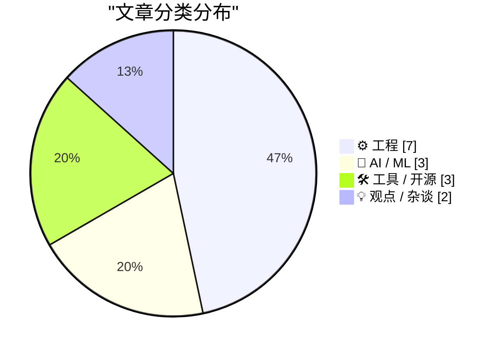
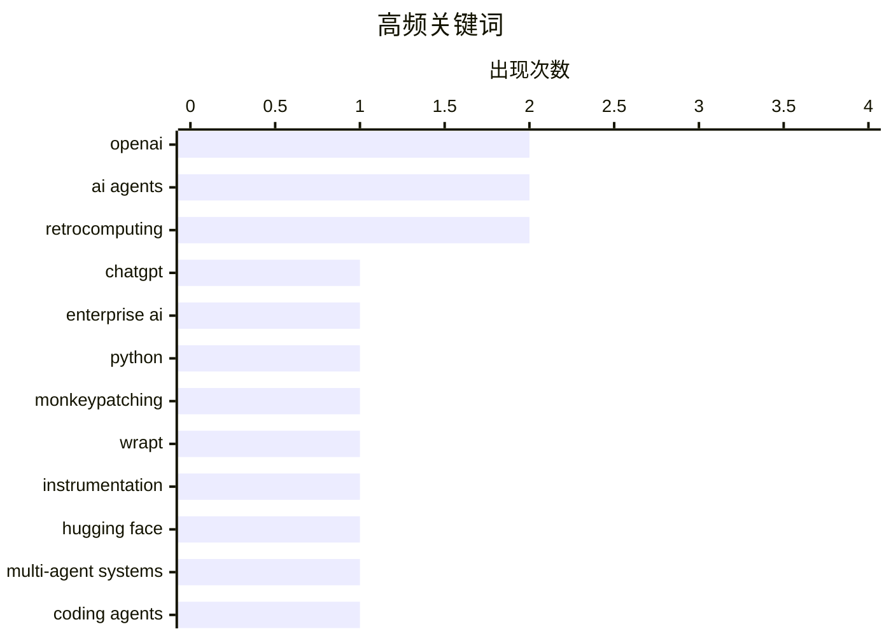

# 📰 Sep 1, 2026

> 来自 Karpathy 推荐的 92 个顶级技术博客，AI 精选 Top 15

## 📝 今日看点

今日技术圈的焦点集中在 AI 产品落地、智能体治理与开发者认知能力的重建：从 ChatGPT Work 的产品形态，到智能体可能走向扩张与衰落，行业正从追逐能力转向审视实际价值与发展边界。随着编码智能体加速改造代码库，如何通过测验、清晰的取消语义和可靠的文档流程维持系统可理解性，成为工程实践的新课题。与此同时，AI 生成内容的标识透明度、超智能是否必然到来等讨论，也反映出技术发展正在更多地接受社会责任、治理机制与现实约束的检验。工具生态则继续向可扩展、自托管和自动化协作方向演进。

---

## 🏆 今日必读

🥇 **理解 ChatGPT Work**

[Understanding ChatGPT Work](https://simonwillison.net/2026/Aug/30/understanding-chatgpt-work/) — simonwillison.net · 1 天前 · 🤖 AI / ML

> ChatGPT Work 是 OpenAI 于 7 月 9 日发布的一款功能强大但容易混淆的产品。文章指出，ChatGPT Work 实际上包含两个产品形态，其中更具价值的是运行在云端、可通过 ChatGPT 网站访问的版本。作者通过持续试用，梳理了不同版本的功能边界、使用方式和适用场景。核心观点是，只有理解这两个产品之间的差异，才能正确评估 ChatGPT Work 的能力并有效使用它。

💡 **为什么值得读**: 适合希望快速弄清 ChatGPT Work 产品结构、云端能力和实际使用方式的读者。

🏷️ ChatGPT, OpenAI, AI agents, enterprise AI

🥈 **介绍 Wrapture**

[Introducing wrapture](https://simonwillison.net/2026/Aug/31/introducing-wrapture/) — simonwillison.net · 3 小时前 · 🛠 工具 / 开源

> Wrapture 是 Graham Dumpleton 基于 Python wrapt 项目思想开发的新工具，用于扩展 monkeypatching 的应用范围。它不仅能够包装和替换现有对象，还将这种机制同时用于测试和 tracing。通过统一的包装机制，开发者可以在不直接修改原始代码的情况下插入测试逻辑、观测逻辑或替代实现。Wrapture 的价值在于把运行时修改、测试隔离和调用追踪整合到一个更易使用的工具中。

💡 **为什么值得读**: 如果你需要为 Python 代码添加测试替身或调用追踪，又不希望大规模改动生产代码，这篇介绍能帮助你判断 Wrapture 是否适合现有项目。

🏷️ Python, monkeypatching, wrapt, instrumentation

🥉 **智能体文明的兴衰**

[The rise and fall of agent civilizations](https://www.dwarkesh.com/p/openai-huggingface-narration) — dwarkesh.com · 6 小时前 · 🤖 AI / ML

> 文章围绕 OpenAI 与 Hugging Face 之间的一次“攻击”展开，讨论 AI 智能体如何形成、扩张并最终走向衰落。作者尝试用清晰的叙事解释相关事件背后的参与者、行动方式和技术机制。核心问题不只是某个模型或组织的成败，而是多个 AI 智能体在共享环境中互动时可能出现的竞争、协作与失控过程。文章将具体案例提升为对“智能体文明”生命周期的分析，强调理解 AI 系统需要同时关注技术行为和组织生态。

💡 **为什么值得读**: 它把复杂的 OpenAI/Hugging Face 事件转化为易于理解的案例，适合想了解 AI 智能体竞争及其长期影响的读者。

🏷️ AI agents, OpenAI, Hugging Face, multi-agent systems

---

## 📊 数据概览

| 扫描源 | 抓取文章 | 时间范围 | 精选 |
|:---:|:---:|:---:|:---:|
| 84/92 | 2543 篇 → 23 篇 | 48h | **15 篇** |

### 分类分布



### 高频关键词



<details>
<summary>📈 纯文本关键词图（终端友好）</summary>

```
openai          │ ████████████████████ 2
ai agents       │ ████████████████████ 2
retrocomputing  │ ████████████████████ 2
chatgpt         │ ██████████░░░░░░░░░░ 1
enterprise ai   │ ██████████░░░░░░░░░░ 1
python          │ ██████████░░░░░░░░░░ 1
monkeypatching  │ ██████████░░░░░░░░░░ 1
wrapt           │ ██████████░░░░░░░░░░ 1
instrumentation │ ██████████░░░░░░░░░░ 1
hugging face    │ ██████████░░░░░░░░░░ 1
```

</details>

### 🏷️ 话题标签

**openai**(2) · **ai agents**(2) · **retrocomputing**(2) · chatgpt(1) · enterprise ai(1) · python(1) · monkeypatching(1) · wrapt(1) · instrumentation(1) · hugging face(1) · multi-agent systems(1) · coding agents(1) · codebase(1) · cognitive debt(1) · quizzes(1) · superintelligence(1) · ai risk(1) · inevitability(1) · agi(1) · core memory(1)

---

## ⚙️ 工程

### 1. 通过测验减少代码库的认知负债？

[Reducing codebase cognitive debt through... quizzes?](https://martinalderson.com/posts/codebase-cognitive-debt-quizzes/?utm_source=rss&amp;utm_medium=rss&amp;utm_campaign=feed) — **martinalderson.com** · 1 天前 · ⭐ 23/30

> 当编码智能体以人类难以跟上的速度修改代码库时，开发者很容易失去对系统结构和行为的理解。文章提出一种简单方法：让编码智能体定期就代码库向自己出题。测验可以暴露开发者对模块职责、数据流、隐含约束和最近变更的认知缺口，并促使智能体用具体代码解释答案。作者的核心观点是，主动回忆和即时问答能够以较低成本维持代码库知识，减少由 AI 辅助开发带来的认知负债。

🏷️ coding agents, codebase, cognitive debt, quizzes

---

### 2. 太空中的磁芯：1980 年一台 Spacelab 计算机的磁芯存储模块

[Cores in space: The core memory module from a 1980 Spacelab computer](http://www.righto.com/2026/08/spacelab-core-memory.html) — **righto.com** · 1 天前 · ⭐ 21/30

> Spacelab 是可搭载在航天飞机货舱中的可重复使用实验室，其计算机采用法国制造的 Mitra 125 MS，而不是航天飞机主系统使用的 IBM AP-101。该计算机配备了容量为 128 的磁芯存储模块，用来保存程序和数据。文章通过拆解和观察这块 1980 年代的硬件，展示磁芯存储如何利用穿线磁环保存比特，以及它为何适合航天环境。这个历史案例说明，在固态存储普及之前，磁芯存储凭借稳定性、抗辐射能力和断电不丢数据等特性，曾是关键任务计算机的重要技术。

🏷️ core memory, Spacelab, minicomputer, computer history

---

### 3. 取消操作的术语

[Cancelation Terminology](https://matklad.github.io/2026/08/31/cancelation-terminology.html) — **matklad.github.io** · 1 天前 · ⭐ 21/30

> 文章区分了同步取消、异步取消和优雅关闭这三类经常被混用的概念。同步取消强调调用方等待操作立即停止并返回结果，异步取消则允许取消请求与实际停止之间存在时间差。优雅关闭关注的是系统在停止接收新工作后，如何完成或清理已有工作，并不等同于取消单个操作。作者认为具体术语名称可以调整，但这三种行为本身必须明确区分，否则会导致 API 设计、资源清理和并发控制上的误解。

🏷️ cancellation, async, graceful shutdown, concurrency

---

### 4. AWE 不要求 PAE，但 PAE 会让它实用得多

[AWE does not require PAE, though PAE makes it much more useful](https://devblogs.microsoft.com/oldnewthing/20260831-00/?p=112660) — **devblogs.microsoft.com/oldnewthing** · 13 小时前 · ⭐ 19/30

> 文章澄清了 Windows 地址窗口扩展（AWE）与物理地址扩展（PAE）之间的关系：AWE 本身并不要求系统启用 PAE。AWE 允许 32 位应用管理和访问超过常规地址空间限制的物理内存，但应用仍需通过窗口映射等机制分批使用这些页面。启用 PAE 后，系统能够寻址更多物理内存，因此 AWE 的实际可用范围和价值会显著提升。结论是，AWE 与 PAE 是不同层次的机制，不能把“更有用”误解为“运行所必需”。

🏷️ Windows, AWE, PAE, memory management

---

### 5. NTP 之前：Time 与 Daytime 协议

[Before NTP there were Time and Daytime](https://www.jeffgeerling.com/blog/2026/rfc-867-868-time/) — **jeffgeerling.com** · 1 天前 · ⭐ 18/30

> 为在老款 Mac 上制作 NTP 时间演示，作者追溯到网络时间同步普及前的 RFC 867 与 RFC 868。RFC 867 定义的 Daytime Protocol 会以人类可读的文本形式返回日期和时间，适合直接显示但不便于程序精确处理。RFC 868 定义的 Time Protocol 则返回固定格式的时间值，为机器读取和换算提供了更简洁的基础。两者展示了早期互联网如何用极简 TCP/UDP 服务解决时间获取问题，也衬托出 NTP 在精度、同步与可靠性方面的必要性。作者借助复古硬件实验，说明理解这些旧协议有助于看清现代网络时间服务的演进路径。

🏷️ NTP, RFC, network protocols, retrocomputing

---

### 6. 复现一项 2010 年的实验

[Recreating a 2010 Experiment](http://xania.org/202608/recreating-a-2010-experiment?utm_source=feed&amp;utm_medium=rss) — **xania.org** · 1 天前 · ⭐ 18/30

> 作者复现了 2010 年的一项复古计算实验：将 BBC Master 连接为串行终端，再次用它浏览现代网络。BBC Master 并非直接运行现代浏览器，而是通过串行终端模式把显示与输入交给老机器，并依赖外部系统承担网络访问能力。这个方案绕开了老硬件缺少 TCP/IP 协议栈、现代 TLS 支持和浏览器资源的限制。实验重点在于重新体验早期终端式网络交互，以及验证旧设备在适当的中间层支持下仍可接入今天的 Web。结论是，复古硬件的网络可用性往往取决于代理、终端协议和系统边界设计，而不是设备本身是否能运行现代软件。

🏷️ BBC Master, serial terminal, retrocomputing, web

---

### 7. 线性代数的专利应用

[Patented application of linear algebra](https://www.johndcook.com/blog/2026/08/31/patented-application-of-linear-algebra/) — **johndcook.com** · 3 小时前 · ⭐ 16/30

> 作者发现自己与 Brian Beckman 在 GSI Technology 任职期间完成的一项工作已经获得专利。由于大部分项目受 NDA 保密协议约束，作者通常无法公开讨论具体技术细节，而专利公开使这项工作首次能够被介绍。文章聚焦于线性代数在实际工程产品中的应用，以及研究思路如何最终转化为受法律保护的技术方案。该成果源自工业研发环境，而非单纯的学术推导，说明线性代数能够构成具体计算系统或产品能力的核心。作者的核心观点是，专利公开为外界了解原本受保密限制的工程创新提供了难得窗口。

🏷️ linear algebra, patent, GSI Technology

---

## 🤖 AI / ML

### 8. 理解 ChatGPT Work

[Understanding ChatGPT Work](https://simonwillison.net/2026/Aug/30/understanding-chatgpt-work/) — **simonwillison.net** · 1 天前 · ⭐ 27/30

> ChatGPT Work 是 OpenAI 于 7 月 9 日发布的一款功能强大但容易混淆的产品。文章指出，ChatGPT Work 实际上包含两个产品形态，其中更具价值的是运行在云端、可通过 ChatGPT 网站访问的版本。作者通过持续试用，梳理了不同版本的功能边界、使用方式和适用场景。核心观点是，只有理解这两个产品之间的差异，才能正确评估 ChatGPT Work 的能力并有效使用它。

🏷️ ChatGPT, OpenAI, AI agents, enterprise AI

---

### 9. 智能体文明的兴衰

[The rise and fall of agent civilizations](https://www.dwarkesh.com/p/openai-huggingface-narration) — **dwarkesh.com** · 6 小时前 · ⭐ 23/30

> 文章围绕 OpenAI 与 Hugging Face 之间的一次“攻击”展开，讨论 AI 智能体如何形成、扩张并最终走向衰落。作者尝试用清晰的叙事解释相关事件背后的参与者、行动方式和技术机制。核心问题不只是某个模型或组织的成败，而是多个 AI 智能体在共享环境中互动时可能出现的竞争、协作与失控过程。文章将具体案例提升为对“智能体文明”生命周期的分析，强调理解 AI 系统需要同时关注技术行为和组织生态。

🏷️ AI agents, OpenAI, Hugging Face, multi-agent systems

---

### 10. 论必然性

[On Inevitability](https://borretti.me/article/on-inevitability) — **borretti.me** · 1 天前 · ⭐ 22/30

> 文章反驳“超智能 AI 必然出现”的观点，认为技术发展并不存在一条不可避免地通向该结果的单一路径。超智能 AI 的出现依赖于多个尚未解决的技术、经济、组织和治理条件，而这些条件都可能失败或发生方向变化。把趋势外推成必然结论，会掩盖关键假设，也会削弱人们对现实选择和政策干预的重视。作者因此主张以条件、概率和可逆决策分析 AI 未来，而不是把超智能视为注定到来的终点。

🏷️ superintelligence, AI risk, inevitability, AGI

---

## 🛠 工具 / 开源

### 11. 介绍 Wrapture

[Introducing wrapture](https://simonwillison.net/2026/Aug/31/introducing-wrapture/) — **simonwillison.net** · 3 小时前 · ⭐ 23/30

> Wrapture 是 Graham Dumpleton 基于 Python wrapt 项目思想开发的新工具，用于扩展 monkeypatching 的应用范围。它不仅能够包装和替换现有对象，还将这种机制同时用于测试和 tracing。通过统一的包装机制，开发者可以在不直接修改原始代码的情况下插入测试逻辑、观测逻辑或替代实现。Wrapture 的价值在于把运行时修改、测试隔离和调用追踪整合到一个更易使用的工具中。

🏷️ Python, monkeypatching, wrapt, instrumentation

---

### 12. Forgejo 技巧（二）：与 Read the Docs 集成

[Forgejo hack #2: Integration with Read The Docs](https://blog.miguelgrinberg.com/post/forgejo-hack-2-integration-with-read-the-docs) — **miguelgrinberg.com** · 1 天前 · ⭐ 19/30

> 文章介绍如何把自托管 Forgejo 中的 Git 仓库连接到 Read the Docs。配置完成后，仓库中的提交可以像 GitHub 仓库一样自动触发文档构建。实现这一流程需要在 Read the Docs 中配置项目来源，并让 Forgejo 通过 webhook 或相应集成机制通知文档服务。这样可以保留代码仓库的自托管能力，同时利用 Read the Docs 的构建、版本管理和发布流程。

🏷️ Forgejo, Read the Docs, documentation, CI

---

### 13. ActivityBot 获得 NLnet 资助

[ActivityBot is the recipient of an NLnet grant!](https://shkspr.mobi/blog/2026/08/activitybot-is-the-recipient-of-an-nlnet-grant/) — **shkspr.mobi** · 1 天前 · ⭐ 18/30

> ActivityBot 获得了 NLnet Next Generation Zero 计划的资助，该计划面向帮助 Fediverse 重塑公共社交互联网的项目。作者于 2 月提交申请，目标是让自己的 ActivityPub 项目获得持续研发支持。ActivityBot 是一个单文件 ActivityPub 服务器，强调轻量、易部署，并适合承载去中心化社交网络中的自动化活动。NLnet 提供 5,000 至 50,000 欧元的中小型研发资助，成熟项目还可能获得进一步扩展支持。此次获资助意味着 ActivityBot 的开发将拥有更稳定的资源，也反映出资助机构正将开放社交协议视为公共互联网基础设施。

🏷️ Fediverse, ActivityPub, NLnet, open source

---

## 💡 观点 / 杂谈

### 14. 一种更好的 AI 视频呈现方式

[Here's a good way to present AI videos](https://idiallo.com/blog/a-good-way-to-present-ai-videos-on-youtube) — **idiallo.com** · 19 小时前 · ⭐ 20/30

> YouTube 对 AI 生成视频添加的标记通常不够显眼，作用类似于搜索广告中不易注意的“赞助”文字。文章指出，即使用户已经被教导去查看该标签，许多明显由 AI 生成的视频仍然没有标记，因此现有提示难以有效阻止误导。若目标是防止欺骗，警告就应当出现在用户真正注意的位置，而不是隐藏在不显著的界面元素中。作者建议借鉴电影分级或内容警告的呈现方式，让 AI 生成或合成内容在观看过程中以更明确、更有效的方式被识别。

🏷️ AI video, content labeling, deepfakes, media literacy

---

### 15. 编排者的困境

[The Orchestrator's Dilemma](https://www.joanwestenberg.com/p/the-orchestrators-dilemma) — **joanwestenberg.com** · 1 天前 · ⭐ 18/30

> 创作工具日益自动化后，创作者的核心竞争力正从亲自操作转向组织、判断和指挥整个创作过程。文章提出，未来的创造力更可能属于“导演型”的编排者，而不只是熟练执行单一工具的操作者。编排者需要定义目标、选择工具与模型、安排人机协作流程，并对输出质量、风格与责任作最终判断。随着 AI 降低生产门槛，单项执行能力的稀缺性下降，而跨工具整合与审美决策的重要性上升。作者的核心观点是，真正的挑战不在于掌握更多操作步骤，而在于学会为复杂创作系统建立方向和约束。

🏷️ AI, creative work, orchestration, automation

---

*生成于 2026-09-01 03:21 | 扫描 84 源 → 获取 2543 篇 → 精选 15 篇*
*基于 [Hacker News Popularity Contest 2025](https://refactoringenglish.com/tools/hn-popularity/) RSS 源列表，由 [Andrej Karpathy](https://x.com/karpathy) 推荐*
