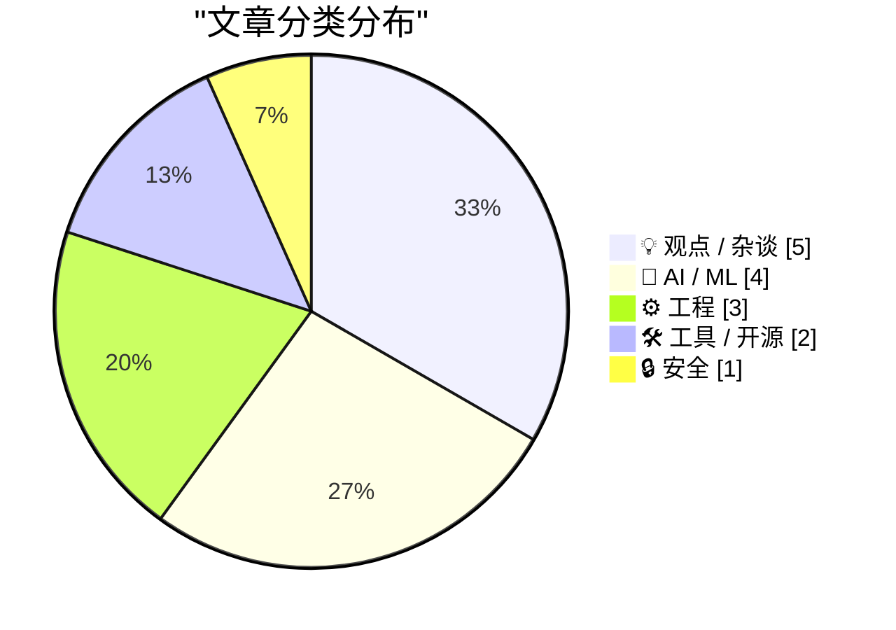
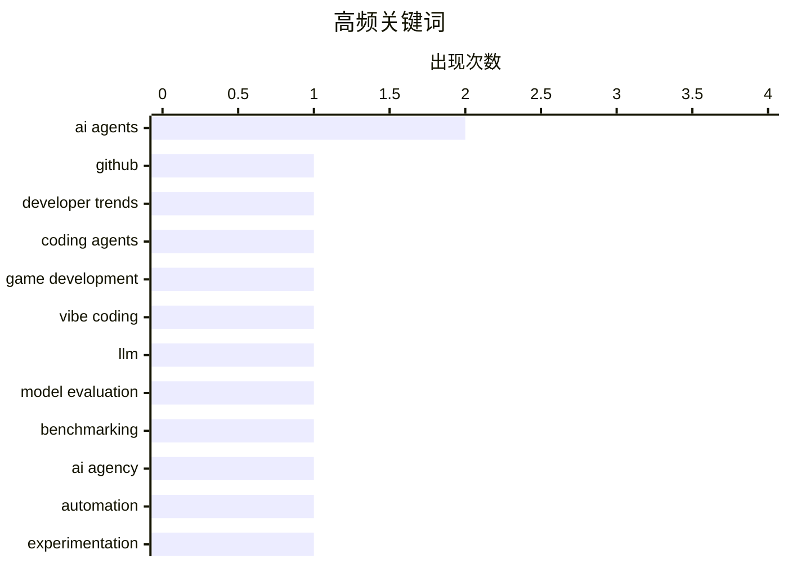

# 📰 Oct 29, 2026

> 来自 Karpathy 推荐的 92 个顶级技术博客，AI 精选 Top 15

## 📝 今日看点

今日技术圈的核心趋势是 AI 从辅助工具加速演变为可执行任务的代理，编程、游戏开发和电商等场景都在探索更高程度的自动化。与此同时，模型能力呈现明显的多维差异，真正提升效率不仅取决于模型规模，也取决于用户对其边界、用法和失败模式的持续实践。AI 应用扩张还带来数据滥用、隐私 consent、定价透明度和平台责任等治理问题，代理人与消费者之间的信息不对称正成为新的风险焦点。开发者生态与代码托管活动持续增长，版本控制安全、工程基础设施以及复杂算法研究仍是技术圈的重要底座。

---

## 🏆 今日必读

🥇 **GitHub Octoverse 2026**

[GitHub Octoverse 2026](https://simonwillison.net/2026/Oct/28/github-octoverse-2026/) — simonwillison.net · 18 小时前 · 🛠 工具 / 开源

> GitHub 在 2026 年 Octoverse 报告中总结开发者生态、代码提交与推送活动的最新变化。报告指出，开发者的提交和推送数量在 2026 年达到新高，GitHub 将这一增长与开发者使用 AI 编程代理构建软件联系起来。该报告由 GitHub EVP Jay Parikh 在 GitHub Universe 大会上公布，并重点展示了多项趋势图表。核心结论是，AI 代理正在成为 GitHub 开发者工作流和开源生态增长的重要推动力。

💡 **为什么值得读**: 适合希望快速了解 2026 年 GitHub 开发者生态规模、代码活动趋势及 AI 编程代理影响的人。

🏷️ GitHub, developer trends, AI agents

🥈 **十月成为氛围式游戏开发的转折点**

[The October inflection point for vibe game development](https://simonwillison.net/2026/Oct/28/vibe-game-development/) — simonwillison.net · 21 小时前 · 🤖 AI / ML

> 继 2025 年 11 月 Opus 4.5 和 GPT-5.1 让编码代理成为软件工程师可靠的日常工具后，作者认为 2026 年 10 月出现了新的拐点。此次变化集中在使用 AI 进行“氛围式编程”开发电脑游戏，即通过自然语言描述、反复尝试和代理执行来完成游戏制作。文章认为，模型能力和相关工具已经使 AI 辅助游戏开发从偶尔可行，转向更适合持续创作和迭代。核心观点是，AI 游戏开发正在进入类似编码代理普及初期的生产力跃迁阶段。

💡 **为什么值得读**: 如果你关心生成式 AI 是否已经能真正改变游戏制作流程，这篇文章提供了一个具体的时间节点和实践视角。

🏷️ coding agents, game development, vibe coding

🥉 **引用 Ted Sanders**

[Quoting Ted Sanders](https://simonwillison.net/2026/Oct/28/ted-sanders/) — simonwillison.net · 12 小时前 · 🤖 AI / ML

> Ted Sanders 指出，大语言模型的能力是高度多维的，擅长数学的模型不一定也擅长讲笑话。尽管不同任务之间不存在固定的模型排名，模型规模仍能解释相当一部分性能差异。通常更大的模型具有更高的性能和可靠性，但每个 token 的成本也更高，并且拥有更好的信息记忆或召回能力。核心观点是，模型选型不能只看单一排行榜，而应结合任务能力、可靠性、成本和知识召回等维度综合判断。

💡 **为什么值得读**: 这段观点能帮助读者避免把大模型评测简化为一张线性排名表，并建立更实用的模型选型框架。

🏷️ LLM, model evaluation, benchmarking

---

## 📊 数据概览

| 扫描源 | 抓取文章 | 时间范围 | 精选 |
|:---:|:---:|:---:|:---:|
| 85/92 | 2584 篇 → 35 篇 | 48h | **15 篇** |

### 分类分布



### 高频关键词



<details>
<summary>📈 纯文本关键词图（终端友好）</summary>

```
ai agents        │ ████████████████████ 2
github           │ ██████████░░░░░░░░░░ 1
developer trends │ ██████████░░░░░░░░░░ 1
coding agents    │ ██████████░░░░░░░░░░ 1
game development │ ██████████░░░░░░░░░░ 1
vibe coding      │ ██████████░░░░░░░░░░ 1
llm              │ ██████████░░░░░░░░░░ 1
model evaluation │ ██████████░░░░░░░░░░ 1
benchmarking     │ ██████████░░░░░░░░░░ 1
ai agency        │ ██████████░░░░░░░░░░ 1
```

</details>

### 🏷️ 话题标签

**ai agents**(2) · **github**(1) · **developer trends**(1) · coding agents(1) · game development(1) · vibe coding(1) · llm(1) · model evaluation(1) · benchmarking(1) · ai agency(1) · automation(1) · experimentation(1) · ai adoption(1) · software engineering(1) · productivity(1) · ai skills(1) · practice(1) · learning(1) · e-commerce(1) · platform power(1)

---

## 💡 观点 / 杂谈

### 1. 你可以直接让 AI 去做事

[You can just ask AI to do things](https://seangoedecke.com/you-can-just-ask-ai-to-do-things/) — **seangoedecke.com** · 11 小时前 · ⭐ 24/30

> 使用 AI 最重要的能力之一是主动性，也就是愿意尝试新颖且有雄心的目标。作者认为，人们在使用 AI 时的主要瓶颈往往不是模型能力，而是没有意识到模型已经能够完成哪些事情。面对快速进步的模型，用户应通过提出具体请求、持续试验和扩大任务范围来发现可行的工作方式。核心结论是，AI 的价值不仅取决于提示技巧，更取决于用户是否敢于把它当作能够执行任务的协作者。

🏷️ AI agency, automation, experimentation

---

### 2. 引用 Terk Terkowitz

[Quoting Terk Terkowitz](https://simonwillison.net/2026/Oct/28/terk-terkowitz/) — **simonwillison.net** · 1 天前 · ⭐ 23/30

> Terk Terkowitz 认为，如果当前 AI 工具无法帮助完成某项工作，这应被视为一项发现，而不是个人失败。工程师应记录 AI 无法发挥作用的具体原因，与同行分享，并向管理者反馈，以便寻找解决方案。能够清楚说明 AI 在工作流程中尚未有效的边界，本身就体现了对工具的判断力。核心观点是，负责任地使用 AI 不意味着强行应用，而是要基于证据判断何时适合使用、何时不适合使用。

🏷️ AI adoption, software engineering, productivity

---

### 3. 变得擅长使用 AI 需要时间和练习

[Getting good at AI takes time and practice](https://seangoedecke.com/getting-good-at-ai-takes-time-and-practice/) — **seangoedecke.com** · 1 天前 · ⭐ 23/30

> 许多人以为掌握 AI 很简单，因为当前模型不再像早期模型那样依赖大量特殊技巧。作者认为，模型能力提升并没有消除学习成本，用户仍需要时间理解模型的行为、边界和适合处理的任务。真正的熟练度来自持续实践，包括设计任务、评估输出、修正错误以及形成稳定的协作方法。核心结论是，AI 使用能力是一种需要积累的实践技能，而不是掌握几个提示技巧就能获得的能力。

🏷️ AI skills, practice, learning

---

### 4. Pluralistic：代理与电子商务（2026 年 10 月 28 日）

[Pluralistic: Agents vs ecommerce (28 Oct 2026)](https://pluralistic.net/2026/10/28/principle-agent-problem/) — **pluralistic.net** · 1 天前 · ⭐ 23/30

> 文章聚焦 AI 代理进入电子商务后产生的代理人问题，核心议题是消费者、代理、商家和平台之间的信息不对称。标题提出“不可透明性是一项功能，而不是缺陷”，暗示电商平台可能会利用复杂的推荐、定价和交易机制来影响代理的决策。AI 代理代表用户自动搜索、比较和购买商品后，平台控制数据、排序规则和交易条件的方式将直接影响用户利益。核心观点是，代理化电商并不会自动带来更公平的市场，透明度和权力分配仍需要被审视。

🏷️ AI agents, e-commerce, platform power, transparency

---

### 5. 我现在是一名全职开源开发者

[I'm a Full-Time Open Source Developer Now](https://blog.miguelgrinberg.com/post/i-m-full-time-open-source-developer-now) — **miguelgrinberg.com** · 1 天前 · ⭐ 22/30

> 作者目前维护包括 Flask、Werkzeug 等在内的 18 个开源项目，并将开源工作从业余投入转为全职投入。过去大部分时间里，他需要在日常工作之外维护这些项目，因此能够投入的时间有限。随着原本的全职工作结束，他计划把更多精力用于项目开发、维护和社区支持。这篇文章也意在更好地介绍这些工作，寻求愿意支持开源开发的人。

🏷️ open source, maintainers, developer career, sustainability

---

## 🤖 AI / ML

### 6. 十月成为氛围式游戏开发的转折点

[The October inflection point for vibe game development](https://simonwillison.net/2026/Oct/28/vibe-game-development/) — **simonwillison.net** · 21 小时前 · ⭐ 25/30

> 继 2025 年 11 月 Opus 4.5 和 GPT-5.1 让编码代理成为软件工程师可靠的日常工具后，作者认为 2026 年 10 月出现了新的拐点。此次变化集中在使用 AI 进行“氛围式编程”开发电脑游戏，即通过自然语言描述、反复尝试和代理执行来完成游戏制作。文章认为，模型能力和相关工具已经使 AI 辅助游戏开发从偶尔可行，转向更适合持续创作和迭代。核心观点是，AI 游戏开发正在进入类似编码代理普及初期的生产力跃迁阶段。

🏷️ coding agents, game development, vibe coding

---

### 7. 引用 Ted Sanders

[Quoting Ted Sanders](https://simonwillison.net/2026/Oct/28/ted-sanders/) — **simonwillison.net** · 12 小时前 · ⭐ 24/30

> Ted Sanders 指出，大语言模型的能力是高度多维的，擅长数学的模型不一定也擅长讲笑话。尽管不同任务之间不存在固定的模型排名，模型规模仍能解释相当一部分性能差异。通常更大的模型具有更高的性能和可靠性，但每个 token 的成本也更高，并且拥有更好的信息记忆或召回能力。核心观点是，模型选型不能只看单一排行榜，而应结合任务能力、可靠性、成本和知识召回等维度综合判断。

🏷️ LLM, model evaluation, benchmarking

---

### 8. Siri AI 在 OS 27.2 中扩展至更多语言

[Siri AI Expands to More Languages in OS 27.2](https://nr.apple.com/Du9G9W8Nq1) — **daringfireball.net** · 1 天前 · ⭐ 21/30

> 随着 iOS、iPadOS、watchOS 等 27.2 版本更新发布，Apple 的全新 Siri AI 开始向更多地区和用户开放。此次扩展新增法语、日语、韩语、葡萄牙语和西班牙语支持。Apple 将这一版本的 Siri 定位为更强大、更具对话能力且更个性化的全新体验。不过，Siri AI 目前仍未在欧盟的 iOS、iPadOS 和 watchOS 中提供，Apple 正与欧盟方面寻求解决方案。

🏷️ Siri, multilingual AI, voice assistants

---

### 9. Apple Creator Studio 更新大量 AI 功能，并为 Keynote 引入新的开放式 JSON 文件格式

[Apple Creator Studio Updated With a Slew of AI Features, Along With a New Open JSON File Format for Keynote](https://www.apple.com/newsroom/2026/10/apple-creator-studio-adds-powerful-new-ai-features-and-even-more-creative-tools/) — **daringfireball.net** · 1 天前 · ⭐ 21/30

> Apple 对 Apple Creator Studio 进行了重大更新，面向 Mac、iPad 和 iPhone 提供更多 AI 能力与创作工具。Final Cut Pro for Mac 新增内置 MotionVFX，提供视觉特效、插件、转场、模板和动态图形等资源。Final Cut Pro 还支持与 Pixelmator Pro 的无缝编辑，强化视频与图像工作流之间的协作。Keynote 同时引入新的开放式 JSON 文件格式，使演示文稿内容更便于被其他工具读取、处理和集成。

🏷️ Apple Creator Studio, AI tools, Keynote, JSON

---

## ⚙️ 工程

### 10. 指数时间假设是错误的

[The Exponential Time Hypothesis is False](https://www.johndcook.com/blog/2026/10/27/eth-false/) — **johndcook.com** · 1 天前 · ⭐ 23/30

> 布尔可满足性问题要求判断一个包含 n 个布尔变量的表达式是否存在满足条件的赋值，穷举搜索的显然上界是遍历全部 2^n 种可能。指数时间假设（ETH）通常认为，3-SAT 等问题不存在显著快于指数时间的算法。文章标题提出 ETH 为假，意味着某些被认为需要指数时间的问题可能存在更快的算法或理论突破。核心结论取决于相关复杂性理论结果，但这一命题若成立，将改变对 SAT、组合优化及大量 NP 问题计算难度的理解。

🏷️ ETH, SAT, computational complexity

---

### 11. 为什么我们不把任务栏和任务管理器设为高优先级，让它们保持响应？

[Why don’t we run the taskbar and Task Manager at high priority, so they can remain responsive?](https://devblogs.microsoft.com/oldnewthing/20261027-00/?p=112800/) — **devblogs.microsoft.com/oldnewthing** · 1 天前 · ⭐ 21/30

> 文章探讨了一个直观但容易产生误解的问题：既然任务栏和任务管理器承担着系统交互与故障处理职责，为什么不将它们设置为高优先级进程。Windows 的任务调度并不能简单地通过提高优先级来保证界面始终响应，高优先级线程反而可能挤压其他关键系统工作。任务栏和任务管理器还会受到资源争用、阻塞操作以及系统整体负载的影响。核心结论是，保持界面响应需要更全面的并发与资源管理设计，而不是单纯调高进程优先级。

🏷️ Windows, scheduling, thread priority, responsiveness

---

### 12. 会议徽章上的 Game Boy Color

[Game Boy Color on My Conference Badge](https://simonwillison.net/2026/Oct/27/game-boy-color-on-my-conference-badge/) — **simonwillison.net** · 1 天前 · ⭐ 20/30

> 作者在 GitHub Universe 期间继续研究会议徽章中的全彩屏计算机，这块徽章与上一年的设备类似，具备完整的计算能力。经过一番改造和实验，他与 Steve Francia 合作，并借助 Gemini 在徽章上运行了《塞尔达传说》相关内容。这个项目把会议周边从展示身份的实体徽章变成了可编程硬件平台。文章的重点在于展示低成本、受限硬件如何通过逆向、编程和生成式 AI 变成可运行游戏的设备。

🏷️ Game Boy Color, embedded systems, hardware hacking

---

## 🛠 工具 / 开源

### 13. GitHub Octoverse 2026

[GitHub Octoverse 2026](https://simonwillison.net/2026/Oct/28/github-octoverse-2026/) — **simonwillison.net** · 18 小时前 · ⭐ 27/30

> GitHub 在 2026 年 Octoverse 报告中总结开发者生态、代码提交与推送活动的最新变化。报告指出，开发者的提交和推送数量在 2026 年达到新高，GitHub 将这一增长与开发者使用 AI 编程代理构建软件联系起来。该报告由 GitHub EVP Jay Parikh 在 GitHub Universe 大会上公布，并重点展示了多项趋势图表。核心结论是，AI 代理正在成为 GitHub 开发者工作流和开源生态增长的重要推动力。

🏷️ GitHub, developer trends, AI agents

---

### 14. 本周源代码管理动态：2026 年 10 月 28 日

[This Week in Source Control: 28 October 2026](https://nesbitt.io/2026/10/28/this-week-in-source-control.html) — **nesbitt.io** · 1 天前 · ⭐ 22/30

> 该周报汇总了版本控制系统和代码托管平台生态中的最新信息。内容范围包括软件发布、版本控制相关安全公告，以及来自各类代码托管平台和开发工具社区的文章。对于依赖 Git、代码托管服务和持续交付基础设施的团队，这类信息可用于跟踪工具更新与潜在安全风险。核心价值在于提供一份面向开发者和维护者的源代码管理领域周度索引。

🏷️ version control, Git, code hosting, security advisories

---

## 🔒 安全

### 15. 英寸与英里

[Inches & Miles](https://feed.tedium.co/link/15204/17507724/ai-startups-sketchy-behavior) — **tedium.co** · 1 天前 · ⭐ 23/30

> 文章批评 AI 时代的部分初创公司重新采取激进的数据策略，在未充分征得用户同意的情况下使用个人或第三方数据。公司可能将这些数据用于训练模型、构建数据产品或包装成新的创业机会，从而把数据获取风险转嫁给用户和原始内容提供者。作者认为，AI 热潮让一些创业团队更大胆地突破既有的隐私和授权边界。核心观点是，技术创新不能替代对数据来源、使用许可和用户权益的基本审查。

🏷️ data privacy, AI startups, consent

---

*生成于 2026-10-29 11:26 | 扫描 85 源 → 获取 2584 篇 → 精选 15 篇*
*基于 [Hacker News Popularity Contest 2025](https://refactoringenglish.com/tools/hn-popularity/) RSS 源列表，由 [Andrej Karpathy](https://x.com/karpathy) 推荐*
