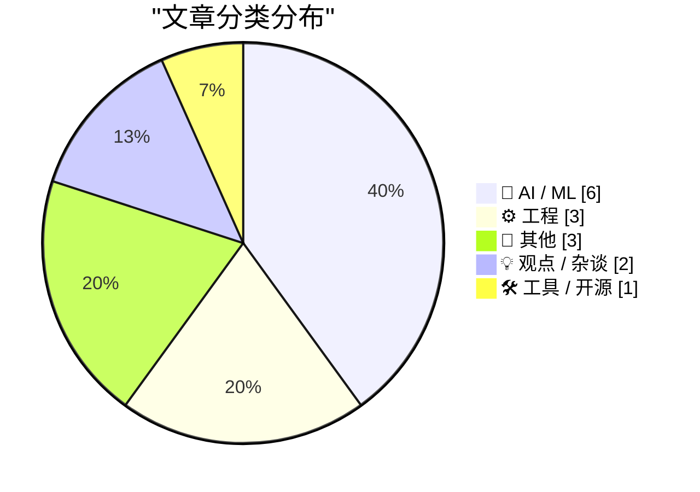
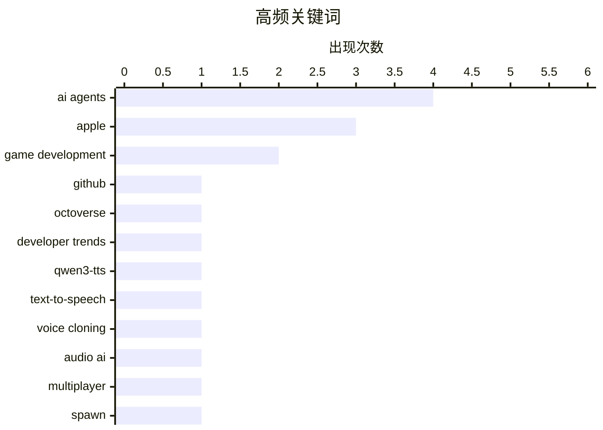

# 📰 Oct 30, 2026

> 来自 Karpathy 推荐的 92 个顶级技术博客，AI 精选 Top 15

## 📝 今日看点

AI 正从辅助写代码走向自主构建软件与游戏，智能体开发、提示词驱动的游戏世界和定制语音共同推动创作门槛下降，开发者如何重新组织工作成为焦点。模型厂商通过订阅附赠 API 额度打通消费与开发场景，争夺开发者入口的竞争进一步升温。与此同时，智能体与电商商业逻辑的冲突、应用商店佣金调整，凸显平台利益分配与规则重塑正成为技术演进的重要议题。

---

## 🏆 今日必读

🥇 **GitHub Octoverse 2026 年度报告**

[GitHub Octoverse 2026](https://simonwillison.net/2026/Oct/28/github-octoverse-2026/) — simonwillison.net · 1 天前 · ⚙️ 工程

> GitHub 在 Universe 大会上发布了 Octoverse 2026 年度报告，关注开发者使用 AI 智能体构建软件时的平台活动变化。报告发布文章的标题指出，2026 年 GitHub 的提交与推送活动创下新高。GitHub 执行副总裁 Jay Parikh 在现场重点展示了多项数据，Simon Willison 则记录了这次发布。现有摘录未包含具体数值，因此只能确认代码活动增长这一趋势，无法据此判断增长幅度或 AI 智能体的实际贡献。

💡 **为什么值得读**: 适合希望从平台级数据观察 AI 编程发展趋势的读者，但具体指标及其统计口径需要查阅完整报告。

🏷️ GitHub, Octoverse, AI agents, developer trends

🥈 **使用 Qwen3-TTS 定制声音**

[Custom Voices With Qwen3-TTS](https://lucumr.pocoo.org/2026/10/29/qwen3-custom-voices/) — lucumr.pocoo.org · 1 天前 · 🤖 AI / ML

> 为与孩子共同开发的地牢探索游戏制作旁白和配音，作者希望获得区别于常见 AI 默认音色的声音。经过调查，他选择了支持通过声音嵌入定制音色的 Qwen3-TTS。这里的核心需求不仅是将文本转换为语音，还包括为游戏建立具有辨识度的声音风格。现有摘录展示了需求和技术选型，但未提供音色制作步骤、运行成本或最终效果。

💡 **为什么值得读**: 如果你正在为独立游戏或个人项目寻找有辨识度的 AI 配音，这个案例提供了明确的工具选择和应用场景。

🏷️ Qwen3-TTS, text-to-speech, voice cloning, audio AI

🥉 **用自主运行的 Fable 级模型构建多人游戏世界**

[Building a multiplayer game world with autonomous Fable-class models](https://simonwillison.net/2026/Oct/29/how-i-built-the-most-ai-pilled-company-in-the-world/) — simonwillison.net · 7 小时前 · 🤖 AI / ML

> Spawn 正在探索利用自主运行的前沿模型构建大型多人游戏环境，让玩家通过提示词参与其中。Simon Willison 推荐了 Jacob Sansbury 对这一项目的介绍，认为它展示了智能体工程的能力前沿。文章标题将 Fable 级模型置于核心位置，关注自主模型在游戏世界构建中的应用。现有摘录没有给出系统架构、运行成本或实际规模，因此尚不足以评价这套方案的成熟度。

💡 **为什么值得读**: 适合关注 AI 原生游戏和自主智能体工程的开发者，可借此了解提示词驱动的多人游戏产品正在探索哪些方向。

🏷️ AI agents, game development, multiplayer, Spawn

---

## 📊 数据概览

| 扫描源 | 抓取文章 | 时间范围 | 精选 |
|:---:|:---:|:---:|:---:|
| 85/92 | 2585 篇 → 32 篇 | 48h | **15 篇** |

### 分类分布



### 高频关键词



<details>
<summary>📈 纯文本关键词图（终端友好）</summary>

```
ai agents        │ ████████████████████ 4
apple            │ ███████████████░░░░░ 3
game development │ ██████████░░░░░░░░░░ 2
github           │ █████░░░░░░░░░░░░░░░ 1
octoverse        │ █████░░░░░░░░░░░░░░░ 1
developer trends │ █████░░░░░░░░░░░░░░░ 1
qwen3-tts        │ █████░░░░░░░░░░░░░░░ 1
text-to-speech   │ █████░░░░░░░░░░░░░░░ 1
voice cloning    │ █████░░░░░░░░░░░░░░░ 1
audio ai         │ █████░░░░░░░░░░░░░░░ 1
```

</details>

### 🏷️ 话题标签

**ai agents**(4) · **apple**(3) · **game development**(2) · github(1) · octoverse(1) · developer trends(1) · qwen3-tts(1) · text-to-speech(1) · voice cloning(1) · audio ai(1) · multiplayer(1) · spawn(1) · coding agents(1) · vibe coding(1) · macbook pro(1) · touchscreen(1) · oled(1) · ecommerce(1) · opacity(1) · platforms(1)

---

## 🤖 AI / ML

### 1. 使用 Qwen3-TTS 定制声音

[Custom Voices With Qwen3-TTS](https://lucumr.pocoo.org/2026/10/29/qwen3-custom-voices/) — **lucumr.pocoo.org** · 1 天前 · ⭐ 25/30

> 为与孩子共同开发的地牢探索游戏制作旁白和配音，作者希望获得区别于常见 AI 默认音色的声音。经过调查，他选择了支持通过声音嵌入定制音色的 Qwen3-TTS。这里的核心需求不仅是将文本转换为语音，还包括为游戏建立具有辨识度的声音风格。现有摘录展示了需求和技术选型，但未提供音色制作步骤、运行成本或最终效果。

🏷️ Qwen3-TTS, text-to-speech, voice cloning, audio AI

---

### 2. 用自主运行的 Fable 级模型构建多人游戏世界

[Building a multiplayer game world with autonomous Fable-class models](https://simonwillison.net/2026/Oct/29/how-i-built-the-most-ai-pilled-company-in-the-world/) — **simonwillison.net** · 7 小时前 · ⭐ 23/30

> Spawn 正在探索利用自主运行的前沿模型构建大型多人游戏环境，让玩家通过提示词参与其中。Simon Willison 推荐了 Jacob Sansbury 对这一项目的介绍，认为它展示了智能体工程的能力前沿。文章标题将 Fable 级模型置于核心位置，关注自主模型在游戏世界构建中的应用。现有摘录没有给出系统架构、运行成本或实际规模，因此尚不足以评价这套方案的成熟度。

🏷️ AI agents, game development, multiplayer, Spawn

---

### 3. 游戏氛围编程在十月迎来拐点

[The October inflection point for vibe game development](https://simonwillison.net/2026/Oct/28/vibe-game-development/) — **simonwillison.net** · 1 天前 · ⭐ 23/30

> Simon Willison 判断，2026 年 10 月可能成为通过氛围编程开发电脑游戏的新拐点。他将这一变化类比于 2025 年 11 月编码智能体的能力跃迁：当时 Opus 4.5 和 GPT-5.1 跨过实用门槛，使相应工具成为软件工程师可靠的日常助手。这次判断关注的是游戏开发，意味着作者认为相关工具的实用能力再次跨过了关键门槛。不过，现有摘录尚未展示支撑判断的游戏案例、开发过程或效果对比。

🏷️ coding agents, game development, vibe coding

---

### 4. 符合条件的 ChatGPT 订阅可获赠 API 额度

[API credits benefit for eligible ChatGPT subscriptions](https://simonwillison.net/2026/Oct/29/api-credits/) — **simonwillison.net** · 1 小时前 · ⭐ 22/30

> OpenAI 为符合条件的 ChatGPT 订阅提供 API 额度福利，将聊天订阅与开发者 API 使用联系起来。Simon Willison 将其与 Anthropic 当月早些时候推出的类似权益作比较。摘录称，Anthropic 的 Max 和 Team 订阅中，每月支付 100、200 或 500 美元的用户可获得等额 API 额度，且额度会过期。现有内容没有列出 OpenAI 的适用套餐、额度金额或有效期，因此不能据此认定两家的福利完全一致。

🏷️ OpenAI, ChatGPT, API credits

---

### 5. 你可以直接让 AI 去做

[You can just ask AI to do things](https://seangoedecke.com/you-can-just-ask-ai-to-do-things/) — **seangoedecke.com** · 1 天前 · ⭐ 22/30

> 有效使用 AI 的关键能力之一，是愿意主动尝试新的、更有挑战性的任务。作者认为，这种主动性既影响你选择构建什么，也影响你采用怎样的工作方法。随着模型能力迅速提高，许多人的瓶颈在于未能及时意识到工具已经能够承担更多工作。其核心观点是，应该通过实际提出任务来探索 AI 的能力边界，并持续调整自己的使用方式。

🏷️ AI, agency, experimentation

---

### 6. 让 AI 智能体更快：过去 12 个月的实践心得

[Making agents fast - what I've learnt over the last 12 months](https://martinalderson.com/posts/making-agents-fast/?utm_source=rss&amp;utm_medium=rss&amp;utm_campaign=feed) — **martinalderson.com** · 1 天前 · ⭐ 22/30

> 提升 AI 智能体速度，需要同时审视模型推理、工具调用、运行硬件与沙箱环境。作者汇总过去 12 个月的实践经验，强调区分首 token 延迟（TTFT）与每秒生成 token 数（tok/s），因为两者衡量的是不同阶段的性能。工具调用轨迹也是排查速度问题的重要线索，可以帮助分析智能体执行任务时的耗时环节。工具设计则应贴合智能体的实际使用方式，并将硬件和沙箱配置纳入优化范围。核心思路是把速度视为整个执行流程的系统问题，而提供的简介未披露具体优化收益或基准数据。

🏷️ AI agents, inference, tool calling, sandboxing

---

## ⚙️ 工程

### 7. GitHub Octoverse 2026 年度报告

[GitHub Octoverse 2026](https://simonwillison.net/2026/Oct/28/github-octoverse-2026/) — **simonwillison.net** · 1 天前 · ⭐ 25/30

> GitHub 在 Universe 大会上发布了 Octoverse 2026 年度报告，关注开发者使用 AI 智能体构建软件时的平台活动变化。报告发布文章的标题指出，2026 年 GitHub 的提交与推送活动创下新高。GitHub 执行副总裁 Jay Parikh 在现场重点展示了多项数据，Simon Willison 则记录了这次发布。现有摘录未包含具体数值，因此只能确认代码活动增长这一趋势，无法据此判断增长幅度或 AI 智能体的实际贡献。

🏷️ GitHub, Octoverse, AI agents, developer trends

---

### 8. C++/WinRT 矫枉过正：使用 make_self 后立即转换为投影接口

[C++/WinRT overcorrection: Using make_self and immediately converting it to the projected interface](https://devblogs.microsoft.com/oldnewthing/20261028-00/?p=112803/) — **devblogs.microsoft.com/oldnewthing** · 1 天前 · ⭐ 21/30

> 在 C++/WinRT 中，先调用 make_self 再立即转换为投影接口，会让对象创建过程绕一个不必要的弯。make_self 用于取得实现类型的智能指针，适合后续需要访问实现类的场景。如果调用方最终只需要投影接口，通常可以直接使用 make 表达这一意图，省去显式的中间转换。关键在于根据调用方需要的是实现类型还是投影类型来选择创建方式。作者将这种写法称为“矫枉过正”，强调避免引入没有实际用途的中间步骤。

🏷️ C++, C++/WinRT, make_self, Windows

---

### 9. 避免让公有函数调用其他公有函数

[Avoid Public Functions Calling Other Public Functions](https://matklad.github.io/2026/10/29/pub-calls-pub.html) — **matklad.github.io** · 1 天前 · ⭐ 21/30

> “避免让公有函数调用其他公有函数”是一条针对代码组织的小尺度经验法则。它关注的是公有接口之间的内部调用关系，而非单个函数的实现细节。作者明确将这一建议定位为启发式规则，没有在所给节选中提出适用于所有场景的硬性约束。他也坦言，一个具体例子会让论述更有说服力，但当时未能想到合适的例子。因此，这条建议适合作为审查接口依赖关系的提示，节选本身尚不足以支持具体的重构结论。

🏷️ API design, encapsulation, abstraction, public functions

---

## 📝 其他

### 10. 史蒂文·利维谈新款 MacBook Pro：没错，配备了触摸屏

[Steven Levy on the New MacBook Pro, With, Yes, a Touchscreen](https://www.wired.com/story/the-inside-story-of-why-apple-finally-brought-a-touch-display-to-the-mac/) — **daringfireball.net** · 20 小时前 · ⭐ 23/30

> Steven Levy 在《连线》的报道聚焦苹果为新款 MacBook Pro 引入触摸屏的产品决策。John Ternus 表示，Mac 仍然以触控板和键盘构成的间接输入方式为主，但触摸操作在某些场景下更方便。这一表态将触摸屏定位为补充输入方式，同时回应用户对 Mac 产品定位变化的担忧。苹果的核心解释是，增加触摸能力可以服务具体使用场景，并继续保留 Mac 原有的交互重心。

🏷️ MacBook Pro, touchscreen, OLED, Apple

---

### 11. 《华尔街日报》记者 Rolfe Winkler：备受压榨的芯片供应商开始向苹果反击

[Rolfe Winkler at The WSJ: ‘The Beleaguered Chip Sellers Getting Their Revenge on Apple’](https://www.wsj.com/tech/apple-iphone-memory-chips-ai-c0084cc9?st=FNAyaT) — **daringfireball.net** · 4 小时前 · ⭐ 22/30

> 苹果与芯片供应商之间的议价权变化，是这篇报道的核心主题，标题将其描述为长期承压的供应商开始向苹果反击。报道以苹果前采购高管 Blevins 的谈判方式为例：他有时会连续安排不同供应商开会，让竞争对手的销售团队碰面，以强化竞争压力。苹果高管还会把谈判拖到午夜之后，且不安排晚餐，供应商销售人员因此学会随身携带能量棒。Blevins 于 2022 年离开苹果，但其强硬作风曾为团队提供额外的谈判筹码。所给节选主要展示苹果过去如何压价，尚未交代供应商如今反击的具体方式及其对芯片价格的影响。

🏷️ Apple, chip suppliers, supply chain, competition

---

### 12. 不平衡群定理

[The Unbalanced Group Theorem](https://www.johndcook.com/blog/2026/10/28/the-unbalanced-group-theorem/) — **johndcook.com** · 1 天前 · ⭐ 21/30

> 不平衡群定理与有限单群分类（CFSG）的证明背景及形式化进展，是这篇文章的主题。有限单群分类常被称为数学中规模最大的定理，这里的“大”主要指证明工程的体量。相关证明历经数十年，分散在数千页期刊论文中，因而核查和组织这些证明本身就是巨大挑战。作者提到，Axiom 在文章发布前两天宣布完成了一项证明的形式化；结合标题，其讨论指向不平衡群定理，但所给节选没有完整呈现公告范围。阅读时需要区分某个相关定理的形式化进展与整个有限单群分类证明的形式化完成。

🏷️ group theory, finite simple groups, formal proof, Axiom

---

## 💡 观点 / 杂谈

### 13. Pluralistic：智能体与电子商务的冲突（2026 年 10 月 28 日）

[Pluralistic: Agents vs ecommerce (28 Oct 2026)](https://pluralistic.net/2026/10/28/principle-agent-problem/) — **pluralistic.net** · 1 天前 · ⭐ 23/30

> 这期 Pluralistic 将 AI 智能体与电子商务之间的关系作为主议题。副标题“不透明是一种特性，而非缺陷”表明，作者把电商的不透明性视为其运作逻辑的一部分。链接路径还指向委托人与代理人之间的利益问题，但现有摘录未展开具体机制或案例。可确认的核心立场是，讨论购物智能体时，需要审视电商体系本身对透明度的态度，具体论证仍需阅读正文。

🏷️ AI agents, ecommerce, opacity, platforms

---

### 14. 苹果将台湾 App Store 佣金“大幅”下调 4 个百分点

[Apple Drops App Store Commission by a Whopping 4 Percentage Points in Taiwan](https://developer.apple.com/news/?id=w9mxlhek) — **daringfireball.net** · 3 小时前 · ⭐ 22/30

> 苹果在与台湾公平交易委员会讨论后，宣布调整台湾地区 App Store 的标准佣金率。自 2026 年 10 月 31 日起，iOS 和 iPadOS 商店的标准 App 内购买及付费应用交易佣金将从 30% 降至 26%。这是下调 4 个百分点，适用范围是公告明确列出的标准交易类型。Daring Fireball 以反讽口吻将其与日本的调整相提并论，质疑这种幅度的降费是否足以解决 App Store 的争议。

🏷️ Apple, App Store, Taiwan, commission

---

## 🛠 工具 / 开源

### 15. 本周版本控制动态：2026 年 10 月 28 日

[This Week in Source Control: 28 October 2026](https://nesbitt.io/2026/10/28/this-week-in-source-control.html) — **nesbitt.io** · 1 天前 · ⭐ 23/30

> 这是一份汇总版本控制系统与代码托管平台动态的周报。本期范围涵盖软件发布、风险通告和相关文章，兼顾工具更新与行业阅读线索。其覆盖对象既包括版本控制工具，也包括围绕代码协作运行的托管平台。现有摘录没有列出具体项目、版本号或通告内容，因此无法进一步判断本期有哪些值得优先处理的更新。

🏷️ version control, releases, security advisories

---

*生成于 2026-10-30 00:23 | 扫描 85 源 → 获取 2585 篇 → 精选 15 篇*
*基于 [Hacker News Popularity Contest 2025](https://refactoringenglish.com/tools/hn-popularity/) RSS 源列表，由 [Andrej Karpathy](https://x.com/karpathy) 推荐*
