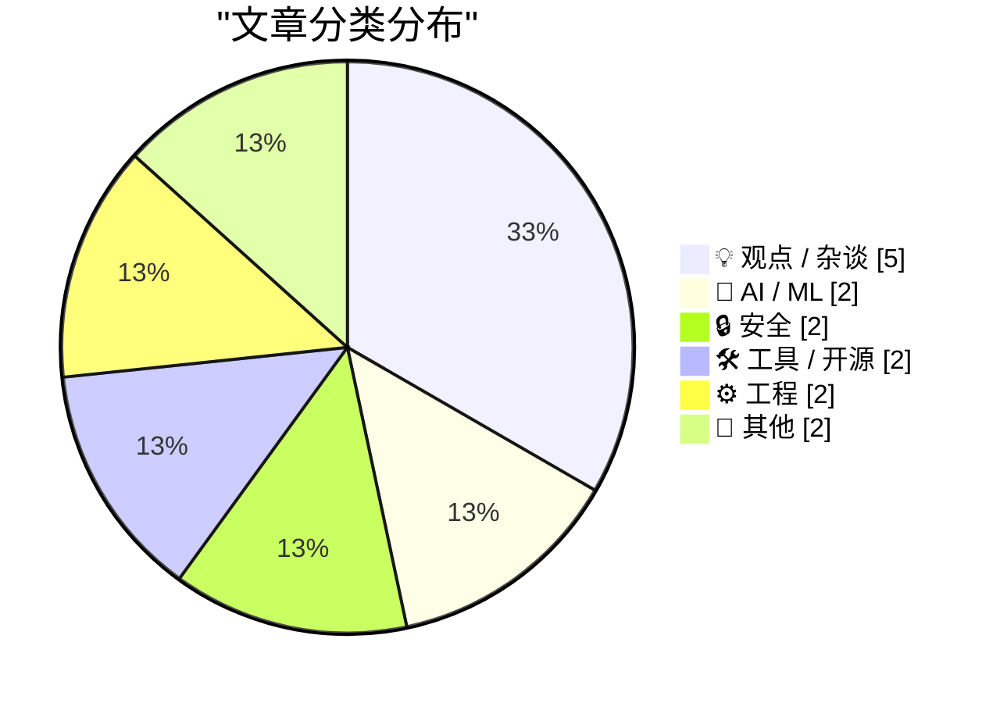
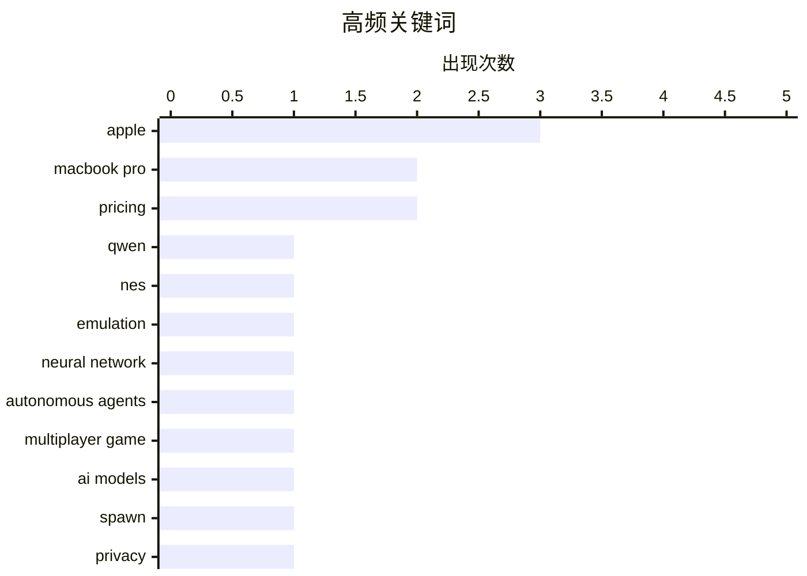

# 📰 Oct 31, 2026

> 来自 Karpathy 推荐的 92 个顶级技术博客，AI 精选 Top 15

## 📝 今日看点

今日技术焦点集中在 AI 能力从模型演示走向可交互的游戏世界，以及厂商开始将订阅权益与 API 额度打包，争夺开发者和用户。芯片需求升温也在重塑产业谈判格局，供应商议价能力增强，苹果则同步调整硬件形态与应用商店政策。与此同时，数据隐私与软件供应链可信度持续受到审视，通用汽车和解案再次凸显个人数据商业化的风险。

---

## 🏆 今日必读

🥇 **dbreunig/nesformer**

[dbreunig/nesformer](https://simonwillison.net/2026/Oct/30/nesformer/) — simonwillison.net · 2 小时前 · 🤖 AI / ML

> Drew Breunig 将任天堂娱乐系统（NES）的 6502 CPU 模拟器嵌入 Qwen3.5-4B 的模型权重中，让模型能够运行 NES 游戏 ROM。这个项目受 Divyansh Agrawal 的 qwenputer 启发，展示了通过训练把特定计算程序“写入”大语言模型的做法。Super Mario Bros 等游戏已经可以在 Qwen 中运行，但速度非常慢。项目的核心成果是证明模型权重可以承载可执行的模拟器，而不只是生成代码或文本。

💡 **为什么值得读**: 它以直观的游戏演示呈现模型权重编码程序的可能性，适合关注模型能力边界与神经网络计算的读者。

🏷️ Qwen, NES, emulation, neural network

🥈 **用 Fable 级自主模型构建多人游戏世界**

[Building a multiplayer game world with autonomous Fable-class models](https://simonwillison.net/2026/Oct/29/how-i-built-the-most-ai-pilled-company-in-the-world/) — simonwillison.net · 1 天前 · 🤖 AI / ML

> Spawn 正在打造一个大型多人游戏环境，玩家可以通过提示词与世界互动，背后由前沿模型驱动自主角色和系统。Jacob Sansbury 的文章记录了团队如何利用 agentic engineering 构建这一体验，并探索 Fable 级模型在开放式、多参与者环境中的能力。项目将模型从单轮问答工具扩展为持续运行的游戏世界参与者，重点涉及自主性、协作与复杂环境中的行为。文章展示了当前前沿模型工程的可行边界，也暴露了构建此类系统需要面对的技术挑战。

💡 **为什么值得读**: 文章提供了前沿模型从聊天走向持续自主交互系统的实际案例，能帮助读者判断 agentic engineering 的真实能力与局限。

🏷️ autonomous agents, multiplayer game, AI models, Spawn

🥉 **通用汽车因背弃驾驶者隐私将支付 2.2 亿美元**

[GM to Pay $220 Million After Betraying Their Own Drivers’ Privacy](https://www.reuters.com/business/autos-transportation/gm-pay-220-million-settle-allegations-it-violated-consumers-privacy-2026-10-29/) — daringfireball.net · 7 小时前 · 🔒 安全

> 通用汽车同意支付 2.2 亿美元，以和解其 Smart Driver 项目涉嫌非法出售驾驶者行为与位置数据的指控。相关数据被卖给数据经纪商，之后又被保险公司用于设定保费，有时还导致费率上调。美国 35 个州和哥伦比亚特区的总检察长参与了这项和解，涉及数百万名在 2016 年至 2024 年间加入项目的驾驶者。事件凸显联网汽车数据收集与转售可能直接影响消费者的隐私和保险成本。

💡 **为什么值得读**: 这起高额和解具体揭示了车载数据如何流入保险定价，值得所有联网汽车用户和关注数据隐私的人了解。

🏷️ privacy, location data, General Motors, data brokers

---

## 📊 数据概览

| 扫描源 | 抓取文章 | 时间范围 | 精选 |
|:---:|:---:|:---:|:---:|
| 84/92 | 2540 篇 → 29 篇 | 48h | **15 篇** |

### 分类分布



### 高频关键词



<details>
<summary>📈 纯文本关键词图（终端友好）</summary>

```
apple             │ ████████████████████ 3
macbook pro       │ █████████████░░░░░░░ 2
pricing           │ █████████████░░░░░░░ 2
qwen              │ ███████░░░░░░░░░░░░░ 1
nes               │ ███████░░░░░░░░░░░░░ 1
emulation         │ ███████░░░░░░░░░░░░░ 1
neural network    │ ███████░░░░░░░░░░░░░ 1
autonomous agents │ ███████░░░░░░░░░░░░░ 1
multiplayer game  │ ███████░░░░░░░░░░░░░ 1
ai models         │ ███████░░░░░░░░░░░░░ 1
```

</details>

### 🏷️ 话题标签

**apple**(3) · **macbook pro**(2) · **pricing**(2) · qwen(1) · nes(1) · emulation(1) · neural network(1) · autonomous agents(1) · multiplayer game(1) · ai models(1) · spawn(1) · privacy(1) · location data(1) · general motors(1) · data brokers(1) · chip suppliers(1) · semiconductors(1) · competition(1) · touchscreen(1) · hardware(1)

---

## 💡 观点 / 杂谈

### 1. 《华尔街日报》Rolfe Winkler：受困芯片供应商向苹果展开反击

[Rolfe Winkler at The WSJ: ‘The Beleaguered Chip Sellers Getting Their Revenge on Apple’](https://www.wsj.com/tech/apple-iphone-memory-chips-ai-c0084cc9?st=FNAyaT) — **daringfireball.net** · 1 天前 · ⭐ 23/30

> Rolfe Winkler 的报道聚焦苹果与芯片供应商之间的谈判关系，以及供应商在 AI 带动芯片需求增长后获得的议价空间。报道通过苹果前采购负责人 Tony Blevins 的谈判方式，呈现苹果如何安排竞争对手供应商接连会面、施加竞争压力，并以强硬策略争取条件。供应商代表曾被要求长时间参加谈判，会议有时持续到午夜之后。文章所呈现的核心变化是：当芯片需求紧俏、供应商更有底气时，苹果长期以来的采购优势可能受到挑战。

🏷️ Apple, chip suppliers, semiconductors, competition

---

### 2. 苹果将台湾 App Store 佣金下调 4 个百分点

[Apple Drops App Store Commission by a Whopping 4 Percentage Points in Taiwan](https://developer.apple.com/news/?id=w9mxlhek) — **daringfireball.net** · 1 天前 · ⭐ 21/30

> 苹果宣布，台湾 App Store 的标准应用内购买和付费应用佣金率将从 30% 降至 26%。新费率自 2026 年 10 月 31 日起适用于 iOS 和 iPadOS 台湾商店。此次调整是在与台湾公平交易委员会讨论后作出的，降低幅度为 4 个百分点。苹果称此举调整了台湾商店的佣金安排，台湾因此与日本等市场的相关变化相呼应。

🏷️ Apple, App Store, Taiwan, commission

---

### 3. 大学教育每月只要 20 美元

[College will only cost $20 a month](https://idiallo.com/blog/college-will-cost-20-dollars) — **idiallo.com** · 45 分钟前 · ⭐ 20/30

> 作者回顾了 2020 至 2022 年间鼓励学生攻读计算机科学的经历，当时科技公司招聘旺盛，计算机相关职业前景看好。如今招聘已经显著放缓，曾被建议投身该领域的学生即将毕业，却可能难以找到工作。文章标题提出“大学每月只要 20 美元”，将低成本教育与变化中的就业现实并置，质疑仅凭过去的行业需求来规划教育投资是否仍然可靠。核心问题是：在科技就业市场转冷、职业回报不确定的情况下，学生该如何评估教育成本与就业前景。

🏷️ computer science, education, tuition, tech careers

---

### 4. 优雅与智慧呈负相关

[Elegance and intelligence are anticorrelated](https://seangoedecke.com/elegance-and-intelligence-are-anticorrelated/) — **seangoedecke.com** · 1 天前 · ⭐ 18/30

> 高智力并不总会带来优雅的解决方案，反而可能因为解决问题的能力过强而产生负相关。聪明人能够迅速通过蛮力或直接计算解决问题，因此未必会花时间寻找更简洁、更巧妙的方法。文章以记忆大量姓名为例：普通人可能设计复杂的助记法，而约翰·冯·诺伊曼或许会直接把名字记住。文中还引述了冯·诺伊曼与两名骑自行车者和一只往返飞行的苍蝇有关的经典故事，说明有些看似复杂的问题可以通过直接处理细节来解决。作者的核心观点是，优雅往往是能力受限时形成的策略，而极高的智能有时会让人不再需要优雅。

🏷️ elegance, intelligence, problem solving

---

### 5. 引用 Ben Hylak

[Quoting Ben Hylak](https://simonwillison.net/2026/Oct/29/ben-hylak/) — **simonwillison.net** · 1 天前 · ⭐ 17/30

> Ben Hylak 认为，用户使用的每个产品都应该只是一个无界面的 MCP，由智能体接入并替用户处理底层细节。MCP，即模型上下文协议，代表了一种让 AI 智能体调用外部工具和服务的产品形态。引文随后用“当然我们自己的产品除外”进行反转，声称自家产品的客户非常喜欢界面，也非常喜欢这家公司。这个例子讽刺了技术从业者常见的双重标准：希望其他产品都被智能体和无界面接口取代，却认为自己的产品界面不可替代。核心观点是，AI 原生交互的普遍理想，往往会在面对自身产品和商业利益时被重新解释。

🏷️ MCP, AI agents, product design

---

## 🤖 AI / ML

### 6. dbreunig/nesformer

[dbreunig/nesformer](https://simonwillison.net/2026/Oct/30/nesformer/) — **simonwillison.net** · 2 小时前 · ⭐ 24/30

> Drew Breunig 将任天堂娱乐系统（NES）的 6502 CPU 模拟器嵌入 Qwen3.5-4B 的模型权重中，让模型能够运行 NES 游戏 ROM。这个项目受 Divyansh Agrawal 的 qwenputer 启发，展示了通过训练把特定计算程序“写入”大语言模型的做法。Super Mario Bros 等游戏已经可以在 Qwen 中运行，但速度非常慢。项目的核心成果是证明模型权重可以承载可执行的模拟器，而不只是生成代码或文本。

🏷️ Qwen, NES, emulation, neural network

---

### 7. 用 Fable 级自主模型构建多人游戏世界

[Building a multiplayer game world with autonomous Fable-class models](https://simonwillison.net/2026/Oct/29/how-i-built-the-most-ai-pilled-company-in-the-world/) — **simonwillison.net** · 1 天前 · ⭐ 23/30

> Spawn 正在打造一个大型多人游戏环境，玩家可以通过提示词与世界互动，背后由前沿模型驱动自主角色和系统。Jacob Sansbury 的文章记录了团队如何利用 agentic engineering 构建这一体验，并探索 Fable 级模型在开放式、多参与者环境中的能力。项目将模型从单轮问答工具扩展为持续运行的游戏世界参与者，重点涉及自主性、协作与复杂环境中的行为。文章展示了当前前沿模型工程的可行边界，也暴露了构建此类系统需要面对的技术挑战。

🏷️ autonomous agents, multiplayer game, AI models, Spawn

---

## 🔒 安全

### 8. 通用汽车因背弃驾驶者隐私将支付 2.2 亿美元

[GM to Pay $220 Million After Betraying Their Own Drivers’ Privacy](https://www.reuters.com/business/autos-transportation/gm-pay-220-million-settle-allegations-it-violated-consumers-privacy-2026-10-29/) — **daringfireball.net** · 7 小时前 · ⭐ 23/30

> 通用汽车同意支付 2.2 亿美元，以和解其 Smart Driver 项目涉嫌非法出售驾驶者行为与位置数据的指控。相关数据被卖给数据经纪商，之后又被保险公司用于设定保费，有时还导致费率上调。美国 35 个州和哥伦比亚特区的总检察长参与了这项和解，涉及数百万名在 2016 年至 2024 年间加入项目的驾驶者。事件凸显联网汽车数据收集与转售可能直接影响消费者的隐私和保险成本。

🏷️ privacy, location data, General Motors, data brokers

---

### 9. 跨软件包注册表的签名与证明声明

[Signing and Attestations Across Package Registries](https://nesbitt.io/2026/10/30/signing-and-attestations-across-package-registries.html) — **nesbitt.io** · 14 小时前 · ⭐ 23/30

> 文章比较多个软件包注册表在数字签名、来源证明声明（provenance attestations）和可信发布（trusted publishing）方面的支持情况。签名用于验证软件包的完整性和发布者身份，证明声明则记录构建来源与流程，可信发布则减少长期凭证在自动化发布中的暴露。不同注册表在这些供应链安全机制上的实现和覆盖并不一致，因此开发者需要了解各生态的具体能力。文章提供横向梳理，帮助团队评估软件包发布流程中的信任与可验证性。

🏷️ package registries, signing, provenance, trusted publishing

---

## 🛠 工具 / 开源

### 10. Steven Levy：新款 MacBook Pro 将配备触摸屏

[Steven Levy on the New MacBook Pro, With, Yes, a Touchscreen](https://www.wired.com/story/the-inside-story-of-why-apple-finally-brought-a-touch-display-to-the-mac/) — **daringfireball.net** · 1 天前 · ⭐ 23/30

> Steven Levy 报道苹果终于决定为 Mac 引入触摸显示屏，并披露新款 MacBook Pro 的相关内幕。苹果硬件负责人 John Ternus 强调，Mac 仍以键盘和触控板为核心输入方式，触摸操作只是在合适场景下提供便利。苹果试图在增加触控能力的同时，避免用户认为 Mac 正在失去作为传统电脑的产品定位。文章聚焦这项长期受关注的产品转向，以及苹果如何在 Mac 与 iPad 的交互设计之间划定界线。

🏷️ MacBook Pro, touchscreen, Apple, hardware

---

### 11. 符合条件的 ChatGPT 订阅可获 API 额度福利

[API credits benefit for eligible ChatGPT subscriptions](https://simonwillison.net/2026/Oct/29/api-credits/) — **simonwillison.net** · 1 天前 · ⭐ 21/30

> OpenAI 为部分符合条件的 ChatGPT 订阅用户提供 API 额度福利。该安排紧随 Anthropic 为 Claude Max 和 Team 订阅推出类似权益之后，反映 AI 服务商开始把订阅与 API 使用额度结合起来。额度可用于 OpenAI API，但具体适用订阅、发放规则和有效期需以官方说明为准。对同时使用 ChatGPT 产品和 API 的用户而言，这项政策可能降低试用或开发应用的额外成本。

🏷️ OpenAI, API credits, ChatGPT, pricing

---

## ⚙️ 工程

### 12. 欢呼吧，闰秒已经终结！

[Rejoice, leap seconds are dead!](https://www.jeffgeerling.com/blog/2026/rejoice-the-utc-leap-second-is-dead/) — **jeffgeerling.com** · 10 小时前 · ⭐ 22/30

> 国际计量大会（CGPM）通过第 5 号决议，决定不再为协调世界时（UTC）插入闰秒。最后一次 UTC 闰秒已经发生在 2016 年，此后不再会有新的闰秒。闰秒原本用于让 UTC 与地球自转保持接近，但会给时间同步、网络系统和基础设施带来处理复杂性。取消闰秒意味着时间标准将采用更平滑的调整方式，相关系统也不必再应对不定期插入的一秒。

🏷️ UTC, leap seconds, timekeeping

---

### 13. 一位客户说自己只能看到黑屏的技术支持案例

[The support case of a customer who said that all they could see was a black screen](https://devblogs.microsoft.com/oldnewthing/20261029-00/?p=112808/) — **devblogs.microsoft.com/oldnewthing** · 1 天前 · ⭐ 18/30

> 文章标题描述了一起客户报告“只能看到黑屏”的技术支持案例。正文仅保留了“不过，这正是他们要求的结果”这一句，暗示问题并非系统故障，而是客户的需求本身就是显示黑色画面。内容通过对“黑屏”这一故障描述的重新解读制造了反转。它没有提供具体的操作系统、软件版本、故障排查步骤或技术修复方案。核心看点在于支持人员如何从字面需求中发现，客户所谓的问题实际上可能是预期行为。

🏷️ debugging, black screen, customer support

---

## 📝 其他

### 14. M6、M5 Pro 与 M5 Max MacBook Pro 的价格与配置

[★ MacBook Pro Pricing and Configurations for M6, M5 Pro, and M5 Max](https://daringfireball.net/2026/10/macbook_pro_pricing_and_configurations_for_m6_m5_pro_and_m5_max) — **daringfireball.net** · 2 小时前 · ⭐ 18/30

> 文章将搭载 M6、M5 Pro 和 M5 Max 芯片的 MacBook Pro 各种配置与价格集中整理在一页表格中。重点信息包括不同芯片、内存、存储和显示配置之间的组合及其对应价格。作者这样整理，是为了让读者更容易横向比较全部购买选项，并在完整评测发布前提供实用的选购参考。文章还提到重新设计的硬件和 PROLED XDR 显示屏，但当前内容主要聚焦于价格与配置清单。对于准备购买新款 MacBook Pro 的用户，表格化信息可以帮助快速判断不同型号的成本与升级价值。

🏷️ MacBook Pro, M6, M5 Pro, pricing

---

### 15. 一种新型化学

[A New Kind of Chemistry](https://www.construction-physics.com/p/a-new-kind-of-chemistry) — **construction-physics.com** · 1 天前 · ⭐ 17/30

> 文章标题提出了“一种新型化学”这一主题，内容可能围绕化学反应、能源技术或材料科学中的新方法展开。现有摘录仅包含作者对 Marathon Fusion 的 Kyle Schiller 表示感谢，说明文章参考了相关对话和信息。摘录没有提供具体的反应机制、实验结果、性能指标、技术路线或与现有方案的比较。由于正文内容不完整，无法可靠判断文章究竟聚焦于核聚变燃料循环、工业化学还是其他研究方向。当前能够确认的是，Marathon Fusion 的技术信息可能构成文章论述的重要背景。若要评估其科学结论和实际价值，还需要阅读完整原文。

🏷️ fusion, chemistry, energy

---

*生成于 2026-10-31 00:20 | 扫描 84 源 → 获取 2540 篇 → 精选 15 篇*
*基于 [Hacker News Popularity Contest 2025](https://refactoringenglish.com/tools/hn-popularity/) RSS 源列表，由 [Andrej Karpathy](https://x.com/karpathy) 推荐*
