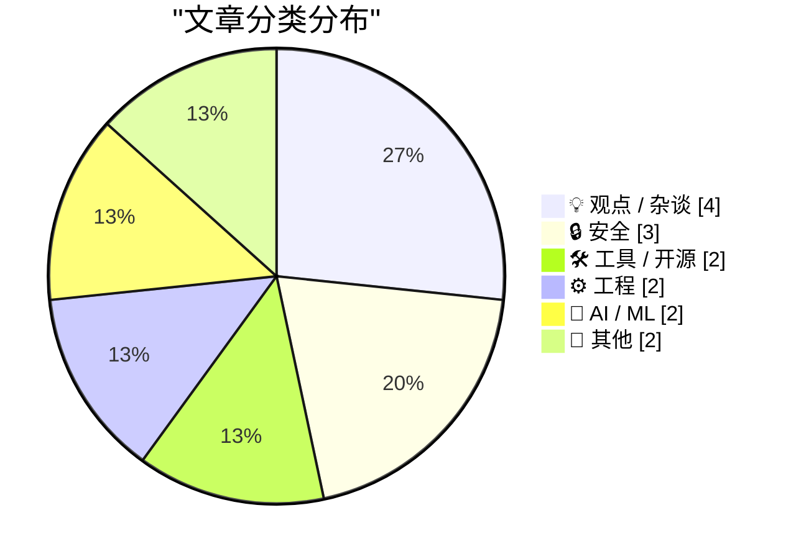
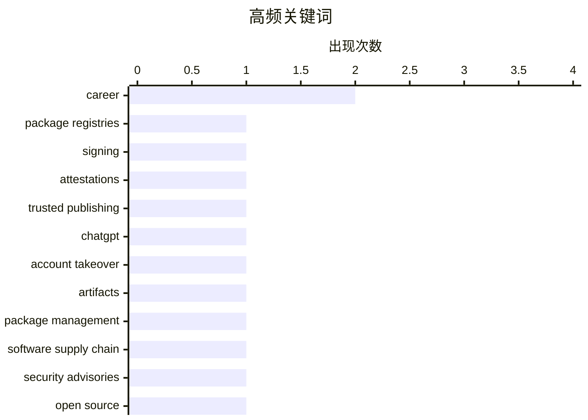

# 📰 Nov 1, 2026

> 来自 Karpathy 推荐的 92 个顶级技术博客，AI 精选 Top 15

## 📝 今日看点

今日技术圈的核心议题集中在安全与信任：软件包生态正通过签名、来源证明和可信发布强化供应链防护，但交互式 AI 功能暴露的账户接管风险也提醒业界，复杂应用场景仍可能成为新的攻击面。数据隐私监管持续加码，汽车厂商因出售驾驶与位置数据面临巨额和解，个人信息商业化的边界进一步收紧。AI 的能力边界与治理问题同步升温，从将 NES 模拟器嵌入模型权重，到版权制度如何适应生成式 AI，技术创新正与知识产权规则加速碰撞。与此同时，闰秒退出历史舞台等基础设施变化，显示全球技术系统仍在持续走向标准化与长期稳定。

---

## 🏆 今日必读

🥇 **各类软件包注册平台的签名与证明机制**

[Signing and Attestations Across Package Registries](https://nesbitt.io/2026/10/30/signing-and-attestations-across-package-registries.html) — nesbitt.io · 1 天前 · 🔒 安全

> 软件包注册平台正在通过签名、来源证明（provenance attestations）和可信发布（trusted publishing）增强软件供应链安全。签名用于验证制品的签署身份与完整性，来源证明用于记录制品的构建来源，可信发布则关注发布流程中的身份认证。这些机制解决的问题各有侧重，评估平台安全能力时需要区分它们的保障范围。文章以跨平台注册机制调查为主题，但所给简介未列出具体平台、支持情况或比较结论。

💡 **为什么值得读**: 适合需要评估软件供应链安全能力的开发者，帮助建立区分签名、来源证明与可信发布的基本框架。

🏷️ package registries, signing, attestations, trusted publishing

🥈 **我们是如何接管 ChatGPT 账户的**

[How We Took Over ChatGPT Accounts](https://simonwillison.net/2026/Oct/31/how-we-took-over-chatgpt-accounts/) — simonwillison.net · 1 小时前 · 🔒 安全

> Parameter Labs 披露了一项针对 ChatGPT 交互式 HTML 应用功能的漏洞，并称其能够导致账户被接管。攻击涉及 ChatGPT 对 artifacts 模式的实现，即在对话中展示可交互的自定义 HTML 应用。Simon Willison 指出，相关功能此前称为 Canvas，最新版本似乎改称 HTML previews（HTML 预览）。所给摘录未包含完整攻击链、受影响范围或修复状态，因此尚无法判断账户接管的具体条件。

💡 **为什么值得读**: 适合开发 AI 交互界面或嵌入式 HTML 功能的工程师，可用于关注内容执行环境与账户权限之间的安全边界。

🏷️ ChatGPT, account takeover, artifacts

🥉 **软件包管理周报：2026 年 10 月 31 日**

[This Week in Package Management: 31 October 2026](https://nesbitt.io/2026/10/31/this-week-in-package-management.html) — nesbitt.io · 14 小时前 · 🛠 工具 / 开源

> 这期周报汇集了软件包管理领域的版本发布、安全公告和技术文章。内容覆盖产品更新与安全风险两类信息，面向需要跟踪包管理生态变化的读者。其定位是跨项目动态汇总，而非针对单个工具的深入分析。所给简介没有列出具体软件包、版本号或漏洞编号，无法据此判断本期最重要的升级与修复事项。

💡 **为什么值得读**: 适合维护依赖管理流程的开发者定期浏览，集中发现需要进一步核查的工具更新与安全公告。

🏷️ package management, software supply chain, security advisories, open source

---

## 📊 数据概览

| 扫描源 | 抓取文章 | 时间范围 | 精选 |
|:---:|:---:|:---:|:---:|
| 84/92 | 2575 篇 → 23 篇 | 48h | **15 篇** |

### 分类分布



### 高频关键词



<details>
<summary>📈 纯文本关键词图（终端友好）</summary>

```
career                │ ████████████████████ 2
package registries    │ ██████████░░░░░░░░░░ 1
signing               │ ██████████░░░░░░░░░░ 1
attestations          │ ██████████░░░░░░░░░░ 1
trusted publishing    │ ██████████░░░░░░░░░░ 1
chatgpt               │ ██████████░░░░░░░░░░ 1
account takeover      │ ██████████░░░░░░░░░░ 1
artifacts             │ ██████████░░░░░░░░░░ 1
package management    │ ██████████░░░░░░░░░░ 1
software supply chain │ ██████████░░░░░░░░░░ 1
```

</details>

### 🏷️ 话题标签

**career**(2) · **package registries**(1) · **signing**(1) · attestations(1) · trusted publishing(1) · chatgpt(1) · account takeover(1) · artifacts(1) · package management(1) · software supply chain(1) · security advisories(1) · open source(1) · utc(1) · leap seconds(1) · timekeeping(1) · privacy(1) · connected cars(1) · data brokers(1) · gm(1) · computer science education(1)

---

## 💡 观点 / 杂谈

### 1. 大学每月只需 20 美元

[College will only cost $20 a month](https://idiallo.com/blog/college-will-cost-20-dollars) — **idiallo.com** · 1 天前 · ⭐ 23/30

> 作者以科技行业招聘降温为背景，反思此前鼓励学生攻读计算机科学专业的建议。2020 至 2022 年间，科技公司大举招聘，他有时每周面试 3 名候选人，因此对行业就业前景十分乐观。如今，当年受到鼓励的学生即将毕业，作者却担心他们面对岗位减少后追问工作的去向。标题提出了“每月 20 美元上大学”的命题，但所给摘录尚未解释这一金额对应的教育方案，能够确认的重点是计算机教育投入与就业回报之间的落差。

🏷️ computer science education, tech hiring, career, college

---

### 2. 提升职场声誉的快方法与慢方法

[Fast and slow ways to improve your reputation](https://seangoedecke.com/how-to-get-assigned-interesting-work/) — **seangoedecke.com** · 23 分钟前 · ⭐ 21/30

> 工程师在科技公司建立声誉时，常遇到一个循环：重要项目有助于积累声誉，但获得重要项目又往往需要已有声誉。作者收到的读者反馈显示，管理者可能持续把更受关注的工作交给已经证明自己的资深工程师。这种分配方式让其他工程师难以获得展示能力的机会，也使既有声誉不断强化。文章以如何获得有吸引力的工作为切入点，标题预告将比较提升声誉的快慢路径，但所给摘录尚未展开具体方法。

🏷️ career, reputation, engineering

---

### 3. 为什么我要打造一家只有一个人、价值十亿美元的服务公司

[Why I’m Building a One-Person, Billion-Dollar Agency](https://www.joanwestenberg.com/p/why-im-building-a-one-person-billion) — **joanwestenberg.com** · 41 分钟前 · ⭐ 20/30

> 作者以打造一家只有一个人、价值十亿美元的服务公司为主题，重新介绍名为 SELF 的项目。标题将单人运营与十亿美元规模并置，提出了一个关于服务型企业规模上限的创业命题。现有摘录只有“重新介绍 SELF”，没有披露业务定位、客户群体、收入模式或实现路径。十亿美元应理解为标题表达的目标，不能据此认定 SELF 已达到相应营收或估值，也无法从摘录判断作者如何论证这一目标。

🏷️ solo founder, agency, entrepreneurship, business model

---

### 4. 罗伯特·卡罗：传记大师在 91 岁时的回望

[Robert Caro – The master biographer reflects at 91](https://www.dwarkesh.com/p/robert-caro) — **dwarkesh.com** · 1 天前 · ⭐ 19/30

> 91 岁的传记作家罗伯特·卡罗回顾自己的写作经历，其中一个突出话题是被删去的素材。摘录中他感叹，许多删掉的内容无人知晓，令人惋惜。这句话呈现了传记写作中素材取舍的代价：最终出版的叙事无法容纳作者掌握的全部内容。现有摘录没有提供具体删稿案例或完整访谈观点，因此能够确认的核心关切是卡罗对未能呈现给读者的材料深感遗憾。

🏷️ Robert Caro, biography, writing, journalism

---

## 🔒 安全

### 5. 各类软件包注册平台的签名与证明机制

[Signing and Attestations Across Package Registries](https://nesbitt.io/2026/10/30/signing-and-attestations-across-package-registries.html) — **nesbitt.io** · 1 天前 · ⭐ 26/30

> 软件包注册平台正在通过签名、来源证明（provenance attestations）和可信发布（trusted publishing）增强软件供应链安全。签名用于验证制品的签署身份与完整性，来源证明用于记录制品的构建来源，可信发布则关注发布流程中的身份认证。这些机制解决的问题各有侧重，评估平台安全能力时需要区分它们的保障范围。文章以跨平台注册机制调查为主题，但所给简介未列出具体平台、支持情况或比较结论。

🏷️ package registries, signing, attestations, trusted publishing

---

### 6. 我们是如何接管 ChatGPT 账户的

[How We Took Over ChatGPT Accounts](https://simonwillison.net/2026/Oct/31/how-we-took-over-chatgpt-accounts/) — **simonwillison.net** · 1 小时前 · ⭐ 24/30

> Parameter Labs 披露了一项针对 ChatGPT 交互式 HTML 应用功能的漏洞，并称其能够导致账户被接管。攻击涉及 ChatGPT 对 artifacts 模式的实现，即在对话中展示可交互的自定义 HTML 应用。Simon Willison 指出，相关功能此前称为 Canvas，最新版本似乎改称 HTML previews（HTML 预览）。所给摘录未包含完整攻击链、受影响范围或修复状态，因此尚无法判断账户接管的具体条件。

🏷️ ChatGPT, account takeover, artifacts

---

### 7. 通用汽车侵犯车主隐私后，将支付 2.2 亿美元和解金

[GM to Pay $220 Million After Betraying Their Own Drivers’ Privacy](https://www.reuters.com/business/autos-transportation/gm-pay-220-million-settle-allegations-it-violated-consumers-privacy-2026-10-29/) — **daringfireball.net** · 1 天前 · ⭐ 23/30

> 据路透社报道，通用汽车将支付 2.2 亿美元，和解有关其非法出售驾驶行为与位置数据的指控。相关数据先被出售给数据经纪商，再转售给保险公司，用于制定保费，有时导致车主保费上涨。这项和解解决了美国 35 个州及哥伦比亚特区总检察长提出的相关诉求。争议涉及通用汽车的 Smart Driver 项目，该项目自 2016 年起吸纳了数百万名驾驶者。事件显示，联网汽车收集的数据可能通过转售直接影响车主的保险成本。

🏷️ privacy, connected cars, data brokers, GM

---

## 🛠 工具 / 开源

### 8. 软件包管理周报：2026 年 10 月 31 日

[This Week in Package Management: 31 October 2026](https://nesbitt.io/2026/10/31/this-week-in-package-management.html) — **nesbitt.io** · 14 小时前 · ⭐ 24/30

> 这期周报汇集了软件包管理领域的版本发布、安全公告和技术文章。内容覆盖产品更新与安全风险两类信息，面向需要跟踪包管理生态变化的读者。其定位是跨项目动态汇总，而非针对单个工具的深入分析。所给简介没有列出具体软件包、版本号或漏洞编号，无法据此判断本期最重要的升级与修复事项。

🏷️ package management, software supply chain, security advisories, open source

---

### 9. datasette-llm 0.1a9 版本发布

[datasette-llm 0.1a9](https://simonwillison.net/2026/Oct/31/datasette-llm/) — **simonwillison.net** · 2 小时前 · ⭐ 17/30

> datasette-llm 0.1a9 为 Datasette Agent 的底层插件带来了一项默认模型选择方面的体验改进。插件现在会读取 LLM 工具所使用的默认模型，让 Datasette Agent 能够沿用已有设置。这项调整的价值在于让两者的模型配置衔接更顺畅，减少开始使用时的配置负担。作者同时表示 Datasette Agent 正在酝酿更大规模的升级，而本次发布聚焦于这一小幅体验优化。

🏷️ Datasette, LLM, release, UX

---

## ⚙️ 工程

### 10. 欢呼吧，闰秒终于退出历史舞台了！

[Rejoice, leap seconds are dead!](https://www.jeffgeerling.com/blog/2026/rejoice-the-utc-leap-second-is-dead/) — **jeffgeerling.com** · 1 天前 · ⭐ 23/30

> Jeff Geerling 根据第 28 届国际计量大会之后的相关决议报道，协调世界时（UTC）将不再插入闰秒。文章引用 2026 年国际计量大会（CGPM）第 5 号决议，并称 UTC 的最后一次闰秒已经发生。作者明确将这一说法限定于 UTC，讨论的是这一时间标准的调整。所给摘录未展示决议的实施安排及替代机制，具体规则仍需结合决议全文理解。

🏷️ UTC, leap seconds, timekeeping

---

### 11. 2026 年 10 月札记

[Notes from October 2026](https://evanhahn.com/notes-from-october-2026/) — **evanhahn.com** · 18 小时前 · ⭐ 18/30

> 这份 2026 年 10 月的个人月记记录了网站基础设施迁移：从运行 Apache 的 VPS 转向由 CDN 提供前端分发的对象存储。作者报告，迁移后费用更低、维护工作更少，而且网站在全球多数地区的加载速度更快。旧站还包含少量 PHP，但摘录在相关说明处截断，无法确认这部分功能的具体处理方式。作者希望迁移对访客基本透明，最直接的变化只是访问更流畅；摘录没有给出成本降幅或性能测试数据。

🏷️ CDN, object storage, Apache, web hosting

---

## 🤖 AI / ML

### 12. dbreunig/nesformer：把 NES 模拟器嵌入 Qwen 模型权重

[dbreunig/nesformer](https://simonwillison.net/2026/Oct/30/nesformer/) — **simonwillison.net** · 1 天前 · ⭐ 21/30

> Drew Breunig 的 nesformer 项目把可运行的任天堂 NES 6502 CPU 模拟器嵌入了 Qwen3.5-4B 的模型权重。该项目受到 Divyansh Agrawal 的 qwenputer 启发，展示了在模型权重中实现计算逻辑的实验方向。按照介绍，用户已经能够在 Qwen 内运行《超级马力欧兄弟》等 NES ROM，但速度非常慢。其主要价值是展示这一实现方式的可行性，所给摘录未提供帧率、资源消耗或完整兼容性数据。

🏷️ Qwen, NES, emulation, model weights

---

### 13. Pluralistic：版权形式要件（2026 年 10 月 31 日）

[Pluralistic: Formalities (31 Oct 2026)](https://pluralistic.net/2026/10/31/burn-berne/) — **pluralistic.net** · 9 小时前 · ⭐ 21/30

> 本期主文借 AI 相关版权问题，提出版权应当是一种需要主动满足条件才能获得的权利。作者认为，美国版权局在处理 AI 问题时，正在恢复这种需要付出努力才能取得版权的定位。标题中的“形式要件”指向版权取得条件这一议题，但所给简介没有解释具体程序或判断标准。可以确认的是，作者支持通过明确的取得条件界定版权，而具体法律论证仍需阅读正文。

🏷️ AI, copyright, Microsoft, technology news

---

## 📝 其他

### 14. 阅读清单：2026 年 10 月 31 日

[Reading List 10/31/26](https://www.construction-physics.com/p/reading-list-103126) — **construction-physics.com** · 11 小时前 · ⭐ 21/30

> 这期 Construction Physics 阅读清单汇集了制造、能源、交通与航天领域的多项议题。制造与能源部分包括太空光纤制造和核能区域供热。交通与航天部分涉及西班牙高铁事故以及中国的空天飞机，覆盖事故事件与技术进展两类内容。所给简介仅列出主题，没有提供各条目的技术指标、事故原因或作者评价，因此更适合作为进一步阅读的选题索引。

🏷️ fiber optics, nuclear heating, high-speed rail, spaceplane

---

### 15. ★ MacBook Pro 价格与配置：M6、M5 Pro 和 M5 Max

[★ MacBook Pro Pricing and Configurations for M6, M5 Pro, and M5 Max](https://daringfireball.net/2026/10/macbook_pro_pricing_and_configurations_for_m6_m5_pro_and_m5_max) — **daringfireball.net** · 1 天前 · ⭐ 20/30

> M6、M5 Pro 和 M5 Max 版 MacBook Pro 的价格与配置选项被集中整理到同一页面的表格中，方便横向查阅。整理重点是各机型的配置组合，为比较不同芯片版本提供统一入口。作者还提到采用全新硬件设计与显示屏的 PROLED XDR 机型，但完整评述尚未完成。这份整理先于完整评测发布，主要价值是辅助配置比较；所提供的摘录未包含具体售价、规格或购买建议。

🏷️ MacBook Pro, Apple, pricing, hardware

---

*生成于 2026-11-01 00:23 | 扫描 84 源 → 获取 2575 篇 → 精选 15 篇*
*基于 [Hacker News Popularity Contest 2025](https://refactoringenglish.com/tools/hn-popularity/) RSS 源列表，由 [Andrej Karpathy](https://x.com/karpathy) 推荐*
