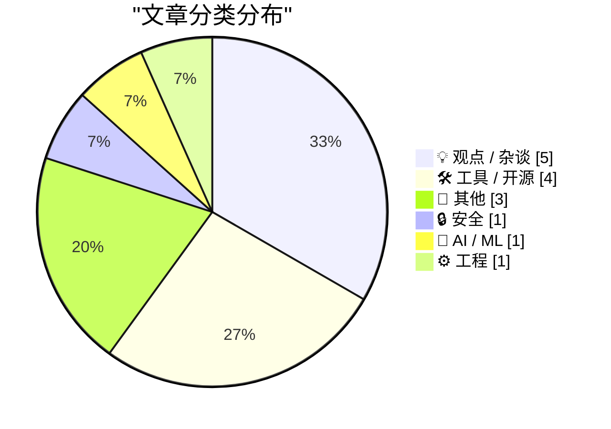
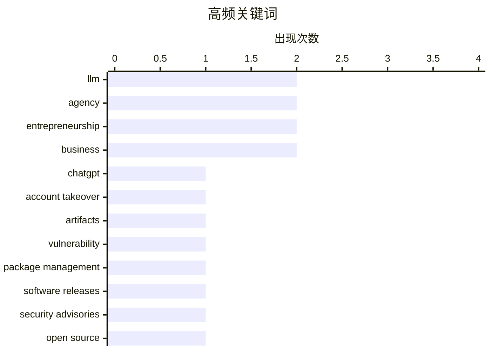

# 📰 Nov 2, 2026

> 来自 Karpathy 推荐的 92 个顶级技术博客，AI 精选 Top 15

## 📝 今日看点

今天的技术讨论集中在 AI 应用快速落地带来的安全与信任挑战：从 ChatGPT 交互功能漏洞到 AI 生成代码的审阅，应用安全和工程可靠性正成为核心议题。围绕 AI 的版权归属、文档可信度与开发组织能力，行业也在重新审视技术责任和制度边界。与此同时，工具生态继续向智能体友好方向演进，从依赖管理排障到无需浏览器完成应用注册，软件基础设施正在适配 AI 智能体的直接操作。

---

## 🏆 今日必读

🥇 **我们如何接管 ChatGPT 账户**

[How We Took Over ChatGPT Accounts](https://simonwillison.net/2026/Oct/31/how-we-took-over-chatgpt-accounts/) — simonwillison.net · 1 天前 · 🔒 安全

> Parameter Labs 披露了一项针对 ChatGPT 交互式 HTML 应用展示功能的漏洞，并以接管账户为题报告其研究。漏洞涉及 artifacts 模式在 ChatGPT 中的实现，这类功能曾称为 Canvas，所给摘录称其最新版本为 HTML previews。该功能允许展示自定义交互式 HTML，因此其安全边界直接关系到运行这些内容的风险。现有摘录未包含攻击链、利用条件或修复状态，无法据此判断账户接管的具体机制与影响范围。

💡 **为什么值得读**: 适合开发 AI 交互界面或嵌入式 HTML 功能的工程师阅读，以关注内容运行环境与账户权限之间的安全边界。

🏷️ ChatGPT, account takeover, artifacts, vulnerability

🥈 **包管理周报：2026 年 10 月 31 日**

[This Week in Package Management: 31 October 2026](https://nesbitt.io/2026/10/31/this-week-in-package-management.html) — nesbitt.io · 1 天前 · 🛠 工具 / 开源

> 本期周报汇总包管理领域的软件发布、安全公告和相关文章。内容覆盖版本动态、风险提示与技术阅读三个方向，可作为跟踪包管理生态变化的入口。所给简介没有列出具体包管理器、版本号、漏洞编号或文章观点，因此无法提炼单项更新的影响。其主要价值是集中组织一周资讯，具体升级或修复决策仍需查看完整条目。

💡 **为什么值得读**: 适合负责依赖维护、构建工具或软件供应链的读者，用一份周报集中筛选需要跟进的变化。

🏷️ package management, software releases, security advisories, open source

🥉 **每周更新第 528 期：阅读 AI 生成的代码与太阳能的经济账**

[Weekly Update 528: Reading AI-generated Code & the Economics of Solar](https://www.troyhunt.com/weekly-update-528/) — troyhunt.com · 20 小时前 · 🤖 AI / ML

> 第 528 期更新围绕阅读 AI 生成的代码与太阳能经济性展开。Troy Hunt 提到，Proton 首席执行官的《AI @ Proton，工程宣言》恰好在本期视频发布前后引发关注。他认为，这位高管的管理风格和措辞招致了许多人的反感，并明确表示这些批评有其道理。所给摘录没有展开代码审阅方法，也没有提供太阳能成本、收益或回本周期，因此只能确认议题与作者对相关管理争议的态度。

💡 **为什么值得读**: 如果你同时关心 AI 编程的工程管理争议和家庭能源投资，这一期提供了两个值得进一步追看的话题。

🏷️ AI-generated code, software engineering, engineering management, solar economics

---

## 📊 数据概览

| 扫描源 | 抓取文章 | 时间范围 | 精选 |
|:---:|:---:|:---:|:---:|
| 83/92 | 2571 篇 → 17 篇 | 48h | **15 篇** |

### 分类分布



### 高频关键词



<details>
<summary>📈 纯文本关键词图（终端友好）</summary>

```
llm                │ ████████████████████ 2
agency             │ ████████████████████ 2
entrepreneurship   │ ████████████████████ 2
business           │ ████████████████████ 2
chatgpt            │ ██████████░░░░░░░░░░ 1
account takeover   │ ██████████░░░░░░░░░░ 1
artifacts          │ ██████████░░░░░░░░░░ 1
vulnerability      │ ██████████░░░░░░░░░░ 1
package management │ ██████████░░░░░░░░░░ 1
software releases  │ ██████████░░░░░░░░░░ 1
```

</details>

### 🏷️ 话题标签

**llm**(2) · **agency**(2) · **entrepreneurship**(2) · business(2) · chatgpt(1) · account takeover(1) · artifacts(1) · vulnerability(1) · package management(1) · software releases(1) · security advisories(1) · open source(1) · ai-generated code(1) · software engineering(1) · engineering management(1) · solar economics(1) · career(1) · reputation(1) · engineering culture(1) · ai(1)

---

## 💡 观点 / 杂谈

### 1. 提升职场声誉的快方法与慢方法

[Fast and slow ways to improve your reputation](https://seangoedecke.com/how-to-get-assigned-interesting-work/) — **seangoedecke.com** · 1 天前 · ⭐ 21/30

> 工程师在科技公司积累声誉时，常遇到一个循环：重要项目能建立好声誉，但获得重要项目又往往需要先有好声誉。作者收到的读者来信描述了这种困境：经理持续把曝光度高的工作交给实力强的资深工程师，使其获得更多后续机会。这种分配方式让其他工程师难以通过同样的路径证明自己，也让既有声誉不断强化。标题表明作者将区分改善声誉的快慢路径，但所给摘录尚未呈现具体方法，不能据此归纳行动建议。

🏷️ career, reputation, engineering culture

---

### 2. Pluralistic：形式要件（2026 年 10 月 31 日）

[Pluralistic: Formalities (31 Oct 2026)](https://pluralistic.net/2026/10/31/burn-berne/) — **pluralistic.net** · 1 天前 · ⭐ 21/30

> 本期主文关注 AI 与版权制度中的形式要件，即取得版权保护是否需要满足特定条件或付出相应努力。作者将美国版权局在 AI 问题上的立场解读为一种回归：版权应是需要努力才能取得的权利。这是一项明确的规范性主张，强调版权保护的取得条件。所给摘录没有说明具体裁定、登记要求或法律论证，其余内容主要是链接推荐和历史文章回顾。

🏷️ AI, copyright, Copyright Office

---

### 3. 摘引 Kyle Kingsbury 的观点

[Quoting Kyle Kingsbury](https://simonwillison.net/2026/Nov/1/kyle-kingsbury/) — **simonwillison.net** · 11 小时前 · ⭐ 20/30

> Kyle Kingsbury 认为，大语言模型正在削弱人们对文档、软件及其开发组织的信任。这段引文来自 Jepsen 对 ParticleDB 1.1.4 的分析，其中讨论了使用 LLM 的取舍。他指出，过去用于判断系统是否成熟的信号，如今更容易被伪造，因此工程师可能开始对所有新软件项目保持怀疑。引文进一步提出维护者如何确保软件正确、文档准确的问题，但所给摘录在回答展开前已经截断。

🏷️ LLM, software trust, documentation

---

### 4. 我为什么要打造一家由一人运营、价值十亿美元的服务公司

[Why I’m Building a One-Person, Billion-Dollar Agency](https://www.joanwestenberg.com/p/why-im-building-a-one-person-billion) — **joanwestenberg.com** · 1 天前 · ⭐ 20/30

> 作者提出打造一家由单人运营、价值十亿美元的服务公司的目标。文章以重新介绍 SELF 为切入点，将个人创业与极高的业务价值目标联系起来。所给简介没有交代 SELF 的服务内容、商业模式、技术工具或现有经营数据，因此无法判断这一目标的实现路径。“十亿美元”在标题中是愿景性表述，现有材料不足以将其认定为已实现的营收或估值。

🏷️ self-employment, agency, entrepreneurship, business

---

### 5. 聊聊我的自主性

[The One About my Agency](https://www.joanwestenberg.com/p/the-one-about-my-agency) — **joanwestenberg.com** · 5 小时前 · ⭐ 16/30

> 这是一则标注为“11 月 2 日”的每周更新，标题涉及作者自身的 agency，可暂译为“自主性”。所给内容只有标题和更新日期，没有提供正文。由于缺少上下文，无法确认 agency 在这里指个人自主性，还是作者经营的机构或业务。因此，目前无法可靠提炼文章的具体论点、案例与结论，中文标题也只能作为暂译。

🏷️ agency, entrepreneurship, business

---

## 🛠 工具 / 开源

### 6. 包管理周报：2026 年 10 月 31 日

[This Week in Package Management: 31 October 2026](https://nesbitt.io/2026/10/31/this-week-in-package-management.html) — **nesbitt.io** · 1 天前 · ⭐ 25/30

> 本期周报汇总包管理领域的软件发布、安全公告和相关文章。内容覆盖版本动态、风险提示与技术阅读三个方向，可作为跟踪包管理生态变化的入口。所给简介没有列出具体包管理器、版本号、漏洞编号或文章观点，因此无法提炼单项更新的影响。其主要价值是集中组织一周资讯，具体升级或修复决策仍需查看完整条目。

🏷️ package management, software releases, security advisories, open source

---

### 7. 拿不准时，先删除 uv.lock 文件

[If in doubt, delete the uv.lock file](https://simonwillison.net/2026/Nov/1/delete-uv-lock-first/) — **simonwillison.net** · 5 小时前 · ⭐ 19/30

> Simon Willison 在切换到 Python 3.15 后，偶尔遇到令人困惑的依赖错误，并提出先删除 uv.lock 的排查经验。他的大多数项目是库，通常不在项目中附带 uv.lock，理由是不希望库的版本锁定影响使用它的其他项目。不过，执行 uv run pytest 等命令仍会在本地留下 uv.lock 文件，使锁文件成为排查依赖问题时容易忽略的因素。作者的核心建议是：在这一环境下遇到难以解释的依赖错误时，可以尝试删除锁文件，但摘录没有给出具体报错或适用于所有项目的结论。

🏷️ Python, uv, dependency management, lockfile

---

### 8. WorkOS：让智能体无需浏览器即可注册你的应用

[WorkOS: Let Agents Sign Up for Your App Without a Browser](https://workos.com/auth-md?utm_source=daringfireball&amp;utm_medium=newsletter&amp;utm_campaign=q42026) — **daringfireball.net** · 8 小时前 · ⭐ 18/30

> WorkOS 推出 auth.md 方案，让 AI 智能体通过读取文件完成应用注册，无需操作面向人类的浏览器注册页面。开发者在控制台启用该功能后，AuthKit 会发布 auth.md，供智能体读取并启动注册流程。智能体随后获得权限范围受限、有效期较短且由应用方控制的凭证，用户也无需中断当前任务去处理登录。这是一则赞助推广内容，其核心主张是将注册与认证入口变成智能体可直接读取和使用的接口。

🏷️ WorkOS, AI agents, authentication, auth.md

---

### 9. datasette-llm 0.1a9

[datasette-llm 0.1a9](https://simonwillison.net/2026/Oct/31/datasette-llm/) — **simonwillison.net** · 1 天前 · ⭐ 17/30

> datasette-llm 0.1a9 为 Datasette Agent 带来一项模型配置体验改进。该插件现在会读取 LLM 工具使用的默认模型，让 Datasette Agent 能够沿用已有的模型选择。这项更新的重点是减少使用时的配置步骤，属于底层插件的小幅体验优化。作者还预告了 Datasette Agent 的较大升级，但所给片段没有披露具体内容。

🏷️ Datasette, LLM, release, UX

---

## 📝 其他

### 10. 阅读清单：2026 年 10 月 31 日

[Reading List 10/31/26](https://www.construction-physics.com/p/reading-list-103126) — **construction-physics.com** · 1 天前 · ⭐ 20/30

> 本期阅读清单汇集制造、能源、交通与航天领域的话题。列出的内容包括太空光纤制造、核能区域供热、西班牙高铁事故以及中国空天飞机。这些议题分别涉及特殊制造环境、供热基础设施、交通安全和航天技术发展。所给简介没有提供各条目的数据、事故原因或技术结论，因此应将其视为跨领域阅读导航。

🏷️ space technology, nuclear heating, high-speed rail, spaceplane

---

### 11. 极点与极线的统一视角

[A unified view of poles and polars](https://www.johndcook.com/blog/2026/11/01/projective-poles-and-polars/) — **johndcook.com** · 7 小时前 · ⭐ 16/30

> 极点与极线在不同几何背景下的联系，是这篇文章关注的核心问题。作者此前讨论过球面三角形的对偶，即极三角形，也介绍过平面几何中的极点与极线。此次文章进一步转向射影几何，尝试统一理解这些相关概念，并指出它们在平面几何中的表述存在不够自然之处。所给片段未展示具体推导，能够确认的核心方向是借助射影几何重新组织极点与极线的理解。

🏷️ geometry, duality, projective geometry, polar triangle

---

### 12. 2026 年 10 月札记

[Notes from October 2026](https://evanhahn.com/notes-from-october-2026/) — **evanhahn.com** · 1 天前 · ⭐ 15/30

> 作者在 2026 年 10 月的个人回顾中，分享了网站托管架构迁移的实践。网站从使用 Apache 的 VPS 迁移到了以 CDN 作为前端的对象存储。作者报告，新架构降低了费用和维护工作量，并让全球大多数地区的访问速度更快，但没有给出量化指标。对访客而言，这次迁移的预期效果是保持原有访问体验，同时提升加载速度，体现了此次架构调整在成本、运维和性能上的收益。

🏷️ static hosting, CDN, object storage, VPS

---

## 🔒 安全

### 13. 我们如何接管 ChatGPT 账户

[How We Took Over ChatGPT Accounts](https://simonwillison.net/2026/Oct/31/how-we-took-over-chatgpt-accounts/) — **simonwillison.net** · 1 天前 · ⭐ 25/30

> Parameter Labs 披露了一项针对 ChatGPT 交互式 HTML 应用展示功能的漏洞，并以接管账户为题报告其研究。漏洞涉及 artifacts 模式在 ChatGPT 中的实现，这类功能曾称为 Canvas，所给摘录称其最新版本为 HTML previews。该功能允许展示自定义交互式 HTML，因此其安全边界直接关系到运行这些内容的风险。现有摘录未包含攻击链、利用条件或修复状态，无法据此判断账户接管的具体机制与影响范围。

🏷️ ChatGPT, account takeover, artifacts, vulnerability

---

## 🤖 AI / ML

### 14. 每周更新第 528 期：阅读 AI 生成的代码与太阳能的经济账

[Weekly Update 528: Reading AI-generated Code & the Economics of Solar](https://www.troyhunt.com/weekly-update-528/) — **troyhunt.com** · 20 小时前 · ⭐ 25/30

> 第 528 期更新围绕阅读 AI 生成的代码与太阳能经济性展开。Troy Hunt 提到，Proton 首席执行官的《AI @ Proton，工程宣言》恰好在本期视频发布前后引发关注。他认为，这位高管的管理风格和措辞招致了许多人的反感，并明确表示这些批评有其道理。所给摘录没有展开代码审阅方法，也没有提供太阳能成本、收益或回本周期，因此只能确认议题与作者对相关管理争议的态度。

🏷️ AI-generated code, software engineering, engineering management, solar economics

---

## ⚙️ 工程

### 15. 用 iOS 快捷指令驱动 Mastodon 机器人

[A Mastodon bot powered by iOS Shortcuts](https://evanhahn.com/mastodon-bot-with-ios-shortcuts/) — **evanhahn.com** · 17 小时前 · ⭐ 17/30

> 一个原本运行在服务器上的 Mastodon 机器人，被作者迁移到了手机上的 iOS 快捷指令。这个名为 Ulrira 的机器人会随机发布《塞尔达传说：织梦岛》中的台词。作者表示，新方案在撰文前已运行数天，展示了用手机自动化承载简单发布任务的实际案例。所给片段未包含后续实现细节，因此无法确认其定时触发、授权和故障处理方式。

🏷️ Mastodon, iOS Shortcuts, automation, bots

---

*生成于 2026-11-02 04:26 | 扫描 83 源 → 获取 2571 篇 → 精选 15 篇*
*基于 [Hacker News Popularity Contest 2025](https://refactoringenglish.com/tools/hn-popularity/) RSS 源列表，由 [Andrej Karpathy](https://x.com/karpathy) 推荐*
