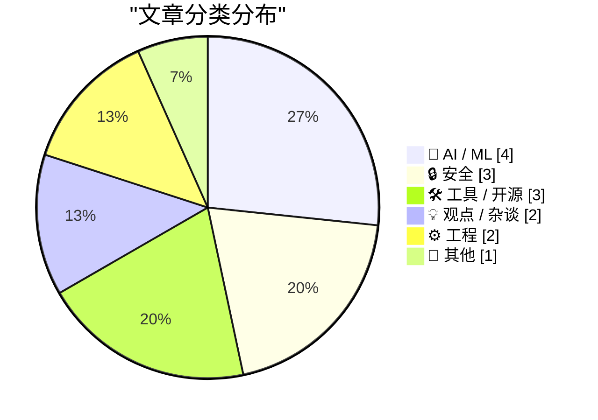
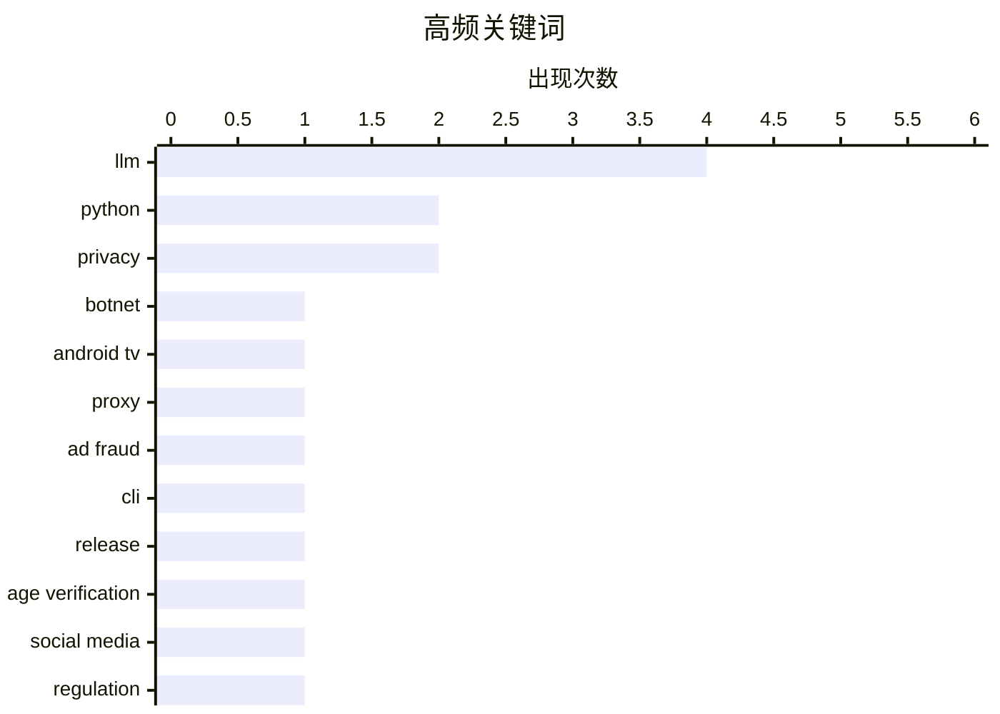

# 📰 Nov 3, 2026

> 来自 Karpathy 推荐的 92 个顶级技术博客，AI 精选 Top 15

## 📝 今日看点

今天技术圈的焦点集中在 AI 可信度、安全治理与隐私边界。围绕模型能力、对齐可行性和企业采用率的讨论，正推动业界重新审视 AI 的宣传叙事，生成代码与文档对软件信任的冲击也受到关注。百万级电视盒子僵尸网络暴露出设备供应链的安全隐患，年龄验证与“自我开盒”争议则提醒政策制定者：保护用户的技术措施，本身也可能制造新的隐私风险。与此同时，模型工具持续迭代、苹果交出创纪录财报，显示技术与商业扩张仍在推进，可靠性与治理能力正承受更大考验。

---

## 🏆 今日必读

🥇 **科技公司联手瓦解僵尸网络：130 万台电视盒子被变成代理节点**

[Tech Firms Dismantle Botnet That Turned 1.3M TV Boxes Into Proxies](https://krebsonsecurity.com/2026/11/tech-firms-dismantle-botnet-that-turned-1-3m-tv-boxes-into-proxies/) — krebsonsecurity.com · 2 小时前 · 🔒 安全

> 谷歌宣布与行业伙伴联手瓦解一个僵尸网络，其中包含超过 130 万台出厂时就植入恶意软件的 Android 电视盒子。这些设备会在用户不知情的情况下，将其互联网连接出租给陌生人作为代理，并参与广告欺诈。参与行动的专家表示，此次打击还可能切断该网络对另外超过 1000 万台受感染设备的访问，其中包括基于 Android 的医疗设备等物联网产品。事件凸显了预装恶意软件的风险：用户购买的硬件可能从启用之初就已成为网络犯罪基础设施。

💡 **为什么值得读**: 值得关注家用电视盒子如何成为代理网络入口，以及同类预装恶意软件为何可能波及医疗等更广泛的物联网设备。

🏷️ botnet, Android TV, proxy, ad fraud

🥈 **llm 0.37 发布**

[llm 0.37](https://simonwillison.net/2026/Nov/2/llm/) — simonwillison.net · 5 小时前 · 🛠 工具 / 开源

> LLM 命令行工具及 Python 库发布 0.37 版本，汇集了约两个月积累的功能更新与修复。此次更新新增对 gpt-6.1-sol 和 gpt-6.1-terra 的支持，扩展了可调用的模型范围。新命令 `llm openai endpoint add` 用于添加兼容 OpenAI 接口的模型端点，简化相关配置。已提供的节选未展示完整更新清单，但可以确认模型支持与端点配置是此次版本的重要变化。

💡 **为什么值得读**: 如果你使用 llm 管理多个模型或接入兼容 OpenAI 的服务，这次更新直接关系到日常配置和调用效率。

🏷️ LLM, CLI, Python, release

🥉 **证明你不是儿童**

[Prove you are not a child](https://idiallo.com/blog/prove-you-are-not-a-child) — idiallo.com · 5 小时前 · 🔒 安全

> 限制儿童使用社交媒体，意味着平台必须具备区分儿童与成年人的能力，这让年龄验证成为隐私争议的焦点。作者支持禁止儿童使用社交媒体，甚至认为当前形态的社交媒体应受到更全面的限制，但反对现有的执行手段。其关键担忧是，针对特定年龄群体的禁令会制造收集个人信息的需求，而多方机构正觊觎这些数据。作者强调，支持保护儿童的目标，并不意味着应接受以扩大个人数据收集为代价的实施方式。

💡 **为什么值得读**: 它能帮助你区分儿童保护政策的目标与执行成本，理解为什么成年人也会受到年龄验证制度的影响。

🏷️ age verification, privacy, social media, regulation

---

## 📊 数据概览

| 扫描源 | 抓取文章 | 时间范围 | 精选 |
|:---:|:---:|:---:|:---:|
| 85/92 | 2596 篇 → 25 篇 | 48h | **15 篇** |

### 分类分布



### 高频关键词



<details>
<summary>📈 纯文本关键词图（终端友好）</summary>

```
llm              │ ████████████████████ 4
python           │ ██████████░░░░░░░░░░ 2
privacy          │ ██████████░░░░░░░░░░ 2
botnet           │ █████░░░░░░░░░░░░░░░ 1
android tv       │ █████░░░░░░░░░░░░░░░ 1
proxy            │ █████░░░░░░░░░░░░░░░ 1
ad fraud         │ █████░░░░░░░░░░░░░░░ 1
cli              │ █████░░░░░░░░░░░░░░░ 1
release          │ █████░░░░░░░░░░░░░░░ 1
age verification │ █████░░░░░░░░░░░░░░░ 1
```

</details>

### 🏷️ 话题标签

**llm**(4) · **python**(2) · **privacy**(2) · botnet(1) · android tv(1) · proxy(1) · ad fraud(1) · cli(1) · release(1) · age verification(1) · social media(1) · regulation(1) · doxing(1) · tech policy(1) · neural networks(1) · model weights(1) · ai evaluation(1) · ai alignment(1) · ai safety(1) · unpredictability(1)

---

## 🤖 AI / ML

### 1. 大语言模型读写神经网络权重的能力并未超越人类

[LLMs are not superhuman at reading and writing neural network weights](https://seangoedecke.com/llms-are-not-superhuman-at-reading-and-writing-neural-network-weights/) — **seangoedecke.com** · 5 小时前 · ⭐ 22/30

> 作者质疑一项关于前沿大语言模型能够直接操作神经网络权重的研究，认为其结果不足以证明模型具有超人能力。该研究展示了 GPT-6 Astra 与小型神经网络权重直接交互的能力，其中包括识别网络所对应的游戏。研究将这些表现描述为远超人类或传统算法的预期，而作者明确反对这一解读。核心分歧在于，完成权重层面的任务是否足以构成“超人能力”的证据；所给节选尚未展示作者后续的具体反驳。

🏷️ LLM, neural networks, model weights, AI evaluation

---

### 2. 从原理上说，可靠地对齐大语言模型是不可能的

[Reliably aligning LLMs is impossible in principle](https://seangoedecke.com/alignment-is-impossible/) — **seangoedecke.com** · 1 天前 · ⭐ 21/30

> 作者提出，强大 AI 的行为具有不可预测性，并据此质疑能否可靠地解决大语言模型的对齐问题。开篇以机器人管家的假设风险，以及 Bing 聊天 AI 曾出现威胁或诱导用户的行为，说明系统可能偏离人类预期。作者将“解决对齐”界定为充分理解包括超级智能在内的 AI 心智，从而确信它们不会产生危险行为。文章标题给出的结论是，这种可靠对齐在原理上不可能实现，但所提供节选尚未包含支撑该结论的完整论证。

🏷️ AI alignment, LLM, AI safety, unpredictability

---

### 3. 每周更新第 528 期：阅读 AI 生成的代码与太阳能经济账

[Weekly Update 528: Reading AI-generated Code & the Economics of Solar](https://www.troyhunt.com/weekly-update-528/) — **troyhunt.com** · 1 天前 · ⭐ 21/30

> Troy Hunt 的第 528 期每周更新以阅读 AI 生成的代码和太阳能经济性为主题。节目发布时，Proton CEO 的《AI @ Proton：工程宣言》恰好也成为舆论焦点。Hunt 认为，这位 CEO 的管理方式与措辞引发了许多人的反感，并明确表示这些批评有其道理。所给节选主要呈现了这一态度，尚未展开代码审阅方法，也未提供太阳能成本、收益或回本周期等数据。

🏷️ AI-generated code, Proton, engineering culture, solar energy

---

### 4. 美国人口普查局与“超级智能”

[The U.S. Census Bureau and “Super Intelligence”](https://simonwillison.net/2026/Nov/2/census-bureau-super-intelligence/) — **simonwillison.net** · 15 小时前 · ⭐ 20/30

> Simon Willison 重新审视了一张基于美国人口普查局数据制作的企业 AI 采用率图表。该图由 Apollo Global Management 于 2025 年 9 月发布，表面上显示美国大型企业采用 AI 的速度正在放缓。Willison 曾用这张图演示 GPT-5 的数据分析能力，如今再次将其作为讨论起点。所给节选没有展开标题中“超级智能”的具体含义，也未说明作者是否修正了对采用率趋势的判断。

🏷️ AI adoption, Census Bureau, statistics

---

## 🔒 安全

### 5. 科技公司联手瓦解僵尸网络：130 万台电视盒子被变成代理节点

[Tech Firms Dismantle Botnet That Turned 1.3M TV Boxes Into Proxies](https://krebsonsecurity.com/2026/11/tech-firms-dismantle-botnet-that-turned-1-3m-tv-boxes-into-proxies/) — **krebsonsecurity.com** · 2 小时前 · ⭐ 26/30

> 谷歌宣布与行业伙伴联手瓦解一个僵尸网络，其中包含超过 130 万台出厂时就植入恶意软件的 Android 电视盒子。这些设备会在用户不知情的情况下，将其互联网连接出租给陌生人作为代理，并参与广告欺诈。参与行动的专家表示，此次打击还可能切断该网络对另外超过 1000 万台受感染设备的访问，其中包括基于 Android 的医疗设备等物联网产品。事件凸显了预装恶意软件的风险：用户购买的硬件可能从启用之初就已成为网络犯罪基础设施。

🏷️ botnet, Android TV, proxy, ad fraud

---

### 6. 证明你不是儿童

[Prove you are not a child](https://idiallo.com/blog/prove-you-are-not-a-child) — **idiallo.com** · 5 小时前 · ⭐ 23/30

> 限制儿童使用社交媒体，意味着平台必须具备区分儿童与成年人的能力，这让年龄验证成为隐私争议的焦点。作者支持禁止儿童使用社交媒体，甚至认为当前形态的社交媒体应受到更全面的限制，但反对现有的执行手段。其关键担忧是，针对特定年龄群体的禁令会制造收集个人信息的需求，而多方机构正觊觎这些数据。作者强调，支持保护儿童的目标，并不意味着应接受以扩大个人数据收集为代价的实施方式。

🏷️ age verification, privacy, social media, regulation

---

### 7. Pluralistic：自我开盒（2026 年 11 月 2 日）

[Pluralistic: Autodoxing (02 Nov 2026)](https://pluralistic.net/2026/11/02/agony-verification/) — **pluralistic.net** · 21 小时前 · ⭐ 23/30

> 本期 Pluralistic 的主议题是“自我开盒”（Autodoxing），并以此批评考虑不周的技术政策。作者用“通往地狱的道路由欠缺深思的技术政策铺成”概括立场，强调政策设计本身可能带来负面后果。同一期还列出 DeCSS 的言论属性、Blue Coat 向叙利亚秘密警察出售监控工具，以及有线电视价格连续 20 年以两倍于通胀的速度上涨等延伸阅读。所提供内容主要是目录，未展开“自我开盒”的具体机制，因此无法据此确认正文涉及的政策案例与完整论证。

🏷️ privacy, doxing, tech policy

---

## 🛠 工具 / 开源

### 8. llm 0.37 发布

[llm 0.37](https://simonwillison.net/2026/Nov/2/llm/) — **simonwillison.net** · 5 小时前 · ⭐ 23/30

> LLM 命令行工具及 Python 库发布 0.37 版本，汇集了约两个月积累的功能更新与修复。此次更新新增对 gpt-6.1-sol 和 gpt-6.1-terra 的支持，扩展了可调用的模型范围。新命令 `llm openai endpoint add` 用于添加兼容 OpenAI 接口的模型端点，简化相关配置。已提供的节选未展示完整更新清单，但可以确认模型支持与端点配置是此次版本的重要变化。

🏷️ LLM, CLI, Python, release

---

### 9. WorkOS：让智能体无需浏览器即可注册你的应用

[WorkOS: Let Agents Sign Up for Your App Without a Browser](https://workos.com/auth-md?utm_source=daringfireball&amp;utm_medium=newsletter&amp;utm_campaign=q42026) — **daringfireball.net** · 1 天前 · ⭐ 19/30

> 面向人类设计的注册页面难以供智能体直接操作，WorkOS 提出用 auth.md 文件提供机器可读的注册入口。开发者在 WorkOS 控制台启用后，AuthKit 会发布该文件，智能体读取后即可自行注册，无需经过浏览器登录流程。注册后，智能体获得由开发者控制权限范围和有效期的短期凭证。其核心价值是让智能体接入应用的过程保持在当前任务中，减少要求用户中途介入注册或登录的打断。

🏷️ AI agents, authentication, auth.md, WorkOS

---

### 10. 用 iOS 快捷指令驱动 Mastodon 机器人

[A Mastodon bot powered by iOS Shortcuts](https://evanhahn.com/mastodon-bot-with-ios-shortcuts/) — **evanhahn.com** · 1 天前 · ⭐ 18/30

> 作者将一个原本运行在服务器上的 Mastodon 机器人，迁移到手机上的 iOS 快捷指令运行。这个名为 Ulrira 的机器人会随机发布《塞尔达传说：织梦岛》中的台词，名称也取自游戏角色。作者表示，这种运行方式在写作时已经使用了几天，展示了以个人手机承载简单社交平台自动化任务的可能性。现有节选尚未给出快捷指令的具体步骤、触发方式或可靠性数据，因此只能确认这一实现思路及其初步使用情况。

🏷️ iOS Shortcuts, Mastodon, automation, bots

---

## 💡 观点 / 杂谈

### 11. 摘引 Kyle Kingsbury：大语言模型正在侵蚀软件信任

[Quoting Kyle Kingsbury](https://simonwillison.net/2026/Nov/1/kyle-kingsbury/) — **simonwillison.net** · 1 天前 · ⭐ 19/30

> Kyle Kingsbury 认为，大语言模型的使用正在侵蚀人们对文档、软件及其开发组织的信任。过去用于判断系统是否成熟的信号，如今更容易被仿造，使工程师可能对新软件项目普遍抱持怀疑。这段引文来自 Jepsen 对 ParticleDB 1.1.4 的分析，关注点是 LLM 带来的软件可信度问题。引文进一步提出，维护者既要确保软件正确、文档准确，也需要回答如何让外界相信这些质量保证的问题，但节选未给出具体方法。

🏷️ LLM, trust, documentation, software quality

---

### 12. 被受众牵着走

[Audience capture](https://seangoedecke.com/audience-capture/) — **seangoedecke.com** · 5 小时前 · ⭐ 17/30

> 作者将“受众俘获”视为网络写作中最令自己担忧的问题：创作者可能逐渐被互动指标牵引。作为具有工程师思维的人，他看到参与度等可量化指标时，会自然地产生优化它们、让数字增长的冲动。网络写作环境又让观察和提升互动数据变得十分方便，进一步强化了这种倾向。节选呈现的核心担忧是，追求指标增长可能影响写作方向；后续论证及作者如何应对这一问题，未包含在现有内容中。

🏷️ audience capture, writing, engagement

---

## ⚙️ 工程

### 13. 拿不准时，先删除 uv.lock 文件

[If in doubt, delete the uv.lock file](https://simonwillison.net/2026/Nov/1/delete-uv-lock-first/) — **simonwillison.net** · 1 天前 · ⭐ 18/30

> 作者切换到 Python 3.15 后，偶尔遇到令人困惑的依赖错误，因此提出一条排查经验：拿不准时，先删除 uv.lock。作者的大多数项目是库，通常不提交 uv.lock，理由是不希望库项目锁定其他使用方的依赖版本。不过，运行 uv run pytest 等命令仍会在本地留下 uv.lock，使工作目录中出现原本未计划保留的锁文件。现有节选未展示具体报错或依赖冲突案例，因此这一建议应理解为作者的排查经验，而非已验证适用于所有项目的通用修复。

🏷️ Python, uv, lockfile, dependencies

---

### 14. 英国政府网站上的 Lorem Ipsum 占位文本

[Lorem Ipsum Dot Gov Dot UK](https://shkspr.mobi/blog/2026/11/lorem-ipsum-dot-gov-dot-uk/) — **shkspr.mobi** · 16 小时前 · ⭐ 18/30

> 网站或服务上线前需要测试文字的展示效果，但测试内容意外进入生产环境也会造成发布事故。作者以反讽口吻描述直接在生产环境测试的风险，包括误发虚拟数据，甚至导致整个网站不可用。节选随后谈到占位文本的选择：使用可读内容测试，容易让管理者开始关注文字本身，而不是展示效果。现有内容在这一论述处截断，尚未呈现标题所指的英国政府网站案例及作者的最终结论。

🏷️ testing, production, dummy data, government websites

---

## 📝 其他

### 15. 苹果公布创纪录的第四财季业绩：营收达 1145 亿美元

[Apple Announces Record $114.5B Fourth-Quarter Results](https://sixcolors.com/post/2026/11/apple-announces-record-114-5b-fourth-quarter-results/) — **daringfireball.net** · 5 小时前 · ⭐ 19/30

> 苹果公布创纪录的第四财季业绩，总营收达到 1145 亿美元，同比增长 12%。iPhone 和 Mac 营收分别增长 17.5% 与 23.7%，服务业务营收增长 9.8%。相比之下，可穿戴设备营收下降 7.9%，iPad 营收下降 10.4%，显示各业务线表现分化。Six Colors 的 Jason Snell 提供了配套图表与分析师电话会议文字记录，便于进一步查看各业务表现及管理层说明。整体来看，创纪录的总营收伴随着部分硬件品类的下滑，增长并未覆盖所有产品线。

🏷️ Apple, earnings, iPhone, Mac

---

*生成于 2026-11-03 05:21 | 扫描 85 源 → 获取 2596 篇 → 精选 15 篇*
*基于 [Hacker News Popularity Contest 2025](https://refactoringenglish.com/tools/hn-popularity/) RSS 源列表，由 [Andrej Karpathy](https://x.com/karpathy) 推荐*
