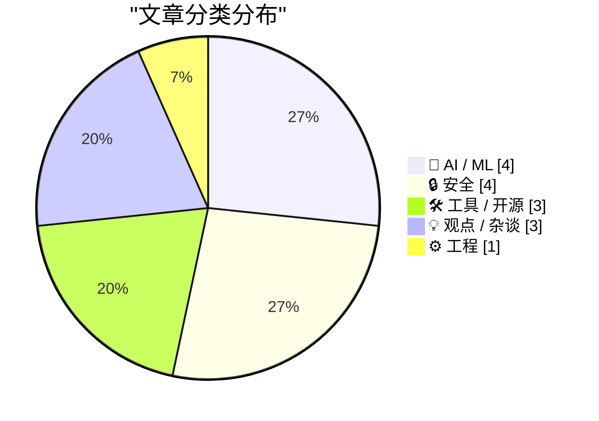
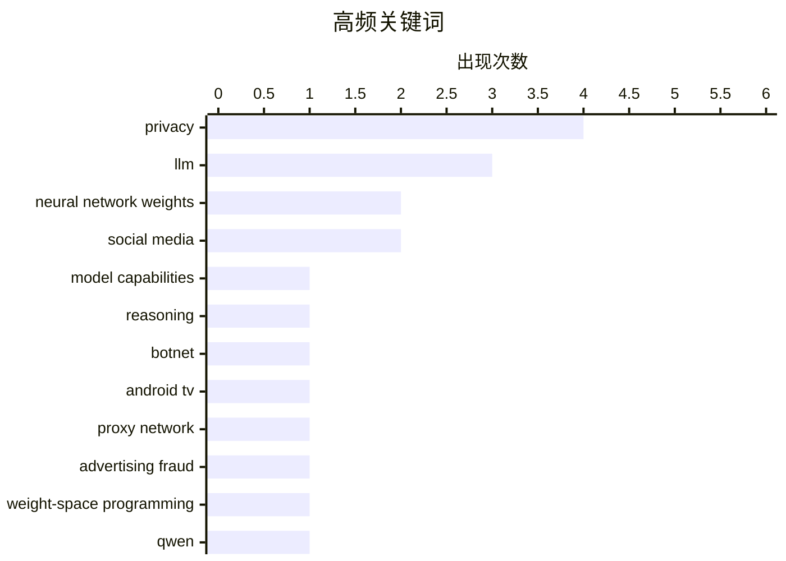

# 📰 Nov 4, 2026

> 来自 Karpathy 推荐的 92 个顶级技术博客，AI 精选 Top 15

## 📝 今日看点

今天的 AI 话题聚焦于模型能力边界：前沿模型和本地开源模型都已能直接解读神经网络权重，但这类能力是否意味着真正的“超越人类”仍存争议。AI 正加速嵌入操作系统与开发工具，苹果开放 Siri AI 开发者预览，相关生态持续扩张。与此同时，AI 训练数据的版权诉讼、平台内容抓取与用户年龄验证问题升温，技术创新与监管边界进一步碰撞。安全领域则持续暴露现实风险，从被恶意利用的电视盒僵尸网络，到通过环境声音反推精确位置，设备供应链与隐私保护都面临新挑战。

---

## 🏆 今日必读

🥇 **大语言模型读写神经网络权重的能力并未超越人类**

[LLMs are not superhuman at reading and writing neural network weights](https://seangoedecke.com/llms-are-not-superhuman-at-reading-and-writing-neural-network-weights/) — seangoedecke.com · 1 天前 · 🤖 AI / ML

> 前沿大语言模型能够直接处理神经网络权重，但作者质疑这足以证明其具备超越人类的能力。被评述的研究展示了 GPT-6 Astra 对小型神经网络权重的分析能力，包括识别网络对应的游戏。研究者将这种表现描述为远超人类或传统算法的预期，而作者反对这一判断。争议的关键在于，完成权重分析任务是否真的超出了人类及常规计算方法能够达到的范围。

💡 **为什么值得读**: 适合用来审视 AI 研究中的“超人能力”叙事，区分实验展示与能力结论之间的距离。

🏷️ LLM, neural network weights, model capabilities, reasoning

🥈 **科技公司联手瓦解僵尸网络，130 万台电视盒曾被用作代理**

[Tech Firms Dismantle Botnet That Turned 1.3M TV Boxes Into Proxies](https://krebsonsecurity.com/2026/11/tech-firms-dismantle-botnet-that-turned-1-3m-tv-boxes-into-proxies/) — krebsonsecurity.com · 1 天前 · 🔒 安全

> Google 宣布与行业伙伴合作，瓦解了一个涉及超过 130 万台 Android 电视机顶盒的僵尸网络。这些设备出厂时就携带恶意软件，会在用户不知情的情况下将其互联网连接出租给陌生人，并实施广告欺诈。参与行动的专家表示，此次打击还可能切断该网络对另外超过 1000 万台受感染系统的访问，其中包括基于 Android 的医疗设备等物联网产品。事件表明，预装恶意软件的风险已从电视盒延伸至更多联网设备，并支撑起大规模代理服务与欺诈活动。

💡 **为什么值得读**: 它揭示了廉价联网设备如何成为代理和欺诈基础设施，有助于判断设备采购与家庭网络中的隐蔽风险。

🏷️ botnet, Android TV, proxy network, advertising fraud

🥉 **我笔记本上的 Qwen 3.8 27B 也能解读模型权重**

[Qwen 3.8 27B on my laptop can interpret model weights, too](https://simonwillison.net/2026/Nov/3/qwen-can-interpret-model-weights/) — simonwillison.net · 12 小时前 · 🤖 AI / ML

> Simon Willison 展示了笔记本上运行的 Qwen 3.8 27B 也能解读模型权重的案例。此前，Rikiya Takehi、Jayden Teoh、Alex Zhang 和 Omar Khattab 发布的《权重空间编程的火花》指出，前沿模型尤其是 GPT-6 Astra 能直接理解并修改机器学习模型的原始权重。这里的输入是权重的文本表示，模型需要从数值中推断相关信息。Willison 的案例说明，至少部分权重解读能力也能在本地运行的 27B 模型上出现，评估这类研究时应关注模型规模与具体任务条件。

💡 **为什么值得读**: 如果你关心本地模型的实际能力，这个案例为判断哪些任务必须依赖前沿云端模型提供了参考。

🏷️ LLM, neural network weights, weight-space programming, Qwen

---

## 📊 数据概览

| 扫描源 | 抓取文章 | 时间范围 | 精选 |
|:---:|:---:|:---:|:---:|
| 84/92 | 2572 篇 → 39 篇 | 48h | **15 篇** |

### 分类分布



### 高频关键词



<details>
<summary>📈 纯文本关键词图（终端友好）</summary>

```
privacy                │ ████████████████████ 4
llm                    │ ███████████████░░░░░ 3
neural network weights │ ██████████░░░░░░░░░░ 2
social media           │ ██████████░░░░░░░░░░ 2
model capabilities     │ █████░░░░░░░░░░░░░░░ 1
reasoning              │ █████░░░░░░░░░░░░░░░ 1
botnet                 │ █████░░░░░░░░░░░░░░░ 1
android tv             │ █████░░░░░░░░░░░░░░░ 1
proxy network          │ █████░░░░░░░░░░░░░░░ 1
advertising fraud      │ █████░░░░░░░░░░░░░░░ 1
```

</details>

### 🏷️ 话题标签

**privacy**(4) · **llm**(3) · **neural network weights**(2) · social media(2) · model capabilities(1) · reasoning(1) · botnet(1) · android tv(1) · proxy network(1) · advertising fraud(1) · weight-space programming(1) · qwen(1) · cli(1) · python(1) · gpt-6.1(1) · siri(1) · apple intelligence(1) · ios(1) · developer api(1) · deterministic testing(1)

---

## 🤖 AI / ML

### 1. 大语言模型读写神经网络权重的能力并未超越人类

[LLMs are not superhuman at reading and writing neural network weights](https://seangoedecke.com/llms-are-not-superhuman-at-reading-and-writing-neural-network-weights/) — **seangoedecke.com** · 1 天前 · ⭐ 26/30

> 前沿大语言模型能够直接处理神经网络权重，但作者质疑这足以证明其具备超越人类的能力。被评述的研究展示了 GPT-6 Astra 对小型神经网络权重的分析能力，包括识别网络对应的游戏。研究者将这种表现描述为远超人类或传统算法的预期，而作者反对这一判断。争议的关键在于，完成权重分析任务是否真的超出了人类及常规计算方法能够达到的范围。

🏷️ LLM, neural network weights, model capabilities, reasoning

---

### 2. 我笔记本上的 Qwen 3.8 27B 也能解读模型权重

[Qwen 3.8 27B on my laptop can interpret model weights, too](https://simonwillison.net/2026/Nov/3/qwen-can-interpret-model-weights/) — **simonwillison.net** · 12 小时前 · ⭐ 25/30

> Simon Willison 展示了笔记本上运行的 Qwen 3.8 27B 也能解读模型权重的案例。此前，Rikiya Takehi、Jayden Teoh、Alex Zhang 和 Omar Khattab 发布的《权重空间编程的火花》指出，前沿模型尤其是 GPT-6 Astra 能直接理解并修改机器学习模型的原始权重。这里的输入是权重的文本表示，模型需要从数值中推断相关信息。Willison 的案例说明，至少部分权重解读能力也能在本地运行的 27B 模型上出现，评估这类研究时应关注模型规模与具体任务条件。

🏷️ LLM, neural network weights, weight-space programming, Qwen

---

### 3. 美国人口普查局与“超级智能”

[The U.S. Census Bureau and “Super Intelligence”](https://simonwillison.net/2026/Nov/2/census-bureau-super-intelligence/) — **simonwillison.net** · 1 天前 · ⭐ 23/30

> Simon Willison 重新提及一张基于美国人口普查局数据、反映美国企业 AI 采用情况的图表。该图由 Apollo Global Management 于 2025 年 9 月发布，看起来显示大型企业采用 AI 的速度正在放缓。Willison 此前曾用这张图演示 GPT-5 的数据分析能力，因此它也关联到如何使用模型解读统计资料的问题。现有节选没有展开标题中“超级智能”的具体含义，也未给出作者此次重新审视数据后的最终结论。

🏷️ AI adoption, superintelligence, U.S. Census Bureau, enterprise AI

---

### 4. 《纽约时报》等媒体起诉 Brave：涉嫌侵犯版权并出售抓取内容供 AI 训练

[The New York Times (et al.) Sues Brave for Copyright Infringement, Selling Scraped Content to AI Companies for Model Training](https://www.theverge.com/tech/1024588/brave-lawsuit-ai-scraping-new-york-times) — **daringfireball.net** · 13 小时前 · ⭐ 23/30

> 《纽约时报》等出版机构对 Brave 浏览器的开发公司提起诉讼，指控其非法抓取内容用于 AI 训练，并帮助用户绕过付费墙。根据 Reuters 的报道，争议同时涉及内容访问方式和抓取数据的商业用途。《纽约每日新闻》《芝加哥论坛报》和《奥兰多哨兵报》的诉状称，Brave Software 通过向 AI 公司提供付费访问等方式，将抓取网站形成的索引变现。案件的核心争议是，Brave 对出版内容的获取、提供与商业化利用是否侵犯了出版方的权利，相关说法目前属于诉讼指控。

🏷️ Brave, copyright, web scraping, AI training

---

## 🔒 安全

### 5. 科技公司联手瓦解僵尸网络，130 万台电视盒曾被用作代理

[Tech Firms Dismantle Botnet That Turned 1.3M TV Boxes Into Proxies](https://krebsonsecurity.com/2026/11/tech-firms-dismantle-botnet-that-turned-1-3m-tv-boxes-into-proxies/) — **krebsonsecurity.com** · 1 天前 · ⭐ 26/30

> Google 宣布与行业伙伴合作，瓦解了一个涉及超过 130 万台 Android 电视机顶盒的僵尸网络。这些设备出厂时就携带恶意软件，会在用户不知情的情况下将其互联网连接出租给陌生人，并实施广告欺诈。参与行动的专家表示，此次打击还可能切断该网络对另外超过 1000 万台受感染系统的访问，其中包括基于 Android 的医疗设备等物联网产品。事件表明，预装恶意软件的风险已从电视盒延伸至更多联网设备，并支撑起大规模代理服务与欺诈活动。

🏷️ botnet, Android TV, proxy network, advertising fraud

---

### 6. 我发现了一种会泄露你精确位置的声音，而且它无处不在

[I discovered a sound that leaks your exact location (and it's everywhere) - YouTube](https://simonwillison.net/2026/Nov/3/a-sound-that-leaks-your-exact-location/) — **simonwillison.net** · 23 小时前 · ⭐ 23/30

> Colsto 展示了一种利用视频中飞机背景噪声推断拍摄位置的开源情报（OSINT）方法。即使飞机声几乎无法察觉，也可以分析其多普勒曲线，提取与飞机运动有关的信息。再将这些线索与 ADS-B 航班数据交叉比对，结合速度、距离及不同航班经过的时间间隔，就能定位视频拍摄地点。这个案例说明，视频音轨中的微弱环境声也可能泄露精确地理位置。

🏷️ OSINT, geolocation, audio forensics, privacy

---

### 7. 证明你不是儿童

[Prove you are not a child](https://idiallo.com/blog/prove-you-are-not-a-child) — **idiallo.com** · 1 天前 · ⭐ 23/30

> 限制儿童使用社交媒体，会带来如何验证所有用户年龄的问题。作者支持禁止儿童使用社交媒体，甚至认为现有形态的社交媒体应被全面禁止，但反对当前的执行方式。只要对不同年龄群体实行不同规则，平台就必须设法区分这些群体，从而产生身份识别与个人数据收集的需求。作者的核心担忧是，保护儿童的政策目标可能为渴望获取个人信息的机构创造新的机会，因此政策目的与执行手段需要分别审视。

🏷️ age verification, privacy, social media, digital identity

---

### 8. Pluralistic：自我人肉搜索

[Pluralistic: Autodoxing (02 Nov 2026)](https://pluralistic.net/2026/11/02/agony-verification/) — **pluralistic.net** · 1 天前 · ⭐ 23/30

> 文章以“Autodoxing”为主题，聚焦技术政策设计不周如何制造新的伤害，并借“通往地狱的路由未经深思熟虑的技术政策铺成”概括其立场。文章将这一主题与莎士比亚编程语言、DeCSS是否属于“纯粹言论”、Blue Coat向叙利亚秘密警察出售监控工具等案例并置，展示技术、言论自由与国家权力之间的冲突。相关链接还涉及有线电视价格在20年间以两倍于通胀的速度上涨，以及反疫苗政治等问题。作者的核心观点是，技术规则若缺乏对现实权力结构和滥用路径的分析，可能会把治理目标转化为新的压迫工具。

🏷️ privacy, tech policy, doxing

---

## 🛠 工具 / 开源

### 9. llm 0.37 发布

[llm 0.37](https://simonwillison.net/2026/Nov/2/llm/) — **simonwillison.net** · 1 天前 · ⭐ 25/30

> LLM 命令行工具及 Python 库发布 0.37 版本，集中收录了约两个月积累的功能与修复。新版本增加了对 gpt-6.1-sol 和 gpt-6.1-terra 的支持。新增的 `llm openai endpoint add` 命令用于配置兼容 OpenAI API 的模型端点，简化其他模型服务的接入。这次更新的明确重点包括扩展模型支持，以及让用户更方便地管理和使用兼容接口。

🏷️ LLM, CLI, Python, GPT-6.1

---

### 10. 苹果开始向开发者开放 Siri AI

[Apple Begins Opening Siri AI to Developers](https://developer.apple.com/news/?id=gdk2umrf) — **daringfireball.net** · 4 小时前 · ⭐ 25/30

> 苹果推出 Siri AI 开发者预览，允许开发者将自己的应用与 Siri AI 集成。预览随 iOS 27.3、iPadOS 27.3、macOS 27.3 和 visionOS 27.3 测试版开放。开发者可以通过 Siri AI App Intents，让应用直接与 Siri AI 协作，为用户提供应用相关服务。此次开放仍处于早期预览阶段，核心意义是让开发者提前探索 Siri AI 带来的应用交互与服务入口。

🏷️ Siri, Apple Intelligence, iOS, developer API

---

### 11. Safari 27.3 Beta 增加垂直标签页和自适应深色模式

[Safari 27.3 Beta Adds Vertical Tabs and Adaptive Dark Mode](https://www.macrumors.com/2026/11/03/ios-27-3-safari/) — **daringfireball.net** · 9 小时前 · ⭐ 21/30

> Safari 27.3 Beta 将在 iOS 27.3、iPadOS 27.3 和 macOS Golden Gate 27.3 中引入多项浏览器界面更新。最主要的变化是新增垂直标签页布局，标签栏位于屏幕左侧，默认使用图标以节省空间，也可以切换为更宽的显示方式。该布局适用于 iPhone、iPad 和 Mac，并特别适合屏幕更大的 iPhone Duo。更新还包括自适应深色模式，使浏览器界面能够更好地适应内容和系统外观设置。

🏷️ Safari, vertical tabs, dark mode, browser

---

## 💡 观点 / 杂谈

### 12. Pluralistic：可分离性

[Pluralistic: Separable (03 Nov 2026)](https://pluralistic.net/2026/11/03/nobody-is-home/) — **pluralistic.net** · 14 小时前 · ⭐ 23/30

> 文章以“Separable”为主题，讨论人工智能如何让人们面对没有画家的绘画、没有作家的文字，以及没有数学家的数学成果。核心问题是，当创作过程被模型取代后，作品、作者与劳动之间的关系将如何重新定义。文章还通过版权政策、个人财产权和其他社会议题的链接，延伸讨论技术进步带来的制度与伦理影响。作者的核心观点是，AI正在把过去依赖具体创作者的文化和知识成果拆分成可以独立消费、传播和交易的对象。

🏷️ AI, creativity, authorship

---

### 13. 我希望科技公司更了解我

[I wish tech companies knew more about me](https://rakhim.exotext.com/i-wish-tech-companies-knew-more-about-me) — **rakhim.exotext.com** · 1 天前 · ⭐ 22/30

> 文章反思“科技公司正在监视我们”这一普遍判断，指出现实中的个性化推荐和广告有时并没有人们想象得那么准确。作者举例说，自己在刚买完某件商品后仍会看到同类广告，说明“他买了床垫”这样的单一行为数据并不等于真正理解一个人的需求、处境或未来变化。文章质疑大数据、机器学习和持续追踪是否真的能够实现“比你更了解你自己”的预测。作者的核心观点是，科技公司掌握了大量数据，却未必具备将数据转化为有用、及时且符合个人语境的理解能力。

🏷️ privacy, surveillance, personal data, tech companies

---

### 14. 受众捕获

[Audience capture](https://seangoedecke.com/audience-capture/) — **seangoedecke.com** · 1 天前 · ⭐ 20/30

> 文章讨论“受众捕获”现象：当网络写作者持续追踪互动率、阅读量等指标时，受众反馈可能逐渐反过来塑造其写作内容和价值判断。作者以工程师式的目标优化心态为例，承认自己会本能地想让 engagement 数字不断上升，而互联网写作环境又让这种优化变得非常容易。长期来看，作者可能从服务真实读者和表达真实观点，转向迎合最容易带来传播的主题、语气和立场。文章的核心观点是，公开写作最大的风险之一，是作者被自己培育出的受众和指标体系重新塑造。

🏷️ audience capture, social media, engagement, writing

---

## ⚙️ 工程

### 15. 新文章与年度 LFP 慈善折扣

[New Article, Annual LFP Charity Discount](https://buttondown.com/hillelwayne/archive/new-article-annual-lfp-charity-discount/) — **buttondown.com/hillelwayne** · 10 小时前 · ⭐ 25/30

> Hillel Wayne 宣布发布其在 Antithesis 的首篇博客《为什么选择 Antithesis》，并提及年度 LFP 慈善折扣活动。这篇约 2000 字的技术文章比较了确定性模拟测试（Deterministic Simulation Testing）与形式化方法的相对优势。作者将两者的核心取舍概括为输入覆盖范围与代码保真度之间的权衡。这一比较强调，评估验证方法时，需要同时考虑能够探索多少输入，以及验证过程对实际代码行为的还原程度。

🏷️ deterministic testing, formal methods, software testing, Antithesis

---

*生成于 2026-11-04 04:53 | 扫描 84 源 → 获取 2572 篇 → 精选 15 篇*
*基于 [Hacker News Popularity Contest 2025](https://refactoringenglish.com/tools/hn-popularity/) RSS 源列表，由 [Andrej Karpathy](https://x.com/karpathy) 推荐*
