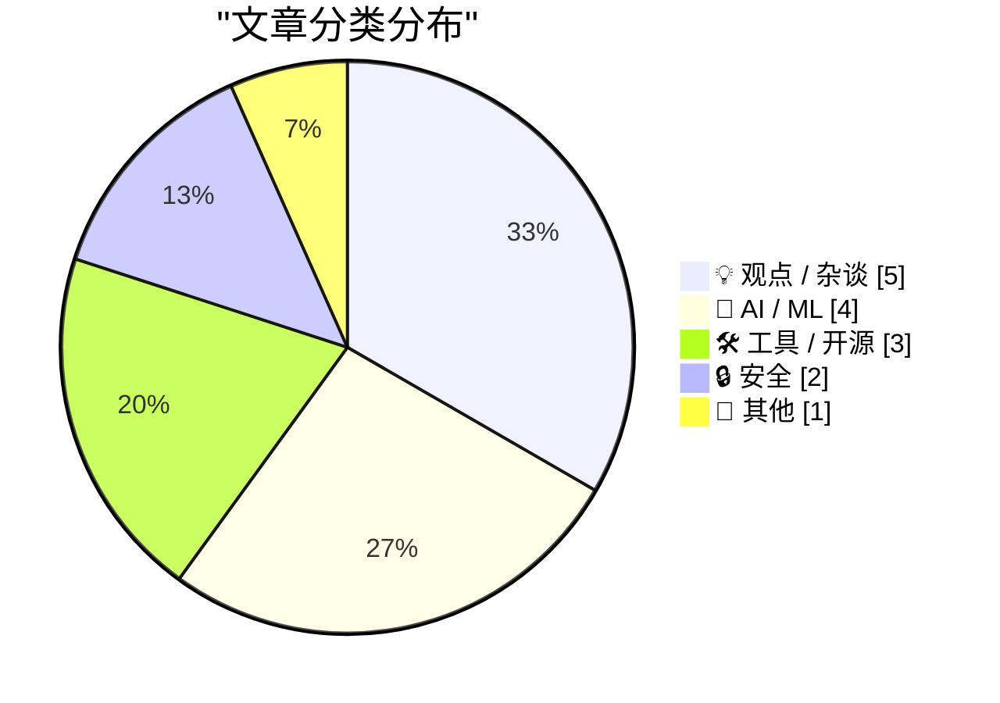
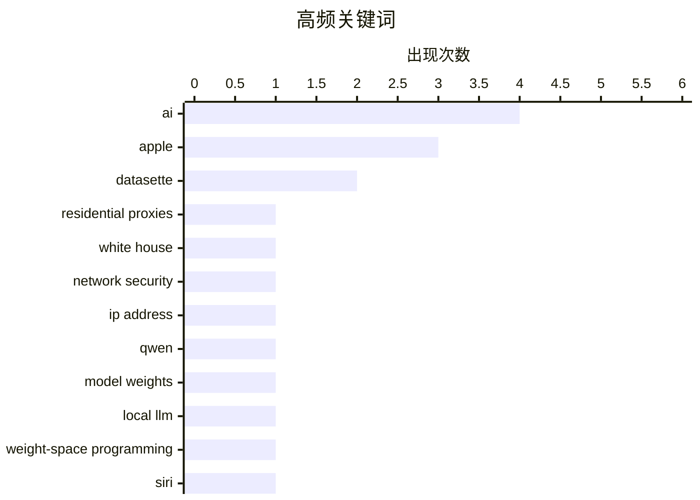

# 📰 Nov 5, 2026

> 来自 Karpathy 推荐的 92 个顶级技术博客，AI 精选 Top 15

## 📝 今日看点

AI 正从独立工具加速嵌入操作系统与日常应用，端侧模型的能力探索和 Siri 向开发者开放，推动新一轮应用生态竞争。与此同时，训练数据版权诉讼、创作者权益争议与强推 AI 入口引发的反感，凸显商业扩张与内容授权、用户体验之间的冲突。安全风险也正藏入更不起眼的角落：住宅代理可能让办公设备成为第三方流量出口，视频背景中的飞机噪声也可能成为暴露精确位置的线索。

---

## 🏆 今日必读

🥇 **想租用一个位于白宫的互联网地址吗？**

[Want to Rent an Internet Address at the White House?](https://krebsonsecurity.com/2026/11/want-to-rent-an-internet-address-at-the-white-house/) — krebsonsecurity.com · 30 分钟前 · 🔒 安全

> 安全专家警告，白宫数名工作人员使用的电脑或移动设备装有住宅代理服务，使外部人员能够租用这些设备的互联网出口地址。此类服务会让第三方流量经由设备的网络连接发出，从而呈现为来自该住宅或办公网络的访问。其中一家服务商是一家俄罗斯公司，其创始人经营的网络托管业务曾是2016年针对亚利桑那州和伊利诺伊州选举系统网络攻击的源头。这一发现凸显了住宅代理进入敏感办公环境的风险，但所给摘录未说明具体设备、安装途径或是否发生数据泄露。

💡 **为什么值得读**: 值得关注住宅代理如何将普通设备变成可出租的网络出口，以及这种隐蔽功能对敏感机构意味着什么。

🏷️ residential proxies, White House, network security, IP address

🥈 **我笔记本上的 Qwen 3.8 27B 也能解读模型权重**

[Qwen 3.8 27B on my laptop can interpret model weights, too](https://simonwillison.net/2026/Nov/3/qwen-can-interpret-model-weights/) — simonwillison.net · 1 天前 · 🤖 AI / ML

> 大语言模型能否直接理解神经网络权重，正在成为一种新的能力探索。Rikiya Takehi、Jayden Teoh、Alex Zhang 和 Omar Khattab 在《权重空间编程的火花》中报告，前沿模型尤其是 GPT-6 Astra，能够读取并修改以文本形式提供的模型原始权重。Simon Willison 则以笔记本上运行的 Qwen 3.8 27B 为例，指出本地模型也能完成权重解读。核心看点是这种能力从前沿模型延伸到了本地运行场景，但摘录未提供本地实验的准确率、任务范围或修改权重的结果。

💡 **为什么值得读**: 如果你关心本地大模型的能力边界，这个案例提供了一个超出常规聊天和代码生成的实验方向。

🏷️ Qwen, model weights, local LLM, weight-space programming

🥉 **苹果开始向开发者开放 Siri AI**

[Apple Begins Opening Siri AI to Developers](https://developer.apple.com/news/?id=gdk2umrf) — daringfireball.net · 1 天前 · 🤖 AI / ML

> 苹果在 iOS 27.3、iPadOS 27.3、macOS 27.3 和 visionOS 27.3 测试版中推出开发者预览，允许开发者将应用接入 Siri AI。此次开放的核心是 Siri AI app intents，让应用能够直接与 Siri AI 协作。苹果将其定位为企业和开发者触达客户、提供服务的新入口。目前这仍是早期开发者预览，所给摘录未列出具体支持的操作、接入要求或正式发布时间。

💡 **为什么值得读**: 对苹果生态开发者而言，这关系到应用功能如何被 Siri AI 调用，以及未来用户入口可能发生的变化。

🏷️ Siri, AI, Apple, API

---

## 📊 数据概览

| 扫描源 | 抓取文章 | 时间范围 | 精选 |
|:---:|:---:|:---:|:---:|
| 84/92 | 2572 篇 → 38 篇 | 48h | **15 篇** |

### 分类分布



### 高频关键词



<details>
<summary>📈 纯文本关键词图（终端友好）</summary>

```
ai                  │ ████████████████████ 4
apple               │ ███████████████░░░░░ 3
datasette           │ ██████████░░░░░░░░░░ 2
residential proxies │ █████░░░░░░░░░░░░░░░ 1
white house         │ █████░░░░░░░░░░░░░░░ 1
network security    │ █████░░░░░░░░░░░░░░░ 1
ip address          │ █████░░░░░░░░░░░░░░░ 1
qwen                │ █████░░░░░░░░░░░░░░░ 1
model weights       │ █████░░░░░░░░░░░░░░░ 1
local llm           │ █████░░░░░░░░░░░░░░░ 1
```

</details>

### 🏷️ 话题标签

**ai**(4) · **apple**(3) · **datasette**(2) · residential proxies(1) · white house(1) · network security(1) · ip address(1) · qwen(1) · model weights(1) · local llm(1) · weight-space programming(1) · siri(1) · api(1) · brave(1) · copyright(1) · web scraping(1) · ai training(1) · version control(1) · releases(1) · security advisories(1)

---

## 💡 观点 / 杂谈

### 1. Pluralistic：AI“误触经济”盯上了我的票据扫描应用（2026年11月4日）

[Pluralistic: The AI fatfinger economy has come for my receipts app (04 Nov 2026)](https://pluralistic.net/2026/11/04/genius-scan-is-neither/) — **pluralistic.net** · 17 小时前 · ⭐ 22/30

> Cory Doctorow 以票据扫描应用 Genius Scan 为切入点，批评实用软件被不断加入的 AI 入口改变了使用体验。他用“AI 误触经济”描述这种现象：原本有用的按钮，如今会唤出他认为无用的 AI 助手。批评的重点是 AI 功能占据既有操作入口，使用户更容易在日常任务中意外触发它们。作者的核心立场是，软件应优先服务用户原有需求，而不是以牺牲操作体验为代价推广 AI。

🏷️ AI, UX, software bloat

---

### 2. Pluralistic：可分离（2026年11月3日）

[Pluralistic: Separable (03 Nov 2026)](https://pluralistic.net/2026/11/03/nobody-is-home/) — **pluralistic.net** · 1 天前 · ⭐ 21/30

> 生成式 AI 正在让作品与创作者之间的关系成为一个更突出的问题。Cory Doctorow 用“没有画家的画作、没有作家的文字、没有数学家的数学”概括这种分离。他关注的是，当人们面对 AI 生成的成果时，如何理解产出背后人的参与与创作关系。所给摘录只呈现这一核心命题，未展开具体案例、完整论证或应对主张。

🏷️ AI, creativity, authorship

---

### 3. 苹果新的 iPhone 发布节奏似乎正在奏效

[Apple’s New iPhone Release Schedule Seems to Pay Off](https://x.com/asymco/status/2117379158087278697) — **daringfireball.net** · 1 天前 · ⭐ 20/30

> 苹果调整 iPhone 发布节奏后，在当季尚未推出 iPhone 18、Duo 和新款 Air 的情况下，iPhone 销售仍增长了17%。Horace Dediu 将这一表现视为值得关注的业绩信号。Duo 直到10月才上市，计入苹果下一财年的第一季度，而标准版 iPhone 18 被推迟到次年冬末发布；摘录同时指出，上一年的 Air 销售表现不佳。作者倾向于认为新的发布安排正在奏效，但现有摘录不足以单独证明这项调整与销售增长之间的因果关系。

🏷️ iPhone, release schedule, Apple, sales

---

### 4. 来点小小的 AI 抵制，犒劳一下自己

[Just a little AI resistance, as a treat](https://shkspr.mobi/blog/2026/11/just-a-little-ai-resistance-as-a-treat/) — **shkspr.mobi** · 1 天前 · ⭐ 20/30

> 面对 AI 的糟糕应用，作者主张公开表达不满，让具体问题得到关注。作者在 EMFCamp 遇到 Kate Devlin 教授，并由她谈及的 AI Resist List 引出这一观点。作为案例，作者提到自己正在联系发送格式错误的日历邀请的企业，其中包括英国在线超市 Ocado；所给节选尚未展示其回应及具体的 AI 使用问题。作者的核心立场是，从日常服务中的具体问题入手并明确投诉，是个人可以采取的一种 AI 抵制行动。

🏷️ AI, consumer advocacy, AI resistance

---

### 5. 乔布斯在最后一次季度分析师电话会议上表示：“我们认为，开放与封闭之争只是烟幕弹”

[Steve Jobs on His Final Quarterly Analyst Call: ‘We Think the Open Versus Closed Argument Is Just a Smokescreen’](https://www.macworld.com/article/208438/jobs_transcript.html) — **daringfireball.net** · 1 天前 · ⭐ 19/30

> 乔布斯在最后一次参与季度分析师电话会议时，质疑将平台竞争归结为“开放对封闭”的讨论方式。他指出，即便接受谷歌设定的这一框架，也不能推导出开放系统必然获胜。作为例子，他提到微软的 PlaysForSure 音乐战略，并将其软硬件分离模式与 PC、Android 的模式作比较。其核心观点是，“开放”标签本身不足以证明一种平台策略更优，判断竞争结果需要超越这一二元划分。

🏷️ Steve Jobs, open systems, Apple, platform strategy

---

## 🤖 AI / ML

### 6. 我笔记本上的 Qwen 3.8 27B 也能解读模型权重

[Qwen 3.8 27B on my laptop can interpret model weights, too](https://simonwillison.net/2026/Nov/3/qwen-can-interpret-model-weights/) — **simonwillison.net** · 1 天前 · ⭐ 24/30

> 大语言模型能否直接理解神经网络权重，正在成为一种新的能力探索。Rikiya Takehi、Jayden Teoh、Alex Zhang 和 Omar Khattab 在《权重空间编程的火花》中报告，前沿模型尤其是 GPT-6 Astra，能够读取并修改以文本形式提供的模型原始权重。Simon Willison 则以笔记本上运行的 Qwen 3.8 27B 为例，指出本地模型也能完成权重解读。核心看点是这种能力从前沿模型延伸到了本地运行场景，但摘录未提供本地实验的准确率、任务范围或修改权重的结果。

🏷️ Qwen, model weights, local LLM, weight-space programming

---

### 7. 苹果开始向开发者开放 Siri AI

[Apple Begins Opening Siri AI to Developers](https://developer.apple.com/news/?id=gdk2umrf) — **daringfireball.net** · 1 天前 · ⭐ 24/30

> 苹果在 iOS 27.3、iPadOS 27.3、macOS 27.3 和 visionOS 27.3 测试版中推出开发者预览，允许开发者将应用接入 Siri AI。此次开放的核心是 Siri AI app intents，让应用能够直接与 Siri AI 协作。苹果将其定位为企业和开发者触达客户、提供服务的新入口。目前这仍是早期开发者预览，所给摘录未列出具体支持的操作、接入要求或正式发布时间。

🏷️ Siri, AI, Apple, API

---

### 8. 《纽约时报》等媒体起诉 Brave，指控其侵权并向 AI 公司出售抓取内容用于训练

[The New York Times (et al.) Sues Brave for Copyright Infringement, Selling Scraped Content to AI Companies for Model Training](https://www.theverge.com/tech/1024588/brave-lawsuit-ai-scraping-new-york-times) — **daringfireball.net** · 1 天前 · ⭐ 23/30

> 《纽约时报》等多家媒体起诉 Brave 浏览器开发商，指控其非法抓取内容供 AI 训练，并帮助用户绕过付费墙。所引诉状涉及《纽约每日新闻》《芝加哥论坛报》和《奥兰多哨兵报》等出版物。出版商指称，Brave 将抓取网站形成的索引商业化，其中包括向 AI 公司提供付费访问。这场争议将搜索索引、付费内容访问和 AI 训练授权的边界联系起来，但摘录呈现的是诉方指控，未提供法院裁决。

🏷️ Brave, copyright, web scraping, AI training

---

### 9. datasette-agent 0.5a0 发布

[datasette-agent 0.5a0](https://simonwillison.net/2026/Nov/3/datasette-agent/) — **simonwillison.net** · 1 天前 · ⭐ 19/30

> datasette-agent 0.5a0 的主要更新是新增 panel 面板，让智能体聊天可以与 Datasette 页面并排显示。用户可以在查看数据表或查询页面时，同时保持与智能体的对话。相比需要在聊天和数据页面之间切换的操作方式，这种布局便于对照数据继续提问和分析。作者将其视为一次重要版本更新；节选还提到与 datasette-apps 的结合，但未给出后续细节。

🏷️ Datasette, AI agents, panel

---

## 🛠 工具 / 开源

### 10. 本周版本控制动态：2026年11月4日

[This Week in Source Control: 4 November 2026](https://nesbitt.io/2026/11/04/this-week-in-source-control.html) — **nesbitt.io** · 19 小时前 · ⭐ 23/30

> 这是一份面向版本控制系统及代码托管平台的每周动态汇总，日期为2026年11月4日。内容范围涵盖软件版本发布、安全公告和相关文章。它将工具更新与生态阅读材料集中在同一期中，方便读者追踪相关变化。所给摘录只有栏目简介，未列出具体项目、版本号、漏洞或文章，因此无法据此判断本期最重要的更新。

🏷️ version control, releases, security advisories, forges

---

### 11. Safari 27.3 测试版新增垂直标签页和自适应深色模式

[Safari 27.3 Beta Adds Vertical Tabs and Adaptive Dark Mode](https://www.macrumors.com/2026/11/03/ios-27-3-safari/) — **daringfireball.net** · 1 天前 · ⭐ 21/30

> Safari 在 iOS 27.3、iPadOS 27.3 和 macOS Golden Gate 27.3 中加入垂直标签页，标题还提及新增自适应深色模式。垂直标签页可替代传统的水平标签栏，位于屏幕左侧，默认以图标显示来节省空间。用户也可以加宽标签栏，这项布局适用于 iPhone、iPad 和 Mac，并被认为尤其适合 iPhone Duo 的较大屏幕。这次更新为跨设备标签管理增加了新的布局选择，但所给摘录未说明自适应深色模式的具体行为。

🏷️ Safari, vertical tabs, dark mode

---

### 12. datasette-apps 0.3a0 发布

[datasette-apps 0.3a0](https://simonwillison.net/2026/Nov/4/datasette-apps/) — **simonwillison.net** · 1 天前 · ⭐ 19/30

> datasette-apps 0.3a0 的更新重点是改善自定义 HTML 应用与 Datasette Agent 的集成。Datasette Apps 支持直接在 Datasette 内托管和编辑 HTML 应用，为数据服务添加自定义界面。这些应用既可以手工编写，也可以通过 Datasette Agent 借助大语言模型创建，作者认为后者更方便。此次更新支持在 Datasette Agent 的聊天消息中标记应用，进一步将应用与对话关联起来；所给节选未包含这一功能的完整操作说明。整体方向是让应用创建、编辑与智能体对话更紧密地结合。

🏷️ Datasette, HTML, web apps

---

## 🔒 安全

### 13. 想租用一个位于白宫的互联网地址吗？

[Want to Rent an Internet Address at the White House?](https://krebsonsecurity.com/2026/11/want-to-rent-an-internet-address-at-the-white-house/) — **krebsonsecurity.com** · 30 分钟前 · ⭐ 25/30

> 安全专家警告，白宫数名工作人员使用的电脑或移动设备装有住宅代理服务，使外部人员能够租用这些设备的互联网出口地址。此类服务会让第三方流量经由设备的网络连接发出，从而呈现为来自该住宅或办公网络的访问。其中一家服务商是一家俄罗斯公司，其创始人经营的网络托管业务曾是2016年针对亚利桑那州和伊利诺伊州选举系统网络攻击的源头。这一发现凸显了住宅代理进入敏感办公环境的风险，但所给摘录未说明具体设备、安装途径或是否发生数据泄露。

🏷️ residential proxies, White House, network security, IP address

---

### 14. 我发现了一种会泄露你精确位置的声音，而且它无处不在——YouTube

[I discovered a sound that leaks your exact location (and it's everywhere) - YouTube](https://simonwillison.net/2026/Nov/3/a-sound-that-leaks-your-exact-location/) — **simonwillison.net** · 1 天前 · ⭐ 20/30

> 视频背景中几乎听不见的飞机噪声，也可能成为定位拍摄地点的线索。Colsto 展示了一种开源情报分析方法：从视频音轨提取飞机声音，分析其多普勒变化曲线，再与 ADS-B 飞行数据交叉比对。飞机的速度、距离以及不同航班经过的时间间隔，共同构成推断视频位置的依据。这个案例表明，即使画面没有明显地标，背景音与公开航空数据的组合仍可能暴露拍摄地点。

🏷️ OSINT, geolocation, audio, privacy

---

## 📝 其他

### 15. iPad mini（A20 Pro）评测汇总

[iPad Mini (A20 Pro) Review Roundup](https://www.techmeme.com/261103/p15#a261103p15) — **daringfireball.net** · 1 天前 · ⭐ 19/30

> 这组 iPad mini（A20 Pro）评测摘录重点展示了 Acoustic Display 的实际听感与设计取舍。The Verge 的 David Pierce 表示，这项设计让声音从前面板发出，而不是通过扬声器开孔向外传播。与此前的声音表现相比，他认为整体音质变化不大，低音可能略有增加，而声音朝向使用者是一个小优势。他的结论是，这项设计的主要价值在于提升机身坚固性，音质大致持平是可以接受的取舍。

🏷️ iPad Mini, A20 Pro, acoustic display

---

*生成于 2026-11-05 05:06 | 扫描 84 源 → 获取 2572 篇 → 精选 15 篇*
*基于 [Hacker News Popularity Contest 2025](https://refactoringenglish.com/tools/hn-popularity/) RSS 源列表，由 [Andrej Karpathy](https://x.com/karpathy) 推荐*
