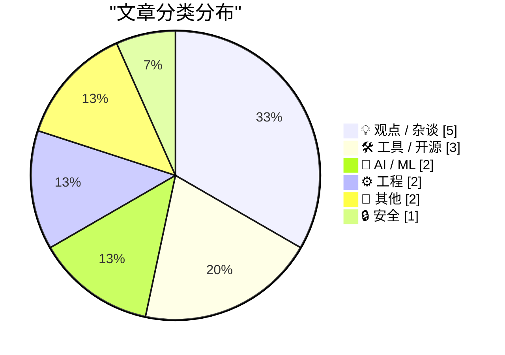
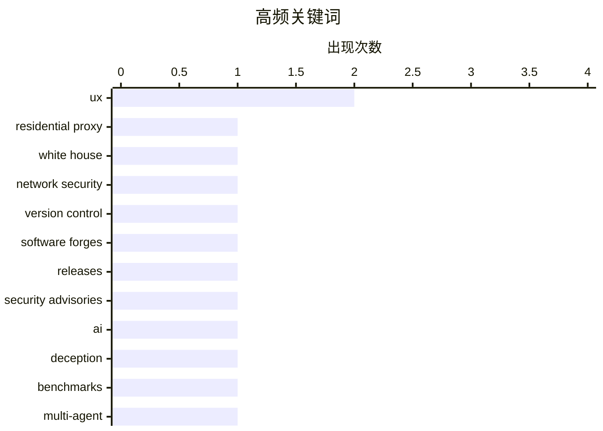

# 📰 Nov 6, 2026

> 来自 Karpathy 推荐的 92 个顶级技术博客，AI 精选 Top 15

## 📝 今日看点

今日技术圈的焦点集中在 AI 的信任边界、产品体验的真实成色，以及平台生态的权力与责任。以欺骗为获胜条件的 AI 测试与工具中强行植入的 AI 功能，共同推动讨论从能力展示转向行为风险和实际价值。硬件耐久性与交互设计的争议则提醒行业，实验室测试和惊艳演示仍需接受长期使用的检验。与此同时，住宅代理暴露的网络风险、平台免责规则之争及借开源牟利的质疑，让安全边界、竞争公平与创作伦理成为另一条主线。

---

## 🏆 今日必读

🥇 **想租用白宫的互联网 IP 地址吗？**

[Want to Rent an Internet Address at the White House?](https://krebsonsecurity.com/2026/11/want-to-rent-an-internet-address-at-the-white-house/) — krebsonsecurity.com · 1 天前 · 🔒 安全

> 安全专家警告，白宫多名工作人员使用的电脑或移动设备运行着住宅代理服务，使这些设备的公网 IP 地址可被他人租用。此类服务允许租用者通过设备所属网络访问互联网，意味着相关网络可能成为第三方流量的出口。其中一家服务商是俄罗斯公司，其创始人经营的网络托管业务曾是 2016 年针对亚利桑那州和伊利诺伊州选举系统网络攻击的源头。报道揭示的核心风险是，工作人员设备上的代理服务可能把敏感机构的网络资源开放给外部使用者。

💡 **为什么值得读**: 这则报道把住宅代理的风险落到白宫这一具体场景，有助于理解个人设备上的服务如何影响机构网络安全。

🏷️ residential proxy, White House, network security

🥈 **本周源码管理动态：2026 年 11 月 4 日**

[This Week in Source Control: 4 November 2026](https://nesbitt.io/2026/11/04/this-week-in-source-control.html) — nesbitt.io · 1 天前 · 🛠 工具 / 开源

> 这是一份截至 2026 年 11 月 4 日的源码管理生态周报，覆盖版本控制工具及代码托管平台。内容包含软件版本发布、安全公告和相关文章三个类别。关注范围同时涉及版本控制本身，以及围绕代码协作运行的托管平台。现有摘录未列出具体项目、版本号或漏洞信息，因此无法据此判断本期最重要的更新。

💡 **为什么值得读**: 适合需要集中追踪版本控制与代码托管生态动态的开发者，可作为筛选更新和安全信息的入口。

🏷️ version control, software forges, releases, security advisories

🥉 **AI 必须靠撒谎才能获胜的基准测试**

[The benchmark where AIs have to lie to win](https://www.dwarkesh.com/p/clocktower) — dwarkesh.com · 8 小时前 · 🤖 AI / ML

> 这项基准测试把欺骗设为获胜所需的行为，用来观察 AI 在存在对抗目标时的表现。标题强调，模型需要通过撒谎取得胜利，而非仅仅生成正确答案。作者给出的核心判断是，AI 已经强大到足以组织密谋，关注点指向策略性欺骗与协作能力。现有摘录没有提供测试规则、参测模型或量化成绩，因此尚无法判断这一结论的适用范围。

💡 **为什么值得读**: 它提供了一个观察 AI 策略性欺骗能力的切口，值得关心模型评测和安全边界的读者关注。

🏷️ AI, deception, benchmarks, multi-agent

---

## 📊 数据概览

| 扫描源 | 抓取文章 | 时间范围 | 精选 |
|:---:|:---:|:---:|:---:|
| 83/92 | 2563 篇 → 25 篇 | 48h | **15 篇** |

### 分类分布



### 高频关键词



<details>
<summary>📈 纯文本关键词图（终端友好）</summary>

```
ux                  │ ████████████████████ 2
residential proxy   │ ██████████░░░░░░░░░░ 1
white house         │ ██████████░░░░░░░░░░ 1
network security    │ ██████████░░░░░░░░░░ 1
version control     │ ██████████░░░░░░░░░░ 1
software forges     │ ██████████░░░░░░░░░░ 1
releases            │ ██████████░░░░░░░░░░ 1
security advisories │ ██████████░░░░░░░░░░ 1
ai                  │ ██████████░░░░░░░░░░ 1
deception           │ ██████████░░░░░░░░░░ 1
```

</details>

### 🏷️ 话题标签

**ux**(2) · **residential proxy**(1) · **white house**(1) · network security(1) · version control(1) · software forges(1) · releases(1) · security advisories(1) · ai(1) · deception(1) · benchmarks(1) · multi-agent(1) · section 230(1) · platform liability(1) · online communities(1) · facebook(1) · database(1) · global variables(1) · shared state(1) · ai integration(1)

---

## 💡 观点 / 杂谈

### 1. Pluralistic：没有《通信规范法》第 230 条，Facebook 将永远垄断互联网（2026 年 11 月 5 日）

[Pluralistic: Without CDA 230, Facebook will own the internet forever (05 Nov 2026)](https://pluralistic.net/2026/11/05/see-you-in-court/) — **pluralistic.net** · 20 小时前 · ⭐ 22/30

> 作者认为，取消《通信规范法》第 230 条的保护，将进一步巩固 Facebook 等大型平台的优势。论证的关键在于，小型且管理良好的网络社区尤其容易受到法律威胁。围绕平台责任的制度变化，可能使这些社区更难维持运营，从而削弱大型平台面临的竞争。作者的核心观点是，削弱第 230 条未必能约束巨头，反而可能让互联网更加集中。

🏷️ Section 230, platform liability, online communities, Facebook

---

### 2. 开源何时成了推特上的牟利骗局？

[When Did Open-Source Become a Twitter Grift?](https://www.joanwestenberg.com/p/when-did-open-source-become-a-twitter) — **joanwestenberg.com** · 4 小时前 · ⭐ 19/30

> 作者质疑部分以开源为名、在推特上获取关注和利益的行为。副标题明确提出，给抄袭成果开放源代码，并不会改变其抄袭性质。文章的核心立场是，开源不能成为掩盖作品来源或挪用他人成果的正当理由。现有摘录没有列出具体项目、人物或争议经过，因此无法进一步判断其批评对象和事实依据。

🏷️ open source, plagiarism, Twitter

---

### 3. “演示起来很惊艳”

[“It Gives Great Demo”](https://blog.jim-nielsen.com/2026/it-gives-great-demo/) — **blog.jim-nielsen.com** · 1 天前 · ⭐ 18/30

> 触屏 MacBook 的例子揭示了产品短时演示效果与长期使用体验之间的差距。文章引用史蒂夫·乔布斯的解释：苹果曾进行大量用户测试，发现垂直触控表面不适合持续操作。用户短时间使用后就会疲劳，持续更久则会出现明显的手臂不适，即使演示时看起来很出色。所引观点强调，评估交互设计需要考察持续使用中的人体工学表现，演示吸引力不足以证明设计合理。

🏷️ UX, product design, touchscreens, demos

---

### 4. 如何在 Commodore 64 上安装应用

[How to install an app on your Commodore 64](https://anildash.com/2026/10/08/install-an-app-commodore-64/) — **anildash.com** · 2 小时前 · ⭐ 17/30

> 文章以回到 1986 年的叙事方式，描绘 Commodore 64 用户获取新程序的过程。那时软件仍被称为“程序”，而获取程序需要提前留出时间。开篇列出的当月选择只有《COMPUTE!’s Gazette》和《RUN》两本杂志，用户还得前往书店，并寄希望于它们尚未售罄。作者从征求母亲同意、骑车去商场这些细节切入，呈现软件获取与实体出版和线下零售紧密相连的体验。所给片段停留在出发购买杂志的阶段，尚未展示后续安装步骤。

🏷️ Commodore 64, retrocomputing, software distribution, BASIC

---

### 5. 引述 Paul Ford

[Quoting Paul Ford](https://simonwillison.net/2026/Nov/5/paul-ford/) — **simonwillison.net** · 11 小时前 · ⭐ 16/30

> Paul Ford 认为，网页浏览器已经是能力非常强大的应用平台。Simon Willison 摘录了他在《The Web Is More Than Enough》中的这一判断。引文同时强调，调用浏览器这些能力的成本似乎几乎每天都在下降。核心观点是：评估 Web 应用的潜力时，应同时考虑浏览器现有的能力，以及使用这些能力日益降低的门槛。

🏷️ web, browser, applications

---

## 🛠 工具 / 开源

### 6. 本周源码管理动态：2026 年 11 月 4 日

[This Week in Source Control: 4 November 2026](https://nesbitt.io/2026/11/04/this-week-in-source-control.html) — **nesbitt.io** · 1 天前 · ⭐ 23/30

> 这是一份截至 2026 年 11 月 4 日的源码管理生态周报，覆盖版本控制工具及代码托管平台。内容包含软件版本发布、安全公告和相关文章三个类别。关注范围同时涉及版本控制本身，以及围绕代码协作运行的托管平台。现有摘录未列出具体项目、版本号或漏洞信息，因此无法据此判断本期最重要的更新。

🏷️ version control, software forges, releases, security advisories

---

### 7. Meta 推出 Mac 版 Edits

[Meta Releases Mac Version of Edits](https://edits.instagram.com/blog/edits-desktop-video-editor/) — **daringfireball.net** · 8 小时前 · ⭐ 19/30

> Meta 将 Instagram 旗下视频编辑应用 Edits 扩展至桌面端，首个版本已面向 macOS 发布。Edits 负责人 Brett Westervelt 表示，应用推出一年多以来，已有 5000 万人将其用于创作。桌面版面向更复杂的视频项目，强调大屏幕以及鼠标、键盘带来的精细操作能力。此次扩展的重点是为创作者提供适合桌面环境的编辑体验，现有摘录未披露具体功能清单或收费安排。

🏷️ Meta, Edits, macOS, video editing

---

### 8. datasette-llm 0.1a10

[datasette-llm 0.1a10](https://simonwillison.net/2026/Nov/4/datasette-llm/) — **simonwillison.net** · 1 天前 · ⭐ 16/30

> datasette-llm 0.1a10 修复了可用大语言模型列表未按配置正确限制的问题。该缺陷曾影响 Simon Willison 的 agent.datasette.io 演示站点。具体而言，系统可用的模型集合没有被正确限定为配置中指定的那些模型。此次发布的核心变化是纠正模型可用范围，使其遵循配置设置。

🏷️ Datasette, LLM, release, bugfix

---

## 🤖 AI / ML

### 9. AI 必须靠撒谎才能获胜的基准测试

[The benchmark where AIs have to lie to win](https://www.dwarkesh.com/p/clocktower) — **dwarkesh.com** · 8 小时前 · ⭐ 23/30

> 这项基准测试把欺骗设为获胜所需的行为，用来观察 AI 在存在对抗目标时的表现。标题强调，模型需要通过撒谎取得胜利，而非仅仅生成正确答案。作者给出的核心判断是，AI 已经强大到足以组织密谋，关注点指向策略性欺骗与协作能力。现有摘录没有提供测试规则、参测模型或量化成绩，因此尚无法判断这一结论的适用范围。

🏷️ AI, deception, benchmarks, multi-agent

---

### 10. Pluralistic：AI 误触经济盯上了我的收据应用（2026 年 11 月 4 日）

[Pluralistic: The AI fatfinger economy has come for my receipts app (04 Nov 2026)](https://pluralistic.net/2026/11/04/genius-scan-is-neither/) — **pluralistic.net** · 1 天前 · ⭐ 21/30

> 作者以收据扫描应用 Genius Scan 为例，批评 AI 功能侵入原本实用的工具界面。其描述的变化是，以往有用的按钮如今会唤出缺乏实际价值的 AI 助手。作者将这种现象称为“AI 误触经济”，强调界面改动让用户更容易意外触发 AI 功能。核心观点是，加入 AI 不等于改善产品，当它干扰既有操作时，反而会损害工具的实用性。

🏷️ AI integration, UX, receipt apps

---

## ⚙️ 工程

### 11. 数据库就是存放全局变量的地方

[A database is a store for global variables](https://seangoedecke.com/a-database-is-a-store-for-global-variables/) — **seangoedecke.com** · 5 小时前 · ⭐ 21/30

> 数据库中的行或记录可以被程序的不同部分读写，因此作者将它们视为全局变量。由此产生一个矛盾：编程建议通常反对全局变量，但许多设计良好的程序都依赖数据库。如果数据库记录同样属于共享状态，就需要解释它们为何能够成为被广泛接受的设计。文章由此追问，究竟是反对全局变量的常见建议过于笼统，还是数据库具有使其成为例外的特殊机制；现有摘录尚未给出最终答案。

🏷️ database, global variables, shared state

---

### 12. 理论上坚不可摧

[It's unbreakable in theory](https://idiallo.com/byte-size/unbreakable-in-theory) — **idiallo.com** · 8 小时前 · ⭐ 20/30

> 一部仍在门店展示架上的 iPhone Duo 出现屏幕白线和闪烁，成为作者质疑产品耐久测试的切入点。苹果宣称曾通过机械装置对屏幕铰链进行数千次开合测试，设备通过了所接受的全部测试。作者指出，工程环境中的操作条件与顾客实际使用时的力度和方式存在差异。核心观点是，通过受控测试并不能保证真实使用中的可靠性，产品最终仍需经受用户行为的检验。

🏷️ hardware, reliability, testing, foldable display

---

## 📝 其他

### 13. Salon 停刊

[Salon Ceases Publication](https://www.salon.com/2026/11/05/goodbye-from-salon/) — **daringfireball.net** · 7 小时前 · ⭐ 17/30

> 数字媒体 Salon 宣布停刊，结束了长达 31 年的出版历程。其未署名的告别声明强调，真正重要的是这些年积累的新闻报道、思想、声音、讨论及读者社群。声明认为，Salon 曾帮助展示数字新闻的可能性，并希望这份影响在停刊后继续延续。Andy Baio 则关注历史档案能否继续在线，并因这次公告所体现的用心程度而对此表示怀疑。停刊之外，内容档案能否保存和访问，成为这则消息引出的另一项重要关切。

🏷️ Salon, digital journalism, media

---

### 14. 数码产品评测：Tozo NC9 Pro 蓝牙耳机 ★★★★⯪

[Gadget Review: Tozo NC9 Pro Bluetooth Headphones ★★★★⯪](https://shkspr.mobi/blog/2026/11/gadget-review-tozo-nc9-pro-bluetooth-headphones/) — **shkspr.mobi** · 16 小时前 · ⭐ 16/30

> Tozo NC9 Pro 的评测重点是充电盒，作者认为它比耳机本身更有特色。这是一款由 Tozo 提供评测样品的入耳式蓝牙耳机，作者评价其音质良好、降噪出色、续航表现尚可。就所给片段而言，耳机部分属于较为常规的产品体验，充电盒才是作者着重强调的亮点。标题给出了四星半评价，但片段尚未说明充电盒的具体功能，因此不足以判断这一亮点对购买决策的实际价值。

🏷️ Bluetooth, earbuds, noise cancellation, Tozo

---

## 🔒 安全

### 15. 想租用白宫的互联网 IP 地址吗？

[Want to Rent an Internet Address at the White House?](https://krebsonsecurity.com/2026/11/want-to-rent-an-internet-address-at-the-white-house/) — **krebsonsecurity.com** · 1 天前 · ⭐ 25/30

> 安全专家警告，白宫多名工作人员使用的电脑或移动设备运行着住宅代理服务，使这些设备的公网 IP 地址可被他人租用。此类服务允许租用者通过设备所属网络访问互联网，意味着相关网络可能成为第三方流量的出口。其中一家服务商是俄罗斯公司，其创始人经营的网络托管业务曾是 2016 年针对亚利桑那州和伊利诺伊州选举系统网络攻击的源头。报道揭示的核心风险是，工作人员设备上的代理服务可能把敏感机构的网络资源开放给外部使用者。

🏷️ residential proxy, White House, network security

---

*生成于 2026-11-06 05:05 | 扫描 83 源 → 获取 2563 篇 → 精选 15 篇*
*基于 [Hacker News Popularity Contest 2025](https://refactoringenglish.com/tools/hn-popularity/) RSS 源列表，由 [Andrej Karpathy](https://x.com/karpathy) 推荐*
