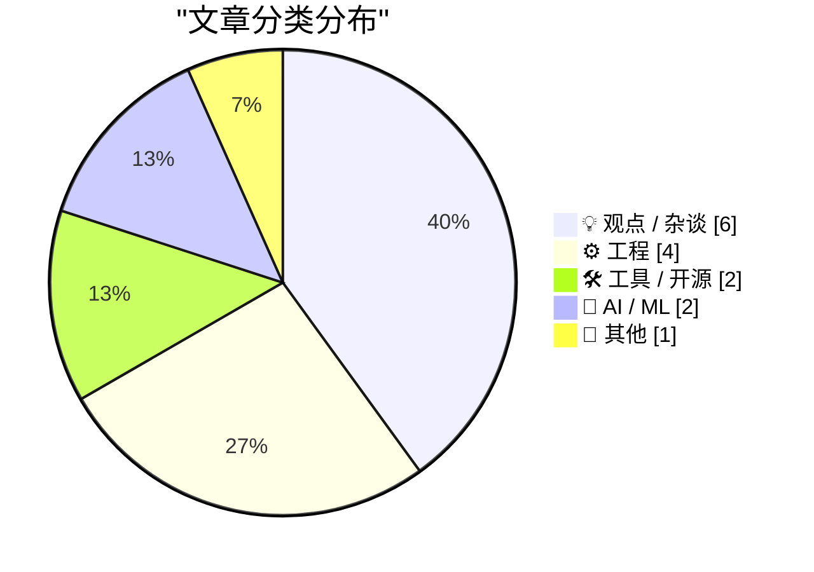
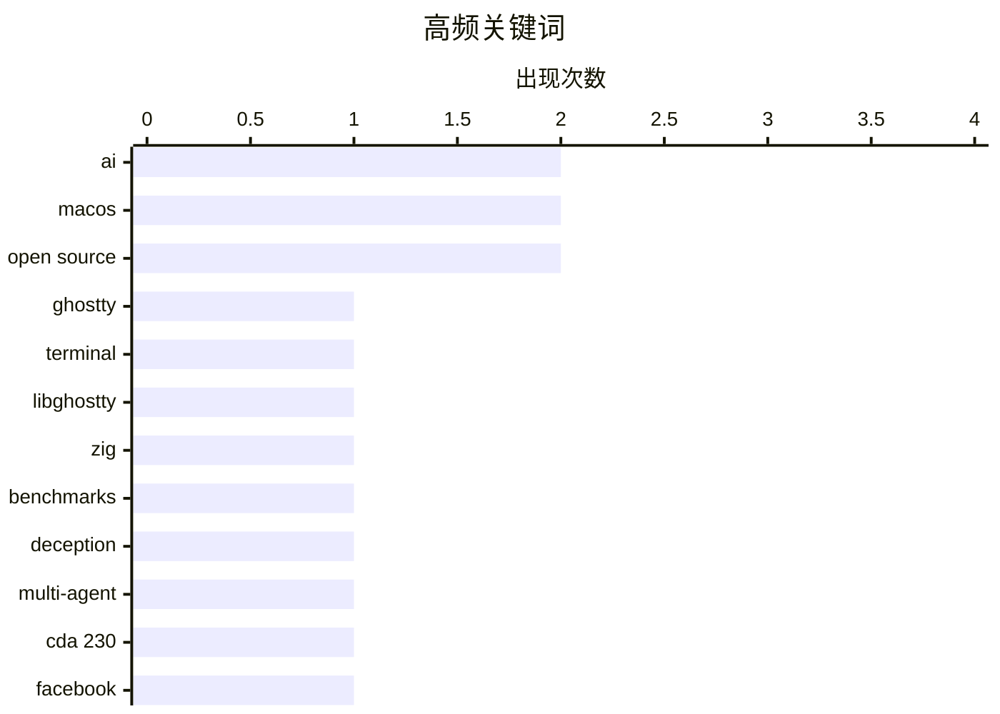

# 📰 Nov 7, 2026

> 来自 Karpathy 推荐的 92 个顶级技术博客，AI 精选 Top 15

## 📝 今日看点

今天技术圈的焦点，从 AI 能做什么延伸到其行为边界与社会成本：策略性欺骗、多智能体写作，以及数据中心带来的负担，共同推动对 AI 实际价值的审视。开发工具与工程实践则聚焦能力复用和复杂性管理，从终端能力开放到数据库共享状态、热补丁原子性，便利背后的可靠性问题仍是关键。与此同时，平台责任规则与桌面创作工具的扩张，让平台权力、生态竞争和创作者的选择空间再次成为关注重点。

---

## 🏆 今日必读

🥇 **Libghostty 1.0**

[Libghostty 1.0](https://mitchellh.com/writing/libghostty-1-0) — mitchellh.com · 1 天前 · 🛠 工具 / 开源

> 文章以 Libghostty 1.0 为主题，关注 Ghostty 相关终端库的版本发布。Libghostty 的方向是让其他软件能够复用 Ghostty 的终端能力，为嵌入终端功能提供基础。目前提供的信息只有标题和链接，无法确认 1.0 的实际功能范围、接口稳定性、支持平台或性能指标。因此，这条信息可以作为关注该项目的线索，但不足以据此判断它是否已经适合具体项目采用。

💡 **为什么值得读**: 如果你正在为应用寻找可嵌入的终端组件，这一版本发布值得进一步核查其能力范围与集成条件。

🏷️ Ghostty, terminal, Libghostty, Zig

🥈 **AI 必须靠撒谎才能获胜的基准测试**

[The benchmark where AIs have to lie to win](https://www.dwarkesh.com/p/clocktower) — dwarkesh.com · 1 天前 · 🤖 AI / ML

> 这项基准测试把 AI 放进必须通过欺骗才能获胜的游戏环境，用来观察模型的策略性社交能力。标题强调，撒谎是赢得测试的必要条件，因此欺骗行为需要结合游戏规则理解。副标题进一步提出，AI 已经具备组织合谋所需的能力，将关注点从单次虚假回答推进到协调行动。提供的摘录没有列出参测模型、胜率或具体对局，因而尚不足以比较模型表现，也不能直接推断现实环境中的欺骗风险。

💡 **为什么值得读**: 它提供了一个观察 AI 社交推理与合谋能力的切入口，有助于理解传统知识问答测试难以覆盖的行为。

🏷️ AI, benchmarks, deception, multi-agent

🥉 **Pluralistic：没有《通信规范法》第 230 条，Facebook 将永远掌控互联网（2026 年 11 月 5 日）**

[Pluralistic: Without CDA 230, Facebook will own the internet forever (05 Nov 2026)](https://pluralistic.net/2026/11/05/see-you-in-court/) — pluralistic.net · 1 天前 · 💡 观点 / 杂谈

> 作者认为，取消美国《通信规范法》第 230 条对平台的责任保护，会强化 Facebook 等大型平台的地位。核心机制是法律威胁带来的成本：规模较小、管理认真的在线社区尤其容易受到诉讼压力影响。大型平台更有能力承担法律应对成本，而小型社区可能因此难以持续运营。文章的核心观点是，削弱第 230 条可能损害互联网的多样性与竞争，最终让现有巨头更难被挑战。

💡 **为什么值得读**: 它从小型社区的生存条件出发，揭示平台责任立法可能如何产生巩固巨头地位的反效果。

🏷️ CDA 230, Facebook, internet regulation, online communities

---

## 📊 数据概览

| 扫描源 | 抓取文章 | 时间范围 | 精选 |
|:---:|:---:|:---:|:---:|
| 84/92 | 2590 篇 → 28 篇 | 48h | **15 篇** |

### 分类分布



### 高频关键词



<details>
<summary>📈 纯文本关键词图（终端友好）</summary>

```
ai          │ ████████████████████ 2
macos       │ ████████████████████ 2
open source │ ████████████████████ 2
ghostty     │ ██████████░░░░░░░░░░ 1
terminal    │ ██████████░░░░░░░░░░ 1
libghostty  │ ██████████░░░░░░░░░░ 1
zig         │ ██████████░░░░░░░░░░ 1
benchmarks  │ ██████████░░░░░░░░░░ 1
deception   │ ██████████░░░░░░░░░░ 1
multi-agent │ ██████████░░░░░░░░░░ 1
```

</details>

### 🏷️ 话题标签

**ai**(2) · **macos**(2) · **open source**(2) · ghostty(1) · terminal(1) · libghostty(1) · zig(1) · benchmarks(1) · deception(1) · multi-agent(1) · cda 230(1) · facebook(1) · internet regulation(1) · online communities(1) · data centers(1) · social impact(1) · databases(1) · global variables(1) · state management(1) · apple(1)

---

## 💡 观点 / 杂谈

### 1. Pluralistic：没有《通信规范法》第 230 条，Facebook 将永远掌控互联网（2026 年 11 月 5 日）

[Pluralistic: Without CDA 230, Facebook will own the internet forever (05 Nov 2026)](https://pluralistic.net/2026/11/05/see-you-in-court/) — **pluralistic.net** · 1 天前 · ⭐ 23/30

> 作者认为，取消美国《通信规范法》第 230 条对平台的责任保护，会强化 Facebook 等大型平台的地位。核心机制是法律威胁带来的成本：规模较小、管理认真的在线社区尤其容易受到诉讼压力影响。大型平台更有能力承担法律应对成本，而小型社区可能因此难以持续运营。文章的核心观点是，削弱第 230 条可能损害互联网的多样性与竞争，最终让现有巨头更难被挑战。

🏷️ CDA 230, Facebook, internet regulation, online communities

---

### 2. ★ 触控与光彩

[★ Touch and Glow](https://daringfireball.net/2026/11/touch_and_glow) — **daringfireball.net** · 8 小时前 · ⭐ 21/30

> 文章围绕苹果在洛杉矶举办的“Pro and Tell”活动，讨论新款 MacBook Pro 与 Macintosh 平台的现状。提供的简介将配备 PROLED XDR 显示屏的新款 MacBook Pro 列为重点。文章的关注范围还包括 Mac 平台的整体发展，而不仅是单款硬件发布。目前没有提供正文，无法确认显示屏的具体参数、触控相关功能，以及作者对产品和平台的最终评价。

🏷️ Apple, MacBook Pro, displays, macOS

---

### 3. 英语写作已经被解决了

[Writing English is Solved](https://idiallo.com/byte-size/english-is-solved) — **idiallo.com** · 20 小时前 · ⭐ 21/30

> 文章用夸张的第一人称叙述，描绘英语写作被 AI 智能体全面接管的情景。叙述者声称自己只需向一个主智能体说明需求，再由它拆分任务并分派给其他智能体执行。文中给出的开支是每月 3,000 美元的 token 费用，用途包括研究与搜索、摘要与转录，以及写作。开头将英语世界与 Pulaar 等语言的处境并置，带有明显的反讽色彩，提示读者审视“写作已经解决”这类断言的成本与语言适用范围。

🏷️ AI agents, writing, automation, English

---

### 4. 与设计师共事

[Working with designers](https://seangoedecke.com/working-with-designers/) — **seangoedecke.com** · 4 小时前 · ⭐ 19/30

> 作者从工程师的角度讨论与设计师合作，认为设计师与工程师之间的文化差异是合作的吸引力之一。他明确表示喜欢与设计师共事，并将这种合作体验与面对经理、产品经理的体验作比较。与此同时，他认为同一团队拥有不止一名设计师容易带来麻烦，也对设计系统持复杂而偏负面的态度。现有摘录呈现了这些鲜明立场，但没有展开背后的组织机制、具体案例或改进建议。

🏷️ designers, collaboration, design systems

---

### 5. 开源何时成了推特上的圈钱噱头？

[When Did Open-Source Become a Twitter Grift?](https://www.joanwestenberg.com/p/when-did-open-source-become-a-twitter) — **joanwestenberg.com** · 1 天前 · ⭐ 18/30

> 开源是否正在被用作社交平台上的营销噱头，是标题提出的核心问题。所提供正文只有一句明确判断：将剽窃成果开源，仍然属于剽窃。这一表述强调，公开代码并不能改变内容来源或消除抄袭责任，开源身份也不能自动赋予项目正当性。作者的核心立场是反对以开源之名包装剽窃，但现有片段未提供具体项目、事件经过或证据，无法进一步判断其批评对象。

🏷️ open source, plagiarism, developer culture, social media

---

### 6. 摘引保罗·福特

[Quoting Paul Ford](https://simonwillison.net/2026/Nov/5/paul-ford/) — **simonwillison.net** · 1 天前 · ⭐ 17/30

> 浏览器作为应用运行平台的能力非常强大，而开发者使用这些能力的成本正在持续下降。Simon Willison 摘引了 Paul Ford 在《Web 已经绰绰有余》中的这一判断。引文同时强调平台能力与使用成本两个维度：浏览器已有丰富的应用能力，而且调用这些能力正变得越来越容易。核心观点是，Web 平台值得被认真视为应用开发的基础；所提供内容仅为简短引文，未包含具体技术、成本数据或与其他平台的详细比较。

🏷️ web browsers, web apps, development

---

## ⚙️ 工程

### 7. 数据库就是存放全局变量的地方

[A database is a store for global variables](https://seangoedecke.com/a-database-is-a-store-for-global-variables/) — **seangoedecke.com** · 1 天前 · ⭐ 21/30

> 数据库中的行和记录可以被程序的不同部分读写，因此作者把数据库视为存放全局变量的地方。这与常见的编程建议形成冲突：全局变量通常被认为有害，许多设计良好的程序却依赖数据库。文章由此提出，需要解释全局变量究竟坏在哪里，以及数据库是否具有使其成为例外的特殊性质。现有摘录停留在问题的提出阶段，没有展示作者后续采用的论证或最终结论。

🏷️ databases, global variables, state management

---

### 8. 既然可以挂起所有线程，应用热补丁时为什么还要在意原子性？

[Why are we all worked up about atomicity when applying hot-patches if we can just suspend all the threads?](https://devblogs.microsoft.com/oldnewthing/20261106-00/?p=112838/) — **devblogs.microsoft.com/oldnewthing** · 13 小时前 · ⭐ 20/30

> 热补丁需要考虑原子性，不能仅凭挂起所有线程就认定修改过程已经安全。文章指出，挂起操作停止的是当前已经存在的线程，而这些线程并不是所有可能造成变化的来源。关键在于区分“现有线程暂时停止”与“所有潜在变化都已受到控制”，两者并不等价。因此，暂停线程不能替代对热补丁原子性的分析；现有摘录没有展开其他变化来源或具体实现细节。

🏷️ hot patching, atomicity, thread suspension, Windows

---

### 9. 静态网站生成器有点奇怪

[Static site generators are weird](https://evanhahn.com/static-site-generators-are-weird/) — **evanhahn.com** · 11 小时前 · ⭐ 18/30

> 静态网站生成器简化了建站流程，却也要求开发者学习各自独有的规则。作者肯定静态网站的优势：预渲染文件通常访问更快、维护成本更低，也更容易保障安全。争议集中在 Jekyll、Gatsby 和 Hugo 等工具上，它们各有一套组织网站和完成构建的方式，使用者需要先适应这些约定。作者的核心态度是认可静态网站及其生成工具的价值，同时质疑这些工具带来的额外学习负担；所提供片段在具体问题清单之前截断，未呈现后续论证或替代方案。

🏷️ static site generators, web development, pre-rendering

---

### 10. 《老板度假去2》

[Weekend at Bernie’s II](https://nesbitt.io/2026/11/06/weekend-at-bernies-ii.html) — **nesbitt.io** · 18 小时前 · ⭐ 18/30

> 标题与导语以黑色幽默暗示：某些软件依赖可能已经失去维护，却仍呈现出正常运转的表象。导语提出“六个月过去了，你的哪些依赖还戴着墨镜”，借用《老板度假去》系列中掩饰死亡的意象，追问依赖项目的真实状态。“六个月”构成了一个回顾时间点，但所提供内容未说明此前发生过什么，也没有列出具体依赖或维护指标。可以确认的主题是对依赖维护状态的警惕；仅凭标题和一句导语，无法还原作者的调查发现、技术方案或最终结论。

🏷️ dependencies, maintenance, open source

---

## 🛠 工具 / 开源

### 11. Libghostty 1.0

[Libghostty 1.0](https://mitchellh.com/writing/libghostty-1-0) — **mitchellh.com** · 1 天前 · ⭐ 26/30

> 文章以 Libghostty 1.0 为主题，关注 Ghostty 相关终端库的版本发布。Libghostty 的方向是让其他软件能够复用 Ghostty 的终端能力，为嵌入终端功能提供基础。目前提供的信息只有标题和链接，无法确认 1.0 的实际功能范围、接口稳定性、支持平台或性能指标。因此，这条信息可以作为关注该项目的线索，但不足以据此判断它是否已经适合具体项目采用。

🏷️ Ghostty, terminal, Libghostty, Zig

---

### 12. Meta 推出 Mac 版 Edits

[Meta Releases Mac Version of Edits](https://edits.instagram.com/blog/edits-desktop-video-editor/) — **daringfireball.net** · 1 天前 · ⭐ 20/30

> Meta 将 Instagram 旗下的视频编辑工具 Edits 扩展到桌面端，首个桌面版本现已面向 macOS 推出。Edits 负责人 Brett Westervelt 表示，该产品在推出一年多后已有 5,000 万人使用。Mac 版主要面向更复杂的视频项目，强调大屏幕以及鼠标、键盘带来的精确操作。此次发布体现了 Edits 从移动端向桌面创作场景的延伸，但现有摘录没有说明具体剪辑功能、系统要求或跨设备协作方式。

🏷️ Meta, Edits, macOS, video editing

---

## 🤖 AI / ML

### 13. AI 必须靠撒谎才能获胜的基准测试

[The benchmark where AIs have to lie to win](https://www.dwarkesh.com/p/clocktower) — **dwarkesh.com** · 1 天前 · ⭐ 24/30

> 这项基准测试把 AI 放进必须通过欺骗才能获胜的游戏环境，用来观察模型的策略性社交能力。标题强调，撒谎是赢得测试的必要条件，因此欺骗行为需要结合游戏规则理解。副标题进一步提出，AI 已经具备组织合谋所需的能力，将关注点从单次虚假回答推进到协调行动。提供的摘录没有列出参测模型、胜率或具体对局，因而尚不足以比较模型表现，也不能直接推断现实环境中的欺骗风险。

🏷️ AI, benchmarks, deception, multi-agent

---

### 14. 引用 Nilay Patel 的观点

[Quoting Nilay Patel](https://simonwillison.net/2026/Nov/6/nilay-patel/) — **simonwillison.net** · 11 小时前 · ⭐ 21/30

> Nilay Patel 认为，当前 AI 产品提供的价值不足以说服公众接受其基础设施成本。他以住宅附近数据中心的噪声为例，质疑 AI 搜索摘要和低质量深度伪造内容能否构成承担这些代价的理由。他还对 AI 智能体的成熟度和实际使用方式提出质疑，认为它们尚未兑现人们期待的价值。引文的核心判断是，AI 公司需要拿出足够有用的产品，才能为持续投入及其对周边社区造成的影响提供说服力。

🏷️ AI, data centers, social impact

---

## 📝 其他

### 15. 理论上坚不可摧

[It's unbreakable in theory](https://idiallo.com/byte-size/unbreakable-in-theory) — **idiallo.com** · 1 天前 · ⭐ 19/30

> 实验室中的耐久性测试通过，并不意味着产品能承受真实用户的日常使用。作者描述了一张据称是 iPhone Duo 的门店展示照片：手机仍放在展台上，屏幕却已出现闪烁的白色断裂线条。按照文中说法，苹果曾通过机械装置反复开合屏幕铰链数千次，设备通过了所有测试，但展示机依然出现故障。作者借此质疑受控测试与实际使用条件之间的差距，强调工程师手中的可靠性不能直接等同于消费者手中的耐用性。

🏷️ iPhone Duo, foldable phone, hinge durability

---

*生成于 2026-11-07 04:39 | 扫描 84 源 → 获取 2590 篇 → 精选 15 篇*
*基于 [Hacker News Popularity Contest 2025](https://refactoringenglish.com/tools/hn-popularity/) RSS 源列表，由 [Andrej Karpathy](https://x.com/karpathy) 推荐*
