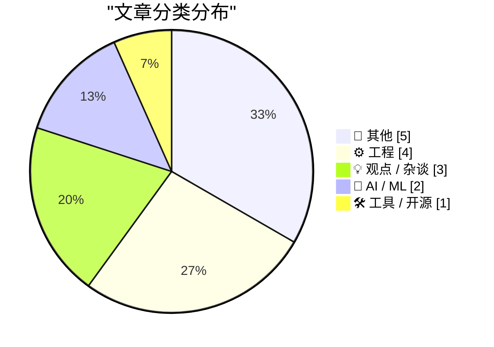
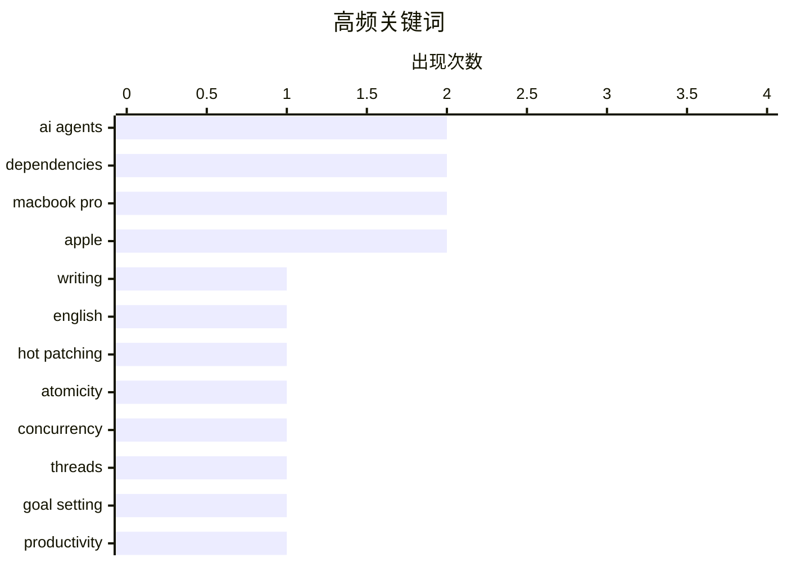

# 📰 Nov 8, 2026

> 来自 Karpathy 推荐的 92 个顶级技术博客，AI 精选 Top 15

## 📝 今日看点

AI 智能体正加速进入日常工作流，但讨论焦点已从“能做什么”转向目标能否说清、投入是否划算，以及实际价值能否兑现。工程领域则持续审视自动化背后的隐性风险：从热补丁与浏览器预取，到依赖维护和构建工具，可靠性仍取决于对底层机制的准确理解。与此同时，数据中心扰民、科技劳工组织与行业权力关系受到关注，技术进步的成本由谁承担、收益如何分配，正成为衡量创新的重要议题。

---

## 🏆 今日必读

🥇 **英语写作已经解决了**

[Writing English is Solved](https://idiallo.com/byte-size/english-is-solved) — idiallo.com · 1 天前 · 🤖 AI / ML

> 作者以夸张、带有讽刺意味的口吻，描绘英语写作被 AI 智能体全面接管的工作方式。文中的主控智能体接收口头需求，将任务拆解后分派给新建的子智能体执行。作者称自己每月花费 3,000 美元购买 token，主要用于研究与搜索、摘要与转录，以及写作。开头将英语世界与 Pulaar 等语言的处境作对照，暗示所谓写作问题“已经解决”的说法具有语言和使用环境上的局限。现有摘录未包含全文结尾，因此不能将这种夸张叙述直接视为作者对 AI 写作的最终评价。

💡 **为什么值得读**: 适合关注 AI 写作与多智能体工作流的读者，用来反思高额自动化投入是否足以支撑“写作已被解决”的判断。

🏷️ AI agents, writing, English

🥈 **既然可以挂起所有线程，应用热补丁时为什么还要纠结原子性？**

[Why are we all worked up about atomicity when applying hot-patches if we can just suspend all the threads?](https://devblogs.microsoft.com/oldnewthing/20261106-00/?p=112838/) — devblogs.microsoft.com/oldnewthing · 1 天前 · ⚙️ 工程

> 应用热补丁时，挂起所有线程并不足以替代对补丁原子性的要求。挂起操作只能停止当前已经存在的线程，而这些线程并不是所有可能引发状态变化的来源。因此，“现有线程都停了”不能直接推出“补丁应用期间不会发生其他变化”，热补丁方案仍需处理并发与一致性问题。核心观点是，线程挂起所覆盖的范围有限，不能据此认定非原子的补丁操作已经安全；摘录未列出其他变化来源的具体例子。

💡 **为什么值得读**: 适合需要理解热补丁安全性的开发者，帮助识别“暂停线程就等于消除并发”这一推理中的漏洞。

🏷️ hot patching, atomicity, concurrency, threads

🥉 **为什么大多数人使用 AI 智能体会失败**

[Why Most People Will Fail With AI Agents](https://www.joanwestenberg.com/p/why-most-people-will-fail-with-ai) — joanwestenberg.com · 11 分钟前 · 🤖 AI / ML

> AI 智能体的使用成效，取决于使用者能否明确自己究竟想要什么。标题与副标题将智能体的执行能力和人的目标判断能力并置，指出“AI 什么都能做”并不自动意味着用户能获得满意结果。这一论点把注意力从工具能力转向需求表达与目标选择：执行能力越强，决定执行什么就越关键。现有摘录只有标题与副标题，未提供作者用于支持“大多数人会失败”的案例、数据或具体方法。

💡 **为什么值得读**: 适合正在引入 AI 智能体的人阅读，促使你先检查目标是否清楚，再判断自动化能力能带来多少价值。

🏷️ AI agents, goal setting, productivity

---

## 📊 数据概览

| 扫描源 | 抓取文章 | 时间范围 | 精选 |
|:---:|:---:|:---:|:---:|
| 83/92 | 2565 篇 → 24 篇 | 48h | **15 篇** |

### 分类分布



### 高频关键词



<details>
<summary>📈 纯文本关键词图（终端友好）</summary>

```
ai agents    │ ████████████████████ 2
dependencies │ ████████████████████ 2
macbook pro  │ ████████████████████ 2
apple        │ ████████████████████ 2
writing      │ ██████████░░░░░░░░░░ 1
english      │ ██████████░░░░░░░░░░ 1
hot patching │ ██████████░░░░░░░░░░ 1
atomicity    │ ██████████░░░░░░░░░░ 1
concurrency  │ ██████████░░░░░░░░░░ 1
threads      │ ██████████░░░░░░░░░░ 1
```

</details>

### 🏷️ 话题标签

**ai agents**(2) · **dependencies**(2) · **macbook pro**(2) · apple(2) · writing(1) · english(1) · hot patching(1) · atomicity(1) · concurrency(1) · threads(1) · goal setting(1) · productivity(1) · package management(1) · releases(1) · security advisories(1) · ai(1) · data centers(1) · product costs(1) · datasette(1) · firefox(1)

---

## 📝 其他

### 1. 阅读清单：2026年11月7日

[Reading List 11/7/2026](https://www.construction-physics.com/p/reading-list-1172026) — **construction-physics.com** · 15 小时前 · ⭐ 19/30

> 这期阅读清单涵盖佛罗里达州房产税回调、印刷电路板（PCB）供应短缺预期、电动汽车产品命运与碳储存进展等议题。产业方面，清单关注预计出现的 PCB 短缺，并将特斯拉 Cybertruck 的终结列为讨论主题。公共政策与气候技术方面，关注点包括佛罗里达州房产税调整，以及碳储存迟迟缺乏进展的问题。现有简介只列出了选题，未提供短缺规模、税制调整细节，也未说明 Cybertruck“终结”的具体含义，无法据此判断各项论断的依据。

🏷️ PCB, supply chain, Tesla, carbon storage

---

### 2. 《杀出重围》

[Deus Ex](https://www.filfre.net/2026/11/deus-ex/) — **filfre.net** · 1 天前 · ⭐ 17/30

> 《杀出重围》（Deus Ex）的开发与问世构成了游戏制作人 Warren Spector 职业故事的一部分。Ion Storm 于 2000 年 6 月推出这款游戏，文章从它上市时的媒体评价切入展开回顾。开篇引用首席编剧 Sheldon Pacotti 在 2014 年的判断：只需稍微改变观察焦点，现实的未来仍可能走向《杀出重围》描绘的世界。这段引语将游戏史回顾与作品的现实关联放在一起，但所给摘录未包含具体开发过程、评价分歧或作者的最终结论。

🏷️ Deus Ex, game design, Warren Spector

---

### 3. 互联网泡沫时代最后一场大型 IPO：Transmeta 后来怎么样了？

[What happened to Transmeta, the last big dotcom IPO](https://dfarq.homeip.net/what-happened-to-transmeta-the-last-big-dotcom-ipo/?utm_source=rss&#038;utm_medium=rss&#038;utm_campaign=what-happened-to-transmeta-the-last-big-dotcom-ipo) — **dfarq.homeip.net** · 1 天前 · ⭐ 17/30

> Transmeta 于 2000 年 11 月 7 日上市，被称为互联网泡沫时代最后一场大型 IPO。此次 IPO 募集了 2.73 亿美元，部分分析师甚至将其视为 2004 年 Google 上市之前最后一次成功的科技公司 IPO。文章同时指出，Transmeta 并不完全符合典型互联网公司的分类，因此其上市故事需要放在更具体的企业背景中理解。标题将关注点引向这家公司上市后的命运，但现有摘录尚未交代其后续经营、技术路线或最终结局。

🏷️ Transmeta, CPU, IPO, dotcom

---

### 4. 我做客 Full Stack Creator，聊聊配备 PROLED XDR 显示屏的新款 MacBook Pro

[Yours Truly on Full Stack Creator, Talking About the New MacBook Pros With PROLED XDR Displays](https://www.youtube.com/watch?v=f2GZtWuUPl0) — **daringfireball.net** · 7 小时前 · ⭐ 16/30

> John Gruber 做客 Tyler Stalman 与 David Altizer 主持的 Full Stack Creator，主要话题是配备 PROLED XDR 显示屏的新款 MacBook Pro。他对这些新电脑的整体感受相当积极，称它们用起来有趣，也很值得聊。节目还谈到理光经典的 GR 系列便携相机；Gruber 提到，自己曾用约 20 年前的初代 GR-D 拍摄一张 2010 年 Steve Jobs 与 Walt Mossberg 的合影。这则节目推荐传达了鲜明的个人兴趣与使用感受，但未提供显示屏规格、性能测试或与旧款机型的比较结论。

🏷️ MacBook Pro, Apple, hardware

---

### 5. ★ 触控与光彩

[★ Touch and Glow](https://daringfireball.net/2026/11/touch_and_glow) — **daringfireball.net** · 1 天前 · ⭐ 16/30

> 苹果在洛杉矶举办的“Pro and Tell”活动、配备 PROLED XDR 显示屏的新款 MacBook Pro，以及 Macintosh 平台的现状，是这篇评论的三个重点。新品层面的明确关注对象是 MacBook Pro 及其 PROLED XDR 显示屏。讨论范围还延伸到整个 Mac 平台，将单次产品发布置于更广的背景中观察。现有简介没有给出触控功能、显示技术细节、测试数据或平台评价结论，因此不能仅凭标题推断具体产品能力与作者立场。

🏷️ Apple, Macintosh, MacBook Pro

---

## ⚙️ 工程

### 6. 既然可以挂起所有线程，应用热补丁时为什么还要纠结原子性？

[Why are we all worked up about atomicity when applying hot-patches if we can just suspend all the threads?](https://devblogs.microsoft.com/oldnewthing/20261106-00/?p=112838/) — **devblogs.microsoft.com/oldnewthing** · 1 天前 · ⭐ 21/30

> 应用热补丁时，挂起所有线程并不足以替代对补丁原子性的要求。挂起操作只能停止当前已经存在的线程，而这些线程并不是所有可能引发状态变化的来源。因此，“现有线程都停了”不能直接推出“补丁应用期间不会发生其他变化”，热补丁方案仍需处理并发与一致性问题。核心观点是，线程挂起所覆盖的范围有限，不能据此认定非原子的补丁操作已经安全；摘录未列出其他变化来源的具体例子。

🏷️ hot patching, atomicity, concurrency, threads

---

### 7. Datasette #3046：不要向 Firefox 的 HTML 页面发送 rel=next 的 Link 响应头

[datasette #3046: Don't serve link: rel=next HTTP headers to Firefox for HTML pages](https://simonwillison.net/2026/Nov/7/link-rel-next/) — **simonwillison.net** · 4 小时前 · ⭐ 19/30

> Datasette 的分页页面在 Firefox 中触发了对下一页表格数据的 HTTP 预取。作者通过 Firefox 网络面板发现这一行为，并将原因追踪到页面返回的带有 rel=next 关系的 Link HTTP 响应头。问题 #3046 提出的处理方向，是在向 Firefox 返回 HTML 页面时停止发送这一响应头，以避免触发下一页预取。这个案例表明，用于描述分页关系的 HTTP 元数据也可能触发浏览器自动请求，影响页面实际产生的网络流量。

🏷️ Datasette, Firefox, HTTP headers

---

### 8. 静态站点生成器很奇怪

[Static site generators are weird](https://evanhahn.com/static-site-generators-are-weird/) — **evanhahn.com** · 1 天前 · ⭐ 19/30

> 静态站点通常具备速度快、维护成本低和更易保障安全等优点，但作者认为多数静态站点生成器的使用方式令人困惑。Jekyll、Gatsby 和 Hugo 虽然让静态站点更容易构建，却要求使用者学习各自特有的规则与工作方式。这种工具专属的学习负担，是作者在肯定静态站点价值的同时质疑生成器设计的主要切入点。现有摘录未包含后续问题清单或替代方案，因此尚不能确定作者最终推荐怎样的构建方式。

🏷️ static sites, SSG, web development, Jekyll

---

### 9. 《老板度假去 2》

[Weekend at Bernie’s II](https://nesbitt.io/2026/11/06/weekend-at-bernies-ii.html) — **nesbitt.io** · 1 天前 · ⭐ 19/30

> 标题借用电影《老板度假去 2》，导语则用“哪些依赖还戴着墨镜”的比喻，追问依赖项目在六个月后的真实状态。“仍戴着墨镜”的说法暗示某些依赖可能表面如常，却需要进一步确认是否仍有人维护。导语给出了“六个月后”这一回看时间点，但没有说明此前观察的对象、判断标准或结果。由于现有摘录只有标题和一句导语，无法确认涉及哪些依赖，也不能据此给出具体的维护风险结论。

🏷️ dependencies, maintenance, open source

---

## 💡 观点 / 杂谈

### 10. 引用 Nilay Patel 的观点

[Quoting Nilay Patel](https://simonwillison.net/2026/Nov/6/nilay-patel/) — **simonwillison.net** · 1 天前 · ⭐ 20/30

> Nilay Patel 认为，当前 AI 产品提供的价值不足以让公众接受其带来的成本。他以住宅附近数据中心的持续噪声为例，质疑 AI 搜索概览与低质量深度伪造内容是否值得居民承担这种影响。对于智能体，他同样持怀疑态度，认为相关能力尚未兑现，实际使用方式也未必符合人们的期待。这段引文的核心判断是，AI 企业需要用足够有用的产品证明投入与社会成本的合理性，而现有产品尚未达到这一标准。

🏷️ AI, data centers, product costs

---

### 11. 与设计师共事

[Working with designers](https://seangoedecke.com/working-with-designers/) — **seangoedecke.com** · 1 天前 · ⭐ 19/30

> 作者从工程师视角谈与设计师合作，强调设计师的职业文化与工程师存在明显差异。他表示自己喜欢这种合作，并将设计师与经理、产品经理作对照，认为前者带来的文化差异是吸引力的一部分。同时，他提出一个鲜明判断：同一团队配备超过一名设计师容易引发麻烦，并表示自己对设计系统持复杂的负面看法。现有摘录尚未展开这些判断背后的案例与理由，因此只能确认作者的立场，不能进一步归纳其团队配置建议。

🏷️ designers, teamwork, design systems

---

### 12. Pluralistic：JS Tan 与 Clarissa Redwine 的《反对科技寡头统治》（2026 年 11 月 7 日）

[Pluralistic: JS Tan and Clarissa Redwine's "Against Tech Oligarchy" (07 Nov 2026)](https://pluralistic.net/2026/11/07/aeiou-but-sometimes-why/) — **pluralistic.net** · 15 小时前 · ⭐ 19/30

> 本期 Pluralistic 的主条目聚焦 JS Tan 与 Clarissa Redwine 的《反对科技寡头统治》，主题是科技行业的劳工组织与权力关系。导语将科技业描述为一个独特且强大的行业，并把为其创造新的劳工行动策略作为讨论方向。同一期还列有其他链接与历史回顾，涉及盗版损失主张、股东至上，以及劳动条件恶化等议题。现有摘录主要是目录，未提供主条目所讨论的具体组织方法、案例或最终论证。

🏷️ tech oligarchy, labor, technology

---

## 🤖 AI / ML

### 13. 英语写作已经解决了

[Writing English is Solved](https://idiallo.com/byte-size/english-is-solved) — **idiallo.com** · 1 天前 · ⭐ 21/30

> 作者以夸张、带有讽刺意味的口吻，描绘英语写作被 AI 智能体全面接管的工作方式。文中的主控智能体接收口头需求，将任务拆解后分派给新建的子智能体执行。作者称自己每月花费 3,000 美元购买 token，主要用于研究与搜索、摘要与转录，以及写作。开头将英语世界与 Pulaar 等语言的处境作对照，暗示所谓写作问题“已经解决”的说法具有语言和使用环境上的局限。现有摘录未包含全文结尾，因此不能将这种夸张叙述直接视为作者对 AI 写作的最终评价。

🏷️ AI agents, writing, English

---

### 14. 为什么大多数人使用 AI 智能体会失败

[Why Most People Will Fail With AI Agents](https://www.joanwestenberg.com/p/why-most-people-will-fail-with-ai) — **joanwestenberg.com** · 11 分钟前 · ⭐ 21/30

> AI 智能体的使用成效，取决于使用者能否明确自己究竟想要什么。标题与副标题将智能体的执行能力和人的目标判断能力并置，指出“AI 什么都能做”并不自动意味着用户能获得满意结果。这一论点把注意力从工具能力转向需求表达与目标选择：执行能力越强，决定执行什么就越关键。现有摘录只有标题与副标题，未提供作者用于支持“大多数人会失败”的案例、数据或具体方法。

🏷️ AI agents, goal setting, productivity

---

## 🛠 工具 / 开源

### 15. 包管理周报：2026 年 11 月 7 日

[This Week in Package Management: 7 November 2026](https://nesbitt.io/2026/11/07/this-week-in-package-management.html) — **nesbitt.io** · 18 小时前 · ⭐ 21/30

> 这是一份面向包管理生态的周报，日期为 2026 年 11 月 7 日。内容范围包括版本发布、安全通告，以及包管理领域的相关文章。它将软件更新、安全风险和行业讨论汇集在同一入口，方便读者了解近期动态。现有摘录未列出具体包管理器、版本号、漏洞编号或文章条目，因此无法进一步概括本期的重要变化与结论。

🏷️ package management, dependencies, releases, security advisories

---

*生成于 2026-11-08 04:28 | 扫描 83 源 → 获取 2565 篇 → 精选 15 篇*
*基于 [Hacker News Popularity Contest 2025](https://refactoringenglish.com/tools/hn-popularity/) RSS 源列表，由 [Andrej Karpathy](https://x.com/karpathy) 推荐*
