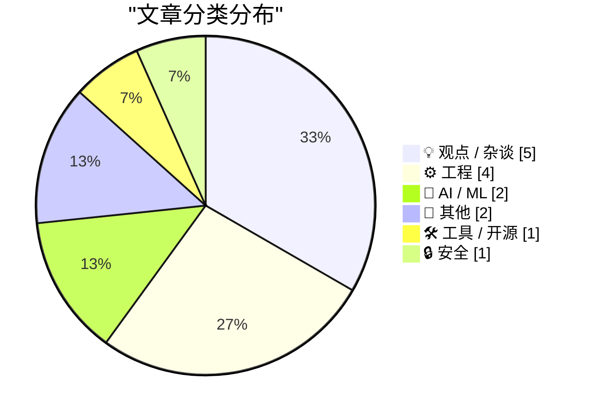
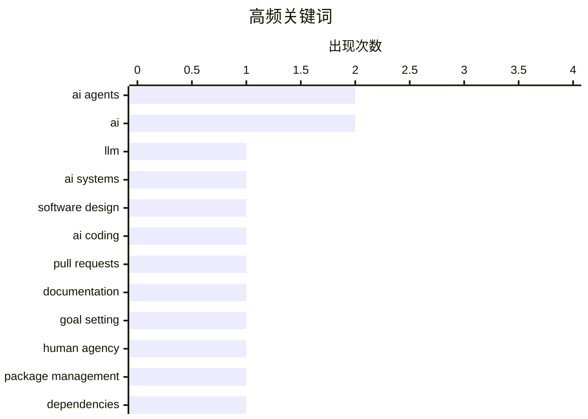

# 📰 Nov 9, 2026

> 来自 Karpathy 推荐的 92 个顶级技术博客，AI 精选 Top 15

## 📝 今日看点

AI 编程加速普及，瓶颈正从代码实现转向目标定义、系统设计与协作质量：会写程序，不等于能设计好 AI 系统，生成更多说明也未必提升审阅效率。随着智能体降低软件开发门槛，软件知识产权的价值基础与行业高利润模式开始受到质疑。与此同时，从证书维护到浏览器预取，基础设施的隐性复杂度持续暴露，减少维护负担、控制技术折腾成为工程实践的重要议题。

---

## 🏆 今日必读

🥇 **大语言模型很不擅长设计 AI 系统**

[LLMs are terrible at designing AI systems](https://seangoedecke.com/llms-are-terrible-at-designing-ai-systems/) — seangoedecke.com · 1 天前 · 🤖 AI / ML

> 大语言模型能够熟练编写常规程序，却经常无法为需要使用 LLM 的软件设计出合适的方案。作者指出，编程能力并不自动等于设计 AI 系统的能力，模型面对带有 AI 特征的问题时尤其容易出错。文章以“陷入符号化的兔子洞”为切入点，追问模型为什么会在这类设计任务上失手。核心观点是，不能因为模型擅长生成代码，就默认它也擅长决定如何使用模型；所提供片段尚未展示具体案例和替代方案。

💡 **为什么值得读**: 如果你正在让编码代理设计 LLM 应用，这篇文章能提醒你重点审查架构判断，而不只是检查生成的代码能否运行。

🏷️ LLM, AI systems, software design

🥈 **用 <details><summary> 折叠你那些 AI 味十足的 PR 描述**

[Hide your slop PR descriptions behind <details><summary>](https://simonwillison.net/2026/Nov/9/details-summary/) — simonwillison.net · 15 分钟前 · ⚙️ 工程

> 编码代理越来越擅长生成详尽的 PR 描述，但过多说明也会增加阅读负担。Simon Willison 将 PR 作为工作单元，用它组织提交、持续完善功能、记录决策并最终合并，而这些 PR 如今大多由 Claude Code 或 Codex 创建。标题提出使用 HTML 的 <details> 和 <summary> 元素，将冗长内容放进可展开的折叠区域。核心建议是通过信息分层保留详细记录，同时让读者更快看到需要优先关注的内容。

💡 **为什么值得读**: 如果团队的 AI 生成 PR 描述越来越长，这提供了一个成本很低、能直接改善评审阅读体验的排版办法。

🏷️ AI coding, pull requests, documentation

🥉 **为什么大多数人用不好 AI 智能体**

[Why Most People Will Fail With AI Agents](https://www.joanwestenberg.com/p/why-most-people-will-fail-with-ai) — joanwestenberg.com · 1 天前 · 🤖 AI / ML

> AI 智能体能执行越来越多的任务，但使用者能否明确自己想要什么，可能成为更关键的限制。文章以“AI 什么都能做，你能决定自己想要什么吗”这一提问，把焦点放在目标选择与需求表达上。其标题与副标题传达的判断是，拥有执行工具并不意味着能够有效使用它，用户仍需要决定任务的方向。所提供内容只有标题和副标题，尚不足以确认作者给出的具体失败案例、论证或行动建议。

💡 **为什么值得读**: 它适合用来反思一个常被工具热潮掩盖的问题：当执行越来越容易时，你是否具备选择目标和定义成果的能力。

🏷️ AI agents, goal setting, human agency

---

## 📊 数据概览

| 扫描源 | 抓取文章 | 时间范围 | 精选 |
|:---:|:---:|:---:|:---:|
| 83/92 | 2566 篇 → 24 篇 | 48h | **15 篇** |

### 分类分布



### 高频关键词



<details>
<summary>📈 纯文本关键词图（终端友好）</summary>

```
ai agents       │ ████████████████████ 2
ai              │ ████████████████████ 2
llm             │ ██████████░░░░░░░░░░ 1
ai systems      │ ██████████░░░░░░░░░░ 1
software design │ ██████████░░░░░░░░░░ 1
ai coding       │ ██████████░░░░░░░░░░ 1
pull requests   │ ██████████░░░░░░░░░░ 1
documentation   │ ██████████░░░░░░░░░░ 1
goal setting    │ ██████████░░░░░░░░░░ 1
human agency    │ ██████████░░░░░░░░░░ 1
```

</details>

### 🏷️ 话题标签

**ai agents**(2) · **ai**(2) · **llm**(1) · ai systems(1) · software design(1) · ai coding(1) · pull requests(1) · documentation(1) · goal setting(1) · human agency(1) · package management(1) · dependencies(1) · security advisories(1) · releases(1) · software ip(1) · software economics(1) · sqlite(1) · c(1) · rust(1) · extensions(1)

---

## 💡 观点 / 杂谈

### 1. 软件知识产权的大幅减值

[The great software IP writedown](https://martinalderson.com/posts/the-great-software-ip-writedown/?utm_source=rss&amp;utm_medium=rss&amp;utm_campaign=feed) — **martinalderson.com** · 1 天前 · ⭐ 22/30

> AI 智能体正在降低软件开发能力的稀缺性，进而挑战软件知识产权的价值基础。作者认为，软件行业长期享有的超高利润率，建立在能够开发软件的人才相对稀缺这一条件上。当智能体扩大软件供给、降低实现成本时，既有软件知识产权还能保留多少经济价值，就成为需要重新审视的问题。文章提出的核心判断是，开发能力供给的变化可能推动软件资产重新定价；片段未提供具体估值模型或企业案例。

🏷️ AI agents, software IP, software economics

---

### 2. 无休止的技术折腾，让人不堪重负

[Yak-Shaving Overload](https://feed.tedium.co/link/15204/17518143/yak-shaving-ai-mental-health-effects) — **tedium.co** · 1 小时前 · ⭐ 21/30

> 作者从折腾一台被遗忘的 Linux 平板电脑出发，反思 AI 与不断扩张的技术支线任务之间的关系。“Yak shaving”指为了完成原本的目标，不断转去处理前置问题或旁支任务，最终陷入层层折腾。作者表示，自己过去也经常掉进技术兔子洞，但这次经历带来了不同寻常的不适，并将其归因于 AI。文章由此提出对 AI 辅助技术探索及其心理影响的疑问；片段尚未展开具体过程和最终判断。

🏷️ yak shaving, Linux, AI, tinkering

---

### 3. Pluralistic：JS Tan 与 Clarissa Redwine 的《反对科技寡头》（2026 年 11 月 7 日）

[Pluralistic: JS Tan and Clarissa Redwine's "Against Tech Oligarchy" (07 Nov 2026)](https://pluralistic.net/2026/11/07/aeiou-but-sometimes-why/) — **pluralistic.net** · 1 天前 · ⭐ 19/30

> 科技行业的权力集中与劳动者如何组织起来，是 JS Tan 与 Clarissa Redwine 的《反对科技寡头》所关注的核心议题。所给导读将科技业描述为一个独特且强大的行业，强调需要为其探索新的劳工行动策略。文章标题与导读把科技寡头问题和劳动者的集体行动联系起来，将组织方式作为应对行业权力结构的重要切入点。当前摘录主要是当日文章目录，未提供书中的具体案例、行动方案或论证细节。

🏷️ tech oligarchy, labor organizing, worker power

---

### 4. 人工智能正在崩盘吗？

[Is AI crashing?](https://dfarq.homeip.net/is-ai-crashing/?utm_source=rss&#038;utm_medium=rss&#038;utm_campaign=is-ai-crashing) — **dfarq.homeip.net** · 16 小时前 · ⭐ 18/30

> 截至 2026 年 11 月 8 日，作者尚不能确认人工智能行业是否正在崩盘，或 AI 泡沫是否已经破裂。尽管有人声称崩盘已经发生，作者仍明确保留判断，没有把这些说法当作定论。作者回忆自己经历过互联网泡沫破裂，却遗憾当时没有通过博客留下记录，由此引出记录当前 AI 行业变化的意图。现有摘录体现的是对不确定性的承认和留下同期观察的价值，尚未提供市场数据、企业业绩或支持崩盘判断的具体证据。

🏷️ AI, tech bubble, dotcom crash

---

### 5. 关于餐厅二维码菜单的一些想法

[Some thoughts on restaurant menu QR codes](https://shkspr.mobi/blog/2026/11/some-thoughts-on-restaurant-menu-qr-codes/) — **shkspr.mobi** · 16 小时前 · ⭐ 17/30

> 餐厅二维码菜单引发的争议，是这篇文章的主题，但开头先以酒店电子房卡为例展开讽刺。作者模拟对新技术极度不满的口吻，抱怨刷卡开门、把房卡放进钱包，以及让电子设备介入生活。随后又以传统钥匙可以用于抵抗袭击、塑料房卡却不行等夸张理由，呈现对旧式钥匙的怀念。这个开场借房卡类比，为审视二维码菜单争论中的反对理由作铺垫；不过，所给摘录尚未展示作者对扫码菜单便利性、可访问性或隐私问题的具体判断。

🏷️ QR codes, UX, digital menus

---

## ⚙️ 工程

### 6. 用 <details><summary> 折叠你那些 AI 味十足的 PR 描述

[Hide your slop PR descriptions behind <details><summary>](https://simonwillison.net/2026/Nov/9/details-summary/) — **simonwillison.net** · 15 分钟前 · ⭐ 22/30

> 编码代理越来越擅长生成详尽的 PR 描述，但过多说明也会增加阅读负担。Simon Willison 将 PR 作为工作单元，用它组织提交、持续完善功能、记录决策并最终合并，而这些 PR 如今大多由 Claude Code 或 Codex 创建。标题提出使用 HTML 的 <details> 和 <summary> 元素，将冗长内容放进可展开的折叠区域。核心建议是通过信息分层保留详细记录，同时让读者更快看到需要优先关注的内容。

🏷️ AI coding, pull requests, documentation

---

### 7. 将 parse_number() 实现为 SQLite 扩展：C 与 Rust 对比

[parse_number() as a SQLite extension: C vs Rust](https://simonwillison.net/2026/Nov/8/sqlite-parse-number-c-vs-rust/) — **simonwillison.net** · 6 小时前 · ⭐ 21/30

> 这项研究探索如何为 SQLite 编写扩展，增加将带格式字符串转换为数值的 parse_number() 函数。示例输入包括 -$1,234.56 和 '12.5%'，目标是让这类数据能够参与求和与排序。研究将 C 与 Rust 作为对照，关注实现同一个 SQLite 扩展的难易程度。所提供片段未展示两种实现的性能、依赖、构建方式或最终结论，因此尚不能判断作者更推荐哪一种语言。

🏷️ SQLite, C, Rust, extensions

---

### 8. 逆向分析一枚古老的二极管—晶体管逻辑芯片

[Reverse engineering a vintage diode-transistor logic chip](http://www.righto.com/2026/11/signetics-st680a-dtl-nand.html) — **righto.com** · 12 小时前 · ⭐ 20/30

> 作者通过开封和显微观察，识别出一枚最初无法确认型号的早期逻辑芯片。分析发现，它使用二极管—晶体管逻辑（DTL），内部实现了 4 个 NAND（与非）门。芯片最终被确定为 Signetics ST680A，属于该公司于 1965 年推出的 600 系列。这个案例展示了如何从芯片内部结构反推逻辑功能，并进一步确认器件身份。

🏷️ reverse engineering, DTL, NAND gates, vintage chips

---

### 9. Datasette #3046：不要向 Firefox 的 HTML 页面发送 rel=next HTTP Link 响应头

[datasette #3046: Don't serve link: rel=next HTTP headers to Firefox for HTML pages](https://simonwillison.net/2026/Nov/7/link-rel-next/) — **simonwillison.net** · 1 天前 · ⭐ 19/30

> Firefox 会因为 Datasette 表格页面返回的 rel=next HTTP Link 响应头，预取下一页数据。作者在 Firefox 网络面板中发现，访问表格页面会额外触发一次指向下一页记录的 HTTP 请求。问题 #3046 提出的处理方向，是对提供给 Firefox 的 HTML 页面停止发送这一响应头，以避免触发该预取行为。这个案例表明，分页元数据可能直接影响浏览器的网络请求，而所提供片段尚未说明修复是否已经合并或发布。

🏷️ Firefox, HTTP headers, Datasette, prefetching

---

## 🤖 AI / ML

### 10. 大语言模型很不擅长设计 AI 系统

[LLMs are terrible at designing AI systems](https://seangoedecke.com/llms-are-terrible-at-designing-ai-systems/) — **seangoedecke.com** · 1 天前 · ⭐ 24/30

> 大语言模型能够熟练编写常规程序，却经常无法为需要使用 LLM 的软件设计出合适的方案。作者指出，编程能力并不自动等于设计 AI 系统的能力，模型面对带有 AI 特征的问题时尤其容易出错。文章以“陷入符号化的兔子洞”为切入点，追问模型为什么会在这类设计任务上失手。核心观点是，不能因为模型擅长生成代码，就默认它也擅长决定如何使用模型；所提供片段尚未展示具体案例和替代方案。

🏷️ LLM, AI systems, software design

---

### 11. 为什么大多数人用不好 AI 智能体

[Why Most People Will Fail With AI Agents](https://www.joanwestenberg.com/p/why-most-people-will-fail-with-ai) — **joanwestenberg.com** · 1 天前 · ⭐ 22/30

> AI 智能体能执行越来越多的任务，但使用者能否明确自己想要什么，可能成为更关键的限制。文章以“AI 什么都能做，你能决定自己想要什么吗”这一提问，把焦点放在目标选择与需求表达上。其标题与副标题传达的判断是，拥有执行工具并不意味着能够有效使用它，用户仍需要决定任务的方向。所提供内容只有标题和副标题，尚不足以确认作者给出的具体失败案例、论证或行动建议。

🏷️ AI agents, goal setting, human agency

---

## 📝 其他

### 12. 阅读清单：2026 年 11 月 7 日

[Reading List 11/7/2026](https://www.construction-physics.com/p/reading-list-1172026) — **construction-physics.com** · 1 天前 · ⭐ 19/30

> 这份阅读清单汇集了房地产税、电子制造供应链、电动汽车和碳储存等领域的议题。政策方面涉及佛罗里达州的房地产税回调，供应链方面关注预计出现的印刷电路板（PCB）短缺。产业话题包括特斯拉 Cybertruck 的终结，以及碳储存进展不足的问题。所给摘录仅列出选题，未提供税收调整幅度、PCB 短缺规模，也未解释 Cybertruck 所谓“终结”的具体含义，因此无法据此判断各项议题的依据与结论。

🏷️ PCB supply, Tesla, carbon storage, industry

---

### 13. 我做客 Full Stack Creator，聊聊配备 PROLED XDR 显示屏的新款 MacBook Pro

[Yours Truly on Full Stack Creator, Talking About the New MacBook Pros With PROLED XDR Displays](https://www.youtube.com/watch?v=f2GZtWuUPl0) — **daringfireball.net** · 1 天前 · ⭐ 16/30

> 这期 Full Stack Creator 节目由 Tyler Stalman 和 David Altizer 邀请作者参与，话题聚焦配备 PROLED XDR 显示屏的新款 MacBook Pro。作者对这些电脑给出了积极的个人评价，认为它们既有趣，也很值得聊。节目还谈到了理光 GR 系列便携相机，作者提到自己曾用距今约 20 年的初代 GR-D，拍摄一张 2010 年 Steve Jobs 与 Walt Mossberg 的照片。所给简介体现了节目对电脑与摄影器材的兴趣，但未提供显示屏参数、性能测试或新旧机型的对比结论。

🏷️ MacBook Pro, displays, Apple, podcast

---

## 🛠 工具 / 开源

### 14. 包管理周报：2026 年 11 月 7 日

[This Week in Package Management: 7 November 2026](https://nesbitt.io/2026/11/07/this-week-in-package-management.html) — **nesbitt.io** · 1 天前 · ⭐ 22/30

> 这是一份面向包管理生态的周报，日期为 2026 年 11 月 7 日。内容范围包括软件发布动态、安全公告，以及包管理领域的相关文章。它将版本变化、安全信息和技术讨论集中呈现，方便读者了解这一领域的近期动向。所提供片段未列出具体包管理器、版本号或漏洞编号，因此无法进一步归纳本期最重要的更新。

🏷️ package management, dependencies, security advisories, releases

---

## 🔒 安全

### 15. 糟糕的公钥把戏

[Horible public key tricks:](https://maurycyz.com/projects/badcert/) — **maurycyz.com** · 1 天前 · ⭐ 20/30

> 作者从部署公开 HTTPS 网站的证书维护负担出发，质疑现有 SSL/TLS 证书体系的复杂性。文中指出，网站需要通过 ACME 流程获取证书，而且证书每隔几个月就会过期，无法配置一次后永久使用。即使实现自动续期，仍需保证 ACME 客户端持续拥有所需的 DNS 记录或 Web 服务器访问权限。片段随后开始质疑证书签发过程，但内容在关键论证处截断，无法据此确认其公钥技巧、攻击条件或对安全性的最终结论。

🏷️ public key, TLS, ACME, certificates

---

*生成于 2026-11-09 04:40 | 扫描 83 源 → 获取 2566 篇 → 精选 15 篇*
*基于 [Hacker News Popularity Contest 2025](https://refactoringenglish.com/tools/hn-popularity/) RSS 源列表，由 [Andrej Karpathy](https://x.com/karpathy) 推荐*
