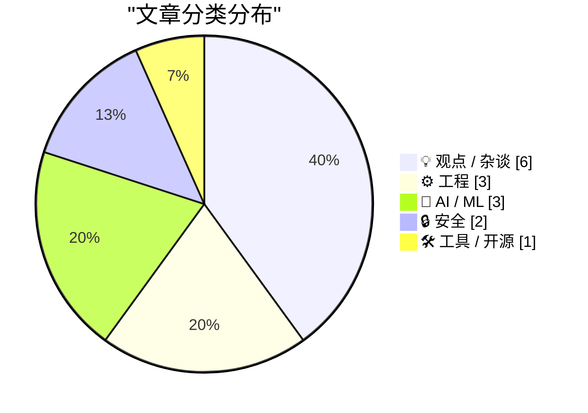
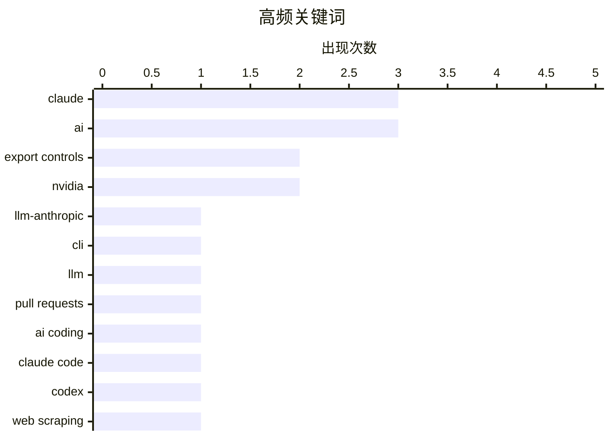

# 📰 Nov 10, 2026

> 来自 Karpathy 推荐的 92 个顶级技术博客，AI 精选 Top 15

## 📝 今日看点

AI 正加速融入软件开发，模型与工具持续迭代，关注点也延伸到提示词如何影响代码修改、自动生成内容如何增加审查负担。与此同时，AI 爬虫带来的流量压力与算力采购引发的合规疑问，正让资源成本和治理责任成为焦点。围绕平台年龄限制、企业人才流失及 AI 利益冲突的讨论，则指向一个共同问题：技术与商业扩张的代价由谁承担，责任又该如何落实。

---

## 🏆 今日必读

🥇 **llm-anthropic 0.31 发布**

[llm-anthropic 0.31](https://simonwillison.net/2026/Nov/9/llm-anthropic/) — simonwillison.net · 5 小时前 · 🛠 工具 / 开源

> llm-anthropic 发布 0.31 版本，发布说明提及 Anthropic 同日推出的 Fable 5.2 和 Mythos 5.2。根据所给摘录，Fable 5.2 当时在 Artificial Analysis 排名第一。Anthropic 还声称，该模型解决了黑洞物理学中的两个开放问题，但摘录未提供研究细节或独立验证。作者借此强调新模型能力评估的变化，不过所给内容不足以确认插件 0.31 的具体功能和兼容性调整。

💡 **为什么值得读**: 适合关注 LLM 工具链和 Claude 新模型的开发者快速获取版本动态，并区分榜单表现与尚待验证的能力宣称。

🏷️ llm-anthropic, Claude, CLI, LLM

🥈 **把 AI 生成的冗长 PR 描述收进 <details><summary> 折叠区**

[Hide your slop PR descriptions behind <details><summary>](https://simonwillison.net/2026/Nov/9/details-summary/) — simonwillison.net · 1 天前 · ⚙️ 工程

> 编码代理生成的 PR 描述过于详尽，可能增加阅读和审查的负担。作者目前的大部分项目修改都由 Claude Code 或 Codex 创建 PR，并把 PR 作为组织提交、迭代功能和记录决策的基本工作单元。这些代理很擅长描述工作，但过量说明也成了新的问题。作者建议使用 HTML 的 <details> 和 <summary> 标签折叠冗长内容，让读者按需展开细节。

💡 **为什么值得读**: 如果你的代码审查正在被 AI 生成的长篇说明淹没，这个简单的排版技巧能直接改善 PR 的可读性。

🏷️ pull requests, AI coding, Claude Code, Codex

🥉 **用简单封禁陷阱大幅拦截基础爬虫**

[Blunt Banhammer Blocks Basic Bots Ballistically](https://shkspr.mobi/blog/2026/11/blunt-banhammer-blocks-basic-bots-ballistically/) — shkspr.mobi · 17 小时前 · ⚙️ 工程

> OpenBenches.org 遭遇大量疑似 AI 爬虫访问，作者通过一个简单陷阱将机器人流量削减了 80% 以上。这个业余网站上个月向访问者传输了超过 2.5 TB 数据，作者认为其中大量流量来自反复抓取数据和图片的机器人。为此，他构建了名为 B 的工具，以较为激进、不加区分的方式拦截不受欢迎的爬虫。所给摘录展示了明显的流量削减效果，但未说明陷阱的具体机制、识别规则或误封情况。

💡 **为什么值得读**: 对承担爬虫带宽成本的个人站长而言，这个案例提供了有明确量化效果的治理思路，也提示了评估误封代价的必要性。

🏷️ web scraping, AI bots, bot mitigation, bandwidth

---

## 📊 数据概览

| 扫描源 | 抓取文章 | 时间范围 | 精选 |
|:---:|:---:|:---:|:---:|
| 83/92 | 2566 篇 → 37 篇 | 48h | **15 篇** |

### 分类分布



### 高频关键词



<details>
<summary>📈 纯文本关键词图（终端友好）</summary>

```
claude          │ ████████████████████ 3
ai              │ ████████████████████ 3
export controls │ █████████████░░░░░░░ 2
nvidia          │ █████████████░░░░░░░ 2
llm-anthropic   │ ███████░░░░░░░░░░░░░ 1
cli             │ ███████░░░░░░░░░░░░░ 1
llm             │ ███████░░░░░░░░░░░░░ 1
pull requests   │ ███████░░░░░░░░░░░░░ 1
ai coding       │ ███████░░░░░░░░░░░░░ 1
claude code     │ ███████░░░░░░░░░░░░░ 1
```

</details>

### 🏷️ 话题标签

**claude**(3) · **ai**(3) · **export controls**(2) · nvidia(2) · llm-anthropic(1) · cli(1) · llm(1) · pull requests(1) · ai coding(1) · claude code(1) · codex(1) · web scraping(1) · ai bots(1) · bot mitigation(1) · bandwidth(1) · prompt engineering(1) · code ownership(1) · sqlite(1) · c(1) · rust(1)

---

## 💡 观点 / 杂谈

### 1. 每周更新第 529 期：儿童社交媒体禁令及其他话题

[Weekly Update 529: Kids Social Media Bans (and Everything Else)](https://www.troyhunt.com/weekly-update-529/) — **troyhunt.com** · 5 小时前 · ⭐ 21/30

> Troy Hunt 将儿童社交媒体禁令争论的重点放在执行责任，而非是否应将使用年龄推迟到 16 岁。作者认为，相关讨论的问题在于本应理解政策的人没有弄清由谁负责落实限制。他引用法律通过后总理发布的说明，作为讨论政策执行责任的切入点。作者的核心立场是，评估年龄限制政策必须厘清执行责任，但所给摘录未展示他对责任归属的具体解释。

🏷️ social media, age verification, regulation, child safety

---

### 2. 特斯拉的人才流失

[Tesla Brain Drain](https://electrek.co/2026/11/09/tesla-deep-bench-gone-musk-admits-talent-shortage/) — **daringfireball.net** · 9 小时前 · ⭐ 20/30

> 这则评论借 Electrek 的报道，将特斯拉的人才储备问题与其产品阵容收缩联系起来。特斯拉在 2024 年股东大会上展示了 Model 3、Model Y、Model S、Model X、Cybertruck 和 Semi，并预告了三款尚未揭幕的新车。根据所引报道，当时展示的五款消费车型中，如今已有三款停产或正走向退出。摘录还提及 2023 年 3 月 1 日投资者日上马斯克较少出面的情形，以回顾当时的团队展示，但未列出具体离职人员或完整的人才短缺证据。

🏷️ Tesla, talent retention, EV, product strategy

---

### 3. AI 与《幽灵公主》中的炼铁镇

[AI and Irontown](https://lucumr.pocoo.org/2026/11/9/irontown/) — **lucumr.pocoo.org** · 1 天前 · ⭐ 20/30

> 作者从重看《幽灵公主》出发，以炼铁镇为切入点思考 AI 相关议题中的利益冲突。影片中的人类、动物和神灵各有合理却难以兼容的需求，而且每个阵营内部也存在分歧。黑帽大人经营的炼铁镇为遭到社会排斥的人提供工作与庇护，使其不能被简单归入善恶阵营。作者欣赏宫崎骏呈现多方立场而不轻易选边的方式，但所给摘录尚未展开这一视角与 AI 的具体对应关系。

🏷️ AI, Princess Mononoke, technology ethics

---

### 4. 无休止的技术折腾

[Yak-Shaving Overload](https://feed.tedium.co/link/15204/17518143/yak-shaving-ai-mental-health-effects) — **tedium.co** · 1 天前 · ⭐ 20/30

> AI 如何影响人们陷入技术支线任务的方式，是作者这次折腾一台被遗忘的 Linux 平板后产生的疑问。作者过去就经常钻进技术兔子洞，为解决一个问题而不断处理额外问题，这类经历常被称为“Yak Shaving”。但这次经历带来的感受与以往不同，作者将这种异样感归因于 AI 的介入。现有节选呈现了对 AI 辅助技术折腾及其心理影响的反思，但没有提供具体操作过程或最终结论。

🏷️ AI, Linux, yak shaving

---

### 5. AI 正在崩盘吗？

[Is AI crashing?](https://dfarq.homeip.net/is-ai-crashing/?utm_source=rss&#038;utm_medium=rss&#038;utm_campaign=is-ai-crashing) — **dfarq.homeip.net** · 1 天前 · ⭐ 20/30

> 截至 2026 年 11 月 8 日，作者尚不能判断 AI 行业是否正在崩盘，或 AI 泡沫是否已经破裂。尽管已经有人宣称崩盘正在发生，作者仍明确保留判断。作者回忆自己经历过互联网泡沫破裂，却遗憾当时没有通过博客记录观察，因此这次选择留下当下的思考。现有节选没有给出估值、融资或营收数据，其核心态度是在局势未明时记录观察，而非提前宣布泡沫终结。

🏷️ AI, tech bubble, dotcom crash

---

### 6. 做空机构 Culper Research 早在 5 月就发布了有关黄仁勋婚外情的信息

[Short-Seller Culper Research Published Information on Jensen Huang’s Affair Back in May](https://culperresearch.com/wp-content/uploads/2026/05/Culper_NVDA_5-13-2026.pdf) — **daringfireball.net** · 9 小时前 · ⭐ 19/30

> 这则条目以 Culper Research 早在 5 月披露黄仁勋婚外情相关信息为标题，但所附节选主要涉及该机构对英伟达中国业务的指控。Culper Research 在 2026 年 5 月的做空报告中称，英伟达宣称其中国业务在 2025 年 4 月美国贸易限制出台后已降至“零”。该机构则估计，英伟达 2026 财年超过 20% 的计算业务收入仍由中国需求驱动，并声称这涉及非法 GPU 转运及东南亚中间商。节选还提及英伟达曾多次为 Megaspeed 背书，但后续内容被截断；这些均属于做空方的说法，现有材料不足以核实相关业务指控或标题涉及的私人生活信息。

🏷️ Nvidia, China, short selling, export controls

---

## ⚙️ 工程

### 7. 把 AI 生成的冗长 PR 描述收进 <details><summary> 折叠区

[Hide your slop PR descriptions behind <details><summary>](https://simonwillison.net/2026/Nov/9/details-summary/) — **simonwillison.net** · 1 天前 · ⭐ 23/30

> 编码代理生成的 PR 描述过于详尽，可能增加阅读和审查的负担。作者目前的大部分项目修改都由 Claude Code 或 Codex 创建 PR，并把 PR 作为组织提交、迭代功能和记录决策的基本工作单元。这些代理很擅长描述工作，但过量说明也成了新的问题。作者建议使用 HTML 的 <details> 和 <summary> 标签折叠冗长内容，让读者按需展开细节。

🏷️ pull requests, AI coding, Claude Code, Codex

---

### 8. 用简单封禁陷阱大幅拦截基础爬虫

[Blunt Banhammer Blocks Basic Bots Ballistically](https://shkspr.mobi/blog/2026/11/blunt-banhammer-blocks-basic-bots-ballistically/) — **shkspr.mobi** · 17 小时前 · ⭐ 23/30

> OpenBenches.org 遭遇大量疑似 AI 爬虫访问，作者通过一个简单陷阱将机器人流量削减了 80% 以上。这个业余网站上个月向访问者传输了超过 2.5 TB 数据，作者认为其中大量流量来自反复抓取数据和图片的机器人。为此，他构建了名为 B 的工具，以较为激进、不加区分的方式拦截不受欢迎的爬虫。所给摘录展示了明显的流量削减效果，但未说明陷阱的具体机制、识别规则或误封情况。

🏷️ web scraping, AI bots, bot mitigation, bandwidth

---

### 9. 用 C 与 Rust 编写 SQLite 的 parse_number() 扩展

[parse_number() as a SQLite extension: C vs Rust](https://simonwillison.net/2026/Nov/8/sqlite-parse-number-c-vs-rust/) — **simonwillison.net** · 1 天前 · ⭐ 21/30

> 这项实验探索如何为 SQLite 编写 parse_number() 扩展，并比较 C 与 Rust 两种实现路线。目标是将带有货币符号、千位分隔符或百分号的字符串转换为数值，例如 -$1,234.56 和 12.5%。转换后的数据可直接参与数值求和与排序，方便处理格式化字符串中的数字。所给摘录明确了功能目标和比较对象，但没有提供两种语言在实现难度、性能或部署方面的结果，因此无法据此判断哪种方案更优。

🏷️ SQLite, C, Rust, extensions

---

## 🤖 AI / ML

### 10. 摘引：Claude Fable 5.2 提示词指南

[Quoting Prompting Claude Fable 5.2](https://simonwillison.net/2026/Nov/10/prompting-claude-fable-52/) — **simonwillison.net** · 23 分钟前 · ⭐ 22/30

> 提示词如何描述代码归属，会影响 Claude Fable 5.2 修改现有代码的方式。Anthropic 在小型编程任务中的测试发现，当提示词没有交代代码归属，或将代码库描述为他人的项目时，模型倾向于在现有结构上继续添加代码。这种倾向甚至会导致模型重复已有代码，说明代码归属的表述会影响其修改策略。该观察提示使用者应明确交代模型对代码的责任与修改权限，但所给摘录未展示完整的推荐提示词或量化结果。

🏷️ Claude, prompt engineering, code ownership

---

### 11. 彭博社一年前就已关注 Megaspeed 的可疑业务

[Bloomberg Was Onto Megaspeed’s Game a Year Ago](https://www.bloomberg.com/news/features/2025-12-22/nvidia-partner-megaspeed-draws-china-chip-smuggling-concerns-in-us) — **daringfireball.net** · 6 小时前 · ⭐ 21/30

> Daring Fireball 回顾彭博社在 2025 年 12 月 22 日对 Megaspeed 的报道，关注其快速采购英伟达芯片所引发的疑问。根据摘录，这家新加坡 AI 公司由一家中国游戏企业分拆而来，在不到三年的时间里成为东南亚最大的英伟达芯片买家。这一增长一度让外界期待其成为区域 AI 产业的重要企业，但所链接报道也涉及美国方面对芯片走私的担忧。现有摘录能够说明其采购规模与监管关注，尚不足以确认具体违规行为。

🏷️ Megaspeed, AI chips, export controls

---

### 12. 用 Claude 定位神秘蜂鸣声的来源

[Locating the source of a mysterious beep with Claude](https://simonwillison.net/2026/Nov/9/mysterious-beeps/) — **simonwillison.net** · 6 小时前 · ⭐ 19/30

> 家中堆满搬家纸箱的小房间出现间歇性蜂鸣声，Simon Willison 尝试用 Claude Code 帮忙寻找声源。由于蜂鸣间隔较长，靠站在房间里听声辨位既耗时又令人沮丧，逐箱翻找也十分麻烦。他让 Claude Code 构建了名为 Beep Locator 的软件系统，尝试通过三角定位寻找声音来源，并提供了 GitHub 项目链接。现有节选展示了将日常定位难题转化为软件任务的思路，但没有披露采集设备、定位精度或最终寻找结果。

🏷️ Claude, audio, troubleshooting

---

## 🔒 安全

### 13. 报道称黄仁勋曾与被美方认定为中国间谍的高管有亲密关系

[Nvidia CEO Jensen Huang Was Banging a Chinese Spy, Who Was Feeding Information Back to Beijing](https://www.nytimes.com/2026/11/08/technology/nvidia-investigation-jensen-huang-china.html?unlocked_article_code=1.O1E.Soow.6UjrM7Ch-C8L) — **daringfireball.net** · 1 天前 · ⭐ 21/30

> 据所引《纽约时报》报道，英伟达因首席执行官兼联合创始人黄仁勋的一段亲密关系启动调查。报道声称，黄仁勋向董事会承认曾与一名企业高管有亲密关系，而美国情报部门认定该女子为中国间谍。报道还称，这名女子名为 Alice Huang，监控发现她直接向北京传递信息，使这段关系引起美国政府关注。这些均为所给摘录转述的报道内容，摘录没有提供可独立核实的证据，也未说明调查结论或所涉信息的性质。

🏷️ Nvidia, Jensen Huang, espionage, investigation

---

### 14. 【赞助】WorkOS：让智能体使用你的工具，同时限制其权限

[[Sponsor] WorkOS: Let Agents Use Your Tools Without Giving Them Free Rein](https://www.workos.com/airlock?utm_source=daringfireball&amp;utm_medium=newsletter&amp;utm_campaign=q42026) — **daringfireball.net** · 1 小时前 · ⭐ 19/30

> WorkOS Airlock 主张根据智能体当前任务的意图检查工具调用，以解决预先分配角色时权限过大或不足的问题。它的基本判断是，智能体实际需要完成的工作往往要到运行时才能确定，因此静态角色难以准确覆盖所需权限。开发者设置策略后，Airlock 会逐次检查调用，无论是读取 Linear 工单，还是向邮件分发列表发送邮件。每次调用都会被允许、拒绝或转交人工审批，所有裁决均会记录日志；这则赞助内容目前邀请用户申请早期访问。

🏷️ AI agents, authorization, WorkOS, access control

---

## 🛠 工具 / 开源

### 15. llm-anthropic 0.31 发布

[llm-anthropic 0.31](https://simonwillison.net/2026/Nov/9/llm-anthropic/) — **simonwillison.net** · 5 小时前 · ⭐ 24/30

> llm-anthropic 发布 0.31 版本，发布说明提及 Anthropic 同日推出的 Fable 5.2 和 Mythos 5.2。根据所给摘录，Fable 5.2 当时在 Artificial Analysis 排名第一。Anthropic 还声称，该模型解决了黑洞物理学中的两个开放问题，但摘录未提供研究细节或独立验证。作者借此强调新模型能力评估的变化，不过所给内容不足以确认插件 0.31 的具体功能和兼容性调整。

🏷️ llm-anthropic, Claude, CLI, LLM

---

*生成于 2026-11-10 05:57 | 扫描 83 源 → 获取 2566 篇 → 精选 15 篇*
*基于 [Hacker News Popularity Contest 2025](https://refactoringenglish.com/tools/hn-popularity/) RSS 源列表，由 [Andrej Karpathy](https://x.com/karpathy) 推荐*
