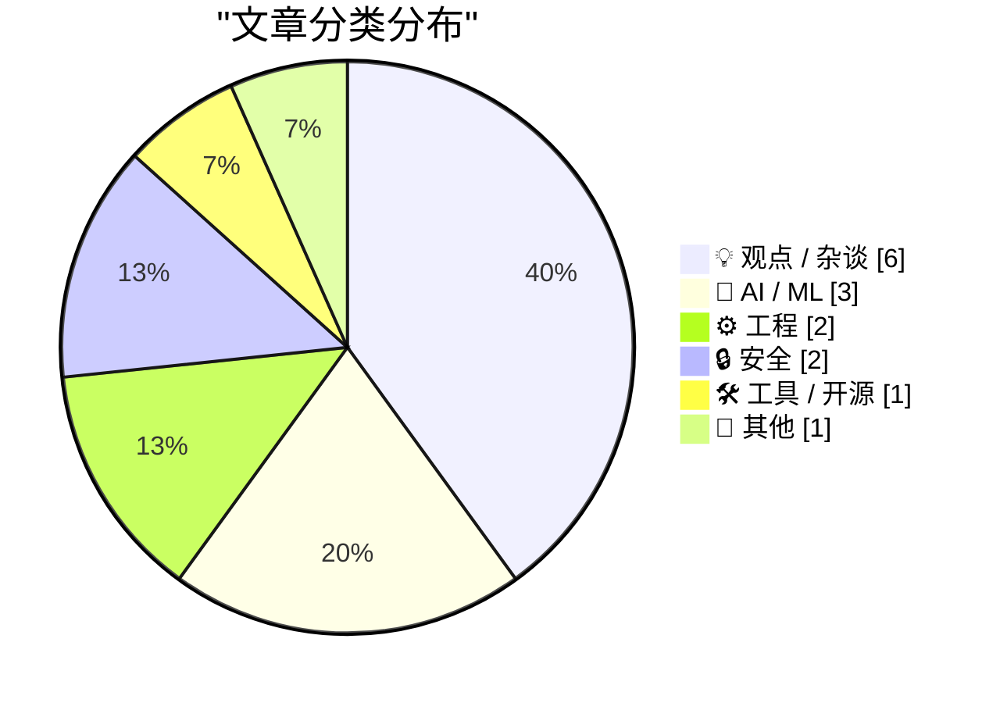
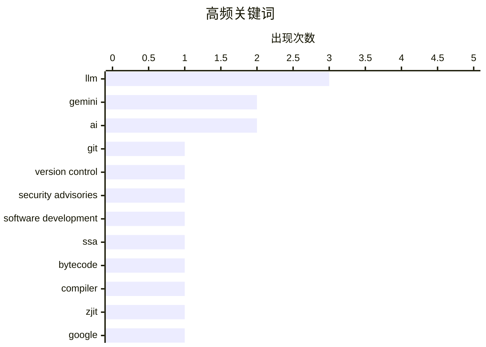

# 📰 Nov 13, 2026

> 来自 Karpathy 推荐的 92 个顶级技术博客，AI 精选 Top 15

## 📝 今日看点

AI 正加速向低成本、专用化方向演进，模型竞争进一步延伸至决策任务与开发工具生态。与此同时，自动化的效率承诺面临现实检验：产出越容易扩张，人类审核的注意力成本越突出，劳动替代的经济可行性也受到质疑。工程实践则持续聚焦可控性与安全性，本地云服务模拟降低测试依赖，工具漏洞修复与勒索软件追踪凸显安全治理的紧迫性。

---

## 🏆 今日必读

🥇 **版本控制周报：2026 年 11 月 11 日**

[This Week in Source Control: 11 November 2026](https://nesbitt.io/2026/11/11/this-week-in-source-control.html) — nesbitt.io · 1 天前 · ⚙️ 工程

> 本期周报汇总版本控制工具与代码托管平台的近期动态。内容覆盖软件版本发布、安全公告和相关文章三个类别。关注范围同时包含版本控制系统及其配套的代码托管生态。所提供的摘录未列出具体项目、版本号或漏洞信息，无法据此判断本期有哪些需要优先处理的更新。

💡 **为什么值得读**: 适合希望集中浏览版本控制生态动态的开发者，可作为查找近期发布与安全公告的入口。

🏷️ Git, version control, security advisories, software development

🥈 **从字节码构建 SSA：一个命令式编程范例**

[SSA from bytecode: imperative pearl](https://bernsteinbear.com/blog/ssa-bytecode/?utm_source=rss) — bernsteinbear.com · 1 天前 · ⚙️ 工程

> 将 CRuby 的 YARV 栈式字节码转换为高层 SSA（静态单赋值）中间表示，是理解 ZJIT 内部实现的重要环节。承担这一任务的 add_iseq_to_hir 函数约有 1900 行，体量容易让初次接触代码的读者望而却步。作者以此前介绍 ZJIT 内部机制的直播为背景，希望解释这段转换过程，降低理解门槛。核心切入点是栈式字节码与 SSA 表示之间的转换，但摘录尚未展示具体算法。

💡 **为什么值得读**: 适合正在学习编译器或阅读 Ruby JIT 源码的开发者，有助于找到理解大型字节码转换函数的切入点。

🏷️ SSA, bytecode, compiler, ZJIT

🥉 **llm-gemini 0.37 发布**

[llm-gemini 0.37](https://simonwillison.net/2026/Nov/12/llm-gemini/) — simonwillison.net · 6 小时前 · 🤖 AI / ML

> llm-gemini 发布 0.37 版本，作者同时关注 Google 新推出的 Gemini 4 Hydrogen。Hydrogen 被定位为 Gemini 4 家族中成本最低的成员。同系列还包括规模更大的 Carbon 和 Argon，但作者指出 Hydrogen 的价格与它们相差并不大。作者认为 Gemini 4 的定价令人困惑；摘录未包含后续价格表，无法给出具体费用差异或性价比结论。

💡 **为什么值得读**: 适合使用 llm-gemini 或准备选择 Gemini 4 模型的开发者，提醒你核对实际价格差距，而非仅依据低成本定位做选择。

🏷️ Gemini, LLM, Google

---

## 📊 数据概览

| 扫描源 | 抓取文章 | 时间范围 | 精选 |
|:---:|:---:|:---:|:---:|
| 84/92 | 2581 篇 → 42 篇 | 48h | **15 篇** |

### 分类分布



### 高频关键词



<details>
<summary>📈 纯文本关键词图（终端友好）</summary>

```
llm                  │ ████████████████████ 3
gemini               │ █████████████░░░░░░░ 2
ai                   │ █████████████░░░░░░░ 2
git                  │ ███████░░░░░░░░░░░░░ 1
version control      │ ███████░░░░░░░░░░░░░ 1
security advisories  │ ███████░░░░░░░░░░░░░ 1
software development │ ███████░░░░░░░░░░░░░ 1
ssa                  │ ███████░░░░░░░░░░░░░ 1
bytecode             │ ███████░░░░░░░░░░░░░ 1
compiler             │ ███████░░░░░░░░░░░░░ 1
```

</details>

### 🏷️ 话题标签

**llm**(3) · **gemini**(2) · **ai**(2) · git(1) · version control(1) · security advisories(1) · software development(1) · ssa(1) · bytecode(1) · compiler(1) · zjit(1) · google(1) · api(1) · ai agents(1) · aws(1) · emulator(1) · rust(1) · testing(1) · ransomware(1) · qilin(1)

---

## 💡 观点 / 杂谈

### 1. Pluralistic：Uber 的劳动力危机（2026 年 11 月 12 日）

[Pluralistic: Uber's labor crash (12 Nov 2026)](https://pluralistic.net/2026/11/12/starvation-wages/) — **pluralistic.net** · 8 小时前 · ⭐ 23/30

> Uber 的劳动模式及其以机器人替代司机的经济可行性，是这一期的核心议题。作者将平台劳动者的处境描述为受到严苛约束且报酬低下，并质疑自动化能够解决这一模式的问题。其明确立场是，用机器人替代现有劳动者在经济账上并不划算。所提供内容主要是当期目录与导语，没有展开成本数据或论证过程，因此无法进一步核实这一判断的具体依据。

🏷️ Uber, automation, labor

---

### 2. 如果 AI 把活都干了，我为什么还这么累？

[Why Am I So Tired If AI Is Doing All the Work?](https://terriblesoftware.org/2026/11/11/why-am-i-so-tired-if-ai-is-doing-all-the-work/) — **terriblesoftware.org** · 1 天前 · ⭐ 23/30

> AI 降低了启动更多工作的门槛，却没有消除人类审核产出所需的时间与注意力。任务更容易开始，意味着使用者可能同时承接更多工作。随着产出增加，检查这些结果的责任仍然落在人身上，审核负担也随之累积。作者的核心观点是，AI 带来的产出增长可以与人的疲惫并存，因为人的注意力仍然是限制因素。

🏷️ AI, productivity, cognitive load

---

### 3. 先发制人

[First Strike](https://geohot.github.io//blog/jekyll/update/2026/11/13/first-strike.html) — **geohot.github.io** · 13 小时前 · ⭐ 23/30

> 作者将电力供给视为制定美国长期地缘战略时必须考虑的基础条件。其预测是，如果当前趋势持续，十年后中国的电力规模将达到美国的 10 倍；这属于有条件的趋势推演。作者据此建议美国尽可能向中国出售 AI 芯片，并用所得资金购买太阳能板和电池工厂，尽快扩大电力产能。核心观点是，应将 AI 芯片贸易收益转化为能源基础设施投资，以应对未来的电力规模差距。

🏷️ China, energy, geopolitics, electricity

---

### 4. 技术是一种搜索问题

[Technology as a Search Problem](https://www.construction-physics.com/p/technology-as-a-search-problem) — **construction-physics.com** · 16 小时前 · ⭐ 22/30

> 技术进步的核心问题，是新技术如何被创造出来，并在持续试错中逐步改进。文章将技术发展理解为一种“搜索问题”：社会需要在庞大的可能方案空间中寻找更有效、更便宜或更可靠的解决路径。这个视角有助于解释为什么技术进步通常不是单一发明者突然突破的结果，而是大量实验、变体、反馈和筛选共同作用的过程。作者希望借此建立一套理解技术演化机制的分析框架，说明创新速度与搜索空间、试验成本及反馈质量之间的关系。

🏷️ Technology, innovation, research, progress

---

### 5. Anthropic 的 IPO 路演视频

[Anthropic's IPO roadshow video](https://simonwillison.net/2026/Nov/11/anthropic-ipo-roadshow/) — **simonwillison.net** · 1 天前 · ⭐ 21/30

> Anthropic 启动 IPO 路演时公开了一段此前未披露太多细节的路演视频，展示了公司的业务运作方式。视频中关于“计算资源策略”的部分尤其值得关注，联合创始人 Tom Brown 介绍了 Anthropic 如何在 AWS Trainium、Google TPU、NVIDIA GPU 和 AMD GPU 之间训练并部署 Claude。多种芯片和云平台并行使用，反映出大模型公司需要围绕成本、供应能力、性能和扩展性进行计算基础设施配置。文章提示，这段视频可能为外界理解 Anthropic 的模型训练、推理服务和硬件供应商布局提供新的一手信息。

🏷️ Anthropic, IPO, business

---

### 6. 内容大通胀

[The Great Content Hyperinflation](https://www.joanwestenberg.com/p/the-great-content-hyperinflation) — **joanwestenberg.com** · 8 分钟前 · ⭐ 21/30

> 内容经济正在经历类似 1923 年货币恶性通胀的阶段：内容产量急剧增加，但单条内容的稀缺性、注意力价值和变现能力持续下降。生成式 AI 降低了写作、图像、视频和营销素材的生产成本，使供给增长速度远超受众注意力和分发渠道的增长速度。结果可能是信息总量繁荣，却让创作者更难被发现、读者更难筛选，也让平台和品牌面临更高的信任与质量判断成本。作者借“内容超通胀”提醒人们，未来真正稀缺的资源可能转向可信度、独特观点、分发能力和人与人之间的关系。

🏷️ Content economy, AI, media, creators

---

## 🤖 AI / ML

### 7. llm-gemini 0.37 发布

[llm-gemini 0.37](https://simonwillison.net/2026/Nov/12/llm-gemini/) — **simonwillison.net** · 6 小时前 · ⭐ 23/30

> llm-gemini 发布 0.37 版本，作者同时关注 Google 新推出的 Gemini 4 Hydrogen。Hydrogen 被定位为 Gemini 4 家族中成本最低的成员。同系列还包括规模更大的 Carbon 和 Argon，但作者指出 Hydrogen 的价格与它们相差并不大。作者认为 Gemini 4 的定价令人困惑；摘录未包含后续价格表，无法给出具体费用差异或性价比结论。

🏷️ Gemini, LLM, Google

---

### 8. Gemini 决策 API

[Gemini Decisions API](https://simonwillison.net/2026/Nov/11/gemini-decisions-api/) — **simonwillison.net** · 1 天前 · ⭐ 23/30

> Google 推出 Gemini Decisions API，以 Gemini Decision 1 进入专门面向决策任务的模型市场。该领域此前已有 Jev 和 OpenAI 的相关产品。根据作者的比较，这个新 API 与 Jev 几乎相同，同样支持是非判断、选项选择和按评分标准打分三类问题。摘录主要揭示了产品定位与接口能力的相似性，未提供准确率、成本或延迟方面的比较。

🏷️ Gemini, API, AI agents

---

### 9. 所以，你想为公司购买 AI

[So you want to buy AI for your company](https://idiallo.com/byte-size/buying-ai-for-your-company) — **idiallo.com** · 4 小时前 · ⭐ 21/30

> 企业采购 AI 的第一步并不是在 Gemini、Claude、Opus、Fable 或 Mythos 等模型之间盲目比较，而是先明确实际工作场景和需求。文章用一连串型号、版本号和基准分数展示市场信息的复杂性：例如 Opus 5.2 得分 94.8，Mythos 5.2 得分 96.1，Fable 5.2 得分 92.7，但这些数字并不能直接决定哪个模型最适合日常工作。模型名称、版本更新、中文能力和宣传话术会让企业采购陷入不断追逐新产品的循环。核心观点是，企业应把 AI 采购视为需求定义、实际测试和工作流适配问题，而不是单纯购买最高基准分数的模型。

🏷️ enterprise AI, LLM, AI procurement

---

## ⚙️ 工程

### 10. 版本控制周报：2026 年 11 月 11 日

[This Week in Source Control: 11 November 2026](https://nesbitt.io/2026/11/11/this-week-in-source-control.html) — **nesbitt.io** · 1 天前 · ⭐ 24/30

> 本期周报汇总版本控制工具与代码托管平台的近期动态。内容覆盖软件版本发布、安全公告和相关文章三个类别。关注范围同时包含版本控制系统及其配套的代码托管生态。所提供的摘录未列出具体项目、版本号或漏洞信息，无法据此判断本期有哪些需要优先处理的更新。

🏷️ Git, version control, security advisories, software development

---

### 11. 从字节码构建 SSA：一个命令式编程范例

[SSA from bytecode: imperative pearl](https://bernsteinbear.com/blog/ssa-bytecode/?utm_source=rss) — **bernsteinbear.com** · 1 天前 · ⭐ 24/30

> 将 CRuby 的 YARV 栈式字节码转换为高层 SSA（静态单赋值）中间表示，是理解 ZJIT 内部实现的重要环节。承担这一任务的 add_iseq_to_hir 函数约有 1900 行，体量容易让初次接触代码的读者望而却步。作者以此前介绍 ZJIT 内部机制的直播为背景，希望解释这段转换过程，降低理解门槛。核心切入点是栈式字节码与 SSA 表示之间的转换，但摘录尚未展示具体算法。

🏷️ SSA, bytecode, compiler, ZJIT

---

## 🔒 安全

### 12. 谁在运营勒索软件组织 Qilin？

[Who Runs the Ransomware Group Qilin?](https://krebsonsecurity.com/2026/11/who-runs-the-ransomware-group-qilin/) — **krebsonsecurity.com** · 1 天前 · ⭐ 23/30

> Qilin 已成为全球最活跃的勒索软件加盟计划，过去三个月就声称攻击了至少 365 家受害组织。调查将重点放在该组织管理员的真实身份上，而非仅描述其攻击活动。作者追踪了这名管理员过去十年间留下的多处操作安全失误，认为线索共同指向一名居住在俄罗斯圣彼得堡的 36 岁男子。核心发现是，长期积累的身份暴露线索可能揭开犯罪运营者的匿名身份，但摘录未展示完整证据链。

🏷️ ransomware, Qilin, cybercrime, operational security

---

### 13. llm 0.37.2 发布

[llm 0.37.2](https://simonwillison.net/2026/Nov/11/llm/) — **simonwillison.net** · 1 天前 · ⭐ 22/30

> LLM 命令行工具发布 0.37.2，重点是修复安全问题。问题由 Daniel de Araujo 报告，对应公告编号为 GHSA-v9h7-jj4g-f862 和 GHSA-r639-rr7r-x72w。两个安全公告为使用者核查问题详情与影响范围提供了明确入口。摘录未包含漏洞机制、受影响版本或触发条件，因此目前只能确认该版本包含安全修复，无法进一步判断具体暴露风险。

🏷️ LLM, security, vulnerability, patch

---

## 🛠 工具 / 开源

### 14. AWS 官方模拟器 aws-emulator

[aws-emulator](https://simonwillison.net/2026/Nov/11/aws-emulator/) — **simonwillison.net** · 1 天前 · ⭐ 23/30

> AWS 推出官方 aws-emulator，让开发者可以针对多个 AWS 服务的本地模拟实现运行测试。它旨在减少测试对真实云服务和付费 API 凭证的依赖。项目使用 Rust 编写，作者称其开发大量依靠 AI 智能体，最初三周便产生了 29,684 次提交。这个案例同时涉及云服务本地测试与智能体辅助开发，但摘录未列出服务覆盖范围或兼容性验证结果。

🏷️ AWS, emulator, Rust, testing

---

## 📝 其他

### 15. “危险或不寻常”

[‘Dangerous or Unusual’](https://www.nytimes.com/interactive/2026/11/10/us/supreme-court-guns-misquote.html?unlocked_article_code=1.PlE.-Nhp.CaLpsgMqdWf3) — **daringfireball.net** · 1 天前 · ⭐ 19/30

> 美国各地法官近二十年来反复引用“危险或不寻常”这一表述，作为判定枪支管制法律是否违宪的重要法律测试。纽约时报的调查指出，这一关键标准建立在对 2008 年最高法院案件 District of Columbia v. Heller 中引文的误读之上。大法官 Antonin Scalia 在多数意见中将这句话归于 18 世纪英国法学家 William Blackstone，但原始文本与判决中的表述并不完全一致。由于这处误引后来被广泛当作先例依据，它已经影响了大量枪支管制案件的裁判，暴露出法律引用、历史解释和司法先例传播中的系统性问题。

🏷️ gun law, Supreme Court, legal history

---

*生成于 2026-11-13 05:02 | 扫描 84 源 → 获取 2581 篇 → 精选 15 篇*
*基于 [Hacker News Popularity Contest 2025](https://refactoringenglish.com/tools/hn-popularity/) RSS 源列表，由 [Andrej Karpathy](https://x.com/karpathy) 推荐*
