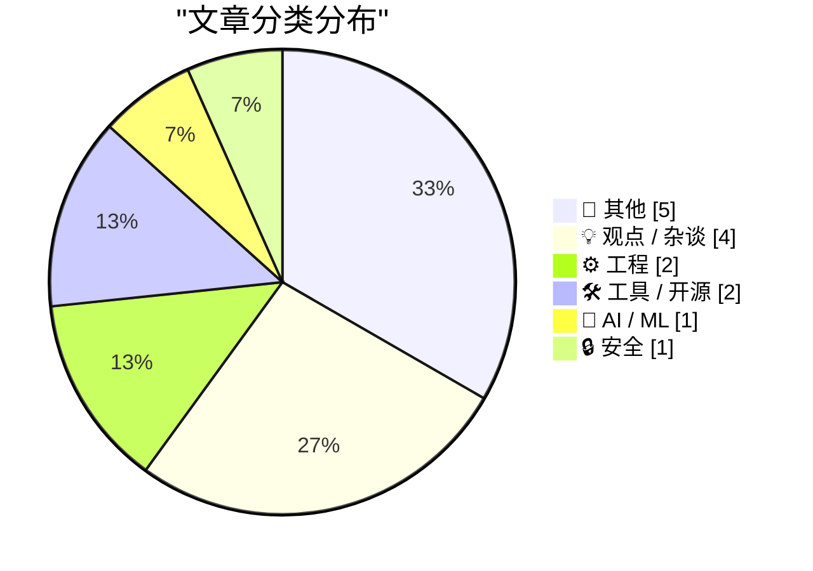
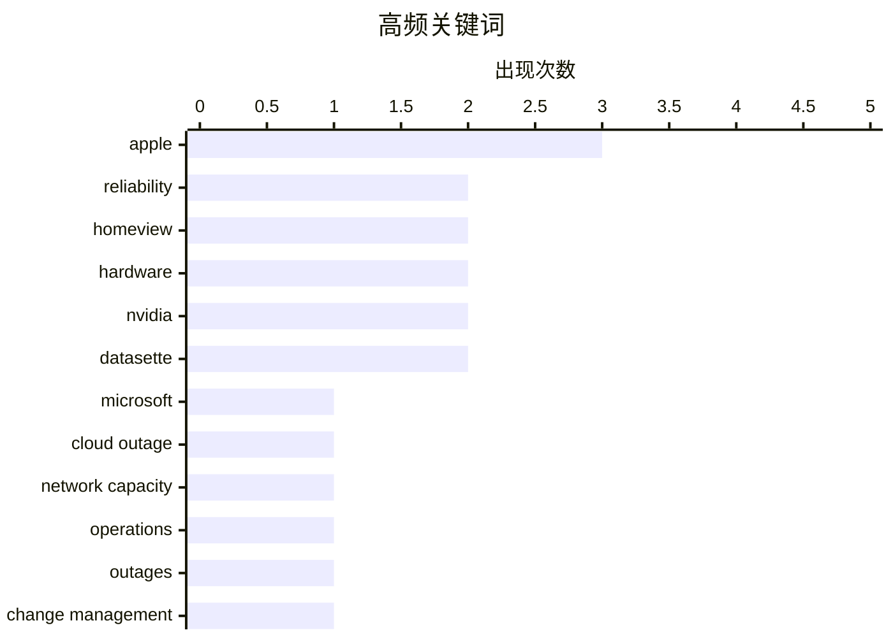

# 📰 Nov 16, 2026

> 来自 Karpathy 推荐的 92 个顶级技术博客，AI 精选 Top 15

## 📝 今日看点

大型服务故障让基础设施可靠性再成焦点：多次网络变更之间的隐性关联，凸显运维流程保留必要审查与操作阻力的价值。工具生态持续关注安全维护与日常效率，从漏洞修复到 Shell 技巧，工程实践的重点仍是把基础工作做扎实。与此同时，消费应用向广告变现收敛的争议，以及人工超级智能的“黑箱”讨论，共同指向对技术商业逻辑与能力边界的重新审视。

---

## 🏆 今日必读

🥇 **微软称云服务中断“与网络攻击或 AI／智能体无关”**

[Microsoft Says Cloud Outage Was ‘Not Related to Cyber or AI / Agents’](https://x.com/microsoft/status/2121282013600907325) — daringfireball.net · 1 天前 · ⚙️ 工程

> 微软在 X 上声明，此次云服务中断源于技术问题，与网络攻击、AI 或智能体无关。故障隐患由此前一次网络容量升级引入，在近期另一项网络变更后暴露。这意味着故障涉及前后两次网络调整之间的关联，而非单次变更的孤立影响。微软表示已处理底层问题，但声明发布时仍在为剩余客户和区域恢复服务。

💡 **为什么值得读**: 值得关注的是微软对故障原因和恢复状态的明确区分，有助于判断事故归因及其实际处置进度。

🏷️ Microsoft, cloud outage, network capacity, reliability

🥈 **运维需要适当的阻力**

[Ops needs friction](https://www.jeffgeerling.com/blog/2026/ops-needs-friction/) — jeffgeerling.com · 1 天前 · 💡 观点 / 杂谈

> 微软持续两天的服务中断和美国联邦航空管理局（FAA）的航班停飞事件，引出了运维工作是否需要保留必要阻力的问题。作者由这些事故联想到自己参与过的基础设施与运维团队，以及规模较小的类似故障。标题主张运维需要一定的约束，节选则强调运维思维具有根本性的不同。提供的内容在展开这一差异前已截断，因此尚无法确认作者建议采用哪些审批、变更或发布机制。

💡 **为什么值得读**: 适合需要平衡交付速度与系统稳定性的工程团队阅读，可借此重新审视运维流程中必要约束的价值。

🏷️ operations, reliability, outages, change management

🥉 **最长的多项式等值线**

[The longest polynomial level set](https://www.johndcook.com/blog/2026/11/14/erdos-lemniscate/) — johndcook.com · 1 天前 · 📝 其他

> 对于次数为 n、首项系数为 1 的复多项式 p(z)，问题是等值线 {z：|p(z)| = 1} 的长度最大能达到多少。厄尔德什猜想，使这一长度达到最大值的多项式是 p(z) = zⁿ − 1。文章指出，Teng Zhang 最近证明了这一猜想，确定了每个次数下的极值多项式。核心结果把一个复平面曲线的几何极值问题，归结为形式简洁的多项式，但所给节选没有包含证明方法或最大长度的具体表达式。

💡 **为什么值得读**: 适合对复分析和数学极值问题感兴趣的读者，用一个容易表述的问题了解厄尔德什猜想的新进展。

🏷️ polynomial, level set, Erdos conjecture, complex analysis

---

## 📊 数据概览

| 扫描源 | 抓取文章 | 时间范围 | 精选 |
|:---:|:---:|:---:|:---:|
| 84/92 | 2592 篇 → 31 篇 | 48h | **15 篇** |

### 分类分布



### 高频关键词



<details>
<summary>📈 纯文本关键词图（终端友好）</summary>

```
apple            │ ████████████████████ 3
reliability      │ █████████████░░░░░░░ 2
homeview         │ █████████████░░░░░░░ 2
hardware         │ █████████████░░░░░░░ 2
nvidia           │ █████████████░░░░░░░ 2
datasette        │ █████████████░░░░░░░ 2
microsoft        │ ███████░░░░░░░░░░░░░ 1
cloud outage     │ ███████░░░░░░░░░░░░░ 1
network capacity │ ███████░░░░░░░░░░░░░ 1
operations       │ ███████░░░░░░░░░░░░░ 1
```

</details>

### 🏷️ 话题标签

**apple**(3) · **reliability**(2) · **homeview**(2) · hardware(2) · nvidia(2) · datasette(2) · microsoft(1) · cloud outage(1) · network capacity(1) · operations(1) · outages(1) · change management(1) · polynomial(1) · level set(1) · erdos conjecture(1) · complex analysis(1) · package management(1) · dependencies(1) · security advisories(1) · releases(1)

---

## 📝 其他

### 1. 最长的多项式等值线

[The longest polynomial level set](https://www.johndcook.com/blog/2026/11/14/erdos-lemniscate/) — **johndcook.com** · 1 天前 · ⭐ 22/30

> 对于次数为 n、首项系数为 1 的复多项式 p(z)，问题是等值线 {z：|p(z)| = 1} 的长度最大能达到多少。厄尔德什猜想，使这一长度达到最大值的多项式是 p(z) = zⁿ − 1。文章指出，Teng Zhang 最近证明了这一猜想，确定了每个次数下的极值多项式。核心结果把一个复平面曲线的几何极值问题，归结为形式简洁的多项式，但所给节选没有包含证明方法或最大长度的具体表达式。

🏷️ polynomial, level set, Erdos conjecture, complex analysis

---

### 2. Jason Snell 的 HomeView 评测

[Jason Snell’s HomeView Review](https://sixcolors.com/post/2026/11/homeview-review-a-late-arrival-with-promise-but-still-showing-some-seams/) — **daringfireball.net** · 1 天前 · ⭐ 20/30

> Jason Snell 对 HomeView 的初步评价是硬件扎实协调，但软件体验仍显拼接。屏幕的触摸和倾斜调节体验获得肯定，是产品较成熟的部分。主界面像放大的 Apple Watch，可定制的表盘式界面有时接近 Apple Watch，有时又像 iPhone 的待机显示模式。应用体验也带有 iPhone 和 iPad 的痕迹，体现出多个苹果平台设计语言的混合。评测标题和节选共同指向一个判断：HomeView 有潜力，但软件整合仍有明显改进空间。

🏷️ HomeView, Apple, hardware, interface

---

### 3. 乔安娜·斯特恩评测 HomeView

[Joanna Stern Reviews the HomeView](https://www.youtube.com/watch?v=yVTcVtLn2o4) — **daringfireball.net** · 1 天前 · ⭐ 19/30

> Joanna Stern 的 HomeView 视频评测获得了 Daring Fireball 作者的强烈推荐。作者认为这段评测既提供了有用信息，也非常幽默。除主评测外，Stern 还制作了一段趣味花絮，作者建议先看主视频，再看花絮。所提供文字没有包含 HomeView 的具体功能、性能数据或评测结论，因此能够确认的是对视频内容与表达方式的推荐，无法据此判断产品本身的优劣。

🏷️ HomeView, Apple, hardware, software

---

### 4. 浮动电价：高价与低价

[Variable Electricity Pricing - the Highs and the Lows](https://shkspr.mobi/blog/2026/11/variable-electricity-pricing-the-highs-and-the-lows/) — **shkspr.mobi** · 16 小时前 · ⭐ 19/30

> Octopus Energy 的浮动电价套餐让家庭用电成本随时段变化，甚至可能出现用电反而获得报酬的情况。作者家中的智能电表每半小时回传一次读数，电力公司因此可以每半小时设置一个不同的价格。与每千瓦时固定收取 30 便士的方案相比，这种套餐的价格会在一天内持续变化。作者记录到，9 月曾有一天连续数小时出现负电价，家庭在这些时段用电可以获得报酬。这个实例展示了浮动电价带来的低价机会，但所提供片段尚未给出高价时段、整体账单或长期节省金额。

🏷️ electricity pricing, smart meter, energy, Octopus Energy

---

### 5. 关于轨道的一则补注

[Orbital footnote](https://www.johndcook.com/blog/2026/11/15/orbital-footnote/) — **johndcook.com** · 2 小时前 · ⭐ 19/30

> 候选矮行星 ED138 的报道同时给出了 281.1 年的公转周期和“距离太阳是地球的 46 倍”这两个数字，作者借此继续讨论轨道参数的关系。此前的文章已使用开普勒第三定律，根据公转周期推断轨道尺度。在绕太阳运行的近似条件下，以年和天文单位计，281.1 年对应的轨道半长轴约为 42.9 天文单位。因此，报道中的 46 倍距离不能直接等同于由周期推得的半长轴；它是否指某一时刻的日心距离，需要更多原文信息确认。所提供片段未展示补注的最终解释，但明确指向对公转周期与轨道距离表述的核对。

🏷️ orbital mechanics, Kepler's law, dwarf planet, ED138

---

## 💡 观点 / 杂谈

### 6. 运维需要适当的阻力

[Ops needs friction](https://www.jeffgeerling.com/blog/2026/ops-needs-friction/) — **jeffgeerling.com** · 1 天前 · ⭐ 23/30

> 微软持续两天的服务中断和美国联邦航空管理局（FAA）的航班停飞事件，引出了运维工作是否需要保留必要阻力的问题。作者由这些事故联想到自己参与过的基础设施与运维团队，以及规模较小的类似故障。标题主张运维需要一定的约束，节选则强调运维思维具有根本性的不同。提供的内容在展开这一差异前已截断，因此尚无法确认作者建议采用哪些审批、变更或发布机制。

🏷️ operations, reliability, outages, change management

---

### 7. 单一模式的市场：为什么每个消费应用最终都会成为广告公司

[The One-Model Market: Why Every Consumer App Eventually Becomes an Ad Company](https://www.joanwestenberg.com/p/the-one-model-market-why-every-consumer) — **joanwestenberg.com** · 1 天前 · ⭐ 21/30

> 消费互联网应用为何最终趋向广告变现，是标题提出的核心问题。作者将这一趋势归因于消费互联网难以回避的经济逻辑，暗示不同产品可能逐渐收敛到同一种商业模式。标题表达了一个强判断：广告业务会成为消费应用演化的终点。所给内容只有标题和副标题，未提供支撑这一判断的成本结构、用户付费数据、案例或例外条件，因此无法进一步还原论证。

🏷️ advertising, consumer apps, monetization, internet economics

---

### 8. Patrick McGee 谈 Johny Srouji 与英伟达

[Patrick McGee on Johny Srouji and Nvidia](https://x.com/patrickmcgee_/status/2120799867140550999) — **daringfireball.net** · 1 天前 · ⭐ 20/30

> 针对 Semafor 关于英伟达正在“考虑”Johny Srouji 的报道，Patrick McGee 认为这位苹果硬件负责人会是领导英伟达的出色人选，并相信他愿意接受。McGee 的理由是，Srouji 在苹果已接近职业天花板，且在他看来没有成为苹果 CEO 的机会。同时，他认为 Srouji 能力突出、抱负强烈，长期希望芯片设计能够决定苹果产品的发布与开发时间表。这些内容属于对潜在人事变动及个人动机的评论，节选没有提供正式任命或 Srouji 本人的表态。

🏷️ Apple, Nvidia, leadership, Johny Srouji

---

### 9. PCAST 军团

[The Legion of PCAST](https://www.whitehouse.gov/ostp/presidents-council-of-advisors-on-science-and-technology/) — **daringfireball.net** · 11 小时前 · ⭐ 19/30

> David Sacks 已宣布结束特朗普第二任期政府中的“AI 沙皇”职务，但仍担任总统科学技术顾问委员会（PCAST）联合主席。摘录称，他在 3 月宣布任期结束，原因是“特别政府雇员”身份的任职期限为 130 天。作者将 Sacks 与其所称的黄仁勋及英伟达争议联系起来，提出如果相关争议冲击 AI 热潮或泡沫，Sacks 可能成为承担责任的人物之一。这属于作者带有讽刺色彩的政治评论，所提供片段未给出该争议的具体事实或证据。片段的核心关注点是，Sacks 结束一项政府职务后，仍在科技政策咨询体系中保有职位。

🏷️ AI policy, PCAST, Nvidia, David Sacks

---

## ⚙️ 工程

### 10. 微软称云服务中断“与网络攻击或 AI／智能体无关”

[Microsoft Says Cloud Outage Was ‘Not Related to Cyber or AI / Agents’](https://x.com/microsoft/status/2121282013600907325) — **daringfireball.net** · 1 天前 · ⭐ 24/30

> 微软在 X 上声明，此次云服务中断源于技术问题，与网络攻击、AI 或智能体无关。故障隐患由此前一次网络容量升级引入，在近期另一项网络变更后暴露。这意味着故障涉及前后两次网络调整之间的关联，而非单次变更的孤立影响。微软表示已处理底层问题，但声明发布时仍在为剩余客户和区域恢复服务。

🏷️ Microsoft, cloud outage, network capacity, reliability

---

### 11. 探一探 Bash 的兔子洞

[Peeking inside the bash rabbit hole](https://www.johndcook.com/blog/2026/11/14/bash-rabbit-hole/) — **johndcook.com** · 1 天前 · ⭐ 21/30

> Bash 的历史展开语法 !$ 可以复用上一条命令的最后一个参数，减少重复输入。作者以这个小技巧为切入点，探索 Shell 中容易被忽略的功能。其动机不仅是节省几秒打字时间，也是在更大的工作压力之外，解决一个具体、可掌握的小问题。节选传达的观点是，探索细小技术问题本身就能带来乐趣，但没有展示后续涉及的其他 Bash 语法。

🏷️ Bash, shell, command line, productivity

---

## 🛠 工具 / 开源

### 12. 包管理周报：2026 年 11 月 14 日

[This Week in Package Management: 14 November 2026](https://nesbitt.io/2026/11/14/this-week-in-package-management.html) — **nesbitt.io** · 1 天前 · ⭐ 22/30

> 这期包管理周报汇集包管理领域的软件发布、安全公告和相关文章。其覆盖范围包含工具版本动态、需要关注的安全信息，以及生态中的技术讨论。所给内容只有标题和栏目简介，没有列出具体包管理器、软件包、版本号或漏洞编号。因此目前只能确认这是一份生态动态汇总，无法据此判断本期最重要的升级或安全事项。

🏷️ package management, dependencies, security advisories, releases

---

### 13. datasette-apps 0.4a0

[datasette-apps 0.4a0](https://simonwillison.net/2026/Nov/15/datasette-apps/) — **simonwillison.net** · 1 天前 · ⭐ 19/30

> datasette-apps 0.4a0 为运行在 Datasette 内部的沙箱式 HTML 和 JavaScript 应用增加了链接支持。这类应用类似 Claude Artifacts，但可以对 Datasette 中的数据执行 SQL 查询。新版本允许通过 URL 中的 #fragment 链接到应用，应用也能读取并使用这些片段信息。更新还涉及支持的 URL scheme 的回报机制，但所提供片段未完整说明其接收方与用途。此次更新的重点是让数据应用能够利用 URL 携带的信息，改善链接访问能力。

🏷️ Datasette, sandbox, SQL, JavaScript

---

## 🤖 AI / ML

### 14. 作为黑箱的人工超级智能

[ASI as a Black Box](https://borretti.me/article/asi-as-a-black-box) — **borretti.me** · 15 小时前 · ⭐ 20/30

> 人工超级智能（ASI）究竟意味着什么，是这则内容提出的核心问题。作者给出的明确判断是，我们对“超级智能”实际会包含什么几乎一无所知。“黑箱”这一标题强调了概念本身的不确定性，但所给内容没有进一步说明它针对的是能力、内部机制还是外在行为。现有材料不足以还原作者的论证、技术依据或政策主张，只能确认其核心立场是质疑人们对超级智能的确定性认识。

🏷️ ASI, superintelligence, uncertainty

---

## 🔒 安全

### 15. Datasette 0.65.6

[datasette 0.65.6](https://simonwillison.net/2026/Nov/15/datasette-2/) — **simonwillison.net** · 5 小时前 · ⭐ 19/30

> Datasette 0.65.6 将 1.0a43 中的一项安全修复回移到 0.65 系列。当数据库通过 add_database(db, name=..., route=...) 注册，且 route 与 name 不同时，原先被拒绝访问该数据库的用户仍可能通过 /<route>.db 下载数据库。问题涉及数据库访问权限与下载路由之间的不一致，可能导致访问限制被绕过。此次更新修复了这一特定配置下的未授权下载问题，使用自定义数据库路由的部署尤其需要关注。

🏷️ Datasette, security fix, database

---

*生成于 2026-11-16 04:45 | 扫描 84 源 → 获取 2592 篇 → 精选 15 篇*
*基于 [Hacker News Popularity Contest 2025](https://refactoringenglish.com/tools/hn-popularity/) RSS 源列表，由 [Andrej Karpathy](https://x.com/karpathy) 推荐*
