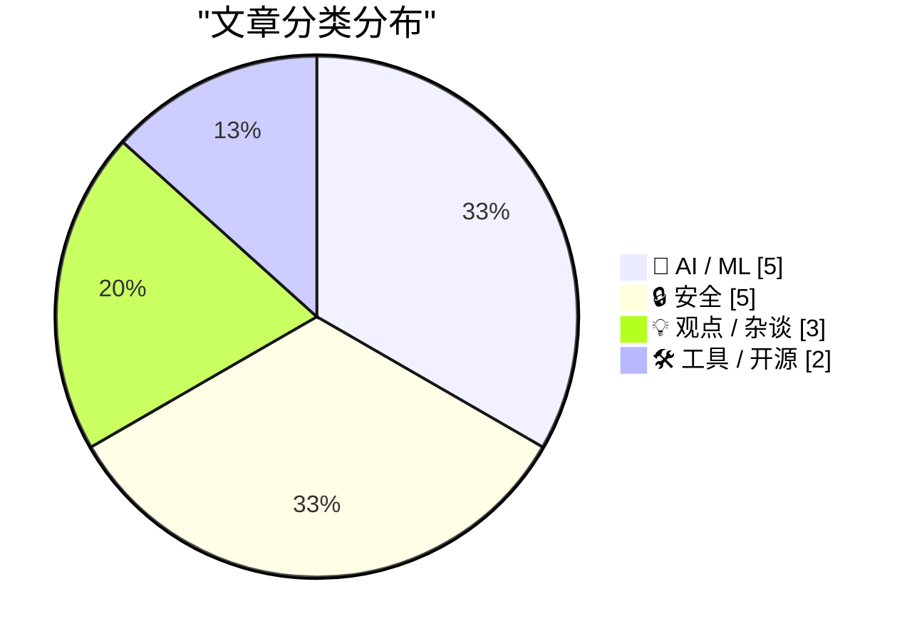
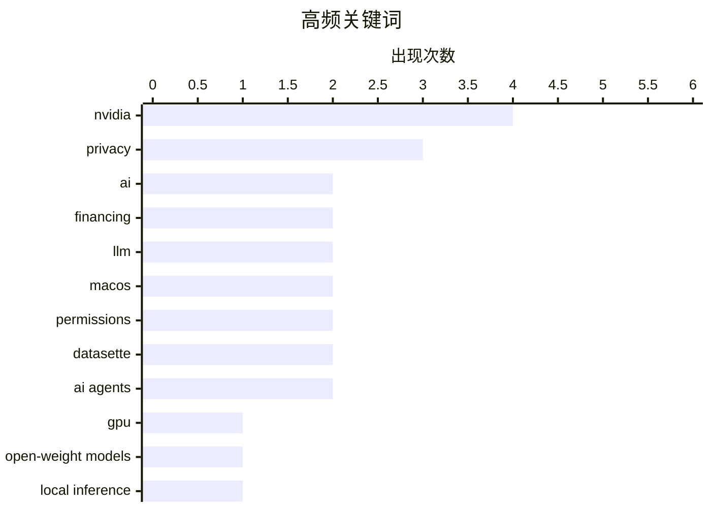

# 📰 Nov 17, 2026

> 来自 Karpathy 推荐的 92 个顶级技术博客，AI 精选 Top 15

## 📝 今日看点

AI 产业的焦点正从算力扩张转向增长能否持续：英伟达为客户提供融资与信用支持的模式受到审视，资金兜底的边界成为关键议题。隐私与权限控制同步升温，从开放权重模型到操作系统授权、智能体工具调用，技术界更关注数据由谁掌握、操作如何获得授权。与此同时，围绕先进 AI 能力的激进风险判断与科技政策人事动向，让治理议题持续升温，但相关时间表仍需与已证实的事实区分。

---

## 🏆 今日必读

🥇 **本·汤普森谈英伟达**

[Ben Thompson on Nvidia](https://stratechery.com/2026/obituaries/) — daringfireball.net · 11 小时前 · 🤖 AI / ML

> 英伟达越来越多地利用自身现金流和信用评级，为购买其芯片的企业提供融资与信用支持。Ben Thompson 将这一模式称为“英伟达的高风险生意”，因为芯片供应商同时承担了扶持客户购买力的角色。看空者认为这是循环融资，看多者则认为这是通往未来 AI 收入增长的必要过渡，届时客户可以偿还债务并创造可观回报。核心分歧在于，这种只有数万亿美元级企业才能支撑的融资模式，最终会由真实需求兑现，还是积累更大的财务风险。

💡 **为什么值得读**: 适合希望理解英伟达芯片销售与 AI 行业融资如何相互依赖、并判断相关增长质量的读者。

🏷️ Nvidia, AI, financing, GPU

🥈 **任何人都能轻松使用保护隐私的开放权重模型**

[Here's how anyone can easily use private, open weight models](https://micahflee.com/heres-how-anyone-can-easily-use-private-open-weight-models/) — micahflee.com · 13 小时前 · 🤖 AI / ML

> 使用大语言模型的实用价值与保护个人数据隐私之间，并不必然存在取舍。作者一方面认可 LLM 的能力，另一方面明确表达了对 OpenAI、Anthropic 及其数据可信度的不信任。文章提出的替代方向是使用开放权重模型，以减少对这些服务商的依赖，并强调普通用户也能轻松上手。所给片段没有列出具体模型、运行工具或硬件要求，因此尚不足以判断其实现方式与实际成本。

💡 **为什么值得读**: 适合希望继续使用 AI、同时寻找更可控的数据处理方式的读者，可据此进一步了解开放权重模型的使用门槛。

🏷️ open-weight models, LLM, privacy, local inference

🥉 **macOS Golden Gate 27.3 开发者测试版 2 为完全磁盘访问等权限引入新的隐私控制**

[MacOS Golden Gate 27.3b2 Includes New Privacy Controls for Full Disk Access (and More)](https://9to5mac.com/2026/11/16/macos-27-3-includes-new-privacy-controls-for-full-disk-access-and-more/) — daringfireball.net · 10 小时前 · 🔒 安全

> macOS 27.3 开发者测试版 2 开始引入新的隐私控制，重点调整“完全磁盘访问”权限的授权界面。苹果此前宣布，授予这种高权限访问能力将需要用户执行更明确的操作，以确认授权确实出于本人意愿。所引报道以 macOS 27.2 中统一的“设备控制与数据访问”开关作为对照，但片段未完整展示新旧设置的具体差异。此次改动的核心是让敏感权限的授予更加明确，降低用户在不了解访问范围时完成授权的可能性。

💡 **为什么值得读**: 适合需要为 Mac 应用配置敏感权限的用户和开发者，帮助提前关注新版系统带来的授权流程变化。

🏷️ macOS, privacy, permissions, Full Disk Access

---

## 📊 数据概览

| 扫描源 | 抓取文章 | 时间范围 | 精选 |
|:---:|:---:|:---:|:---:|
| 82/92 | 2462 篇 → 35 篇 | 48h | **15 篇** |

### 分类分布



### 高频关键词



<details>
<summary>📈 纯文本关键词图（终端友好）</summary>

```
nvidia      │ ████████████████████ 4
privacy     │ ███████████████░░░░░ 3
ai          │ ██████████░░░░░░░░░░ 2
financing   │ ██████████░░░░░░░░░░ 2
llm         │ ██████████░░░░░░░░░░ 2
macos       │ ██████████░░░░░░░░░░ 2
permissions │ ██████████░░░░░░░░░░ 2
datasette   │ ██████████░░░░░░░░░░ 2
ai agents   │ ██████████░░░░░░░░░░ 2
gpu         │ █████░░░░░░░░░░░░░░░ 1
```

</details>

### 🏷️ 话题标签

**nvidia**(4) · **privacy**(3) · **ai**(2) · financing(2) · llm(2) · macos(2) · permissions(2) · datasette(2) · ai agents(2) · gpu(1) · open-weight models(1) · local inference(1) · full disk access(1) · investment(1) · ai safety(1) · ai governance(1) · existential risk(1) · paul christiano(1) · disk access(1) · system protection(1)

---

## 🤖 AI / ML

### 1. 本·汤普森谈英伟达

[Ben Thompson on Nvidia](https://stratechery.com/2026/obituaries/) — **daringfireball.net** · 11 小时前 · ⭐ 24/30

> 英伟达越来越多地利用自身现金流和信用评级，为购买其芯片的企业提供融资与信用支持。Ben Thompson 将这一模式称为“英伟达的高风险生意”，因为芯片供应商同时承担了扶持客户购买力的角色。看空者认为这是循环融资，看多者则认为这是通往未来 AI 收入增长的必要过渡，届时客户可以偿还债务并创造可观回报。核心分歧在于，这种只有数万亿美元级企业才能支撑的融资模式，最终会由真实需求兑现，还是积累更大的财务风险。

🏷️ Nvidia, AI, financing, GPU

---

### 2. 任何人都能轻松使用保护隐私的开放权重模型

[Here's how anyone can easily use private, open weight models](https://micahflee.com/heres-how-anyone-can-easily-use-private-open-weight-models/) — **micahflee.com** · 13 小时前 · ⭐ 24/30

> 使用大语言模型的实用价值与保护个人数据隐私之间，并不必然存在取舍。作者一方面认可 LLM 的能力，另一方面明确表达了对 OpenAI、Anthropic 及其数据可信度的不信任。文章提出的替代方向是使用开放权重模型，以减少对这些服务商的依赖，并强调普通用户也能轻松上手。所给片段没有列出具体模型、运行工具或硬件要求，因此尚不足以判断其实现方式与实际成本。

🏷️ open-weight models, LLM, privacy, local inference

---

### 3. 《华尔街日报》：英伟达为 AI 经济无限提供资金支持的日子屈指可数

[WSJ: ‘Nvidia’s Days as an Open Checkbook for the AI Economy Are Numbered’](https://www.wsj.com/tech/ai/nvidias-days-as-an-open-checkbook-for-the-ai-economy-are-numbered-90c7b388) — **daringfireball.net** · 12 小时前 · ⭐ 23/30

> 《华尔街日报》报道，英伟达正在收缩为 AI 产业提供融资和兜底支持的做法。报道所述背景是，黄仁勋在担任 CEO 的最后几个月已着手调整这一策略，随后由一位对部分既有交易持保留态度的财务负责人接掌公司。原本依赖英伟达支持的初创企业因此预期，资金支持的收缩幅度可能进一步扩大。对购买英伟达芯片的新兴云服务商而言，这意味着其经营计划需要重新评估供应商资金支持的持续性。

🏷️ Nvidia, AI, investment, financing

---

### 4. 保罗·克里斯蒂亚诺：能够推翻政府的 AI，可能距我们只有 12 个月

[Paul Christiano – We could be 12 months away from AIs that can overthrow the government](https://www.dwarkesh.com/p/paul-christiano-2) — **dwarkesh.com** · 12 小时前 · ⭐ 23/30

> Paul Christiano 在一场 99 分钟的访谈中提出，能够推翻政府的 AI 可能在 12 个月内出现。这一表述是对潜在能力与时间窗口的风险判断，不能视为已经得到证实的事实。随附引语强调，一旦发生此类情形，人类可能很难恢复正常秩序。所给材料仅包含标题、时长和一句引语，尚无法核实他支持这一判断的技术依据、前提条件或应对建议。

🏷️ AI safety, AI governance, existential risk, Paul Christiano

---

### 5. 作为黑箱的人工超级智能

[ASI as a Black Box](https://borretti.me/article/asi-as-a-black-box) — **borretti.me** · 1 天前 · ⭐ 20/30

> 人工超级智能（ASI）究竟意味着什么，仍缺乏明确的认识。作者的核心判断是，我们并不了解所谓“超级智能”实际会具备怎样的能力。标题以“黑箱”概括这种认知状态，强调概念背后的未知。现有摘录未提供具体的能力定义、技术路径或验证依据，因此能够确认的核心观点是：对 ASI 的讨论应正视这种不确定性。

🏷️ ASI, superintelligence, AI forecasting, uncertainty

---

## 🔒 安全

### 6. macOS Golden Gate 27.3 开发者测试版 2 为完全磁盘访问等权限引入新的隐私控制

[MacOS Golden Gate 27.3b2 Includes New Privacy Controls for Full Disk Access (and More)](https://9to5mac.com/2026/11/16/macos-27-3-includes-new-privacy-controls-for-full-disk-access-and-more/) — **daringfireball.net** · 10 小时前 · ⭐ 23/30

> macOS 27.3 开发者测试版 2 开始引入新的隐私控制，重点调整“完全磁盘访问”权限的授权界面。苹果此前宣布，授予这种高权限访问能力将需要用户执行更明确的操作，以确认授权确实出于本人意愿。所引报道以 macOS 27.2 中统一的“设备控制与数据访问”开关作为对照，但片段未完整展示新旧设置的具体差异。此次改动的核心是让敏感权限的授予更加明确，降低用户在不了解访问范围时完成授权的可能性。

🏷️ macOS, privacy, permissions, Full Disk Access

---

### 7. 苹果支持文档：macOS 27.3 测试版 2 中新增的“完全磁盘访问”和“系统与应用保护覆盖”设置

[Apple Support Document on the New ‘Full Disk Access’ and ‘System & App Protection Override’ Settings in MacOS 27.3 Beta 2](https://support.apple.com/en-us/149699) — **daringfireball.net** · 4 小时前 · ⭐ 21/30

> macOS 27.3 测试版 2 新增的“完全磁盘访问”和“系统与应用保护覆盖”设置，引发了关于权限提示是否过度制造恐惧的争论。作者不同意将这些界面简单视为吓阻用户的警告，同时认可围绕其设计展开讨论的合理性。他认为，苹果对新权限机制进行了认真设计，其出发点是许多 Mac 用户曾在不了解访问范围的情况下向过多应用授予完全磁盘访问权限。作者的核心立场是，应结合苹果明确提出的问题与设计前提来评价这些设置，而不能只看提示是否令人不安。

🏷️ macOS, permissions, disk access, system protection

---

### 8. Datasette 0.65.6 发布

[datasette 0.65.6](https://simonwillison.net/2026/Nov/15/datasette-2/) — **simonwillison.net** · 1 天前 · ⭐ 20/30

> Datasette 0.65.6 从 1.0a43 回移了一项数据库下载权限相关的安全修复。当开发者通过 add_database(db, name=..., route=...) 注册数据库，且 route 与 name 不一致时，原先的权限控制可能出现漏洞。即使访问者已被拒绝访问该数据库，仍可能通过 /<route>.db 路径下载数据库文件。此次更新修复了这一特定条件下的未授权下载问题，使用自定义数据库路由的部署尤其需要关注。

🏷️ Datasette, security fix, database, backport

---

### 9. WorkOS：让智能体使用你的工具，同时约束其权限

[WorkOS: Let Agents Use Your Tools Without Giving Them Free Rein](https://www.workos.com/airlock?utm_source=daringfireball&amp;utm_medium=newsletter&amp;utm_campaign=q42026) — **daringfireball.net** · 1 天前 · ⭐ 20/30

> WorkOS Airlock 针对 AI 智能体任务动态变化、预先分配的角色权限容易过大或不足的问题，提出按任务意图检查工具调用的方案。开发者为智能体指定任务后，系统会逐次核查其操作是否符合该意图，例如读取 Linear 工单或向邮件分发列表发送邮件。每次调用可以被允许、拒绝或转交人工审批，所有判定都会留下日志。该产品目前邀请用户申请早期访问，所给内容属于赞助推广，未提供实际效果或性能验证数据。

🏷️ AI agents, authorization, WorkOS, access control

---

### 10. 出租车与哈希函数

[Taxis and hash functions](https://www.johndcook.com/blog/2026/11/16/taxis-and-hash-functions/) — **johndcook.com** · 15 小时前 · ⭐ 20/30

> 纽约市在 2014 年公开了前一年的出租车行程及车费记录，并尝试通过哈希处理保护相关标识符的隐私。数据中的出租车执照号码和营运牌照号码使用了 MD5 哈希函数。文章以这一案例引出安全问题：将标识符转换为哈希值，是否足以阻止原始身份被识别。所给片段尚未展开攻击方法或结论，但评估此类匿名化措施时，除了哈希算法本身，还需要考虑原始标识符是否容易被枚举和匹配。

🏷️ MD5, hashing, anonymization, privacy

---

## 💡 观点 / 杂谈

### 11. 总统科学技术顾问委员会的阵容

[The Legion of PCAST](https://www.whitehouse.gov/ostp/presidents-council-of-advisors-on-science-and-technology/) — **daringfireball.net** · 1 天前 · ⭐ 21/30

> David Sacks 在离开特朗普第二届政府的“AI 沙皇”岗位后，仍担任总统科学技术顾问委员会（PCAST）联合主席。所给片段称，他于 3 月宣布结束前一职务，其“特别政府雇员”身份的任期上限为 130 天。作者将 Sacks 放在其所谈及的黄仁勋及英伟达争议背景下，质疑 AI 繁荣一旦受挫时相关政治人物可能承担的责任。片段没有展开委员会其他成员的情况，能够确认的重点是 Sacks 的行政任职结束后，仍保有科技政策顾问角色。

🏷️ PCAST, AI policy, David Sacks, Nvidia

---

### 12. 我的尘土帝国

[My Empire of Dirt](https://geohot.github.io//blog/jekyll/update/2026/11/17/my-empire-of-dirt.html) — **geohot.github.io** · 14 小时前 · ⭐ 20/30

> 作者设想，递归自我改进（RSI）出现后，AI 经济可能逐步将人类排除在运行闭环之外。在这一判断中，未来的需求将由系统内部产生，智能体与其他智能体协作，形成自我驱动的活动网络。黄仁勋、供应商以及企业或个人客户，都被作者列为这种未来不再需要的参与者。其核心观点是：如果智能体能够自行产生需求并组织协作，今天围绕人类企业与消费者建立的产业角色就可能失去必要性。

🏷️ AI agents, RSI, AI economy

---

### 13. 英伟达下一步何去何从？

[What’s Next For Nvidia?](https://steveblank.com/2026/11/15/whats-next-for-nvidia/) — **steveblank.com** · 1 天前 · ⭐ 20/30

> 英伟达在失去具有远见的领导者后能否延续创新，是文章提出的核心问题。文章称，董事会宣布黄仁勋辞职，此时距离他共同创办公司已过去 33 年；所给摘录未提供这一消息的独立核实依据。作者认为，这类领导者离任后，企业往往依靠既有发展惯性与品牌维持经营，创新能力则可能衰退。他进一步指出，企业很少能够重新获得昔日的辉煌，并将这种组织层面的创新衰退视为英伟达面临的危险。

🏷️ Nvidia, Jensen Huang, CEO succession, innovation

---

## 🛠 工具 / 开源

### 14. LLM 0.37.3 发布

[llm 0.37.3](https://simonwillison.net/2026/Nov/16/llm/) — **simonwillison.net** · 6 小时前 · ⭐ 19/30

> LLM 0.37.3 是一次错误修复版本，主要处理最新 Homebrew 软件包暴露的问题。触发背景是 Homebrew 开始提供 SQLite 3.54.1，而该 SQLite 版本包含一项相关修复。发布说明将此次兼容性问题与这项上游修复联系起来，但提供的摘录在具体原因处截断，无法确认受影响的操作与错误表现。此次更新的重点是恢复相关使用场景的正常运行，使用 Homebrew 安装 LLM 的用户尤其值得关注。

🏷️ LLM, CLI, Homebrew, bug fix

---

### 15. datasette-maplibre 0.1a0 发布

[datasette-maplibre 0.1a0](https://simonwillison.net/2026/Nov/15/datasette-maplibre/) — **simonwillison.net** · 1 天前 · ⭐ 19/30

> datasette-maplibre 0.1a0 是一个新发布的 Datasette 地理空间插件，也是该生态一段时间以来少有的新地理插件。它结合 MapLibre GL 地图库与 OpenFreeMap 地图服务，为 Datasette 增加地图展示能力。OpenFreeMap 是由 Zsolt Ero 运营的免费矢量地图服务，构成该方案的底图服务来源。版本号 0.1a0 表明项目仍处于早期 Alpha 阶段；此次发布的主要看点，是将这一地图库与地图服务组合引入 Datasette。

🏷️ Datasette, MapLibre, geospatial, visualization

---

*生成于 2026-11-17 06:34 | 扫描 82 源 → 获取 2462 篇 → 精选 15 篇*
*基于 [Hacker News Popularity Contest 2025](https://refactoringenglish.com/tools/hn-popularity/) RSS 源列表，由 [Andrej Karpathy](https://x.com/karpathy) 推荐*
