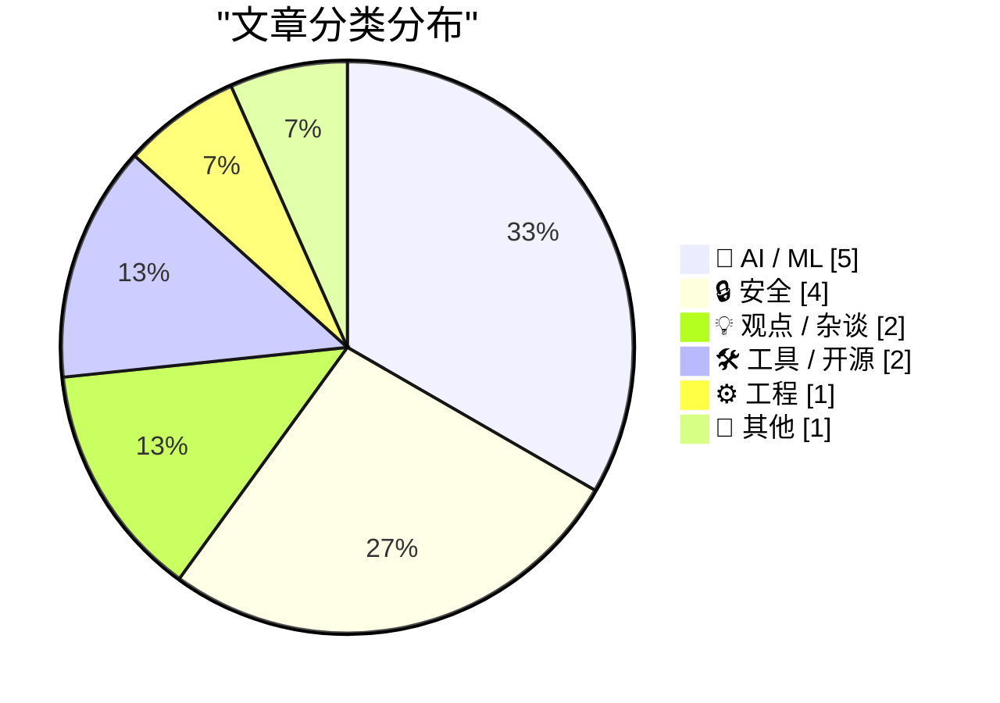
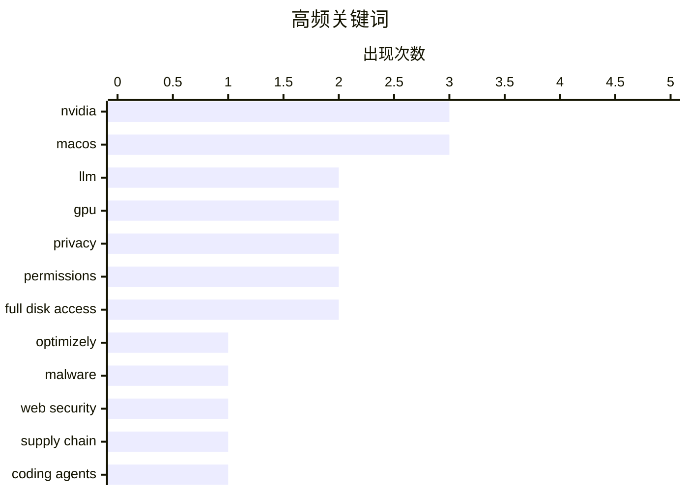

# 📰 Nov 18, 2026

> 来自 Karpathy 推荐的 92 个顶级技术博客，AI 精选 Top 15

## 📝 今日看点

今日技术圈的焦点集中在 AI 产品分化、安全边界与算力繁荣的可持续性。大模型加速面向高难度任务与日常工作分层，开放权重模型和浏览器内运行应用的探索，则凸显用户对隐私与本地执行能力的需求。第三方服务遭滥用、编程智能体面临执行风险，推动沙箱隔离与系统高权限管控成为重要议题。与此同时，围绕英伟达融资模式的争论升温，AI 产业的关注点正从能力扩张延伸至资金循环与真实需求能否持续。

---

## 🏆 今日必读

🥇 **攻击者利用 Optimizely 在头部网站上对恶意软件进行 A/B 测试**

[Attackers Used Optimizely to A/B Test Malware on Top Websites](https://krebsonsecurity.com/2026/11/attackers-used-optimizely-to-a-b-test-malware-on-top-websites/) — krebsonsecurity.com · 3 小时前 · 🔒 安全

> 一起涉及网站体验优化与 A/B 测试服务 Optimizely 的安全事件，导致至少 178 个头部网站在过去 24 小时内向访客投放恶意攻击代码。受影响网站包括 BBC、CNN、Equifax、Ledger 和 Zoom，攻击者借助相关漏洞将窃取数据的恶意软件悄然注入页面。文章标题指出，攻击者还利用 Optimizely 对恶意软件进行 A/B 测试，但所给摘录未说明具体测试方法。安全专家认为，许多热门网站没有严格限制页面可加载的代码来源，进一步放大了此次事件的影响。

💡 **为什么值得读**: 适合依赖第三方脚本的网站团队阅读，有助于重新评估 A/B 测试工具的供应链风险和脚本来源限制。

🏷️ Optimizely, malware, web security, supply chain

🥈 **为编程智能体使用外部沙箱**

[External sandboxes for coding agents](https://simonwillison.net/2026/Nov/17/external-sandboxes-for-coding-agents/) — simonwillison.net · 7 小时前 · 🔒 安全

> 编程智能体执行代码时，模型失误或提示注入攻击可能导致宿主机器遭受破坏。Simon Willison 正在探索使用外部沙箱隔离智能体执行的代码，重点是降低试用本地模型时的风险。这项工作与 AI 研究实验室 Prime Radiant 合作开展，但所给摘录没有列出具体沙箱产品、权限配置或测试结果。核心思路是通过执行环境隔离来约束智能体行为，让本地模型实验具备更可靠的安全边界。

💡 **为什么值得读**: 如果你准备让本地模型运行命令或修改文件，这一方向能帮助你优先考虑执行隔离，而不只依赖提示词约束。

🏷️ coding agents, sandboxing, local models

🥉 **GPT‑6.2 Astra 与 GPT‑6.2 Sol**

[GPT‑6.2 Astra and GPT‑6.2 Sol](https://simonwillison.net/2026/Nov/17/gpt62-astra-and-sol/) — simonwillison.net · 7 小时前 · 🤖 AI / ML

> OpenAI 发布 GPT‑6.2 Astra 和 GPT‑6.2 Sol，分别面向高难度项目与日常工作。Astra 被定位为处理最具挑战性任务的前沿模型，Sol 则强调效率与通用性。两款模型的 API 标识分别为 gpt-6.2-astra 和 gpt-6.2-sol，Simon Willison 也提到发布了 LLM 0.38。现有摘录明确了产品分工，但未提供价格、性能基准或上下文长度，尚不足以判断两者的实际性价比。

💡 **为什么值得读**: 适合需要更新模型调用配置的开发者快速了解新增 API 名称及两款模型的选型定位。

🏷️ OpenAI, GPT-6.2, LLM

---

## 📊 数据概览

| 扫描源 | 抓取文章 | 时间范围 | 精选 |
|:---:|:---:|:---:|:---:|
| 87/92 | 2641 篇 → 40 篇 | 48h | **15 篇** |

### 分类分布



### 高频关键词



<details>
<summary>📈 纯文本关键词图（终端友好）</summary>

```
nvidia           │ ████████████████████ 3
macos            │ ████████████████████ 3
llm              │ █████████████░░░░░░░ 2
gpu              │ █████████████░░░░░░░ 2
privacy          │ █████████████░░░░░░░ 2
permissions      │ █████████████░░░░░░░ 2
full disk access │ █████████████░░░░░░░ 2
optimizely       │ ███████░░░░░░░░░░░░░ 1
malware          │ ███████░░░░░░░░░░░░░ 1
web security     │ ███████░░░░░░░░░░░░░ 1
```

</details>

### 🏷️ 话题标签

**nvidia**(3) · **macos**(3) · **llm**(2) · gpu(2) · privacy(2) · permissions(2) · full disk access(2) · optimizely(1) · malware(1) · web security(1) · supply chain(1) · coding agents(1) · sandboxing(1) · local models(1) · openai(1) · gpt-6.2(1) · datasette(1) · pyodide(1) · webassembly(1) · service workers(1)

---

## 🤖 AI / ML

### 1. GPT‑6.2 Astra 与 GPT‑6.2 Sol

[GPT‑6.2 Astra and GPT‑6.2 Sol](https://simonwillison.net/2026/Nov/17/gpt62-astra-and-sol/) — **simonwillison.net** · 7 小时前 · ⭐ 23/30

> OpenAI 发布 GPT‑6.2 Astra 和 GPT‑6.2 Sol，分别面向高难度项目与日常工作。Astra 被定位为处理最具挑战性任务的前沿模型，Sol 则强调效率与通用性。两款模型的 API 标识分别为 gpt-6.2-astra 和 gpt-6.2-sol，Simon Willison 也提到发布了 LLM 0.38。现有摘录明确了产品分工，但未提供价格、性能基准或上下文长度，尚不足以判断两者的实际性价比。

🏷️ OpenAI, GPT-6.2, LLM

---

### 2. Ben Thompson 谈英伟达

[Ben Thompson on Nvidia](https://stratechery.com/2026/obituaries/) — **daringfireball.net** · 1 天前 · ⭐ 23/30

> Ben Thompson 将英伟达利用自身现金流和信用评级，为购买其芯片的企业提供资金支持的模式称为一项高风险业务。看空者把这种安排视为循环融资，担心供应商资金反过来支撑了对自身产品的需求。看多者则认为，这是通往未来 AI 收入增长的必要过渡，客户最终可以用收入偿还债务，并带来巨大回报。Thompson 强调，无论如何评价，这种风险承担方式都依赖英伟达作为数万亿美元市值公司的财务实力。

🏷️ Nvidia, AI financing, GPU, circular financing

---

### 3. 《华尔街日报》：英伟达为 AI 经济无限输血的日子屈指可数

[WSJ: ‘Nvidia’s Days as an Open Checkbook for the AI Economy Are Numbered’](https://www.wsj.com/tech/ai/nvidias-days-as-an-open-checkbook-for-the-ai-economy-are-numbered-90c7b388) — **daringfireball.net** · 1 天前 · ⭐ 23/30

> 《华尔街日报》的报道指向英伟达收缩对 AI 产业融资支持的趋势。报道声称，黄仁勋在担任首席执行官的最后几个月，已开始为减少此类支持作准备。接任掌舵的财务负责人此前就对部分交易持谨慎态度，因此依赖英伟达支持的初创企业预计，融资收缩幅度可能进一步扩大。摘录还提到采购英伟达芯片的新兴云服务公司，但没有给出具体融资规模；报道的核心判断是，相关企业将更难继续依赖英伟达提供资金保障。

🏷️ Nvidia, AI investment, corporate strategy, leadership

---

### 4. 任何人都能轻松使用注重隐私的开放权重模型

[Here's how anyone can easily use private, open weight models](https://micahflee.com/heres-how-anyone-can-easily-use-private-open-weight-models/) — **micahflee.com** · 1 天前 · ⭐ 23/30

> 作者认为，大语言模型虽然伴随低质内容、数据中心环境负担和数据使用争议，仍然具有很强的实用价值。他同时对 OpenAI 和 Anthropic 的数据可信度持批评态度，不愿将隐私数据交给这些服务商。文章标题提出，普通用户也能较容易地使用注重隐私的开放权重模型，从而获得商业托管服务之外的选择。所给摘录尚未展示具体工具、模型名称或部署步骤，因此只能确认其倡导方向，不能据此判断实际使用门槛。

🏷️ LLM, open weights, privacy, local inference

---

### 5. Paul Christiano：我们距离能够推翻政府的 AI 可能只有 12 个月

[Paul Christiano – We could be 12 months away from AIs that can overthrow the government](https://www.dwarkesh.com/p/paul-christiano-2) — **dwarkesh.com** · 1 天前 · ⭐ 23/30

> 这期时长 99 分钟的访谈围绕 Paul Christiano 对强大 AI 风险的判断展开。标题提出，我们可能只需再过 12 个月，就会面对具备推翻政府能力的 AI，这属于受访者的风险预测。节目摘录还引用了“人类将很难从中恢复”的警告，强调其对潜在后果的严重担忧。现有材料没有提供支撑该时间判断的论证、能力指标或情景假设，因此无法进一步评估这一预测的依据。

🏷️ AI safety, AI governance, alignment, existential risk

---

## 🔒 安全

### 6. 攻击者利用 Optimizely 在头部网站上对恶意软件进行 A/B 测试

[Attackers Used Optimizely to A/B Test Malware on Top Websites](https://krebsonsecurity.com/2026/11/attackers-used-optimizely-to-a-b-test-malware-on-top-websites/) — **krebsonsecurity.com** · 3 小时前 · ⭐ 27/30

> 一起涉及网站体验优化与 A/B 测试服务 Optimizely 的安全事件，导致至少 178 个头部网站在过去 24 小时内向访客投放恶意攻击代码。受影响网站包括 BBC、CNN、Equifax、Ledger 和 Zoom，攻击者借助相关漏洞将窃取数据的恶意软件悄然注入页面。文章标题指出，攻击者还利用 Optimizely 对恶意软件进行 A/B 测试，但所给摘录未说明具体测试方法。安全专家认为，许多热门网站没有严格限制页面可加载的代码来源，进一步放大了此次事件的影响。

🏷️ Optimizely, malware, web security, supply chain

---

### 7. 为编程智能体使用外部沙箱

[External sandboxes for coding agents](https://simonwillison.net/2026/Nov/17/external-sandboxes-for-coding-agents/) — **simonwillison.net** · 7 小时前 · ⭐ 23/30

> 编程智能体执行代码时，模型失误或提示注入攻击可能导致宿主机器遭受破坏。Simon Willison 正在探索使用外部沙箱隔离智能体执行的代码，重点是降低试用本地模型时的风险。这项工作与 AI 研究实验室 Prime Radiant 合作开展，但所给摘录没有列出具体沙箱产品、权限配置或测试结果。核心思路是通过执行环境隔离来约束智能体行为，让本地模型实验具备更可靠的安全边界。

🏷️ coding agents, sandboxing, local models

---

### 8. 苹果支持文档详解 macOS 27.3 Beta 2 新增的“完全磁盘访问权限”和“系统与 App 保护覆盖”设置

[Apple Support Document on the New ‘Full Disk Access’ and ‘System & App Protection Override’ Settings in MacOS 27.3 Beta 2](https://support.apple.com/en-us/149699) — **daringfireball.net** · 1 天前 · ⭐ 21/30

> macOS 27.3 Beta 2 引入与“完全磁盘访问权限”和“系统与 App 保护覆盖”有关的新设置，苹果通过支持文档解释其设计。一些用户认为这些设置采用了更具威慑性的警告界面，Daring Fireball 作者不赞同这一评价，但认为相关争论合理。他认可苹果在权限设计上的投入，并指出其出发点是：许多 Mac 用户在不了解权限覆盖范围的情况下，向过多应用授予了完全磁盘访问权限。评论的核心观点是，应结合苹果希望用户充分理解高权限授权后果的目标，评价这些新增设置。

🏷️ macOS, permissions, Full Disk Access, system protection

---

### 9. macOS Golden Gate 27.3 Beta 2 为完全磁盘访问权限等功能新增隐私控制

[MacOS Golden Gate 27.3b2 Includes New Privacy Controls for Full Disk Access (and More)](https://9to5mac.com/2026/11/16/macos-27-3-includes-new-privacy-controls-for-full-disk-access-and-more/) — **daringfireball.net** · 1 天前 · ⭐ 21/30

> macOS 27.3 开发者 Beta 2 开始推出针对完全磁盘访问权限等能力的新隐私控制。苹果此前约一个月曾宣布，将修改授权界面，要求用户通过非常明确的操作才能授予应用这种高等级访问权限。摘录引用 9to5Mac 的说明，指出 macOS 27.2 中“设备控制与数据访问”使用统一开关，但没有完整展示新版如何调整这一机制。此次变化的方向是提高敏感权限授权的明确程度，减少用户在未充分理解后果时完成授权的可能性。

🏷️ macOS, privacy, Full Disk Access, permissions

---

## 💡 观点 / 杂谈

### 10. 算力是新石油吗？（我们是不是都要完蛋了？）

[Is Compute the New Oil? (And Are We All F**ked?)](https://www.joanwestenberg.com/p/is-compute-the-new-oil-and-are-we) — **joanwestenberg.com** · 10 小时前 · ⭐ 21/30

> AI 创业公司的商业模式依赖大量昂贵算力，这让人联想到航空业：企业需要持续投入巨额资本，却难以摆脱高成本和激烈竞争。标题下方还展示了另一种说法——AI 创业公司像航空公司，而这种类比并非好兆头。现有摘录没有提供文章对算力供需、成本或行业前景的具体分析，也没有足够内容核实作者的完整论证。核心问题是，算力会不会成为 AI 产业的关键稀缺资源，以及这种依赖会给创业公司带来什么风险。

🏷️ AI, compute, startups, economics

---

### 11. 英伟达泡沫

[The NVIDIA Bubble](https://www.wheresyoured.at/the-nvidia-bubble/) — **wheresyoured.at** · 14 小时前 · ⭐ 21/30

> 文章聚焦英伟达及 AI 热潮背后的财务状况，标题提出的问题是：市场对英伟达的估值是否正在形成泡沫。现有摘录只包含作者关于付费订阅的说明，以及其高级通讯会深入分析 AI 的财务问题。摘录没有提供英伟达营收、估值、客户支出或其他数据，也没有展示作者判断泡沫与否的具体依据。因此，仅凭现有内容无法确定文章的论证过程或最终结论。

🏷️ NVIDIA, AI economics, GPU, market bubble

---

## 🛠 工具 / 开源

### 12. SetShot 1.0（以及一次探查系统默认设置的个人经历）

[SetShot 1.0 (and a Personal Tale of Defaults System Spelunking)](https://tidbits.com/2026/11/13/setshot-1-0-tracks-even-more-macos-settings/) — **daringfireball.net** · 11 小时前 · ⭐ 20/30

> Mac 用户担心操作系统更新会悄悄改变设置，Adam Engst 因此开发了 SetShot，一款用于记录和检查 macOS 设置变化的 Mac 应用。作者花了数月与 Claude Code 合作完成这款应用，并在 2026 年 8 月首次发布完整的 Mac 软件。SetShot 1.0 扩展了可追踪的 macOS 设置范围，帮助用户观察系统更新前后的差异。到目前为止，作者还没有抓到 Apple 在系统更新中擅自改动设置的确凿证据，但仍在调查相关传闻。

🏷️ SetShot, macOS, system preferences, Claude Code

---

### 13. 使用 Maiao 管理堆叠式差异

[Stacked diffs with Maiao](https://entropicthoughts.com/stacked-diffs-with-maiao) — **entropicthoughts.com** · 1 天前 · ⭐ 20/30

> 习惯堆叠式差异（stacked diffs）的开发者，常需要把一组相互依赖的代码变更提交到 GitHub 等传统代码托管平台，工作流程因此容易变得繁琐。作者推荐 Maiao 的社区分支，称它能把堆叠式差异与传统代码托管平台衔接起来。根据作者的使用体验，Maiao 在多数场景下都能顺畅处理这类工作，并至少将其使用 GitHub 时的挫败感减少了一半。文章面向熟悉堆叠式差异的读者，也试图向尚不了解这种工作方式的人说明其价值。

🏷️ Maiao, stacked diffs, GitHub, code review

---

## ⚙️ 工程

### 14. 利用 Service Worker 和 Pyodide 在浏览器中运行完整的 Datasette 服务端 Python 应用

[Running the full server-side Datasette Python app in the browser with service workers and Pyodide](https://simonwillison.net/2026/Nov/17/datasette-lite/) — **simonwillison.net** · 13 小时前 · ⭐ 23/30

> Datasette Lite 将原本运行于服务端的 Datasette Python 应用移植到浏览器，通过 WebAssembly 和 Pyodide 执行。此次完整重写引入了 Service Worker，使浏览器版本的使用体验几乎与真正的服务端应用一致。作者还表示，可以通过精心构造的 lite.datasette.io URL 触发多种功能，但所给摘录没有展开功能清单。这个项目展示了将既有 Python Web 应用迁入浏览器运行的可行路径，并显著缩小了浏览器移植版与原版之间的体验差距。

🏷️ Datasette, Pyodide, WebAssembly, service workers

---

## 📝 其他

### 15. 苹果云服务遭遇故障，连系统状态页面也未能幸免

[Apple’s Cloud Services Are Having a Bad Day, Including Their Status Page](https://www.macrumors.com/2026/11/17/apple-accounts-experiencing-issues/) — **daringfireball.net** · 11 小时前 · ⭐ 20/30

> 2026 年 11 月 17 日，Apple 账户和 iCloud 登录出现问题，用户报告与苹果系统状态页面都显示服务异常。作者在多款应用中遇到同步故障：照片显示同步完成，却缺少近期照片；备忘录也没有显示其他设备上的改动。作者还在一台 Mac 上安装 macOS 27.3 测试版时遇到了这些问题，说明故障影响了多个苹果服务和应用。现有摘录没有给出故障持续时间、影响范围或苹果的最终解释。

🏷️ Apple, iCloud, outage, cloud services

---

*生成于 2026-11-18 05:55 | 扫描 87 源 → 获取 2641 篇 → 精选 15 篇*
*基于 [Hacker News Popularity Contest 2025](https://refactoringenglish.com/tools/hn-popularity/) RSS 源列表，由 [Andrej Karpathy](https://x.com/karpathy) 推荐*
