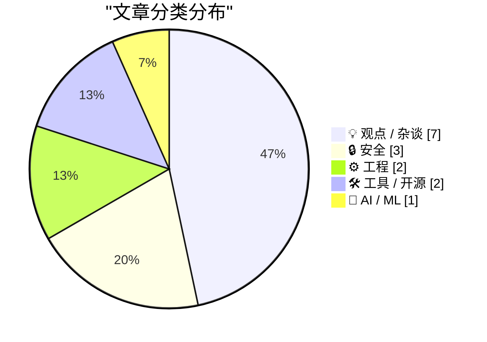
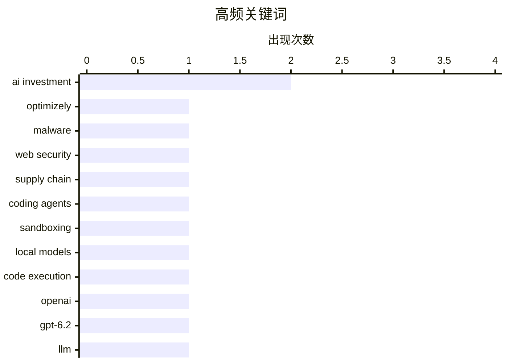

# 📰 Nov 19, 2026

> 来自 Karpathy 推荐的 92 个顶级技术博客，AI 精选 Top 15

## 📝 今日看点

AI 正从模型能力竞赛走向工程落地，复杂任务与日常工作的产品分工更加清晰，编程智能体的执行安全、维护价值和算力成本也成为焦点。安全风险则贯穿第三方服务、底层软件与智能体运行环境，推动业界重新审视供应链信任、内存安全和沙箱隔离。与此同时，浏览器承载完整应用、工具追踪系统设置变化等实践，正探索将更多执行能力与控制权交还用户。

---

## 🏆 今日必读

🥇 **攻击者利用 Optimizely 在热门网站上对恶意软件进行 A/B 测试**

[Attackers Used Optimizely to A/B Test Malware on Top Websites](https://krebsonsecurity.com/2026/11/attackers-used-optimizely-to-a-b-test-malware-on-top-websites/) — krebsonsecurity.com · 1 天前 · 🔒 安全

> 据报道，与网站体验优化及 A/B 测试服务 Optimizely 有关的安全漏洞，导致至少 178 个热门网站在过去 24 小时内向访客投放恶意攻击代码。受影响的网站包括 BBC、CNN、Equifax、Ledger 和 Zoom，攻击涉及静默注入窃取数据的恶意软件。攻击者借助网站已接入的第三方服务传播恶意内容，使多个知名站点成为攻击入口。安全专家指出，许多热门网站对内容来源缺乏严格限制，进一步放大了这次事件的影响。

💡 **为什么值得读**: 值得关注第三方脚本如何把单一供应商的安全问题扩散到大量网站，为审视网站依赖和内容来源限制提供具体案例。

🏷️ Optimizely, malware, web security, supply chain

🥈 **为编程智能体构建外部沙箱**

[External sandboxes for coding agents](https://simonwillison.net/2026/Nov/17/external-sandboxes-for-coding-agents/) — simonwillison.net · 1 天前 · 🔒 安全

> 编程智能体执行代码时，模型失误或提示注入攻击可能导致其对宿主机采取破坏性操作。Simon Willison 正在探索新的代码沙箱方案，重点是让本地模型的试用更安全。该项目与 AI 研究实验室 Prime Radiant 合作开展，围绕为智能体提供外部隔离执行环境展开。其核心目标是通过执行环境限制错误操作的影响，让开发者更放心地运行智能体生成的代码。

💡 **为什么值得读**: 如果你正在本地运行编程智能体，这个项目能帮助你思考如何通过执行隔离降低模型失误和提示注入带来的实际损失。

🏷️ coding agents, sandboxing, local models, code execution

🥉 **GPT‑6.2 Astra 与 GPT‑6.2 Sol**

[GPT‑6.2 Astra and GPT‑6.2 Sol](https://simonwillison.net/2026/Nov/17/gpt62-astra-and-sol/) — simonwillison.net · 1 天前 · 🤖 AI / ML

> OpenAI 宣布推出 GPT‑6.2 Astra 和 GPT‑6.2 Sol，分别面向高难度项目与日常工作。Astra 被定位为处理复杂任务的前沿模型，Sol 则强调效率与通用性。两款模型的 API 标识分别为 `gpt-6.2-astra` 和 `gpt-6.2-sol`，Simon Willison 同时提到发布了 LLM 0.38。现有摘录明确了两款模型的用途划分，但未提供价格、性能测试或上下文长度，尚不足以判断具体任务中的性价比。

💡 **为什么值得读**: 适合需要跟进模型 API 和命令行工具生态的开发者，用于快速了解新模型的定位及接入名称。

🏷️ OpenAI, GPT-6.2, LLM, model release

---

## 📊 数据概览

| 扫描源 | 抓取文章 | 时间范围 | 精选 |
|:---:|:---:|:---:|:---:|
| 85/92 | 2593 篇 → 37 篇 | 48h | **15 篇** |

### 分类分布



### 高频关键词



<details>
<summary>📈 纯文本关键词图（终端友好）</summary>

```
ai investment  │ ████████████████████ 2
optimizely     │ ██████████░░░░░░░░░░ 1
malware        │ ██████████░░░░░░░░░░ 1
web security   │ ██████████░░░░░░░░░░ 1
supply chain   │ ██████████░░░░░░░░░░ 1
coding agents  │ ██████████░░░░░░░░░░ 1
sandboxing     │ ██████████░░░░░░░░░░ 1
local models   │ ██████████░░░░░░░░░░ 1
code execution │ ██████████░░░░░░░░░░ 1
openai         │ ██████████░░░░░░░░░░ 1
```

</details>

### 🏷️ 话题标签

**ai investment**(2) · **optimizely**(1) · **malware**(1) · web security(1) · supply chain(1) · coding agents(1) · sandboxing(1) · local models(1) · code execution(1) · openai(1) · gpt-6.2(1) · llm(1) · model release(1) · datasette(1) · pyodide(1) · webassembly(1) · service workers(1) · enshittification(1) · scams(1) · platforms(1)

---

## 💡 观点 / 杂谈

### 1. Pluralistic：劣化平台者如何让我们更容易受骗（2026 年 11 月 18 日）

[Pluralistic: Enshittifiers groom us for scammers (18 Nov 2026)](https://pluralistic.net/2026/11/18/malice-v-incompetence/) — **pluralistic.net** · 21 小时前 · ⭐ 23/30

> 平台和商家不断恶化的商业行为，会让用户越来越难区分正常交易与诈骗。Cory Doctorow 的核心判断是：当糟糕的商业惯例与骗局在表现上趋同时，诈骗者就更容易得手。这里关注的是商业环境如何削弱用户识别欺诈的能力，而非某一种具体诈骗技术。作者认为，平台劣化的后果不仅是体验变差，还包括为诈骗创造更有利的条件。

🏷️ enshittification, scams, platforms, consumer trust

---

### 2. 算力是新的石油吗？我们是不是都完蛋了？

[Is Compute the New Oil? (And Are We All F**ked?)](https://www.joanwestenberg.com/p/is-compute-the-new-oil-and-are-we) — **joanwestenberg.com** · 1 天前 · ⭐ 22/30

> 这篇评论以“算力是否成为新的石油”为问题，审视 AI 创业公司的资源依赖与商业处境。所给副标题将 AI 初创公司比作航空公司，并明确认为这种处境不利。标题和副标题共同将关注点放在算力资源与企业经营之间的关系，但摘录未展开航空业类比的具体依据。现有内容不足以确认作者对成本结构、利润率或供应商依赖的详细判断，也没有提供可用于比较的数据。

🏷️ compute, AI startups, unit economics, capital intensity

---

### 3. 引述 Daniel Stenberg

[Quoting Daniel Stenberg](https://simonwillison.net/2026/Nov/18/daniel-stenberg/) — **simonwillison.net** · 13 小时前 · ⭐ 21/30

> curl 维护者 Daniel Stenberg 质疑用智能体将 curl 从 C 重写为 Rust 的实际维护价值。据其统计，相关智能体在略多于三周的时间里，将约 185,000 行 C 代码转换成了约 340,000 行 Rust 代码。与此同时，原 curl 项目合并了超过 300 次提交，完成了 200 多项缺陷修复，并修复了若干安全漏洞，而这些 Rust 重写版本并未包含相应修复。他强调，原项目仍会持续演进，因此评估重写成果必须考虑其能否跟上维护进度，而不能只看代码转换是否完成。

🏷️ curl, Rust, AI agents, code migration

---

### 4. Anthropic 的 IPO 对投资者和社会而言都是一场糟糕的押注吗？

[Is Anthropic’s IPO a bad bet, both for investors and society?](https://garymarcus.substack.com/p/is-anthropics-ipo-a-bad-bet-both) — **garymarcus.substack.com** · 8 小时前 · ⭐ 21/30

> 作者质疑 Anthropic 的 IPO 是否会同时给投资者和社会带来不利结果。标题将评估范围分为投资回报与社会影响两个维度，表明其关注点超出了公司的商业前景。副标题“看多理由遗漏了什么”提示，论述将着重审视支持这一投资判断的理由是否完整。不过，所提供内容只有标题和副标题，无法确认作者引用的财务数据、具体风险及最终结论。

🏷️ Anthropic, IPO, AI investment, social impact

---

### 5. 英伟达泡沫

[The NVIDIA Bubble](https://www.wheresyoured.at/the-nvidia-bubble/) — **wheresyoured.at** · 1 天前 · ⭐ 21/30

> 标题将英伟达置于“泡沫”的讨论框架下，但所提供节选没有展开具体论证。可见正文主要是付费通讯的订阅推广，价格分别为每年 70 美元、每季度 18 美元或每月 7 美元。订阅内容被描述为每周深入分析 AI 行业财务状况的通讯，但节选在此处截断。现有材料不足以确认作者如何评估英伟达的估值、收入或需求，也无法提炼其关于泡沫是否成立的结论。

🏷️ NVIDIA, AI investment, GPU, market bubble

---

### 6. 醒醒！美国的基础设施正在崩溃，AI 似乎也是部分原因

[Wake up! America’s infrastructure is melting. And AI appears to be partly responsible.](https://garymarcus.substack.com/p/wake-up-americas-infrastructure-is) — **garymarcus.substack.com** · 1 天前 · ⭐ 20/30

> 作者警告美国基础设施正面临严重问题，并认为 AI 可能是部分原因。副标题称已有数百家公司受到影响，强调问题具有较广的波及范围。标题使用“似乎”来描述 AI 的作用，说明这一因果判断仍带有不确定性。所提供内容未说明受影响的是哪类基础设施、涉及哪些公司，也未提供事件细节，因此无法核实影响规模或 AI 的具体责任。

🏷️ AI, infrastructure, systemic risk

---

### 7. “氛围编程”做出的游戏，正在让我成为实体二元论者吗？

[Are vibe-coded games making me a substance dualist?](https://rakhim.exotext.com/are-vibe-coded-games-making-me-a-substance-dualist) — **rakhim.exotext.com** · 1 天前 · ⭐ 19/30

> 由 AI 辅助“氛围编程”（vibe coding）制作的游戏，让作者产生一种缺乏人类气息的怪异感。作者将这种体验与 AI 图片、视频常见的“恐怖谷效应”区分开来：后者是“近乎真实却不完全真实”，前者则是“近乎人类创作却又有所欠缺”。尽管自称没有宗教信仰、也不特别相信灵性，作者仍用“没有灵魂”描述观看这些游戏运行时的感受。这促使作者追问，究竟是什么让电子游戏或其他艺术作品具有人类气息，并借标题中的“实体二元论”表达这种直觉带来的冲击。节选停在问题展开之处，尚未给出判断标准或完整结论。

🏷️ vibe coding, game development, creativity, uncanny valley

---

## 🔒 安全

### 8. 攻击者利用 Optimizely 在热门网站上对恶意软件进行 A/B 测试

[Attackers Used Optimizely to A/B Test Malware on Top Websites](https://krebsonsecurity.com/2026/11/attackers-used-optimizely-to-a-b-test-malware-on-top-websites/) — **krebsonsecurity.com** · 1 天前 · ⭐ 26/30

> 据报道，与网站体验优化及 A/B 测试服务 Optimizely 有关的安全漏洞，导致至少 178 个热门网站在过去 24 小时内向访客投放恶意攻击代码。受影响的网站包括 BBC、CNN、Equifax、Ledger 和 Zoom，攻击涉及静默注入窃取数据的恶意软件。攻击者借助网站已接入的第三方服务传播恶意内容，使多个知名站点成为攻击入口。安全专家指出，许多热门网站对内容来源缺乏严格限制，进一步放大了这次事件的影响。

🏷️ Optimizely, malware, web security, supply chain

---

### 9. 为编程智能体构建外部沙箱

[External sandboxes for coding agents](https://simonwillison.net/2026/Nov/17/external-sandboxes-for-coding-agents/) — **simonwillison.net** · 1 天前 · ⭐ 24/30

> 编程智能体执行代码时，模型失误或提示注入攻击可能导致其对宿主机采取破坏性操作。Simon Willison 正在探索新的代码沙箱方案，重点是让本地模型的试用更安全。该项目与 AI 研究实验室 Prime Radiant 合作开展，围绕为智能体提供外部隔离执行环境展开。其核心目标是通过执行环境限制错误操作的影响，让开发者更放心地运行智能体生成的代码。

🏷️ coding agents, sandboxing, local models, code execution

---

### 10. “这事没法预防”，唯一经常出这种事的语言的用户如是说

["No way to prevent this" say users of only language where this regularly happens](https://xeiaso.net/shitposts/no-way-to-prevent-this/memory-safety/CVE-2026-123633/) — **xeiaso.net** · 1 天前 · ⭐ 23/30

> 这篇讽刺文章以 NGINX 的两项 HTTP/2 漏洞为切入点，批评反复出现的内存安全问题。摘录列出 CVE-2026-123633 和 CVE-2026-123007，涉及反向代理处理时连接槽位不足所触发的释放后使用，以及流量控制中的整数下溢。后者会导致 TLS 通信中的越界内存复制，文中称这两类漏洞均可能让未经身份验证的攻击者远程执行代码。标题借“没法预防”的说法反讽对这类问题的无奈态度，将讨论指向语言选择与内存安全。

🏷️ NGINX, memory safety, use-after-free, HTTP/2

---

## ⚙️ 工程

### 11. 借助 Service Worker 和 Pyodide，在浏览器中运行完整的 Datasette Python 服务端应用

[Running the full server-side Datasette Python app in the browser with service workers and Pyodide](https://simonwillison.net/2026/Nov/17/datasette-lite/) — **simonwillison.net** · 1 天前 · ⭐ 23/30

> Datasette Lite 将原本运行在服务器上的 Datasette Python 应用移植到浏览器，通过 WebAssembly 和 Pyodide 执行。此次完整重写引入了 Service Worker，作者称其体验已与真正的服务端应用几乎无法区分。用户可以通过精心构造的 lite.datasette.io URL 使用相关功能，但所给摘录没有列出具体功能清单。这一实现展示了在浏览器内复用完整 Python Web 应用的可行性，进一步缩小了浏览器版本与服务端版本之间的体验差距。

🏷️ Datasette, Pyodide, WebAssembly, service workers

---

### 12. 苹果云服务状况不佳，连系统状态页面也出了问题

[Apple’s Cloud Services Are Having a Bad Day, Including Their Status Page](https://www.macrumors.com/2026/11/17/apple-accounts-experiencing-issues/) — **daringfireball.net** · 1 天前 · ⭐ 21/30

> 苹果账户和 iCloud 登录出现异常，社交媒体上的多份报告及苹果系统状态页面均提及相关问题。作者在一台尝试安装 27.3 测试版的 Mac 上，发现“照片”“备忘录”和“系统设置”等多个应用表现异常。“照片”显示同步刚刚完成，却缺少部分近期照片，而且缺失情况并不按时间顺序分布；“备忘录”也未显示来自其他设备的部分更改。标题进一步指出，苹果用于通报服务健康状况的系统状态页面本身也存在问题。现有节选凸显了同步状态提示与实际数据不一致的困扰，但未提供故障根因、影响范围或恢复时间。

🏷️ Apple, iCloud, outage, observability

---

## 🛠 工具 / 开源

### 13. SetShot 1.0，以及一次深入探查 macOS 默认设置系统的亲身经历

[SetShot 1.0 (and a Personal Tale of Defaults System Spelunking)](https://tidbits.com/2026/11/13/setshot-1-0-tracks-even-more-macos-settings/) — **daringfireball.net** · 1 天前 · ⭐ 22/30

> SetShot 是一款追踪 macOS 设置变化的工具，开发动机是核实系统更新是否会悄悄修改用户设置。Adam Engst 表示，他花了数月时间借助 Claude Code 开发这款 Mac 应用，并于 2026 年 8 月首次发布。此次介绍的 SetShot 1.0 扩大了可追踪的设置范围，相关经历也涉及对 macOS 默认设置系统的深入探索。作者同时明确表示，目前尚未抓到苹果在更新中擅自改动设置的确凿证据，因此工具的价值在于记录变化并帮助验证传闻。

🏷️ SetShot, macOS, Claude Code, settings

---

### 14. 本周源码管理动态：2026 年 11 月 18 日

[This Week in Source Control: 18 November 2026](https://nesbitt.io/2026/11/18/this-week-in-source-control.html) — **nesbitt.io** · 19 小时前 · ⭐ 22/30

> 这是一份面向版本控制工具与代码托管平台的每周动态汇总，日期为 2026 年 11 月 18 日。内容范围包括软件发布、安全公告和相关文章，可用于集中跟进源码管理生态。所给摘录仅说明了栏目范围，没有列出具体项目、版本号或漏洞信息。因此目前可以确认其信息汇编性质，但无法据此判断本期有哪些值得升级的版本或需要优先处理的安全问题。

🏷️ version control, software forges, releases, security advisories

---

## 🤖 AI / ML

### 15. GPT‑6.2 Astra 与 GPT‑6.2 Sol

[GPT‑6.2 Astra and GPT‑6.2 Sol](https://simonwillison.net/2026/Nov/17/gpt62-astra-and-sol/) — **simonwillison.net** · 1 天前 · ⭐ 24/30

> OpenAI 宣布推出 GPT‑6.2 Astra 和 GPT‑6.2 Sol，分别面向高难度项目与日常工作。Astra 被定位为处理复杂任务的前沿模型，Sol 则强调效率与通用性。两款模型的 API 标识分别为 `gpt-6.2-astra` 和 `gpt-6.2-sol`，Simon Willison 同时提到发布了 LLM 0.38。现有摘录明确了两款模型的用途划分，但未提供价格、性能测试或上下文长度，尚不足以判断具体任务中的性价比。

🏷️ OpenAI, GPT-6.2, LLM, model release

---

*生成于 2026-11-19 05:55 | 扫描 85 源 → 获取 2593 篇 → 精选 15 篇*
*基于 [Hacker News Popularity Contest 2025](https://refactoringenglish.com/tools/hn-popularity/) RSS 源列表，由 [Andrej Karpathy](https://x.com/karpathy) 推荐*
