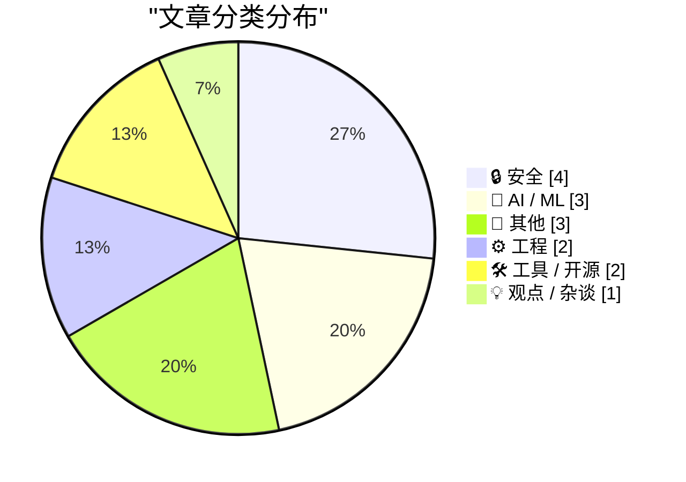
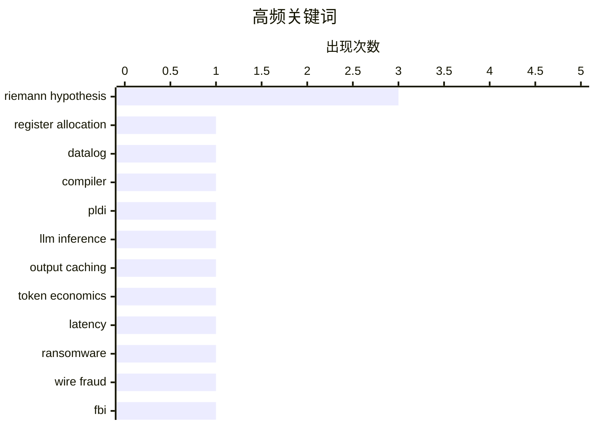

# 📰 Nov 22, 2026

> 来自 Karpathy 推荐的 92 个顶级技术博客，AI 精选 Top 15

## 📝 今日看点

今天的技术热点集中在 AI 应用落地的成本、权限与安全边界：从输入缓存的经济价值、模型推理等级到云服务额度，行业正加速探索如何控制 AI 使用成本并设计更精细的产品分层。与此同时，Token 欺诈、勒索软件骗局以及操作系统隐私权限的讨论升温，显示 AI 和数据安全风险正从概念问题变成现实的治理挑战。AI 辅助数学研究再次引发关注，但相关黎曼猜想证明仍需经过严格、持续的同行审查。工程领域则延续“用更可靠的方法减少重大失误”的主线，从 Datalog 表达编译器算法到日常编程实践，强调可验证性与稳健性。

---

## 🏆 今日必读

🥇 **用 Datalog 实现线性扫描寄存器分配**

[Linear scan register allocation in Datalog](https://bernsteinbear.com/blog/lsra-datalog/?utm_source=rss) — bernsteinbear.com · 1 天前 · ⚙️ 工程

> 线性扫描寄存器分配是这篇内容的核心，作者尝试用 Datalog 表达这一编译器算法。作者此前已经编写过一个小型线性扫描寄存器分配器，此次将主题延伸到 Datalog 实现。文章由熟悉 Datalog 的合作者参与，作者也强调自己希望先理解实现细节再发布。发布说明提到，文章原计划在 PLDI 2026 后不久推出，但因理解和编辑工作而推迟；所给片段尚未展示具体规则、算法实现或性能结果。

💡 **为什么值得读**: 适合对声明式编程与编译器实现交叉应用感兴趣的读者，可据此探索用 Datalog 表达寄存器分配算法的思路。

🏷️ register allocation, Datalog, compiler, PLDI

🥈 **为什么输出缓存行不通**

[Why output caching doesn't work](https://seangoedecke.com/why-output-caching-doesnt-work/) — seangoedecke.com · 1 天前 · 🤖 AI / ML

> LLM 输入缓存与输出缓存是否具有同样的经济价值，是文章讨论的核心问题。输入缓存能够避免每次收到新消息时都重新计算完整对话历史，是降低推理成本的重要机制。作者明确反对把这一逻辑直接推广到模型输出，认为输出缓存并不能获得同样的效果。所给片段尚未展开输出缓存失效的具体原因，因此可以确认的是作者对两类缓存价值的区分，无法据此判断其适用边界。

💡 **为什么值得读**: 适合正在评估 LLM 缓存方案的工程师，有助于审视输入缓存的收益能否直接套用到输出缓存。

🏷️ LLM inference, output caching, token economics, latency

🥉 **“RansomwareHelp”首席技术官因涉嫌电信欺诈被起诉**

[CTO of ‘RansomwareHelp’ Indicted for Wire Fraud](https://krebsonsecurity.com/2026/11/cto-of-ransomwarehelp-indicted-for-wire-fraud/) — krebsonsecurity.com · 23 小时前 · 🔒 安全

> 佛罗里达州一家经营六年的勒索软件恢复公司 ransomwarehelp.com，其首席技术官兼联合创始人因涉嫌电信欺诈被起诉。该公司声称使用“先进密码学工具”恢复被勒索软件锁定的数据。FBI 的诱捕调查发现，公司实际做法是向攻击者付款取得解密密钥，再向受害者收取加价费用。指控的关键在于，公司被指对未实际执行的技术工作收费，并以此包装真实的恢复方式；案件目前处于起诉阶段。

💡 **为什么值得读**: 这起案件为评估勒索软件恢复服务提供了具体警示，尤其值得负责供应商尽调、事件响应和付款决策的人阅读。

🏷️ ransomware, wire fraud, FBI, cryptocurrency

---

## 📊 数据概览

| 扫描源 | 抓取文章 | 时间范围 | 精选 |
|:---:|:---:|:---:|:---:|
| 84/92 | 2593 篇 → 26 篇 | 48h | **15 篇** |

### 分类分布



### 高频关键词



<details>
<summary>📈 纯文本关键词图（终端友好）</summary>

```
riemann hypothesis  │ ████████████████████ 3
register allocation │ ███████░░░░░░░░░░░░░ 1
datalog             │ ███████░░░░░░░░░░░░░ 1
compiler            │ ███████░░░░░░░░░░░░░ 1
pldi                │ ███████░░░░░░░░░░░░░ 1
llm inference       │ ███████░░░░░░░░░░░░░ 1
output caching      │ ███████░░░░░░░░░░░░░ 1
token economics     │ ███████░░░░░░░░░░░░░ 1
latency             │ ███████░░░░░░░░░░░░░ 1
ransomware          │ ███████░░░░░░░░░░░░░ 1
```

</details>

### 🏷️ 话题标签

**riemann hypothesis**(3) · **register allocation**(1) · **datalog**(1) · compiler(1) · pldi(1) · llm inference(1) · output caching(1) · token economics(1) · latency(1) · ransomware(1) · wire fraud(1) · fbi(1) · cryptocurrency(1) · token fraud(1) · ai agents(1) · authentication(1) · chatprd(1) · gemini(1) · llm(1) · reasoning(1)

---

## 🔒 安全

### 1. “RansomwareHelp”首席技术官因涉嫌电信欺诈被起诉

[CTO of ‘RansomwareHelp’ Indicted for Wire Fraud](https://krebsonsecurity.com/2026/11/cto-of-ransomwarehelp-indicted-for-wire-fraud/) — **krebsonsecurity.com** · 23 小时前 · ⭐ 25/30

> 佛罗里达州一家经营六年的勒索软件恢复公司 ransomwarehelp.com，其首席技术官兼联合创始人因涉嫌电信欺诈被起诉。该公司声称使用“先进密码学工具”恢复被勒索软件锁定的数据。FBI 的诱捕调查发现，公司实际做法是向攻击者付款取得解密密钥，再向受害者收取加价费用。指控的关键在于，公司被指对未实际执行的技术工作收费，并以此包装真实的恢复方式；案件目前处于起诉阶段。

🏷️ ransomware, wire fraud, FBI, cryptocurrency

---

### 2. Token 欺诈已经出现，而且问题很严重（YouTube）

[Token fraud is here and it’s BAD (YouTube)](https://simonwillison.net/2026/Nov/20/token-fraud-is-here-and-its-bad/) — **simonwillison.net** · 1 天前 · ⭐ 24/30

> 这则视频推荐聚焦 AI 产品中的 Token 欺诈问题，标题将其描述为已经出现且严重的风险。视频主讲人 Claire Vo 运营 ChatPRD，这是一款帮助产品经理“把想法变成规格说明”的 AI 平台。ChatPRD 从 GPT-4 时代就已上线，Claire 也长期公开分享产品开发过程。所给片段尚未披露欺诈手法、损失规模或防范措施，因此不能据此确定问题涉及账号滥用、计费造假还是其他机制。

🏷️ token fraud, AI agents, authentication, ChatPRD

---

### 3. 体验 macOS 27.3 Beta 2 新隐私控制一周

[★ A Week With the New Privacy Controls in MacOS 27.3 Beta 2](https://daringfireball.net/2026/11/a_week_with_the_new_privacy_controls_in_macos_273) — **daringfireball.net** · 4 小时前 · ⭐ 23/30

> macOS 27.3 Beta 2 的新隐私控制是这篇一周体验评测的重点。作者总体认可新的“完全磁盘访问权限”（Full Disk Access）及其他隐私控制。主要批评集中在菜单栏提示：对于能够控制其他应用的应用，系统会持续显示指示标记。作者的核心判断是，新权限控制整体值得肯定，但这一常驻指示标记影响了使用体验；所给片段未展开具体权限流程或设置细节。

🏷️ macOS, privacy controls, Full Disk Access, Apple

---

### 4. 为什么约翰尼打不上补丁

[Why Johnny Can’t Patch](https://dfarq.homeip.net/why-johnny-cant-patch-2/?utm_source=rss&#038;utm_medium=rss&#038;utm_campaign=why-johnny-cant-patch-2) — **dfarq.homeip.net** · 1 天前 · ⭐ 22/30

> 安全漏洞接连出现时，用户为何难以及时打上补丁，是文章关注的核心问题。作者以近期接连发生的安全事件为背景，并提到 10 月下旬 PHP 出现了一个受到广泛关注的漏洞。这一切入点将关注点从漏洞本身转向补丁能否实际得到部署。当前提供的摘录在提及 11 月事件时截断，未展示作者对更新障碍的具体分析或解决建议，因此尚无法确认其完整结论。

🏷️ patching, PHP, vulnerability, computer security

---

## 🤖 AI / ML

### 5. 为什么输出缓存行不通

[Why output caching doesn't work](https://seangoedecke.com/why-output-caching-doesnt-work/) — **seangoedecke.com** · 1 天前 · ⭐ 25/30

> LLM 输入缓存与输出缓存是否具有同样的经济价值，是文章讨论的核心问题。输入缓存能够避免每次收到新消息时都重新计算完整对话历史，是降低推理成本的重要机制。作者明确反对把这一逻辑直接推广到模型输出，认为输出缓存并不能获得同样的效果。所给片段尚未展开输出缓存失效的具体原因，因此可以确认的是作者对两类缓存价值的区分，无法据此判断其适用边界。

🏷️ LLM inference, output caching, token economics, latency

---

### 6. 引述 Levent Alpöge

[Quoting Levent Alpöge](https://simonwillison.net/2026/Nov/20/levent-alpoge/) — **simonwillison.net** · 1 天前 · ⭐ 22/30

> Levent Alpöge 声称，自己与 Claude 合作发现了黎曼猜想的证明。他进一步表示，该方法可以扩展到广义黎曼猜想，并预计投入更多时间后还能处理扩展黎曼猜想。引述还称，他与 Claude 已经在不引入额外假设的情况下形式化了相关论证。上述内容属于作者本人对成果的声明，所给片段没有提供独立审查结果，因此不能将这些猜想表述为已经得到公认解决。

🏷️ Riemann Hypothesis, Claude, AI-assisted mathematics

---

### 7. 苹果公布各付费 iCloud+ 档位可增加的 Apple Intelligence 使用额度

[Apple Documents Extra Apple Intelligence Usage Limits Per iCloud+ Paid Tier](https://support.apple.com/en-us/127901) — **daringfireball.net** · 6 小时前 · ⭐ 22/30

> 苹果支持文档说明了 Siri AI 和 Apple Intelligence 的免费使用范围，以及通过 iCloud+ 增加部分功能额度的安排。从 2027 年的软件版本起，使用受支持设备并设置为受支持语言的用户，可以免费使用这些功能。部分依赖大型服务器模型的功能设有使用限制，自 27.3 版本起，符合条件的 iCloud+ 套餐可提供更高额度。涉及类别包括 Siri AI，以及照片智能编辑中的 Clean Up、Extend 等工具；所给片段未包含各付费档位的具体额度，无法进行数值比较。

🏷️ Apple Intelligence, Siri, iCloud+, usage limits

---

## 📝 其他

### 8. 引述 Ravi Vakil

[Quoting Ravi Vakil](https://simonwillison.net/2026/Nov/20/ravi-vakil/) — **simonwillison.net** · 1 天前 · ⭐ 22/30

> Ravi Vakil 透露，Alessandro Masullo 提出了一份广义黎曼猜想（GRH）的候选证明。Brian Conrad 已持续数月仔细审阅，并提供了正在被纳入证明稿的大量反馈，Vakil 称目前进展看起来不错。Vakil 特别强调，这项工作完全由人类完成，没有使用 AI。原计划是让 Masullo 到斯坦福大学用一年时间完善写作，并在足够多的人审阅后再公布，因此现阶段应将其视为仍在完善和核验的候选证明。

🏷️ Riemann Hypothesis, Generalized Riemann Hypothesis, mathematics

---

### 9. 什么是广义黎曼猜想？

[What is the Generalized Riemann Hypothesis?](https://www.johndcook.com/blog/2026/11/20/grh/) — **johndcook.com** · 20 小时前 · ⭐ 20/30

> 广义黎曼猜想（GRH）如何扩展黎曼猜想（RH），是文章的核心主题。作者以当天出现的两项证明声明切入：一项由 AI 生成，另一项由人类提出，且两者都声称证明了更一般的 GRH。RH 断言黎曼 ζ 函数在临界带内的全部零点都位于实部为 1/2 的直线上；GRH 则将相应断言推广到更广泛的 L 函数。由于 GRH 包含 RH 这一特例，证明前者也就意味着证明后者，但“宣布证明”并不代表证明已获验证。现有摘录没有给出对这两项证明有效性的判断，不能据此认定任何一个猜想已经解决。

🏷️ Riemann Hypothesis, GRH, number theory, AI proofs

---

### 10. 毫不意外：特朗普与小罗伯特·肯尼迪主政下，美国失去麻疹消除状态认定

[The U.S. — Utterly Predictably — Has Lost Measles Elimination Status Under Trump and RFK Jr.](https://www.wsj.com/health/measles-is-back-it-will-take-years-to-eliminate-it-again-9971736e?st=GKiu3E) — **daringfireball.net** · 5 小时前 · ⭐ 19/30

> 所引《华尔街日报》报道将美国失去麻疹消除状态认定视为一次重大公共卫生挫败，并追问恢复这一状态需要多久。医生和流行病学家参考其他国家的经验，估计这一过程可能长达 5 年。这一估计有明确前提：联邦政府必须积极、有力地参与麻疹疫苗接种工作。如果缺少这样的联邦支持，恢复所需时间可能更长。Daring Fireball 的标题将这一结果归咎于特朗普与小罗伯特·肯尼迪主政，而所引报道强调的核心判断是，恢复进程取决于政府参与和接种行动。

🏷️ measles, public health, vaccination, United States

---

## ⚙️ 工程

### 11. 用 Datalog 实现线性扫描寄存器分配

[Linear scan register allocation in Datalog](https://bernsteinbear.com/blog/lsra-datalog/?utm_source=rss) — **bernsteinbear.com** · 1 天前 · ⭐ 26/30

> 线性扫描寄存器分配是这篇内容的核心，作者尝试用 Datalog 表达这一编译器算法。作者此前已经编写过一个小型线性扫描寄存器分配器，此次将主题延伸到 Datalog 实现。文章由熟悉 Datalog 的合作者参与，作者也强调自己希望先理解实现细节再发布。发布说明提到，文章原计划在 PLDI 2026 后不久推出，但因理解和编辑工作而推迟；所给片段尚未展示具体规则、算法实现或性能结果。

🏷️ register allocation, Datalog, compiler, PLDI

---

### 12. 离散傅里叶变换（DFT）笔记

[Notes on the discrete Fourier transform (DFT)](https://eli.thegreenplace.net/2026/notes-on-the-discrete-fourier-transform-dft/) — **eli.thegreenplace.net** · 1 小时前 · ⭐ 21/30

> 离散傅里叶变换（DFT）面向实际数字信号处理中离散且长度有限的信号分析。前一篇内容讨论了离散时间傅里叶级数（DTFS）与离散时间傅里叶变换（DTFT），分别用于分析无限时长的周期与非周期离散信号。本篇由这些理论对象转向有限长度的数据，突出实际数字信号与无限时长数学模型之间的差别。其核心方向是承接 DTFS、DTFT 的概念，进入适用于有限数据的 DFT；现有摘录尚未展示具体公式、推导或计算示例。

🏷️ DFT, Fourier transform, signal processing

---

## 🛠 工具 / 开源

### 13. llm-gemini 0.38.1 发布

[llm-gemini 0.38.1](https://simonwillison.net/2026/Nov/20/llm-gemini/) — **simonwillison.net** · 1 天前 · ⭐ 23/30

> llm-gemini 0.38.1 修复了 Gemini 4 不同模型推理等级支持不完整的问题。Gemini 4 Carbon 仅支持 low、medium 和 high 三个等级，而 Gemini 4 Hydrogen 与 Gemini 4 Neon 额外支持 xhigh。作者此前向插件加入这些模型时遗漏了这一差异，此次补丁版本补上了相应支持。使用 Hydrogen 或 Neon 的用户因此可以通过插件选择 xhigh；所给片段未提供该等级的性能、延迟或成本数据。

🏷️ Gemini, LLM, reasoning, Python

---

### 14. 包管理周报：2026 年 11 月 21 日

[This Week in Package Management: 21 November 2026](https://nesbitt.io/2026/11/21/this-week-in-package-management.html) — **nesbitt.io** · 14 小时前 · ⭐ 21/30

> 这是一份汇集包管理领域版本发布、安全公告与相关文章的每周资讯。报道范围覆盖软件包管理生态，兼顾工具更新、安全风险和技术阅读材料。版本发布与安全公告是其中两类信息，可作为关注依赖管理变化的线索。不过，当前提供的内容只有一句栏目介绍，没有列出具体项目、版本号、漏洞编号或文章观点，因此无法提炼本期的重要更新与结论。

🏷️ package management, dependencies, security advisories, releases

---

## 💡 观点 / 杂谈

### 15. 想写好代码，先避免重大失误

[To code well, avoid blunders](https://seangoedecke.com/to-code-well-avoid-blunders/) — **seangoedecke.com** · 21 分钟前 · ⭐ 22/30

> 写好代码的关键在于避免灾难性错误，这是作者提出的核心观点。作者反对将编程表现主要归因于灵光一现，认为持续不犯重大错误更能决定结果。他以国际象棋作类比：只要不轻易白送棋子，就能战胜许多对手。文章因此把工程能力的关注点转向减少重大失误；所给片段尚未列出具体编程案例或操作方法。

🏷️ software engineering, code quality, blunders, programming

---

*生成于 2026-11-22 00:21 | 扫描 84 源 → 获取 2593 篇 → 精选 15 篇*
*基于 [Hacker News Popularity Contest 2025](https://refactoringenglish.com/tools/hn-popularity/) RSS 源列表，由 [Andrej Karpathy](https://x.com/karpathy) 推荐*
