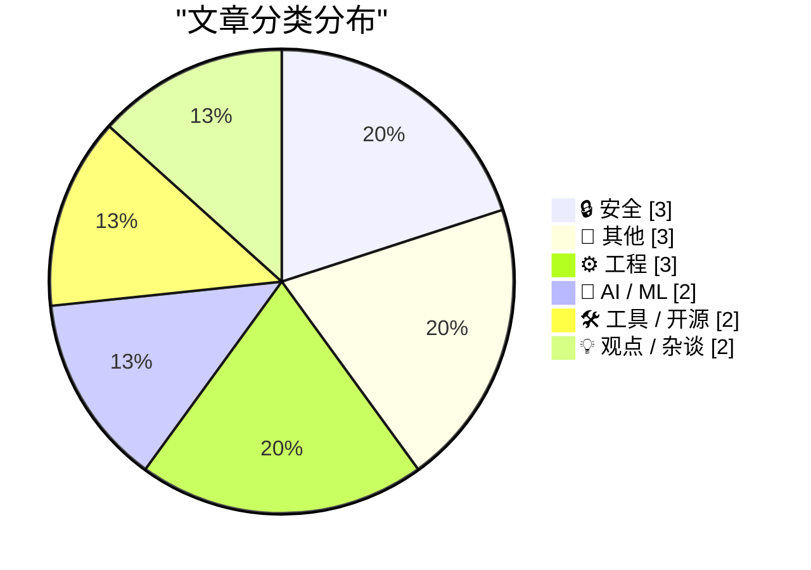
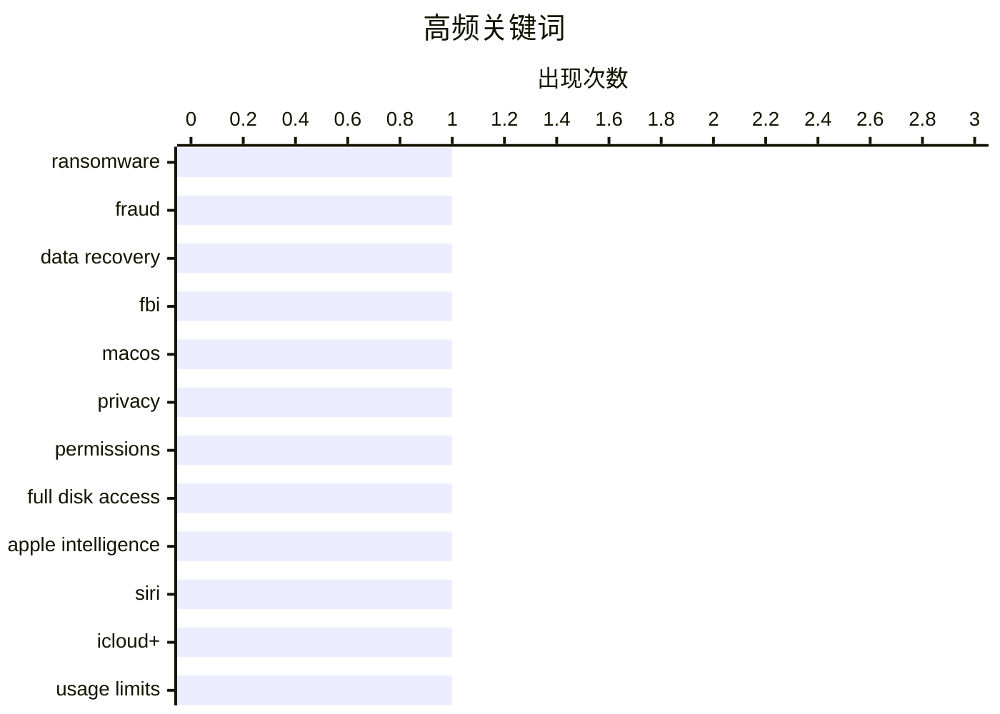

# 📰 Nov 23, 2026

> 来自 Karpathy 推荐的 92 个顶级技术博客，AI 精选 Top 15

## 📝 今日看点

AI 正从功能竞赛走向科研应用与商业化分层：辅助攻克数学难题的消息引发关注，但相关证明仍待验证，苹果则将部分 AI 功能的使用额度与付费订阅挂钩。安全议题进一步聚焦信任与责任，从勒索软件恢复服务涉嫌虚假宣传，到第三方依赖风险与系统隐私控制，服务商和平台的责任边界成为焦点。工程实践则强调夯实基础，通过工具演进、依赖管理和减少重大失误，提升软件交付的可靠性。

---

## 🏆 今日必读

🥇 **“RansomwareHelp”首席技术官被控电信欺诈**

[CTO of ‘RansomwareHelp’ Indicted for Wire Fraud](https://krebsonsecurity.com/2026/11/cto-of-ransomwarehelp-indicted-for-wire-fraud/) — krebsonsecurity.com · 1 天前 · 🔒 安全

> 美国佛罗里达州勒索软件恢复公司 RansomwareHelp 的首席技术官兼联合创始人被控电信欺诈，案件涉及其数据恢复服务的虚假宣传。这家经营了六年的公司宣称，能够使用“先进密码学工具”恢复被勒索软件锁定的数据。FBI 的诱捕调查发现，公司实际是向攻击者付款购买解密密钥，再向受害者加价收费。指控的关键在于，公司为并未执行的技术工作收取费用，并将向攻击者购买密钥包装成自主解密服务。案件凸显了勒索软件恢复服务中技术能力、收费依据与真实操作透明度的重要性。

💡 **为什么值得读**: 有助于企业识别勒索软件恢复服务的宣传陷阱，在紧急采购时核查供应商的实际能力与收费依据。

🏷️ ransomware, fraud, data recovery, FBI

🥈 **★ macOS 27.3 Beta 2 新隐私控制一周体验**

[★ A Week With the New Privacy Controls in MacOS 27.3 Beta 2](https://daringfireball.net/2026/11/a_week_with_the_new_privacy_controls_in_macos_273) — daringfireball.net · 1 天前 · 🔒 安全

> macOS 27.3 Beta 2 的新隐私控制总体获得作者肯定，但其中一项持续显示的菜单栏提示受到批评。作者经过一周使用，评价了包括“完全磁盘访问权限”在内的隐私控制调整。主要争议是：当某个应用控制其他应用时，系统会一直在菜单栏显示指示器。作者认可相关隐私控制的整体方向，却认为这一常驻提示是体验上的明显例外。评价的核心在于，隐私保护机制本身有价值，但提示方式仍需兼顾日常使用体验。

💡 **为什么值得读**: 适合希望提前了解 macOS 权限交互变化的人，尤其是依赖跨应用控制工具的用户。

🏷️ macOS, privacy, permissions, Full Disk Access

🥉 **苹果公布各付费 iCloud+ 档位可增加的 Apple Intelligence 使用额度**

[Apple Documents Extra Apple Intelligence Usage Limits Per iCloud+ Paid Tier](https://support.apple.com/en-us/127901) — daringfireball.net · 1 天前 · 🤖 AI / ML

> 苹果支持文档说明，部分 Siri AI 和 Apple Intelligence 功能将设置使用额度，符合条件的 iCloud+ 订阅可提供更多访问量。文档称，自 2027 年的软件版本起，使用受支持设备并设置为受支持语言的用户，可以免费使用相关 AI 功能。额度限制主要涉及依赖强大服务器模型的部分功能，增加额度的安排将从 27.3 版本开始提供。列出的功能类别包括 Siri AI，以及智能照片编辑工具中的 Clean Up 和 Extend 等。所给摘录未展示各订阅档位的具体配额，因此只能确认免费访问与付费增加额度的分层安排。

💡 **为什么值得读**: 能帮助苹果用户判断 iCloud+ 订阅与 AI 使用需求之间的关系，避免把免费可用理解为无限量使用。

🏷️ Apple Intelligence, Siri, iCloud+, usage limits

---

## 📊 数据概览

| 扫描源 | 抓取文章 | 时间范围 | 精选 |
|:---:|:---:|:---:|:---:|
| 83/92 | 2494 篇 → 20 篇 | 48h | **15 篇** |

### 分类分布



### 高频关键词



<details>
<summary>📈 纯文本关键词图（终端友好）</summary>

```
ransomware         │ ████████████████████ 1
fraud              │ ████████████████████ 1
data recovery      │ ████████████████████ 1
fbi                │ ████████████████████ 1
macos              │ ████████████████████ 1
privacy            │ ████████████████████ 1
permissions        │ ████████████████████ 1
full disk access   │ ████████████████████ 1
apple intelligence │ ████████████████████ 1
siri               │ ████████████████████ 1
```

</details>

### 🏷️ 话题标签

**ransomware**(1) · **fraud**(1) · **data recovery**(1) · fbi(1) · macos(1) · privacy(1) · permissions(1) · full disk access(1) · apple intelligence(1) · siri(1) · icloud+(1) · usage limits(1) · package management(1) · dependencies(1) · security advisories(1) · releases(1) · third-party risk(1) · script dependencies(1) · optimizely(1) · accountability(1)

---

## 🔒 安全

### 1. “RansomwareHelp”首席技术官被控电信欺诈

[CTO of ‘RansomwareHelp’ Indicted for Wire Fraud](https://krebsonsecurity.com/2026/11/cto-of-ransomwarehelp-indicted-for-wire-fraud/) — **krebsonsecurity.com** · 1 天前 · ⭐ 25/30

> 美国佛罗里达州勒索软件恢复公司 RansomwareHelp 的首席技术官兼联合创始人被控电信欺诈，案件涉及其数据恢复服务的虚假宣传。这家经营了六年的公司宣称，能够使用“先进密码学工具”恢复被勒索软件锁定的数据。FBI 的诱捕调查发现，公司实际是向攻击者付款购买解密密钥，再向受害者加价收费。指控的关键在于，公司为并未执行的技术工作收取费用，并将向攻击者购买密钥包装成自主解密服务。案件凸显了勒索软件恢复服务中技术能力、收费依据与真实操作透明度的重要性。

🏷️ ransomware, fraud, data recovery, FBI

---

### 2. ★ macOS 27.3 Beta 2 新隐私控制一周体验

[★ A Week With the New Privacy Controls in MacOS 27.3 Beta 2](https://daringfireball.net/2026/11/a_week_with_the_new_privacy_controls_in_macos_273) — **daringfireball.net** · 1 天前 · ⭐ 24/30

> macOS 27.3 Beta 2 的新隐私控制总体获得作者肯定，但其中一项持续显示的菜单栏提示受到批评。作者经过一周使用，评价了包括“完全磁盘访问权限”在内的隐私控制调整。主要争议是：当某个应用控制其他应用时，系统会一直在菜单栏显示指示器。作者认可相关隐私控制的整体方向，却认为这一常驻提示是体验上的明显例外。评价的核心在于，隐私保护机制本身有价值，但提示方式仍需兼顾日常使用体验。

🏷️ macOS, privacy, permissions, Full Disk Access

---

### 3. 每周更新第 531 期：Optimizely、脚本依赖与第三方

[Weekly Update 531: Optimizely. Script Dependencies & Third Parties](https://www.troyhunt.com/weekly-update-531/) — **troyhunt.com** · 18 小时前 · ⭐ 23/30

> 将安全事件归因于“第三方”，并不能免除采用该服务的企业对用户承担的责任。Troy Hunt 在第 531 期更新中围绕 Optimizely、脚本依赖与第三方服务讨论这一问题。他质疑安全披露中强调“事件发生在第三方”的表述，认为这种措辞容易让事件听起来没那么严重。其批评重点是，这类说明可能被用来转移责任，而没有充分回应企业自身的问责义务。作者的核心观点是“责任不能外包”，第三方依赖的存在不应成为淡化自身责任的理由。

🏷️ third-party risk, script dependencies, Optimizely, accountability

---

## 📝 其他

### 4. 什么是广义黎曼猜想？

[What is the Generalized Riemann Hypothesis?](https://www.johndcook.com/blog/2026/11/20/grh/) — **johndcook.com** · 1 天前 · ⭐ 21/30

> 广义黎曼猜想（GRH）比黎曼猜想（RH）覆盖的范围更广，并将 RH 包含为一个特例。文章的背景是，当天出现了两份声称证明黎曼猜想的成果，其中一份由 AI 生成，另一份由人类生成。两份成果都宣称证明了更一般的 GRH，但摘录没有说明这些证明是否通过验证。作为概念起点，RH 断言黎曼 ζ 函数在临界带内的所有零点都位于实部为 1/2 的直线上。理解 RH 与 GRH 的包含关系，是判断这些证明宣称究竟涉及多大范围问题的基础。

🏷️ Generalized Riemann Hypothesis, number theory, zeta function

---

### 5. 毫不意外：在特朗普和小罗伯特·肯尼迪主政下，美国失去了麻疹消除认证

[The U.S. — Utterly Predictably — Has Lost Measles Elimination Status Under Trump and RFK Jr.](https://www.wsj.com/health/measles-is-back-it-will-take-years-to-eliminate-it-again-9971736e?st=GKiu3E) — **daringfireball.net** · 1 天前 · ⭐ 16/30

> 这则评论援引《华尔街日报》的报道，称美国失去麻疹消除认证，并将其视为重大的公共卫生挫败。报道引述医生和流行病学家的判断：参照其他国家的经验，重新获得这一认证可能需要长达五年。这个时间预估有明确前提，即联邦政府必须积极、有力地参与麻疹疫苗接种工作；缺少这种配合，恢复时间可能更长。标题直接批评特朗普和小罗伯特·肯尼迪，而所引报道强调的核心问题是，恢复认证需要持续的疫苗接种行动与联邦政府支持。

🏷️ measles, public health, vaccination, US policy

---

### 6. 阅读清单：2026年11月21日

[Reading List 11/21/2026](https://www.construction-physics.com/p/reading-list-11212026) — **construction-physics.com** · 1 天前 · ⭐ 16/30

> 这是一份涵盖工程、材料、能源和网络安全议题的阅读清单。简介列出的主题包括 BAAJA、用于导弹的人造丝，以及美国汽油消费。清单还涉及名为“Cyberarmageddon”的内容，但节选未解释其具体所指。现有材料没有提供各条目的论点、数据或作者评价，因此只能确认选题范围，无法提炼统一结论。

🏷️ industrial technology, energy, materials, cybersecurity

---

## ⚙️ 工程

### 7. 离散傅里叶变换（DFT）笔记

[Notes on the discrete Fourier transform (DFT)](https://eli.thegreenplace.net/2026/notes-on-the-discrete-fourier-transform-dft/) — **eli.thegreenplace.net** · 1 天前 · ⭐ 21/30

> 离散傅里叶变换（DFT）将讨论重点转向实际数字信号处理中长度有限的离散信号。此前的内容使用离散时间傅里叶级数（DTFS）和离散时间傅里叶变换（DTFT），分析无限时长的周期与非周期离散信号。这篇笔记承接上述基础，进一步处理信号既离散、又有限长时的频域分析问题。关键区别是，仅有时间离散化还不足以描述实际处理的数据，有限长度也是必须考虑的条件。所给摘录呈现了引入 DFT 的动机，但未包含后续公式推导、算法或实验结果。

🏷️ DFT, signal processing, Fourier transform

---

### 8. 想写好代码，先避免重大失误

[To code well, avoid blunders](https://seangoedecke.com/to-code-well-avoid-blunders/) — **seangoedecke.com** · 1 天前 · ⭐ 20/30

> 写好代码的关键，是避免灾难性的错误。作者反对将编程能力主要理解为不断产生精妙洞见，认为减少重大失误才是取得好结果的核心。他用国际象棋作类比：只要不轻易白送棋子，就能战胜绝大多数对手。这一类比强调，基础判断的稳定性和对明显错误的控制，能够带来很大的实际优势。作者的核心主张是，把避免严重失误放在追求精彩招数之前。

🏷️ programming, code quality, error prevention

---

### 9. 改用 CC BY-SA 许可，并在 Schema 元数据中明确标注

[Relicensing to CC BY-SA and making it visible in Schema metadata](https://shkspr.mobi/blog/2026/11/relicensing-to-cc-by-sa-and-making-it-visible-in-schema-metadata/) — **shkspr.mobi** · 1 天前 · ⭐ 19/30

> 博客文章的版权许可需要同时向读者和机器清晰表达，标题表明作者正在改用 CC BY-SA（署名—相同方式共享）许可。节选给出的首个技术入口是网页元数据：在 HTML 的 <head> 中通过 rel 属性标示许可关系。文章还将许可标注延伸到 Schema 结构化元数据，但当前节选未展示具体字段、代码或 CC BY-SA 版本。作者的核心立场是，即使在 AI 广泛使用内容的环境下，明确声明版权与 copyleft 条件仍然有价值。

🏷️ CC BY-SA, Schema.org, metadata, copyright

---

## 🤖 AI / ML

### 10. 苹果公布各付费 iCloud+ 档位可增加的 Apple Intelligence 使用额度

[Apple Documents Extra Apple Intelligence Usage Limits Per iCloud+ Paid Tier](https://support.apple.com/en-us/127901) — **daringfireball.net** · 1 天前 · ⭐ 23/30

> 苹果支持文档说明，部分 Siri AI 和 Apple Intelligence 功能将设置使用额度，符合条件的 iCloud+ 订阅可提供更多访问量。文档称，自 2027 年的软件版本起，使用受支持设备并设置为受支持语言的用户，可以免费使用相关 AI 功能。额度限制主要涉及依赖强大服务器模型的部分功能，增加额度的安排将从 27.3 版本开始提供。列出的功能类别包括 Siri AI，以及智能照片编辑工具中的 Clean Up 和 Extend 等。所给摘录未展示各订阅档位的具体配额，因此只能确认免费访问与付费增加额度的分层安排。

🏷️ Apple Intelligence, Siri, iCloud+, usage limits

---

### 11. Levent Alpöge 在 Claude 帮助下解决了黎曼猜想！这意味着什么？

[Levent Alpöge has solved the Riemann Hypothesis with help of Claude! What does it mean?](https://garymarcus.substack.com/p/levent-alpoge-has-solved-the-riemann) — **garymarcus.substack.com** · 5 小时前 · ⭐ 22/30

> 文章以 Levent Alpöge 据称借助 Claude 解决黎曼猜想为切入点，追问这一消息的意义及其市场反响。标题将 Claude 描述为数学研究中的辅助工具，但所给内容没有展示证明过程或 AI 的具体贡献。副标题进一步提出疑问：如果成果如此重大，为什么没有立即提振市场？这一设问将数学突破的宣称与市场反应联系起来，但摘录未提供作者的完整论证。现有材料只能确认文章的讨论方向，不能据此认定黎曼猜想已经获得数学界认可的证明。

🏷️ Claude, Riemann Hypothesis, AI reasoning, proof verification

---

## 🛠 工具 / 开源

### 12. 软件包管理周报：2026 年 11 月 21 日

[This Week in Package Management: 21 November 2026](https://nesbitt.io/2026/11/21/this-week-in-package-management.html) — **nesbitt.io** · 1 天前 · ⭐ 23/30

> 这期软件包管理周报汇总了截至 2026 年 11 月 21 日的相关生态动态。内容范围包括版本发布、安全通告和技术文章三类信息。其覆盖对象是软件包管理领域，但所给摘录没有列出具体包管理器、软件包或平台。摘录也未提供版本号、漏洞编号或技术变更，无法据此判断本期最重要的更新及其影响。可以确认的是，这是一份用于集中追踪软件包管理动态的定期资讯汇编。

🏷️ package management, dependencies, security advisories, releases

---

### 13. Muru

[Muru](https://simonwillison.net/2026/Nov/21/muru/) — **simonwillison.net** · 1 天前 · ⭐ 22/30

> Muru 是一个面向 Python Web 应用的新服务器，目标是同时支持开发与生产环境中的 ASGI 和 WSGI 应用。项目由 Graham Dumpleton 发起，他在 20 年前创建了 mod_wsgi，此后持续思考 Python Web 应用的生产部署方式。Muru 使用 Rust 编写，并采用了 AI 辅助开发。它希望为两类 Python Web 接口提供完善的运行工具，但所给摘录未披露具体架构、功能清单或性能测试。现有信息体现了该项目的兼容性目标与开发背景，尚不足以判断其相对其他服务器的实际优势。

🏷️ Python, Muru, web server, deployment

---

## 💡 观点 / 杂谈

### 14. 拿不准时，就先折腾起来

[When in doubt, flail about](https://seangoedecke.com/when-in-doubt-flail-about/) — **seangoedecke.com** · 21 分钟前 · ⭐ 19/30

> 在缺乏明确指导、也不知道什么行动有用的情境下，作者主张先动手尝试，而不是等待局势变得清晰。这个建议挑战了“理解充分后再行动”的直觉，认为谨慎等待通常并非最佳选择。不过，作者明确将其称为“危险的建议”：在科技公司里，糟糕的盲目折腾很容易损害工程师的职业声誉。核心观点是，不确定时可以优先行动，但现有节选尚未说明如何区分有效探索与有害折腾。

🏷️ uncertainty, experimentation, problem solving

---

### 15. 如何做出人们真正在乎的东西

[How To Make Something People Give a Shit About](https://www.joanwestenberg.com/p/how-to-make-something-people-give) — **joanwestenberg.com** · 3 小时前 · ⭐ 18/30

> 创作或制作产品时，关键问题是如何让人们真正关心，而不是随手划过。文章以六条从实践中总结出的规则回应这一问题。标题与简介强调的是受众是否在意作品，但所提供的材料没有列出六条规则及其案例。因此，目前能够确认的核心方向是围绕受众关注来思考创作，尚无法据此判断作者提出了哪些具体方法。

🏷️ product development, audience, creativity

---

*生成于 2026-11-23 00:21 | 扫描 83 源 → 获取 2494 篇 → 精选 15 篇*
*基于 [Hacker News Popularity Contest 2025](https://refactoringenglish.com/tools/hn-popularity/) RSS 源列表，由 [Andrej Karpathy](https://x.com/karpathy) 推荐*
