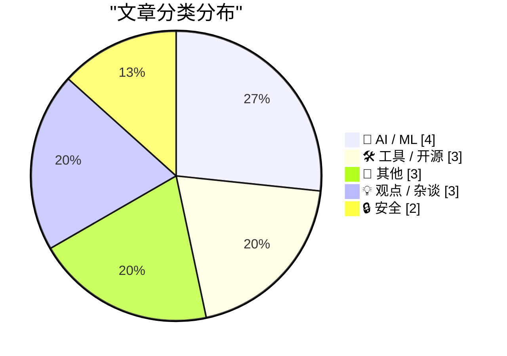
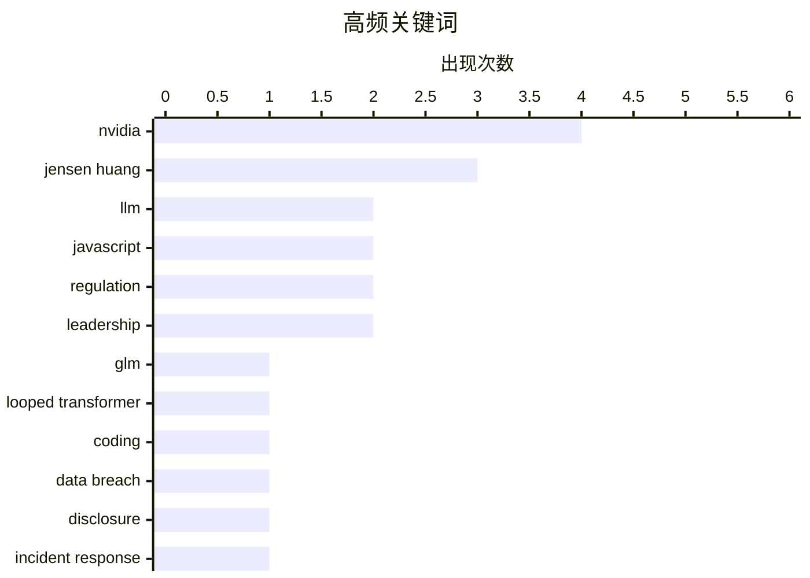

# 📰 Nov 24, 2026

> 来自 Karpathy 推荐的 92 个顶级技术博客，AI 精选 Top 15

## 📝 今日看点

AI 竞争正同时向架构创新与能力评估深化，通用编程、复杂任务执行和真实工作价值成为观察模型进展的关键。围绕英伟达的人事动态与芯片供应政策讨论，则凸显算力产业、公司治理与地缘政治的紧密交织。与此同时，数据泄露披露与第三方依赖风险持续暴露企业责任缺口，技术生态的安全与问责机制面临更大考验。

---

## 🏆 今日必读

🥇 **GLM-5.4：以首个循环 Transformer 迈向通用编程**

[GLM-5.4: Toward Generalized Coding with Our First Loop Transformer](https://simonwillison.net/2026/Nov/23/glm-54/) — simonwillison.net · 38 分钟前 · 🤖 AI / ML

> 智谱 Z.ai 发布 GLM-5.4，尝试通过循环 Transformer 架构提升模型的通用编程能力。标准 Transformer 的每一层在一次前向传播中只执行一次，而循环 Transformer 会让一组共享权重的层执行多轮迭代。每轮计算都基于上一轮的隐藏状态继续细化，使同一组参数能够参与多次处理。这是 Z.ai 首次在模型中采用这种架构，但所提供的摘录未包含编程基准、性能增幅或推理成本，尚不足以判断其实际收益。

💡 **为什么值得读**: 适合关注大模型架构演进的读者，可帮助理解共享权重与循环计算如何成为提升编程能力的新方向。

🏷️ GLM, looped transformer, coding, LLM

🥈 **数据泄露披露为何如此困难：与被黑企业往来数百封邮件的经验**

[Here's Why Data Breach Disclosure is so Hard: Lessons from Hundreds of Emails with Hacked Companies](https://www.troyhunt.com/heres-why-data-breach-disclosure-is-so-hard-lessons-from-hundreds-of-emails-with-hacked-companies/) — troyhunt.com · 16 小时前 · 🔒 安全

> 数据泄露披露的难点不仅在于确认泄露事实，也在于推动涉事企业配合沟通和处理。Troy Hunt 从与遭遇数据泄露的企业往来的数百封邮件中，观察到态度冷淡、刻意拖延等反复出现的行为模式。他让 Claude 根据这些邮件撰写文章，并说明自己事先已经了解邮件内容及其中的共性。现有摘录凸显了企业响应方式给披露工作造成的阻力，但未提供完整案例或具体改进建议。

💡 **为什么值得读**: 适合安全响应与企业沟通负责人阅读，帮助识别可能拖慢泄露披露、损害外部信任的沟通行为。

🏷️ data breach, disclosure, incident response

🥉 **Ladybird 的首个 Alpha 版本**

[Ladybird's first alpha release](https://simonwillison.net/2026/Nov/23/ladybird/) — simonwillison.net · 2 小时前 · 🛠 工具 / 开源

> Ladybird 推出首个 Alpha 版本，其核心目标是构建拥有独立技术实现的新浏览器。项目自行实现了 HTML 解析、CSS 引擎、页面布局、JavaScript 以及 WebAssembly 等关键组件。它仍采用部分外部基础库，包括用于文本塑形的 HarfBuzz、用于二维图形的 Skia，以及 FFmpeg 和 SQLite。这种技术路线体现了从浏览器底层建立独立实现的雄心，但摘录未提供网站兼容性、运行性能或日常使用成熟度的数据。

💡 **为什么值得读**: 如果你关注浏览器引擎的技术多样性，这个项目能提供观察独立浏览器如何构建核心技术栈的具体样本。

🏷️ Ladybird, browser, web standards, JavaScript

---

## 📊 数据概览

| 扫描源 | 抓取文章 | 时间范围 | 精选 |
|:---:|:---:|:---:|:---:|
| 83/92 | 2520 篇 → 29 篇 | 48h | **15 篇** |

### 分类分布



### 高频关键词



<details>
<summary>📈 纯文本关键词图（终端友好）</summary>

```
nvidia             │ ████████████████████ 4
jensen huang       │ ███████████████░░░░░ 3
llm                │ ██████████░░░░░░░░░░ 2
javascript         │ ██████████░░░░░░░░░░ 2
regulation         │ ██████████░░░░░░░░░░ 2
leadership         │ ██████████░░░░░░░░░░ 2
glm                │ █████░░░░░░░░░░░░░░░ 1
looped transformer │ █████░░░░░░░░░░░░░░░ 1
coding             │ █████░░░░░░░░░░░░░░░ 1
data breach        │ █████░░░░░░░░░░░░░░░ 1
```

</details>

### 🏷️ 话题标签

**nvidia**(4) · **jensen huang**(3) · **llm**(2) · javascript(2) · regulation(2) · leadership(2) · glm(1) · looped transformer(1) · coding(1) · data breach(1) · disclosure(1) · incident response(1) · ladybird(1) · browser(1) · web standards(1) · openai(1) · perplexity(1) · model evaluation(1) · trump(1) · corporate governance(1)

---

## 🤖 AI / ML

### 1. GLM-5.4：以首个循环 Transformer 迈向通用编程

[GLM-5.4: Toward Generalized Coding with Our First Loop Transformer](https://simonwillison.net/2026/Nov/23/glm-54/) — **simonwillison.net** · 38 分钟前 · ⭐ 25/30

> 智谱 Z.ai 发布 GLM-5.4，尝试通过循环 Transformer 架构提升模型的通用编程能力。标准 Transformer 的每一层在一次前向传播中只执行一次，而循环 Transformer 会让一组共享权重的层执行多轮迭代。每轮计算都基于上一轮的隐藏状态继续细化，使同一组参数能够参与多次处理。这是 Z.ai 首次在模型中采用这种架构，但所提供的摘录未包含编程基准、性能增幅或推理成本，尚不足以判断其实际收益。

🏷️ GLM, looped transformer, coding, LLM

---

### 2. 关于 OpenAI 披露困惑度数据的几点思考

[Notes on OpenAI's perplexity reveal](https://seangoedecke.com/notes-on-openais-perplexity-reveal/) — **seangoedecke.com** · 1 天前 · ⭐ 24/30

> OpenAI 公布了一张展示其已发布模型困惑度随时间变化的图表，引发了对模型进展衡量方式的讨论。困惑度衡量模型预测文本的能力，通常数值越低，表示模型对评测文本的预测越准确。作者以这张覆盖多代模型的图表为起点，提出了一系列观察与思考。不过，所提供的摘录没有包含图表数值或后续论证，因此无法据此确定具体模型的排名、进步幅度，或作者对困惑度与智能关系的结论。

🏷️ OpenAI, perplexity, LLM, model evaluation

---

### 3. 英伟达董事会恢复黄仁勋职务

[Nvidia Board Reinstates Jensen Huang](https://nvidianews.nvidia.com/news/nvidia-board-reinstates-jensen-huang-as-president-ceo-and-board-director) — **daringfireball.net** · 9 小时前 · ⭐ 22/30

> 英伟达公告称，黄仁勋即日起恢复总裁、首席执行官及董事会成员职务。董事会在与他进行一系列讨论和会面后，一致投票支持其复职。公告表示，董事会已对黄仁勋的坦诚程度及其领导英伟达的能力感到满意，并在决策过程中听取了美国高层方面的意见。该声明明确了复职决定与董事会给出的理由，但所提供的摘录没有交代此前免职的完整背景，也未具体说明外部意见如何影响决策。

🏷️ Nvidia, Jensen Huang, leadership

---

### 4. 两张图

[Two graphs](https://martinalderson.com/posts/two-graphs/?utm_source=rss&amp;utm_medium=rss&amp;utm_campaign=feed) — **martinalderson.com** · 1 天前 · ⭐ 22/30

> 作者将 Remote Labor Index 与 METR 任务时间跨度的外推结果并置，用来思考 2027 年可能出现的变化。前者提供观察 AI 完成远程工作任务能力的视角，后者关注 AI 能够完成的任务所对应的时间跨度。将两类指标放在一起，可以从工作任务表现和可处理任务的持续时长两个维度审视能力发展。不过，所提供内容只有简短导语，没有图表数值、外推假设或具体预测，无法据此确定作者对 2027 年的判断。

🏷️ AI agents, METR, automation, labor market

---

## 🛠 工具 / 开源

### 5. Ladybird 的首个 Alpha 版本

[Ladybird's first alpha release](https://simonwillison.net/2026/Nov/23/ladybird/) — **simonwillison.net** · 2 小时前 · ⭐ 24/30

> Ladybird 推出首个 Alpha 版本，其核心目标是构建拥有独立技术实现的新浏览器。项目自行实现了 HTML 解析、CSS 引擎、页面布局、JavaScript 以及 WebAssembly 等关键组件。它仍采用部分外部基础库，包括用于文本塑形的 HarfBuzz、用于二维图形的 Skia，以及 FFmpeg 和 SQLite。这种技术路线体现了从浏览器底层建立独立实现的雄心，但摘录未提供网站兼容性、运行性能或日常使用成熟度的数据。

🏷️ Ladybird, browser, web standards, JavaScript

---

### 6. datasette-charts 0.1a0 发布

[datasette-charts 0.1a0](https://simonwillison.net/2026/Nov/23/datasette-charts/) — **simonwillison.net** · 23 小时前 · ⭐ 19/30

> datasette-charts 0.1a0 将作者酝酿一年多的 Datasette 图表插件想法变成了可用的初始版本。作者在周日使用 Claude Fable 5.2 构建原型，开发进展顺利，随后将其扩展为完整插件。文章提供了 GitHub 发布页面，以及通过安装 datasette-charts 进行体验的 Datasette Lite 链接。这个版本展示了作者借助 AI 从长期构想到插件发布的实践，但所给节选未包含具体图表能力、兼容性或稳定性说明。

🏷️ Datasette, charts, data visualization, AI coding

---

### 7. 下拉选择框样式示例集

[Select Styling Specimens](https://simonwillison.net/2026/Nov/22/select-styling/) — **simonwillison.net** · 1 天前 · ⭐ 18/30

> HTML 原生 <select> 下拉选择框在不同浏览器中的默认外观不一致，是这个工具要处理的核心问题。作者展示了 Chrome、Safari 和 Firefox 的差异：Chrome 使用白色背景和黑色边框，Safari 为灰色且没有边框，Firefox 则为灰色并带黑色边框，三者尺寸也略有不同。作者尤其不满意 Chrome 的默认样式，并提供了名为 Select Styling Specimens 的工具页面。其出发点是为下拉框样式提供直观参考，但所给节选未展示具体 CSS 方案及其兼容性。

🏷️ CSS, HTML select, browser compatibility, UI

---

## 📝 其他

### 8. Semafor：黄仁勋复职前数小时，特朗普致电英伟达董事会争取让他回归

[Semafor: ‘Hours Before Huang’s Reinstatement, Trump Called Nvidia’s Board to Argue for His Return’](https://www.semafor.com/article/11/23/2026/jensen-huang-reinstated-as-nvidia-ceo) — **daringfireball.net** · 8 小时前 · ⭐ 23/30

> 据 Semafor 援引知情人士报道，特朗普在黄仁勋恢复英伟达 CEO 职务前数小时，曾接入董事会会议并支持其回归。报道将美国总统的直接介入与英伟达随后恢复黄仁勋职务的决定联系起来。白宫通讯主任 Steven Cheung 公开表示特朗普深度参与此事，并称董事会作出了正确决定。Daring Fireball 的引文及评论将关注点引向政治权力对企业治理的影响，但摘录不足以证明这次介入对董事会投票起了决定性作用。

🏷️ Nvidia, Jensen Huang, Trump, corporate governance

---

### 9. 黄仁勋重返工作岗位

[Jensen Huang Returns to Work](https://www.businessinsider.com/jensen-huang-returns-to-nvidia-hq-im-terribly-sorry-2026-11) — **daringfireball.net** · 25 分钟前 · ⭐ 20/30

> 据 Business Insider 报道，黄仁勋复职后回到英伟达总部，受到现场员工聚集欢迎。知情人士称，员工高喊他的名字，人群拥挤到需要争相寻找观看位置。他当天身穿海军蓝棉质外套，而非标志性的黑色皮夹克，并数次将手放在胸前。标题引述了他的歉意，正文摘录则记录他说这是自己上班的第一天；现有材料主要呈现回归现场，未说明道歉的完整内容或后续管理安排。

🏷️ Nvidia, Jensen Huang, leadership

---

### 10. 数码产品评测：廉价 Zigbee 环境传感器 ★★★☆☆

[Gadget Review: Cheap Zigbee Environmental Sensors ★★★☆☆](https://shkspr.mobi/blog/2026/11/gadget-review-cheap-zigbee-environmental-sensors/) — **shkspr.mobi** · 11 小时前 · ⭐ 19/30

> 这次评测聚焦低价 Zigbee 温湿度传感器，选用的产品是 Sonoff AirGuard TH Lite，标题给出三星评价。作者参考了一篇对多款 Zigbee 温湿度传感器的测试，所购型号在其中获得了特别提及。购买时，它是作者在英国能找到的最便宜的选择，机身也仅比随附的两节 AAA 电池稍大。现有节选说明了价格与体积方面的吸引力，但没有提供测量精度、连接稳定性或三星评分原因，尚不足以判断其实际使用表现。

🏷️ Zigbee, IoT, sensors, Sonoff

---

## 💡 观点 / 杂谈

### 11. 政府监管与需求

[Government Regulation and Demand](https://stratechery.com/2026/obituaries/) — **daringfireball.net** · 8 小时前 · ⭐ 22/30

> 讨论围绕美国是否应通过持续供应英伟达芯片，让中国保持对美国技术生态的依赖展开。作者引用 Ben Thompson 的观点，将政府通过资金和行政指令影响供给，与建立技术生态所需的条件区分开来。引文认为，中国政府能够从供给侧投入资源、下达指令，但生态建设还涉及这些措施无法直接解决的问题。作者表示这段论述值得继续思考，不过摘录在关键论证处截断，未呈现其对监管、市场需求和技术依赖关系的完整结论。

🏷️ Nvidia, chip exports, regulation, China

---

### 12. 拿不准时，就动手试一试

[When in doubt, flail about](https://seangoedecke.com/when-in-doubt-flail-about/) — **seangoedecke.com** · 1 天前 · ⭐ 19/30

> 在缺乏明确指引、也不知道什么行动有效的工作情境中，作者主张先动手尝试。与谨慎等待、直到充分理解局面再行动相比，他认为主动探索通常更有帮助。不过，这是一条有风险的建议：不恰当的尝试可能损害工程师在科技公司的职业声誉。核心观点是在不确定性中保持行动，同时意识到行动方式会影响结果；所给节选尚未展开具体做法与适用边界。

🏷️ uncertainty, experimentation, problem solving

---

### 13. 粗制内容核心（slopcore）

[slopcore](https://geohot.github.io//blog/jekyll/update/2026/11/23/slopcore.html) — **geohot.github.io** · 1 天前 · ⭐ 18/30

> 所给片段以激烈的政治类比，批评借安全之名限制技术发展和算力获取的权力倾向。作者将“坚持由人类掌控”与“坚持由特定的人掌控”联系起来，质疑这种主张背后的权力归属。他以禁止他人拥有 10,000 块 GPU 为例，认为安全理由可能被用来阻止潜在竞争者。核心观点是警惕安全话语成为维持控制权的工具，但节选没有提供具体政策案例或进一步论证。

🏷️ AI governance, GPU, regulation

---

## 🔒 安全

### 14. 数据泄露披露为何如此困难：与被黑企业往来数百封邮件的经验

[Here's Why Data Breach Disclosure is so Hard: Lessons from Hundreds of Emails with Hacked Companies](https://www.troyhunt.com/heres-why-data-breach-disclosure-is-so-hard-lessons-from-hundreds-of-emails-with-hacked-companies/) — **troyhunt.com** · 16 小时前 · ⭐ 25/30

> 数据泄露披露的难点不仅在于确认泄露事实，也在于推动涉事企业配合沟通和处理。Troy Hunt 从与遭遇数据泄露的企业往来的数百封邮件中，观察到态度冷淡、刻意拖延等反复出现的行为模式。他让 Claude 根据这些邮件撰写文章，并说明自己事先已经了解邮件内容及其中的共性。现有摘录凸显了企业响应方式给披露工作造成的阻力，但未提供完整案例或具体改进建议。

🏷️ data breach, disclosure, incident response

---

### 15. 每周更新第 531 期：Optimizely、脚本依赖与第三方

[Weekly Update 531: Optimizely. Script Dependencies & Third Parties](https://www.troyhunt.com/weekly-update-531/) — **troyhunt.com** · 1 天前 · ⭐ 22/30

> 第 531 期更新以 Optimizely、脚本依赖和第三方风险为主题，强调企业无法将自身责任一并外包。Troy Hunt 质疑某些泄露通知将事件描述为发生在第三方的做法，认为这种措辞可能是在转移责任。即使安全事件源自外部服务商，使用该服务的企业仍需为其对用户造成的影响承担责任。其核心观点是，说明事故发生的位置不等于解释清楚责任归属，而摘录未提供具体事件的技术细节。

🏷️ third-party risk, JavaScript, accountability, Optimizely

---

*生成于 2026-11-24 00:18 | 扫描 83 源 → 获取 2520 篇 → 精选 15 篇*
*基于 [Hacker News Popularity Contest 2025](https://refactoringenglish.com/tools/hn-popularity/) RSS 源列表，由 [Andrej Karpathy](https://x.com/karpathy) 推荐*
