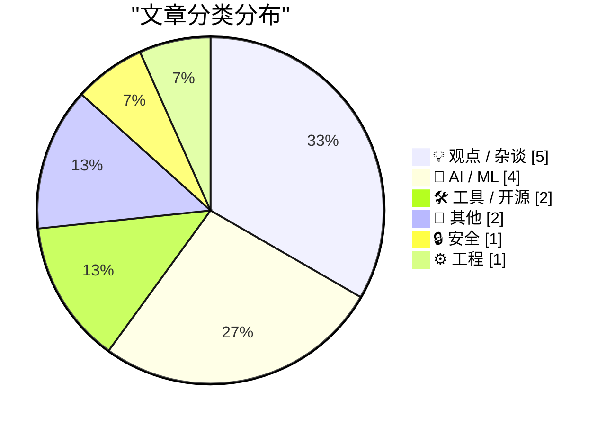
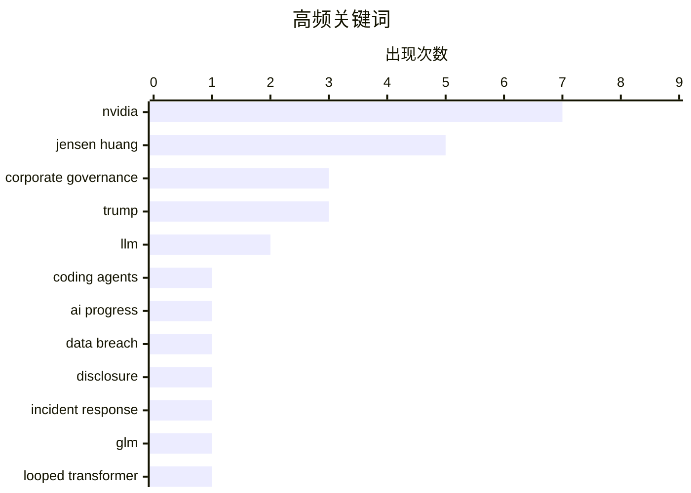

# 📰 Nov 25, 2026

> 来自 Karpathy 推荐的 92 个顶级技术博客，AI 精选 Top 15

## 📝 今日看点

AI 能力跃迁成为今日焦点：从编程智能体、循环 Transformer 到历史文献研究，模型架构与应用边界持续拓展，递归自我改进的潜力与局限也引发争论。围绕英伟达高层人事与政治介入的密集报道，则凸显 AI 算力、资本与国家权力日益交织，产业集中带来的治理风险受到关注。与此同时，独立浏览器的探索与数据泄露披露的困境，共同将技术生态的自主性、透明度与问责机制推向台前。

---

## 🏆 今日必读

🥇 **十二个月内，大语言模型的三次能力拐点**

[Three LLM inflection points in twelve months](https://simonwillison.net/2026/Nov/24/llm-inflection-points/) — simonwillison.net · 1 小时前 · 🤖 AI / ML

> Simon Willison 认为，过去十二个月里，大语言模型与编程智能体的能力出现了三次重要拐点。他以这一判断为主线，在 AI Engineer Code Summit 2026 上发表了主题演讲。文章在演讲视频之外，进一步审视这些变化是否足以被称为“拐点”，关注的是能力的阶段性跃迁。作者的核心判断是，理解近期 AI 进展需要识别关键转折；但所给摘录尚未列出三次拐点的具体内容与证据。

💡 **为什么值得读**: 适合希望梳理大语言模型与编程智能体年度变化、建立技术演进判断框架的读者。

🏷️ LLM, coding agents, AI progress

🥈 **数据泄露披露为何如此困难：与遭入侵公司往来数百封邮件的教训**

[Here's Why Data Breach Disclosure is so Hard: Lessons from Hundreds of Emails with Hacked Companies](https://www.troyhunt.com/heres-why-data-breach-disclosure-is-so-hard-lessons-from-hundreds-of-emails-with-hacked-companies/) — troyhunt.com · 1 天前 · 🔒 安全

> Troy Hunt 从与遭遇数据泄露的公司往来的数百封邮件中，提炼安全事件披露反复受阻的原因。他指出，这些沟通存在共同模式，包括态度冷淡、刻意拖延，以及多个相关方深度介入。Hunt 让 Claude 阅读邮件并撰写文章，同时说明自己事先已经了解邮件内容及其中的行为模式。摘录呈现的核心判断是，推动数据泄露披露的困难很大程度上来自企业的沟通方式与组织反应，具体案例和完整分析尚未展示。

💡 **为什么值得读**: 对安全研究员、企业安全负责人和事件响应人员而言，这些实际沟通经验有助于理解漏洞与泄露披露为何经常卡在技术之外。

🏷️ data breach, disclosure, incident response

🥉 **GLM-5.4：以首个循环 Transformer 迈向通用编程**

[GLM-5.4: Toward Generalized Coding with Our First Loop Transformer](https://simonwillison.net/2026/Nov/23/glm-54/) — simonwillison.net · 1 天前 · 🤖 AI / ML

> 中国 AI 实验室 Z.ai 发布了 GLM-5.4，这是其首个采用循环 Transformer 架构的模型，目标是推进通用编程能力。标准 Transformer 在一次前向传播中，每层通常只执行一次。循环 Transformer 则让一组共享权重的层执行多轮迭代，持续细化上一轮产生的隐藏状态。关键变化是通过重复使用同一组参数增加计算深度，但所给摘录没有提供编程基准成绩、推理成本或相对其他模型的性能结论。

💡 **为什么值得读**: 如果你关注模型架构如何影响编程能力，这个案例能帮助理解参数共享与迭代计算这条技术路线。

🏷️ GLM, looped transformer, coding

---

## 📊 数据概览

| 扫描源 | 抓取文章 | 时间范围 | 精选 |
|:---:|:---:|:---:|:---:|
| 87/92 | 2595 篇 → 56 篇 | 48h | **15 篇** |

### 分类分布



### 高频关键词



<details>
<summary>📈 纯文本关键词图（终端友好）</summary>

```
nvidia               │ ████████████████████ 7
jensen huang         │ ██████████████░░░░░░ 5
corporate governance │ █████████░░░░░░░░░░░ 3
trump                │ █████████░░░░░░░░░░░ 3
llm                  │ ██████░░░░░░░░░░░░░░ 2
coding agents        │ ███░░░░░░░░░░░░░░░░░ 1
ai progress          │ ███░░░░░░░░░░░░░░░░░ 1
data breach          │ ███░░░░░░░░░░░░░░░░░ 1
disclosure           │ ███░░░░░░░░░░░░░░░░░ 1
incident response    │ ███░░░░░░░░░░░░░░░░░ 1
```

</details>

### 🏷️ 话题标签

**nvidia**(7) · **jensen huang**(5) · **corporate governance**(3) · trump(3) · llm(2) · coding agents(1) · ai progress(1) · data breach(1) · disclosure(1) · incident response(1) · glm(1) · looped transformer(1) · coding(1) · ladybird(1) · browser(1) · web engines(1) · webassembly(1) · recursive self-improvement(1) · superintelligence(1) · ai(1)

---

## 💡 观点 / 杂谈

### 1. “经济成了一场人质危机”

[‘The Economy Is a Hostage Situation’](https://www.theatlantic.com/technology/2026/11/ai-hostage-economy-nvidia-huang/689552/?gift=aQyUJR7AIw1mJWdQ6Ed6yMQrokNaYAmgr0aVusAzQCY&amp;) — **daringfireball.net** · 5 小时前 · ⭐ 23/30

> Charlie Warzel 在《大西洋月刊》的评论中，将围绕黄仁勋的市场与政治反应描述为一种“经济被挟持”的局面。文中认为，英伟达既为 AI 经济提供算力，也通过自身投资支撑这一生态，而黄仁勋被视为整个体系的核心人物。这种叙事把 AI 进展、美国科技领导地位与投资者信心，都与黄仁勋能否继续掌舵联系起来。作者批评的核心是，这种对单一公司和个人的高度依赖，会让维持市场信心成为强大的政治与经济压力。

🏷️ Nvidia, AI economy, Jensen Huang, systemic risk

---

### 2. Semafor：黄仁勋复职前数小时，特朗普致电英伟达董事会争取其回归

[Semafor: ‘Hours Before Huang’s Reinstatement, Trump Called Nvidia’s Board to Argue for His Return’](https://www.semafor.com/article/11/23/2026/jensen-huang-reinstated-as-nvidia-ceo) — **daringfireball.net** · 1 天前 · ⭐ 22/30

> Semafor 援引知情人士称，特朗普在英伟达恢复黄仁勋职务前数小时，接入董事会会议并主张让他回归。报道将美国总统的直接介入，与这家关键 AI 芯片公司的高层人事决定联系起来。白宫通讯主任 Steven Cheung 公开表示，特朗普全程参与，并以“必须保护我们的天才”为由肯定董事会的决定。这些材料显示白宫积极支持黄仁勋复职，但摘录没有证明总统介入对最终投票产生了多大决定性影响。

🏷️ Nvidia, Jensen Huang, Trump, corporate governance

---

### 3. 英伟达与特朗普的国家资本主义

[Nvidia and Trump’s State Capitalism](https://www.wsj.com/opinion/nvidia-jensen-huang-donald-trump-130e644c) — **daringfireball.net** · 2 小时前 · ⭐ 21/30

> 《华尔街日报》编委会批评特朗普介入英伟达事务，认为其做法会损害法治与国家安全。社论指出，这种干预传递出的信号是：出口管制可以被随意对待，国家安全也可能服从总统个人的政治意愿。作为类比，文章提到特朗普在 2025 年拒绝执行一项由国会两党多数支持、以国家安全为依据禁止 TikTok 的法律。作者的核心观点是，政府以政治意志左右企业和监管执行，体现了其所批评的国家资本主义倾向。

🏷️ Nvidia, export controls, industrial policy, Trump

---

### 4. 我早就说过，要押大

[I Told You to Bet the Over](https://www.wsj.com/business/nvidia-jensen-huang-white-house-9ad03961?st=HzeUyV) — **daringfireball.net** · 5 小时前 · ⭐ 21/30

> 黄仁勋回归英伟达的过程中，白宫展开了持续 48 小时的紧急协调。特朗普、副总统及其他政府高层向董事会成员转达了布兰奇的保证，试图促成黄仁勋回归。《华尔街日报》的报道强调，特朗普在第二任期开始时甚至还没听说过这位后来得到政府力挺的企业领导人。特朗普在周一晚间的采访中称，市场反应非常积极，并以此肯定此次干预的效果。现有节选呈现的核心是白宫对企业领导层变动的直接介入，但未交代相关保证的具体内容。

🏷️ Nvidia, corporate governance, White House, Jensen Huang

---

### 5. 政府监管与需求

[Government Regulation and Demand](https://stratechery.com/2026/obituaries/) — **daringfireball.net** · 1 天前 · ⭐ 21/30

> 美国是否应让中国持续依赖英伟达芯片，涉及政府控制供给与市场形成需求之间的差异。Ben Thompson 提出的观点是，中国政府可以通过资金投入和自上而下的指令干预供给侧。相比之下，建立 AI 等领域的生态系统，还需要解释需求如何形成，不能仅凭供给侧投入判断结果。这一分析为维持中国对美国芯片依赖的主张提供了思考框架，但所给节选在生态系统论述处截断，未呈现作者的完整结论。

🏷️ Nvidia, chip exports, regulation, China

---

## 🤖 AI / ML

### 6. 十二个月内，大语言模型的三次能力拐点

[Three LLM inflection points in twelve months](https://simonwillison.net/2026/Nov/24/llm-inflection-points/) — **simonwillison.net** · 1 小时前 · ⭐ 26/30

> Simon Willison 认为，过去十二个月里，大语言模型与编程智能体的能力出现了三次重要拐点。他以这一判断为主线，在 AI Engineer Code Summit 2026 上发表了主题演讲。文章在演讲视频之外，进一步审视这些变化是否足以被称为“拐点”，关注的是能力的阶段性跃迁。作者的核心判断是，理解近期 AI 进展需要识别关键转折；但所给摘录尚未列出三次拐点的具体内容与证据。

🏷️ LLM, coding agents, AI progress

---

### 7. GLM-5.4：以首个循环 Transformer 迈向通用编程

[GLM-5.4: Toward Generalized Coding with Our First Loop Transformer](https://simonwillison.net/2026/Nov/23/glm-54/) — **simonwillison.net** · 1 天前 · ⭐ 24/30

> 中国 AI 实验室 Z.ai 发布了 GLM-5.4，这是其首个采用循环 Transformer 架构的模型，目标是推进通用编程能力。标准 Transformer 在一次前向传播中，每层通常只执行一次。循环 Transformer 则让一组共享权重的层执行多轮迭代，持续细化上一轮产生的隐藏状态。关键变化是通过重复使用同一组参数增加计算深度，但所给摘录没有提供编程基准成绩、推理成本或相对其他模型的性能结论。

🏷️ GLM, looped transformer, coding

---

### 8. 回应对递归自我改进的质疑

[Responding to objections to recursive self-improvement](https://www.dwarkesh.com/p/rsiobjections) — **dwarkesh.com** · 2 小时前 · ⭐ 24/30

> 文章围绕 AI 的递归自我改进展开，即系统通过改进自身能力，进一步增强后续改进能力的设想。标题表明，作者将回应针对这一过程的反对意见。副标题“怀疑者对超级智能的哪些判断是对的”显示，讨论也会承认质疑者的部分观点。所给材料只有标题与副标题，无法确认作者具体接受哪些限制、如何回应质疑，以及最终如何判断超级智能的发展前景。

🏷️ recursive self-improvement, superintelligence, AI

---

### 9. GPT-6.2 Astra 破解一桩历史谜案

[GPT 6.2 Astra Solves a Historical Mystery](https://simonwillison.net/2026/Nov/24/astra-historical-mystery/) — **simonwillison.net** · 7 小时前 · ⭐ 21/30

> 历史学教授 Mark Humphries 分享了使用 GPT-6.2 Astra 研究匿名历史文献的案例。研究对象是耶鲁大学拜内克图书馆收藏的一本 1808 年匿名素描册。按摘录中的描述，模型仅接受少量提示，就自主识别出了素描册的创作者，展示了大语言模型参与历史归属考证的潜力。该案例的价值在于呈现 AI 辅助史料研究的可能性，但摘录未提供作者姓名、完整证据链或独立核验过程，无法据此判断结论的可靠程度。

🏷️ LLM, historical research, GPT

---

## 🛠 工具 / 开源

### 10. Ladybird 的首个 Alpha 版本

[Ladybird's first alpha release](https://simonwillison.net/2026/Nov/23/ladybird/) — **simonwillison.net** · 1 天前 · ⭐ 24/30

> Ladybird 推出了首个 Alpha 版本，尝试在 2026 年构建一款拥有独立核心实现的新浏览器。其自主实现范围涵盖 HTML 解析、CSS 引擎、页面布局、JavaScript，甚至 WebAssembly。项目同时采用部分外部组件，包括用于文本塑形的 HarfBuzz、用于二维图形的 Skia，以及 ffmpeg 和 SQLite。Simon Willison 将其视为一个雄心极大的工程项目；摘录展示了它的技术覆盖范围，但没有给出兼容性、性能或日常使用成熟度的评测。

🏷️ Ladybird, browser, web engines, WebAssembly

---

### 11. datasette-charts 0.1a0

[datasette-charts 0.1a0](https://simonwillison.net/2026/Nov/23/datasette-charts/) — **simonwillison.net** · 1 天前 · ⭐ 20/30

> datasette-charts 发布了 0.1a0 版本，将作者酝酿一年多的图表功能想法实现为 Datasette 插件。作者在周日使用 Claude Fable 5.2 构建初始原型，原型效果促使其继续完成插件。发布说明提供了 GitHub 版本链接，以及通过安装 datasette-charts 体验功能的 Datasette Lite 在线示例。所给示例链接包含折线图配置，但节选未列出完整图表类型、配置能力或兼容性要求。此次发布最明确的成果，是一个长期构想借助 AI 编程工具从原型推进到了可体验的插件。

🏷️ Datasette, data visualization, AI coding

---

## 📝 其他

### 12. 英伟达董事会恢复黄仁勋职务

[Nvidia Board Reinstates Jensen Huang](https://nvidianews.nvidia.com/news/nvidia-board-reinstates-jensen-huang-as-president-ceo-and-board-director) — **daringfireball.net** · 1 天前 · ⭐ 23/30

> 英伟达公告称，黄仁勋即刻恢复总裁、首席执行官及董事会成员职务。董事会在与黄仁勋进行一系列讨论和会面后，一致投票支持其复职。公告称，董事会已对他的坦诚程度及领导英伟达的能力感到满意，并在决策过程中听取了美国高层方面的意见，但摘录在相关表述处截断。该声明确认了复职结果与董事会给出的理由，尚不足以解释此前免职的原因、完整审议过程或是否存在附加条件。

🏷️ Nvidia, Jensen Huang, leadership, corporate governance

---

### 13. 黄仁勋回归后，特朗普持有的英伟达股票最多增值 1500 万美元

[Trump Made Up to $15M on Nvidia Stock After Huang’s Return](https://www.theguardian.com/technology/2026/nov/24/donald-trump-nvidia-stock-jensen-huang-stock-market) — **daringfireball.net** · 1 小时前 · ⭐ 19/30

> 据《卫报》报道，黄仁勋意外回归英伟达担任首席执行官后，公司股价大涨，特朗普所持股票的账面收益可能高达 1500 万美元，约合 1150 万英镑。英伟达股价周一上涨 31.5%，市值增加约 9500 亿美元。提交给美国政府道德办公室的财务披露显示，截至最近可得的 9 月 30 日数据，特朗普可能持有最多 37 万股英伟达股票，这一持仓消息最先由《金融时报》报道。这些数字是基于已披露持仓的估算，节选未显示特朗普是否仍持有全部股份或已经出售获利。报道的核心关注是，总统的个人股票持仓如何使其直接受益于重大科技企业事件。

🏷️ Nvidia, Trump, stock holdings, Jensen Huang

---

## 🔒 安全

### 14. 数据泄露披露为何如此困难：与遭入侵公司往来数百封邮件的教训

[Here's Why Data Breach Disclosure is so Hard: Lessons from Hundreds of Emails with Hacked Companies](https://www.troyhunt.com/heres-why-data-breach-disclosure-is-so-hard-lessons-from-hundreds-of-emails-with-hacked-companies/) — **troyhunt.com** · 1 天前 · ⭐ 25/30

> Troy Hunt 从与遭遇数据泄露的公司往来的数百封邮件中，提炼安全事件披露反复受阻的原因。他指出，这些沟通存在共同模式，包括态度冷淡、刻意拖延，以及多个相关方深度介入。Hunt 让 Claude 阅读邮件并撰写文章，同时说明自己事先已经了解邮件内容及其中的行为模式。摘录呈现的核心判断是，推动数据泄露披露的困难很大程度上来自企业的沟通方式与组织反应，具体案例和完整分析尚未展示。

🏷️ data breach, disclosure, incident response

---

## ⚙️ 工程

### 15. 废除锁中毒机制

[Abolish Lock Poisoning](https://lucumr.pocoo.org/2026/11/25/poisoning/) — **lucumr.pocoo.org** · 19 分钟前 · ⭐ 21/30

> Rust 的互斥锁中毒机制会让一次持锁期间的 panic 影响后续获取锁的操作。当代码持有 std::sync::Mutex 时发生 panic，该锁会被标记为中毒，之后调用 lock() 会返回 PoisonError。这项设计旨在提醒调用者：panic 可能打断对象更新，使内部不变量遭到破坏，对象因而处于不一致状态。作者质疑这一历史设计，认为如果今天重新设计 Rust，这项机制未必会被采纳，并在标题中明确主张废除它。所给节选仅包含机制及其动机，尚未展示支持废除的完整论证或替代方案。

🏷️ Rust, mutex poisoning, concurrency, error handling

---

*生成于 2026-11-25 00:19 | 扫描 87 源 → 获取 2595 篇 → 精选 15 篇*
*基于 [Hacker News Popularity Contest 2025](https://refactoringenglish.com/tools/hn-popularity/) RSS 源列表，由 [Andrej Karpathy](https://x.com/karpathy) 推荐*
