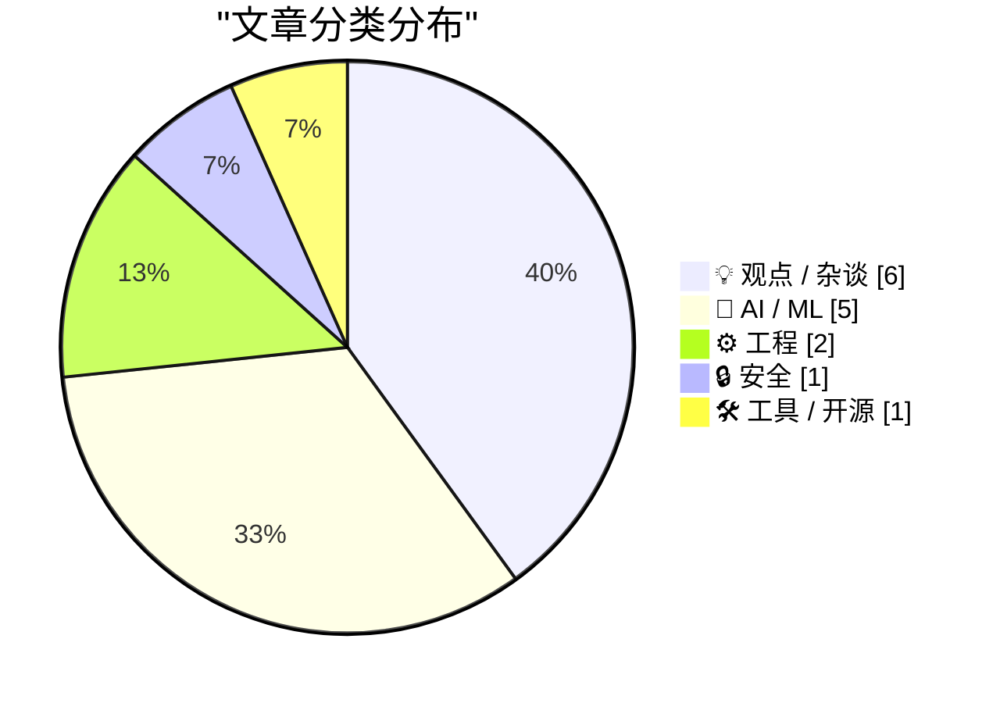
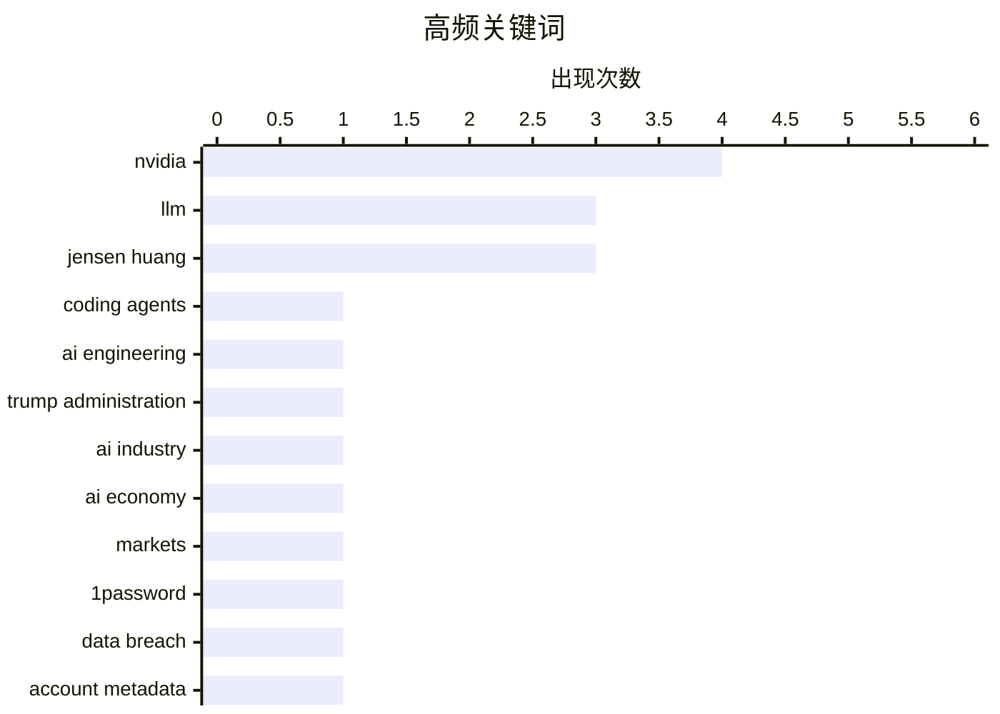

# 📰 Nov 26, 2026

> 来自 Karpathy 推荐的 92 个顶级技术博客，AI 精选 Top 15

## 📝 今日看点

AI 能力加速跃迁，编程智能体正推动软件开发与产品设计重心转移，递归自我改进的前景与人的使用体验成为争论焦点。与此同时，Token 支出增长趋缓，让“成本下降必然带动需求扩张”的逻辑受到审视，AI 商业化进入增长成色的检验期。围绕英伟达的政治干预与市场依赖，则凸显算力、资本和政策深度交织的风险；1Password 后端入侵事件也提醒业界，技术提速仍需守住安全底线。

---

## 🏆 今日必读

🥇 **十二个月内，大语言模型迎来三次能力拐点**

[Three LLM inflection points in twelve months](https://simonwillison.net/2026/Nov/24/llm-inflection-points/) — simonwillison.net · 1 天前 · 🤖 AI / ML

> 大语言模型与编程智能体在过去十二个月中出现了三次显著的能力拐点，这是 Simon Willison 在 AI Engineer Code Summit 2026 主题演讲中的核心判断。文章以这场演讲为基础，进一步审视这些变化及其意义。讨论重点是模型与编程智能体的能力变化，并将其概括为三个阶段性转折。当前提供的片段尚未列出三个拐点的具体内容，因此无法据此判断涉及哪些模型、技术突破或时间节点。

💡 **为什么值得读**: 适合希望梳理编程智能体能力演进的人阅读，但需查看原文才能了解作者划分三次拐点的具体依据。

🏷️ LLM, coding agents, AI engineering

🥈 **我早说过，该押更大的**

[I Told You to Bet the Over](https://www.wsj.com/business/nvidia-jensen-huang-white-house-9ad03961?st=HzeUyV) — daringfireball.net · 1 天前 · 🤖 AI / ML

> 《华尔街日报》的报道聚焦白宫为促成黄仁勋回归而展开的一场持续 48 小时的紧急行动。特朗普、副总统及其他政府高层向董事会成员转达了 Blanche 的保证，试图挽回这位企业领导人。报道强调，特朗普在第二任期开始时甚至还没听说过黄仁勋，此后却亲自参与了这次干预。特朗普在周一晚间的采访中称市场反应非常积极，呈现出政府介入企业领导层事务与资本市场预期相互交织的局面。

💡 **为什么值得读**: 这则报道提供了观察美国政府如何直接介入关键科技企业治理的具体案例，有助于理解英伟达的政治分量。

🏷️ Nvidia, Jensen Huang, Trump administration, AI industry

🥉 **“经济成了一场人质危机”**

[‘The Economy Is a Hostage Situation’](https://www.theatlantic.com/technology/2026/11/ai-hostage-economy-nvidia-huang/689552/?gift=aQyUJR7AIw1mJWdQ6Ed6yMQrokNaYAmgr0aVusAzQCY&amp;) — daringfireball.net · 1 天前 · 💡 观点 / 杂谈

> Charlie Warzel 将围绕黄仁勋的市场信心问题描述为一场经济层面的“人质危机”。其分析指出，英伟达既提供支撑 AI 经济的算力，也通过自身投资支撑这一生态，使公司与黄仁勋个人形成高度绑定。按照文章概括的市场逻辑，黄仁勋在位意味着 AI 进步与美国科技领导地位可以延续，而他的离开可能导致投资者信心动摇，甚至引发 AI 泡沫破裂。作者借此批评一种将庞大产业及经济预期过度寄托于单一企业领导人的脆弱结构。

💡 **为什么值得读**: 它能帮助读者从关键人物依赖和系统性风险的角度，重新审视 AI 热潮背后的市场信心。

🏷️ AI economy, Nvidia, Jensen Huang, markets

---

## 📊 数据概览

| 扫描源 | 抓取文章 | 时间范围 | 精选 |
|:---:|:---:|:---:|:---:|
| 83/92 | 2522 篇 → 45 篇 | 48h | **15 篇** |

### 分类分布



### 高频关键词



<details>
<summary>📈 纯文本关键词图（终端友好）</summary>

```
nvidia               │ ████████████████████ 4
llm                  │ ███████████████░░░░░ 3
jensen huang         │ ███████████████░░░░░ 3
coding agents        │ █████░░░░░░░░░░░░░░░ 1
ai engineering       │ █████░░░░░░░░░░░░░░░ 1
trump administration │ █████░░░░░░░░░░░░░░░ 1
ai industry          │ █████░░░░░░░░░░░░░░░ 1
ai economy           │ █████░░░░░░░░░░░░░░░ 1
markets              │ █████░░░░░░░░░░░░░░░ 1
1password            │ █████░░░░░░░░░░░░░░░ 1
```

</details>

### 🏷️ 话题标签

**nvidia**(4) · **llm**(3) · **jensen huang**(3) · coding agents(1) · ai engineering(1) · trump administration(1) · ai industry(1) · ai economy(1) · markets(1) · 1password(1) · data breach(1) · account metadata(1) · privacy(1) · export controls(1) · national security(1) · state capitalism(1) · version control(1) · code hosting(1) · releases(1) · security advisories(1)

---

## 💡 观点 / 杂谈

### 1. “经济成了一场人质危机”

[‘The Economy Is a Hostage Situation’](https://www.theatlantic.com/technology/2026/11/ai-hostage-economy-nvidia-huang/689552/?gift=aQyUJR7AIw1mJWdQ6Ed6yMQrokNaYAmgr0aVusAzQCY&amp;) — **daringfireball.net** · 1 天前 · ⭐ 25/30

> Charlie Warzel 将围绕黄仁勋的市场信心问题描述为一场经济层面的“人质危机”。其分析指出，英伟达既提供支撑 AI 经济的算力，也通过自身投资支撑这一生态，使公司与黄仁勋个人形成高度绑定。按照文章概括的市场逻辑，黄仁勋在位意味着 AI 进步与美国科技领导地位可以延续，而他的离开可能导致投资者信心动摇，甚至引发 AI 泡沫破裂。作者借此批评一种将庞大产业及经济预期过度寄托于单一企业领导人的脆弱结构。

🏷️ AI economy, Nvidia, Jensen Huang, markets

---

### 2. 英伟达与特朗普的国家资本主义

[Nvidia and Trump’s State Capitalism](https://www.wsj.com/opinion/nvidia-jensen-huang-donald-trump-130e644c) — **daringfireball.net** · 1 天前 · ⭐ 24/30

> 《华尔街日报》编辑委员会批评特朗普对英伟达相关事务的干预，认为这会损害法治与国家安全。社论指出，这种干预释放的信号是：出口管制可以流于形式，国家安全也可能让位于总统的政治意愿。作为对照，文章提到特朗普在 2025 年拒绝执行国会两党多数支持、基于国家安全考虑通过的 TikTok 禁令。作者将这些行为归入国家资本主义的批评框架，认为政治权力正在削弱既定法律与监管规则的约束力。

🏷️ Nvidia, export controls, national security, state capitalism

---

### 3. 你试过用你的智能体吗？

[Have You Tried Using Your Agent?](https://blog.jim-nielsen.com/2026/have-you-tried-your-agent/) — **blog.jim-nielsen.com** · 5 小时前 · ⭐ 23/30

> 软件越来越方便机器人使用，却仍可能让人难以使用，这是作者对当前产品设计趋势的担忧。作者回顾了自己在 2025 年对 AX（智能体体验）的思考，担心它会成为软件开发者的最高优先事项。他并不反对改善智能体体验，但明确主张在人与其他使用主体之间，应优先保障人的体验。文章片段所表达的核心观点是，面向智能体的可访问性进步，不能取代面向人的可访问性与易用性。

🏷️ AI agents, agent experience, UX, software design

---

### 4. Pluralistic：纽约州对抗汽车行业的“劣化”（2026年11月25日）

[Pluralistic: New York vs auto-enshittification (25 Nov 2026)](https://pluralistic.net/2026/11/25/empire-state-strikes-back/) — **pluralistic.net** · 10 小时前 · ⭐ 22/30

> 纽约州对抗汽车行业产品与服务“劣化”的举措，被作者视为州政府弥补联邦立法问题的一种范例。标题中的“enshittification”指向产品或服务逐渐变差、用户利益受到侵蚀的现象。副标题将核心主张概括为：各州可以采取行动，纠正美国国会犯下的错误。不过，所给片段只有栏目目录，未提供具体法案、汽车厂商行为或执行机制，无法进一步判断这一方案的适用范围。

🏷️ automotive, consumer rights, regulation, enshittification

---

### 5. 黄仁勋回归后，特朗普持有的英伟达股票最多增值1500万美元

[Trump Made Up to $15M on Nvidia Stock After Huang’s Return](https://www.theguardian.com/technology/2026/nov/24/donald-trump-nvidia-stock-jensen-huang-stock-market) — **daringfireball.net** · 1 天前 · ⭐ 21/30

> 《卫报》报道称，黄仁勋意外回归担任英伟达首席执行官后，股价大涨，使特朗普所持英伟达股票最多增值1500万美元，约合1150万英镑。提交给美国政府道德办公室的财务披露显示，截至最近可获得数据的9月30日，他可能持有多达37万股英伟达股票。英伟达股价在周一上涨31.5%，市值增加约9500亿美元，相关持股消息最先由《金融时报》报道。这些数字反映的是依据披露持仓估算的股票增值，所给片段没有说明特朗普是否出售股票并实现收益。

🏷️ Nvidia, Trump, Jensen Huang, stock

---

### 6. Pluralistic：免费的午餐（2026年11月24日）

[Pluralistic: Free lunches (24 Nov 2026)](https://pluralistic.net/2026/11/24/move-fast-break-kings/) — **pluralistic.net** · 1 天前 · ⭐ 21/30

> 科技行业的利润空间，被作者视为其他市场参与者可以利用的机会。文章以“免费的午餐”为题，副标题直接提出“科技公司的利润，就是其他人的机会”这一观点。其关注点是科技企业获取的利润与外部参与者机会之间的关系，但所给片段没有展开具体商业案例、技术方案或比较数据。可以确认的核心立场是，作者希望读者从科技行业现有的利润空间中寻找机会，具体实现路径仍需查阅正文。

🏷️ tech industry, profit margins, competition

---

## 🤖 AI / ML

### 7. 十二个月内，大语言模型迎来三次能力拐点

[Three LLM inflection points in twelve months](https://simonwillison.net/2026/Nov/24/llm-inflection-points/) — **simonwillison.net** · 1 天前 · ⭐ 26/30

> 大语言模型与编程智能体在过去十二个月中出现了三次显著的能力拐点，这是 Simon Willison 在 AI Engineer Code Summit 2026 主题演讲中的核心判断。文章以这场演讲为基础，进一步审视这些变化及其意义。讨论重点是模型与编程智能体的能力变化，并将其概括为三个阶段性转折。当前提供的片段尚未列出三个拐点的具体内容，因此无法据此判断涉及哪些模型、技术突破或时间节点。

🏷️ LLM, coding agents, AI engineering

---

### 8. 我早说过，该押更大的

[I Told You to Bet the Over](https://www.wsj.com/business/nvidia-jensen-huang-white-house-9ad03961?st=HzeUyV) — **daringfireball.net** · 1 天前 · ⭐ 26/30

> 《华尔街日报》的报道聚焦白宫为促成黄仁勋回归而展开的一场持续 48 小时的紧急行动。特朗普、副总统及其他政府高层向董事会成员转达了 Blanche 的保证，试图挽回这位企业领导人。报道强调，特朗普在第二任期开始时甚至还没听说过黄仁勋，此后却亲自参与了这次干预。特朗普在周一晚间的采访中称市场反应非常积极，呈现出政府介入企业领导层事务与资本市场预期相互交织的局面。

🏷️ Nvidia, Jensen Huang, Trump administration, AI industry

---

### 9. 回应对递归自我改进的质疑

[Responding to objections to recursive self-improvement](https://www.dwarkesh.com/p/rsiobjections) — **dwarkesh.com** · 1 天前 · ⭐ 23/30

> 文章围绕 AI 的递归自我改进展开，即 AI 能否通过改进自身推动后续能力增长。标题表明，作者将回应针对这一设想的反对意见。副标题“怀疑者对超级智能的哪些判断是正确的”显示，作者也试图辨析质疑中成立的部分。当前提供的内容没有展开具体异议、论据或结论，因此无法判断作者如何评估递归自我改进的可行性与限制。

🏷️ recursive self-improvement, superintelligence, AI scaling

---

### 10. 杰文斯悖论失效了吗？

[Has Jevons paradox broken down?](https://martinalderson.com/posts/has-jevons-paradox-broken-down/?utm_source=rss&amp;utm_medium=rss&amp;utm_campaign=feed) — **martinalderson.com** · 1 天前 · ⭐ 23/30

> Ramp 的数据显示，Token 支出增长正在停滞，引出了 AI 使用领域是否仍符合杰文斯悖论的问题。杰文斯悖论通常意味着效率提升、单位成本下降后，总需求反而增加；这里的疑问是，Token 价格下降能否继续带动使用增长。作者结合自身 Token 消耗进入平台期的经历，提出组织变革速度可能成为扩大使用的限制因素。文章关注的关键是，企业采用与工作方式调整能否跟上 Token 降价速度，而现有片段不足以证明杰文斯悖论已经失效。

🏷️ Jevons paradox, token spending, AI adoption, LLM

---

### 11. GPT-6.2 Astra 解开一桩历史谜案

[GPT 6.2 Astra Solves a Historical Mystery](https://simonwillison.net/2026/Nov/24/astra-historical-mystery/) — **simonwillison.net** · 1 天前 · ⭐ 21/30

> 历史学教授 Mark Humphries 提供了一个使用 GPT-6.2 Astra 辅助历史研究的案例。研究对象是耶鲁大学拜内克图书馆收藏的一本匿名速写本，年代为1808年。据引用内容，GPT-6.2 Astra 仅在少量提示下，就自主识别出了这本速写本的创作者。这个案例展示了大模型参与历史资料身份考证的潜力，但所给片段没有呈现作者姓名、证据链或独立核验过程，尚不足以评估结论的可靠性。

🏷️ LLM, historical research, GPT

---

## ⚙️ 工程

### 12. Ubuntu 26 上 Ansible 等待权限提升失败

[Ansible Fails waiting for privilege escalation on Ubuntu 26](https://www.jeffgeerling.com/blog/2026/ansible-fails-become-ubuntu2604/) — **jeffgeerling.com** · 2 小时前 · ⭐ 22/30

> 将服务器从 Ubuntu 22 和 24 迁移到 Ubuntu 26 后，作者发现 Ansible 自动化在需要 sudo 密码时开始失败。故障发生在权限提升环节，表现为等待权限提升失败。文中给出的触发命令是 ansible-playbook main.yml -K，其中 -K 用于提示输入权限提升密码。当前提供的片段尚未包含完整报错、根因或修复步骤，因此只能确认这是升级后与密码保护的 sudo 使用相关的自动化问题。

🏷️ Ansible, Ubuntu, sudo, automation

---

### 13. 废除锁中毒机制

[Abolish Lock Poisoning](https://lucumr.pocoo.org/2026/11/25/poisoning/) — **lucumr.pocoo.org** · 1 天前 · ⭐ 22/30

> Rust 的互斥锁中毒机制会在代码持有 std::sync::Mutex 时发生 panic 后，将该锁标记为中毒。此后再次调用 lock()，会返回 PoisonError，要求调用方处理潜在的状态异常。该机制的设计动机是保护对象的内部不变量，因为 panic 可能打断状态更新，使对象停留在不一致的状态。作者主张废除这一机制，并认为如果它不是早已存在，今天很可能不会被 Rust 接纳；所给片段尚未展开其反对理由或替代方案。

🏷️ Rust, mutex, concurrency, panic

---

## 🔒 安全

### 14. 1Password 后端系统遭入侵，仅客户账户元数据泄露

[1Password’s Backend Systems Were Compromised, Revealing Only Customer Account Metadata](https://1password.com/blog/update-on-nov-2026-security-incident) — **daringfireball.net** · 1 小时前 · ⭐ 24/30

> 1Password 披露，攻击者进入了部分后端系统，并复制了部分客户的有限账户信息。受影响的信息包括用于登录 1Password 的姓名和电子邮箱地址。公司表示，密码库数据、库内条目及其保护密钥均未受影响，并强调自身无法访问用户的密码或 Secret Key。1Password 已采取遏制措施，并恢复受影响服务的干净版本；按其披露，此次事件的影响范围限于部分账户元数据。

🏷️ 1Password, data breach, account metadata, privacy

---

## 🛠 工具 / 开源

### 15. 本周源码版本管理动态：2026 年 11 月 25 日

[This Week in Source Control: 25 November 2026](https://nesbitt.io/2026/11/25/this-week-in-source-control.html) — **nesbitt.io** · 14 小时前 · ⭐ 23/30

> 这是一份日期为 2026 年 11 月 25 日的源码版本管理生态周报。覆盖范围包括版本控制工具，以及代码托管与协作平台。内容类型涵盖版本发布、安全公告和相关文章，旨在集中呈现这一领域的近期动态。当前提供的内容只有标题与简介，未列出具体项目、版本号或安全问题，无法进一步提炼各项更新的影响。

🏷️ version control, code hosting, releases, security advisories

---

*生成于 2026-11-26 00:18 | 扫描 83 源 → 获取 2522 篇 → 精选 15 篇*
*基于 [Hacker News Popularity Contest 2025](https://refactoringenglish.com/tools/hn-popularity/) RSS 源列表，由 [Andrej Karpathy](https://x.com/karpathy) 推荐*
