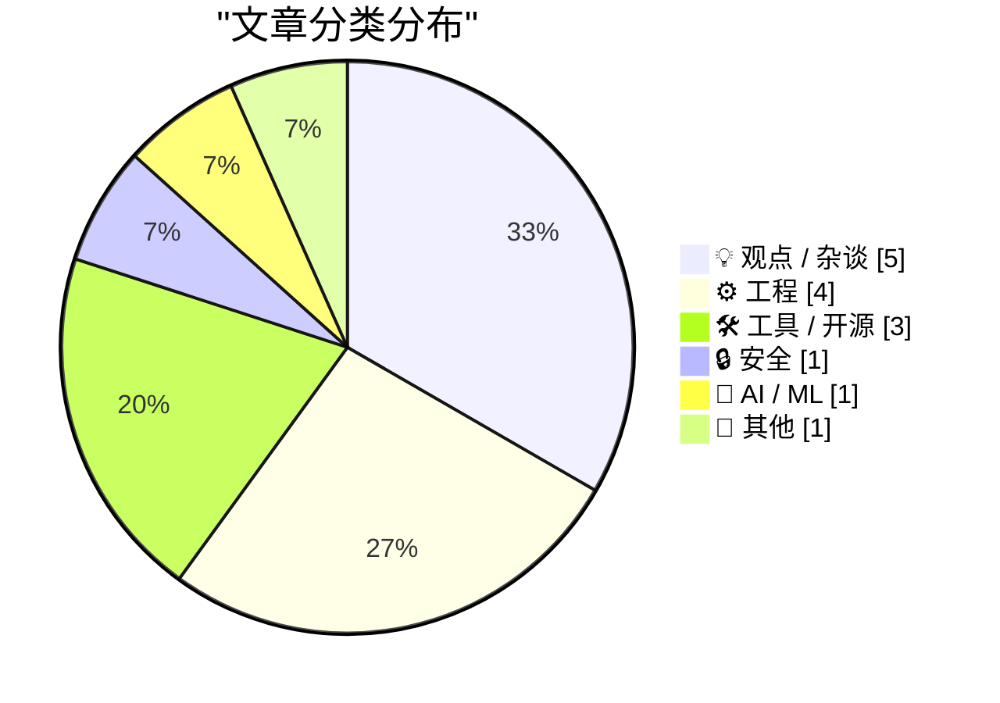
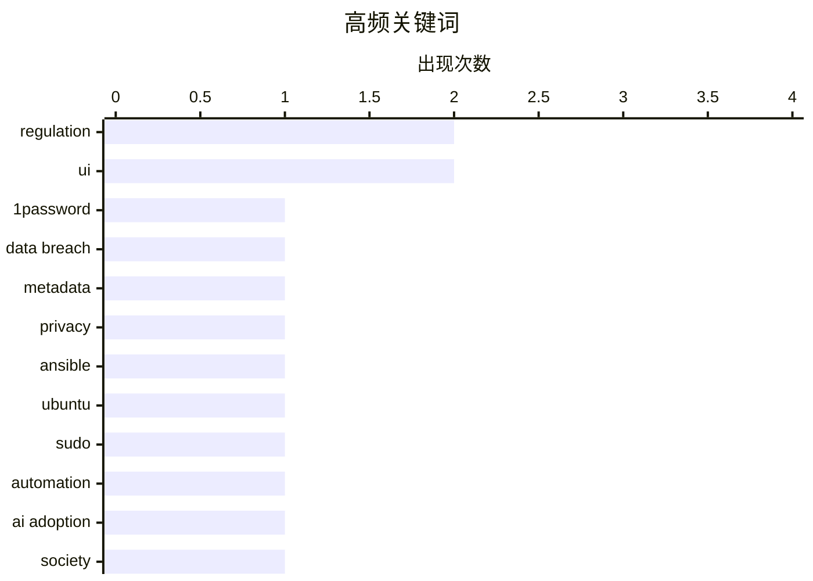

# 📰 Nov 27, 2026

> 来自 Karpathy 推荐的 92 个顶级技术博客，AI 精选 Top 15

## 📝 今日看点

AI 的落地正面临技术之外的考验：社会规则、新闻真实性与表达同质化，正在共同划定其应用边界。产品设计也迎来反思，从优先服务智能体到过度追求极简，人的使用体验能否重回中心成为焦点。与此同时，账户元数据泄露与系统升级引发的自动化故障提醒业界，安全防护和基础设施兼容性仍是技术演进中不可忽视的底线。

---

## 🏆 今日必读

🥇 **1Password 后端系统遭入侵，仅客户账户元数据泄露**

[1Password’s Backend Systems Were Compromised, Revealing Only Customer Account Metadata](https://1password.com/blog/update-on-nov-2026-security-incident) — daringfireball.net · 1 天前 · 🔒 安全

> 1Password 披露，攻击者进入其部分后端系统，复制了部分客户的有限账户信息，包括登录使用的姓名和电子邮件地址。公司表示，密码库数据、库内条目及保护这些数据的密钥均未受到影响。1Password 强调，其本身无法访问用户的密码或 Secret Key，这使账户元数据泄露与密码库内容泄露具有不同的风险范围。公司已采取遏制措施，并恢复受影响服务的干净版本；所给节选未披露受影响客户数量或具体入侵路径。

💡 **为什么值得读**: 有助于 1Password 用户判断此次泄露涉及哪些信息，并理解账户元数据与密码库内容的安全边界。

🏷️ 1Password, data breach, metadata, privacy

🥈 **Ubuntu 26 上 Ansible 等待权限提升失败**

[Ansible Fails waiting for privilege escalation on Ubuntu 26](https://www.jeffgeerling.com/blog/2026/ansible-fails-become-ubuntu2604/) — jeffgeerling.com · 1 天前 · ⚙️ 工程

> 作者将服务器从 Ubuntu 22 和 24 逐步迁移到 Ubuntu 26 时，发现原有 Ansible 自动化出现权限提升失败。问题发生在 sudo 需要密码验证的环境中，涉及 Ansible 的 become 提权流程。节选给出的复现入口是执行 ansible-playbook main.yml -K，其中 -K 用于提示输入提权密码。现有内容尚未展示完整报错、根因或修复方法，但明确指出，系统升级后需要验证带密码的 sudo 与 Ansible 提权是否仍能正常协作。

💡 **为什么值得读**: 正在升级 Ubuntu 的运维人员可以据此提前检查 Ansible 提权流程，降低自动化任务在迁移后中断的概率。

🏷️ Ansible, Ubuntu, sudo, automation

🥉 **世界将消化 AI**

[The World Will Eat AI](https://www.joanwestenberg.com/p/the-world-will-eat-ai) — joanwestenberg.com · 4 小时前 · 💡 观点 / 杂谈

> 文章提出，AI 的实际落地节奏将由现实社会的吸收能力决定。副标题将数十亿人的行为、法律和习惯列为这一过程中的关键因素。其核心判断是，复杂社会会按照自己的时间表消化 AI，技术进展本身不足以决定普及速度。所给内容仅包含标题与副标题，未提供具体案例或数据，因此能够确认的主旨是：理解 AI 的未来，需要同时考虑制度与人的适应过程。

💡 **为什么值得读**: 为判断 AI 普及速度提供社会与制度层面的视角，适合用来审视单纯依据技术能力作出的预测。

🏷️ AI adoption, society, regulation

---

## 📊 数据概览

| 扫描源 | 抓取文章 | 时间范围 | 精选 |
|:---:|:---:|:---:|:---:|
| 85/92 | 2566 篇 → 24 篇 | 48h | **15 篇** |

### 分类分布



### 高频关键词



<details>
<summary>📈 纯文本关键词图（终端友好）</summary>

```
regulation  │ ████████████████████ 2
ui          │ ████████████████████ 2
1password   │ ██████████░░░░░░░░░░ 1
data breach │ ██████████░░░░░░░░░░ 1
metadata    │ ██████████░░░░░░░░░░ 1
privacy     │ ██████████░░░░░░░░░░ 1
ansible     │ ██████████░░░░░░░░░░ 1
ubuntu      │ ██████████░░░░░░░░░░ 1
sudo        │ ██████████░░░░░░░░░░ 1
automation  │ ██████████░░░░░░░░░░ 1
```

</details>

### 🏷️ 话题标签

**regulation**(2) · **ui**(2) · **1password**(1) · data breach(1) · metadata(1) · privacy(1) · ansible(1) · ubuntu(1) · sudo(1) · automation(1) · ai adoption(1) · society(1) · ai agents(1) · agent experience(1) · human-centered design(1) · ux(1) · affordances(1) · usability(1) · version control(1) · software releases(1)

---

## 💡 观点 / 杂谈

### 1. 世界将消化 AI

[The World Will Eat AI](https://www.joanwestenberg.com/p/the-world-will-eat-ai) — **joanwestenberg.com** · 4 小时前 · ⭐ 22/30

> 文章提出，AI 的实际落地节奏将由现实社会的吸收能力决定。副标题将数十亿人的行为、法律和习惯列为这一过程中的关键因素。其核心判断是，复杂社会会按照自己的时间表消化 AI，技术进展本身不足以决定普及速度。所给内容仅包含标题与副标题，未提供具体案例或数据，因此能够确认的主旨是：理解 AI 的未来，需要同时考虑制度与人的适应过程。

🏷️ AI adoption, society, regulation

---

### 2. 你试过用你的智能体吗？

[Have You Tried Using Your Agent?](https://blog.jim-nielsen.com/2026/have-you-tried-your-agent/) — **blog.jim-nielsen.com** · 1 天前 · ⭐ 22/30

> 作者担心，软件开发正在越来越优先满足 AI 智能体的使用需求，却未同步改善人的使用体验。他在 2025 年关于 AX（智能体体验）的思考中，就曾提出这种优先级失衡的风险。如今他的观察是，一些产品对机器人越来越容易访问，对人却依然难以使用。作者并不反对优化 AX，而是主张在人与智能体的需求排序中，将人的体验放在首位。

🏷️ AI agents, agent experience, human-centered design

---

### 3. ★ 让可点击一目了然的界面设计该回归了

[★ Obvious Affordances Are Due for a Comeback](https://daringfireball.net/2026/11/obvious_affordances_are_due_for_a_comeback) — **daringfireball.net** · 9 小时前 · ⭐ 21/30

> 文章批评一种过度简化的界面设计：可点击元素在视觉上看不出能够点击。作者借用常被归于爱因斯坦的原则——凡事应尽可能简单，但不能过度简单——说明极简设计也有边界。当界面省略了帮助用户识别操作入口的视觉线索，简洁就会损害可发现性。作者的核心主张是，让控件清楚地呈现其可操作性，应重新成为界面设计的基本要求。

🏷️ UI, UX, affordances, usability

---

### 4. 引述 Jack Despain Zhou

[Quoting Jack Despain Zhou](https://simonwillison.net/2026/Nov/26/jack-despain-zhou/) — **simonwillison.net** · 9 小时前 · ⭐ 20/30

> 这段引文将 AI 已经造成的一种影响概括为“去个性化”。Jack Despain Zhou 描述，自己在 YouTube 视频、会议演讲和电子邮件中，反复听到或读到类似 Claude 的表达方式。他尤其关注那些拥有专业资历和机构背景、以个人声誉发表内容的人，也开始呈现相似的语言风格。引文由此提出的担忧是，AI 辅助表达正在削弱不同作者之间原本可辨认的声音与个性。

🏷️ AI, Claude, writing, homogenization

---

### 5. Pluralistic：纽约州对抗汽车“劣化”（2026 年 11 月 25 日）

[Pluralistic: New York vs auto-enshittification (25 Nov 2026)](https://pluralistic.net/2026/11/25/empire-state-strikes-back/) — **pluralistic.net** · 1 天前 · ⭐ 20/30

> 本期 Pluralistic 的主议题是纽约州如何应对汽车领域的“劣化”问题，即产品或服务体验逐步变差的现象。副标题将纽约州的做法定位为一种州级政策蓝图，用于纠正美国国会此前犯下的错误。其核心方向是探讨州政府能否通过行动弥补联邦层面的政策缺陷。所给节选主要是栏目目录，未交代具体法案、汽车功能限制或监管机制，因此尚无法判断这套方案的实际覆盖范围。

🏷️ automotive, consumer rights, regulation, enshittification

---

## ⚙️ 工程

### 6. Ubuntu 26 上 Ansible 等待权限提升失败

[Ansible Fails waiting for privilege escalation on Ubuntu 26](https://www.jeffgeerling.com/blog/2026/ansible-fails-become-ubuntu2604/) — **jeffgeerling.com** · 1 天前 · ⭐ 22/30

> 作者将服务器从 Ubuntu 22 和 24 逐步迁移到 Ubuntu 26 时，发现原有 Ansible 自动化出现权限提升失败。问题发生在 sudo 需要密码验证的环境中，涉及 Ansible 的 become 提权流程。节选给出的复现入口是执行 ansible-playbook main.yml -K，其中 -K 用于提示输入提权密码。现有内容尚未展示完整报错、根因或修复方法，但明确指出，系统升级后需要验证带密码的 sudo 与 Ansible 提权是否仍能正常协作。

🏷️ Ansible, Ubuntu, sudo, automation

---

### 7. 一个输入编辑器的诞生

[‘The Life of a Composer’](https://composer.pablostanley.com/#1) — **daringfireball.net** · 1 天前 · ⭐ 18/30

> 设计师 Pablo Stanley 制作了一段交互式体验，展示一个看似简单的输入编辑器背后需要处理的界面细节。这里的“composer”是行业术语，指比普通输入框更复杂的内容输入组件。Marcin Wichary 推荐这一作品，特别强调它制作精良、体验有趣，声音和音乐也是不可错过的部分。作品还提供完整视频版本，方便以非交互方式观看。其价值不仅在于呈现组件设计的复杂性，也在于示范如何用交互体验讲清界面细节。

🏷️ UI, input, interaction design

---

### 8. 拉斯维加斯算法、蒙特卡洛算法与整数分解

[Las Vegas, Monte Carlo, and Integer Factorization](https://www.johndcook.com/blog/2026/11/26/las-vegas-monte-carlo/) — **johndcook.com** · 11 小时前 · ⭐ 18/30

> 蒙特卡洛算法与拉斯维加斯算法的核心区别，在于把不确定性放在结果正确性还是运行时间上。蒙特卡洛算法通常具有固定运行时间，但错误率可能变化；拉斯维加斯算法的运行时间不固定，但不会返回错误结果。历史上，Stanisław Ulam 于 1946 年提出蒙特卡洛方法的构想，Nicholas Metropolis 于次年为其命名。标题还将这两类随机算法与整数分解联系起来，但所给节选没有展开具体的分解算法或应用结论。理解两者时，关键是区分“可能算错”与“可能需要更长时间”这两种不同的代价。

🏷️ Monte Carlo, Las Vegas, randomized algorithms, integer factorization

---

### 9. 针轮式机械计算器是如何工作的？

[How did pinwheel calculators work?](https://blog.coredump.cx/p/how-did-pinwheel-calculators-work) — **lcamtuf.substack.com** · 1 天前 · ⭐ 17/30

> 针轮式机械计算器如何完成计算，是这篇内容提出的核心问题。所给简介只明确提到，读者可以观看作者进行数字相加的演示。这为了解机械计算器提供了一个从实际操作入手的切入口，但节选没有说明针轮结构、进位机制或具体机型。现有信息能够确认其包含加法演示，尚不足以概括作者对内部工作原理的解释或最终结论。

🏷️ mechanical calculator, pinwheel, computing history

---

## 🛠 工具 / 开源

### 10. 本周源码管理动态：2026 年 11 月 25 日

[This Week in Source Control: 25 November 2026](https://nesbitt.io/2026/11/25/this-week-in-source-control.html) — **nesbitt.io** · 1 天前 · ⭐ 21/30

> 这是一份面向版本控制工具与代码托管平台的每周动态汇总。本期日期为 2026 年 11 月 25 日，关注范围包括软件发布、安全公告和相关文章。其覆盖对象同时涉及版本控制工具及代码托管协作平台，便于读者集中跟踪相关生态变化。所给节选未列出具体项目、版本号或漏洞信息，因此无法进一步判断本期最重要的更新。

🏷️ version control, software releases, security advisories

---

### 11. sqlite3_rsync：SQLite 数据库远程复制工具

[sqlite3_rsync: Database Remote-Copy Tool For SQLite](https://simonwillison.net/2026/Nov/26/sqlite3-rsync/) — **simonwillison.net** · 18 小时前 · ⭐ 20/30

> sqlite3_rsync 是用于远程复制 SQLite 数据库的附加工具。它于 2024 年 10 月随 SQLite 3.47.0 以实验性功能推出，并在 2025 年 5 月的 SQLite 3.50.0 中得到增强。Simon Willison 表示，自己直到此次才理解其中一个尤其有吸引力的特性，但所给节选未展示该特性的具体内容。可以确认的是，这一工具已跨多个版本持续演进，值得有 SQLite 远程复制需求的开发者进一步了解。

🏷️ SQLite, sqlite3_rsync, database, sync

---

### 12. datasette-charts 0.3a0：新增图表注释功能

[datasette-charts 0.3a0](https://simonwillison.net/2026/Nov/25/datasette-charts/) — **simonwillison.net** · 1 天前 · ⭐ 18/30

> datasette-charts 0.3a0 新增图表注释功能，让用户可以在绘制图表后补充说明信息。注释支持线条、阴影区域和文字标签三种形式。这些形式可以单独使用，也可以组合到同一张图表中，标明参考位置、突出特定区间或添加文字解释。此次更新的核心是让图表在展示数据之外，也能呈现帮助读者理解数据的上下文。

🏷️ Datasette, charts, annotations, visualization

---

## 🔒 安全

### 13. 1Password 后端系统遭入侵，仅客户账户元数据泄露

[1Password’s Backend Systems Were Compromised, Revealing Only Customer Account Metadata](https://1password.com/blog/update-on-nov-2026-security-incident) — **daringfireball.net** · 1 天前 · ⭐ 24/30

> 1Password 披露，攻击者进入其部分后端系统，复制了部分客户的有限账户信息，包括登录使用的姓名和电子邮件地址。公司表示，密码库数据、库内条目及保护这些数据的密钥均未受到影响。1Password 强调，其本身无法访问用户的密码或 Secret Key，这使账户元数据泄露与密码库内容泄露具有不同的风险范围。公司已采取遏制措施，并恢复受影响服务的干净版本；所给节选未披露受影响客户数量或具体入侵路径。

🏷️ 1Password, data breach, metadata, privacy

---

## 🤖 AI / ML

### 14. 《纽约时报》因 AI 功能警告摄影师暂勿更新 Photoshop

[The New York Times warns photographers not to update Photoshop over AI features](https://simonwillison.net/2026/Nov/26/hn-50651685/) — **simonwillison.net** · 19 小时前 · ⭐ 20/30

> 《纽约时报》因 Photoshop 的 AI 功能提醒摄影师不要更新软件，引出了新闻摄影对图像真实性的要求。Simon Willison 在 Hacker News 的评论中，回忆了一位《纽约时报》摄影师到他家拍摄的经历。当他询问能否修掉衬衫上的污渍时，对方明确表示不能这样处理。这一经历说明，即使看似轻微的修饰，也可能触及新闻摄影的真实性边界；节选尚未说明此次警告涉及哪些 Photoshop 版本或具体 AI 功能。

🏷️ Photoshop, generative AI, photojournalism, authenticity

---

## 📝 其他

### 15. 特朗普希望黄仁勋回归，如今总统在华盛顿陷入孤立

[‘Trump Wanted Jensen Huang Back. Now, the President Is Alone in Washington’](https://www.cnbc.com/2026/11/24/trump-jensen-huang-nvidia.html) — **daringfireball.net** · 1 天前 · ⭐ 18/30

> CNBC 报道聚焦特朗普支持黄仁勋回归、却遭遇国会盟友反对的政治分歧。所给节选称，特朗普对黄仁勋获恢复职务表示欣喜，但部分坚定支持特朗普的国会议员对此强烈反对，并誓言继续调查黄仁勋。议员担忧的焦点是黄仁勋与一名潜在中国情报人员的关系，以及这种关系是否可能危及美国国家安全；这些属于报道转述的疑虑，并非节选中已证实的事实。报道呈现的核心矛盾是，总统对黄仁勋的支持并未消除国会对相关安全风险的质疑。

🏷️ Jensen Huang, Trump, China, investigation

---

*生成于 2026-11-27 00:18 | 扫描 85 源 → 获取 2566 篇 → 精选 15 篇*
*基于 [Hacker News Popularity Contest 2025](https://refactoringenglish.com/tools/hn-popularity/) RSS 源列表，由 [Andrej Karpathy](https://x.com/karpathy) 推荐*
